# Lime Slice

Lime Slice 3.9.2 is a filament slicer and a solid modeler in one window. Open an STL, 3MF, or STEP file, or start a solid from a sketch, then slice it to G-code. A Rust planner builds the toolpaths. Model edits go through Open CASCADE when its bridge is installed. The window is a Tauri 2 desktop app, and the same pages run in a browser against a local engine.

The shell is the landscape layout: a tool rail on the left, a dock on each side, and a status line. Prepare and Preview use the left dock for settings and the right dock for results. Model uses the left dock for the open tool, the sketch, History, and Parameters, and the right dock for Inspect.

Dark theme, 1440×900, except the phone frames. Model clips and stills are the web UI against a local engine with the Open CASCADE bridge. Slice stills use `samples/overhang_ledge.stl` on the Lime 220 (PLA, 0.4 mm), speed strategy, organic tree supports: 8 min 19 s, 3.67 g, €0.07. The shelf layer is layer 62 at Z 12.40 mm.

## Modeler

Model edits a STEP solid, or starts one from a primitive or a sketch. The desktop release includes the Open CASCADE libraries. A build without them still slices an unedited STEP file, and Model stays off. `.lime` version 4 stores the solid as Open CASCADE's binary brep, so a saved part opens in Model without rebuilding every face from scratch, and gzips its big binary records (meshes, solids, root STEPs) so a file is about a quarter of its version 3 size. The contract is [docs/step-modeler.md](docs/step-modeler.md).

### Sketches and the constraint solver

Sketch on the bed, or on a flat face. Line, rectangle, and the Draw menu (circle, arc, polygon, slot, and the rest) live on the sketch card in the left dock, not on the rail. A rectangle is born with horizontal and vertical constraints.

The solver is in-house (`src/sketch/solve.ts`): Levenberg-Marquardt over the sketch's points, radii, and arc bulges. It is MIT. It is not PlaneGCS or FreeCAD. Constraints are coincident, horizontal, vertical, parallel, perpendicular, tangent, equal, concentric, midpoint, fixed, and the driving sizes distance, length, radius, diameter, and angle. A driving size can be an expression that names a parameter. Dragging a point solves the rest. The readout says when the sketch is fully defined, when a constraint conflicts, and when one repeats another. A size the other constraints cannot meet is refused and the old value stays.

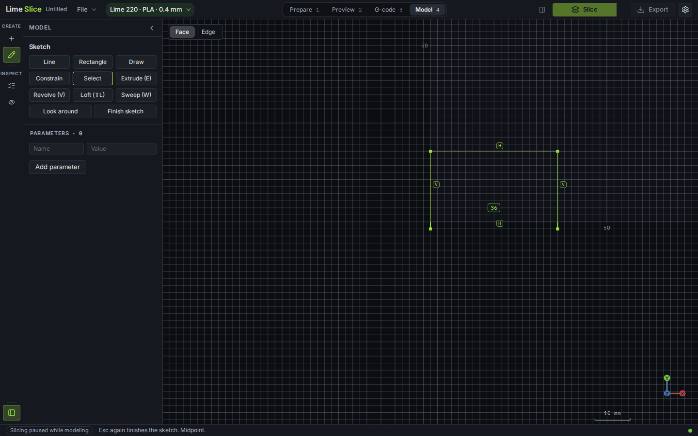


### Extrude, revolve, loft, sweep, and holes

Those five are sketch operations. They are buttons on the sketch card, and keys while a sketch is being edited. There is no rail button for them.

- **Extrude** (E) takes the selected region, or the only outer region, and a signed distance. Join, cut, intersect, or a new object.
- **Revolve** (V) spins that region about the line, construction line, or projected edge under the pointer, or about the plane's U or V axis. The angle runs from a tenth of a degree to a full turn. A profile that crosses the axis is refused.
- **Loft** (Shift+L) blends two or more sections: regions of the open sketch, a pinned sketch, or a flat face. Ruled is a straight blend.
- **Sweep** (W) carries the profile along a path sketch.
- **Holes** (H) only on a sketch drawn on a face. Select points or circle centres and Apply drills one hole at each, with one radius, depth, through, and optional counterbore for the whole set. With no sketch open, H is still the single Hole tool.

Step-by-step examples, with the window at each click, are in [docs/tutorials](docs/tutorials/README.md): three revolves, three lofts, and three sweeps.


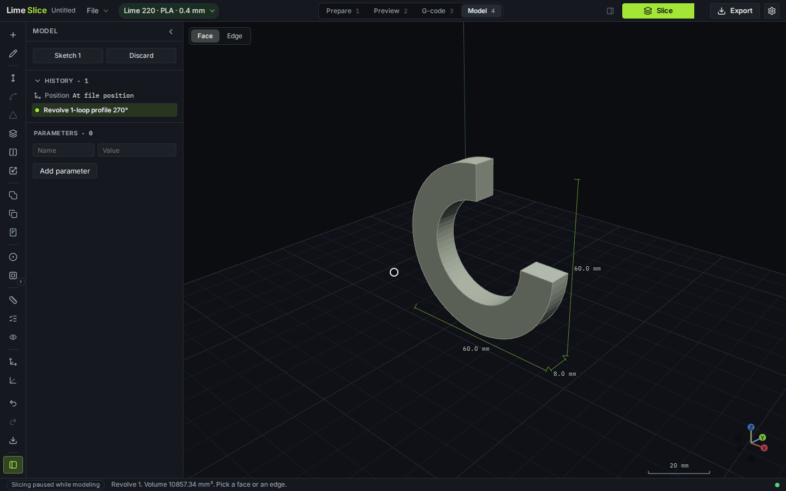

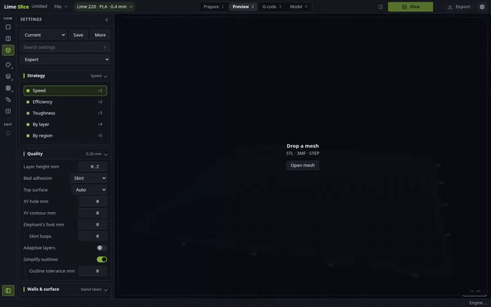

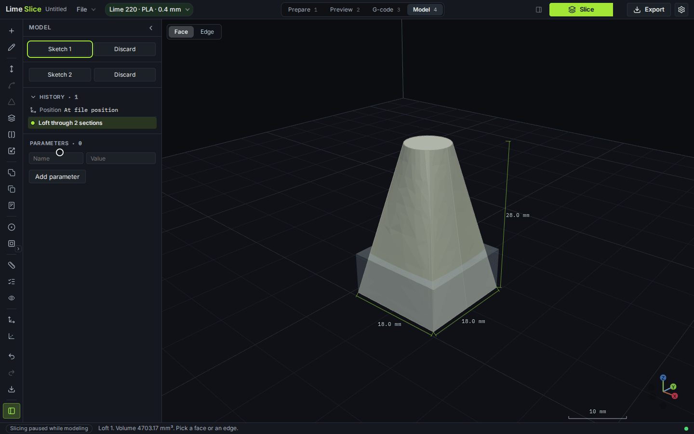


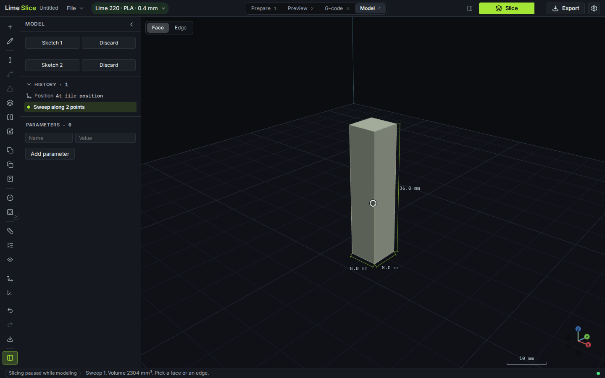


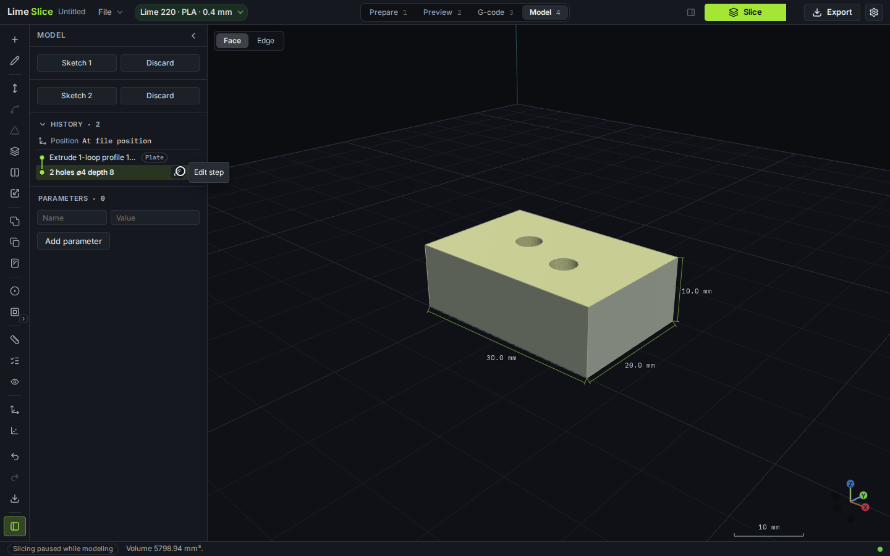


The rail's other Model tools are still there: New solid (box, cylinder, sphere, ellipsoid, cone, torus, wedge, polygon, tube), fillet, chamfer, shell, split, scale, boolean, pattern, mirror, and the Features menu (pocket, boss, texture, array, ribs, text, Parameters). Measure and Check sit under Inspect. Place and Workplane sit under Frame. Undo, Redo, and STEP sit at the foot of the rail.

### Push/pull and edge drag

With no other tool open, hovering a face lights it and seats an arrow on the outward normal. Drag the arrow, or type a distance. The context bar offers Push/Pull, Hole, and Shell for that face. A plain drag moves the face and its neighbours (`moveFaces`): a box gets taller. Alt extrudes that face alone (`faceExtrude`).

Hover an edge and type a radius. Enter fillets that edge. The same gesture with the chamfer tool breaks the edge instead. The context bar is the short row by the pointer, not a second toolbar.

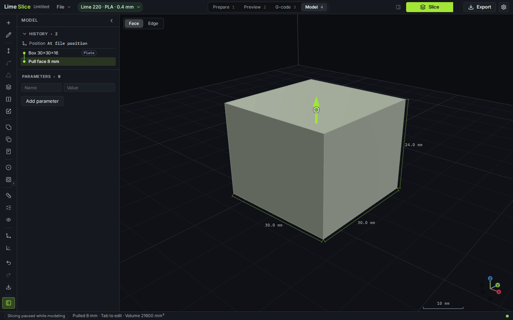


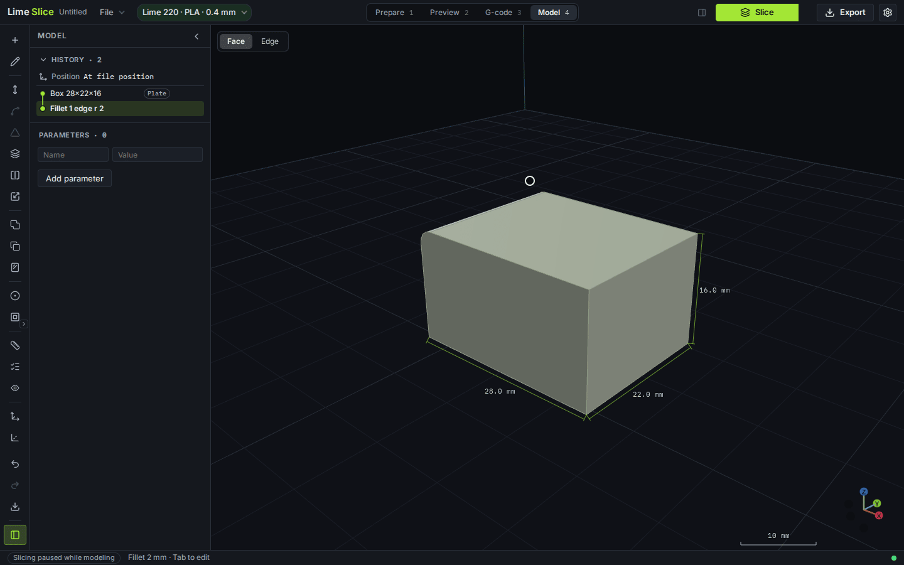


### Parameters, expressions, and History Edit

Parameters live under History in the left dock. Each row is a name and a value, or an expression in other parameters. Type that name into a size field: the field shows the number it evaluates to, with an ƒ mark, and keeps the expression. Change the parameter and Rebuild replays the steps that use it.

History lists every step. Edit step (the row, or Shift+E) reopens that step's panel, including a group of sketch holes. The tree is stored in the `.lime` project. A part an MCP recipe built shows "Built by a recipe" and that line stays read-only: changing the recipe's parameters and rebuilding from them is not in the window yet. Undo and redo walk the same tree.


### Section view

View, on the rail, opens section, colour by step, the bed, and the size readout. A section plane through the part's centre drops the side the normal points at. The cut is red. Offset slides the plane; Flip swaps the side. It changes the drawing only.

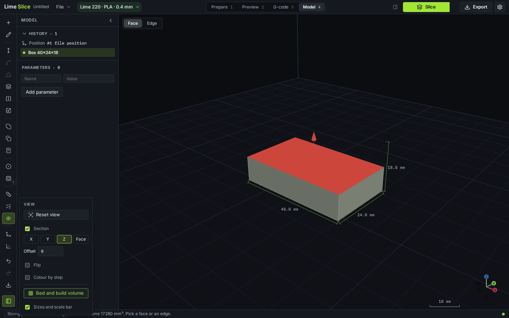


### STEP in and STEP out

An unedited STEP is tessellated on load. With the bridge, Open CASCADE reads it. Without the bridge, the pure-Rust [truck](https://github.com/ricosjp/truck) kernel reads planes, cylinders, cones, spheres, tori, and NURBS, and converts file units to millimetres. Assemblies and multi-body parts become one mesh; each instance keeps its placement. The chord tolerance defaults to 0.05 mm (0.01–2 mm) via the Prepare field or `slice --step-tolerance`. Faceted brep and AP242 tessellated solids are rejected with an error.

Model mode opens that STEP as the root of the history tree. The STEP button at the foot of the rail writes the solid on screen as AP214, a manifold solid B-rep. The same write is the MCP tool `model_export_step`.

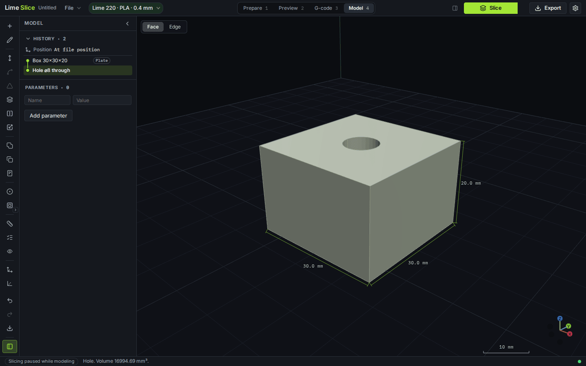

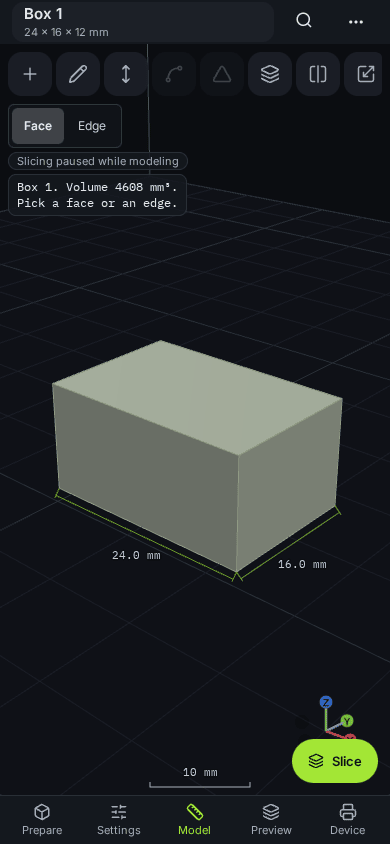

On a phone (`?layout=compact`, or a window 600 px wide or narrower) the Model rail is one strip along the top. History, Undo, Redo, and STEP sit at the end of that strip.

### Stress estimate

Model → Stress… (also in the command palette) estimates how a part takes a load, solved as it will be printed rather than as a solid block. Pick held faces or the bed, add a force or a pressure, and choose a material card and targets such as a minimum safety factor or a maximum deflection. Run slices the part and solves its real beads, grouped into cells of whole layers. Walls, infill, bead direction, and the bond between layers and between beads all count. The result is painted on the part's own faces, on a flat bed and on a belt alike, with a marker at each hot spot. The legend gives the ramp's two ends, the peak, the trust word, and In-house estimate. The deformed shape is off until you tick it, and then it states its scale (×N). When there is nothing to show, the panel says so instead of drawing noise: a part held on the bed and pressed into it bends nothing, and a result that moves past the `rough` line between the two cell sizes would colour the part with numbers it doesn't hold. One row per target gives the margin and the failure mode that governs it: along a bead, across beads, across layers, or shear. Each mode suggests a different change. A sweep tries walls, infill, or pattern variants, each one sliced and solved. Preview can colour the toolpaths by stress or by safety factor.

**A worked example.** On the Lime 220 with PLA, make a box of 100 × 10 × 10 mm and set its infill to 100 %. In Stress, choose Faces, pick one 10 × 10 end, then pick the other end as the load: 20 N, direction 0, 0, −1. Choose the PLA card, set Advanced → Cell size to 1.5 mm, and Run. The part turns red at the held end and blue at the free end. Beam theory gives σ = P L c / I = 20 · 100 · 5 / 833.3 = 12.0 MPa at the held end; the legend's peak reads 11.9 MPa. The free end drops 4.9 mm against 4.75 mm for a solid beam: the infill's beads cross the beam at ±45°, so the print is a little softer. `mcp/sim-paint.test.ts` checks these numbers on the real engine, and `e2e/stress-cantilever.spec.ts` checks the colours in the window. At the default 5 mm cells this bar is two cells deep, and the two cell sizes disagree too much to draw it.

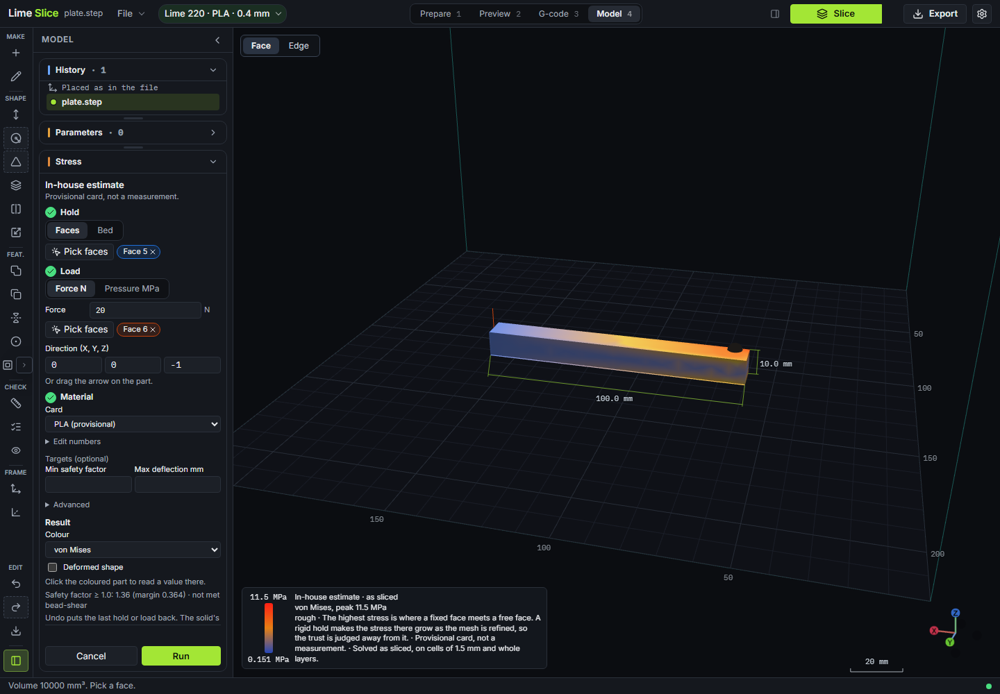

Every result is labelled In-house estimate and comes with a trust word. Trust comes from a second solve at finer cells: within 5 % is `converged`, within 15 % `usable`, and otherwise `rough`. The four material cards (PLA, PETG, ABS, TPU) are placeholders, not measured data, so for now every result is `rough`, and a rough result never counts a target as met. The solver is `crates/lime-sim`, and `crates/lime-sim-bridge` links it to the slicer. The plans are in `docs/plan-stress-simulation.md` and `docs/plan-stress-sliced.md`.

## Slicing

**Prepare** puts the model on the plate. Move, turn, and scale it, then choose a strategy: speed, efficiency, toughness, or a blend by weight, by layer, or by region. Each strategy is a real set of walls, infill, speed, acceleration, seam, and retraction.

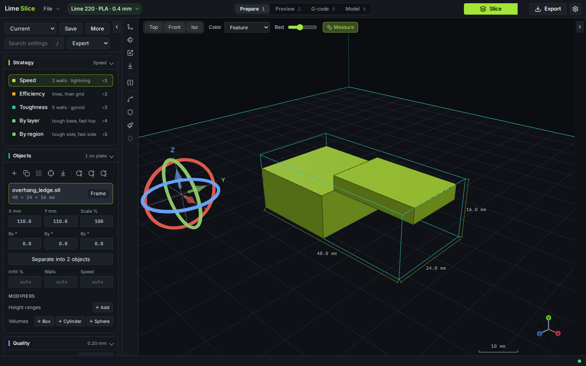

**Preview** draws the finished toolpaths in 3D, coloured by feature. The stage can be 2D, split, or 3D. The layer slider walks the print in every pane. The results dock gives the time and the filament. A G-code tab shows the file.

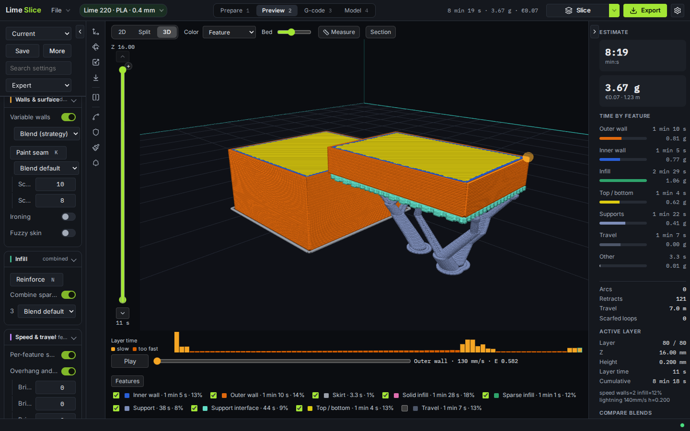


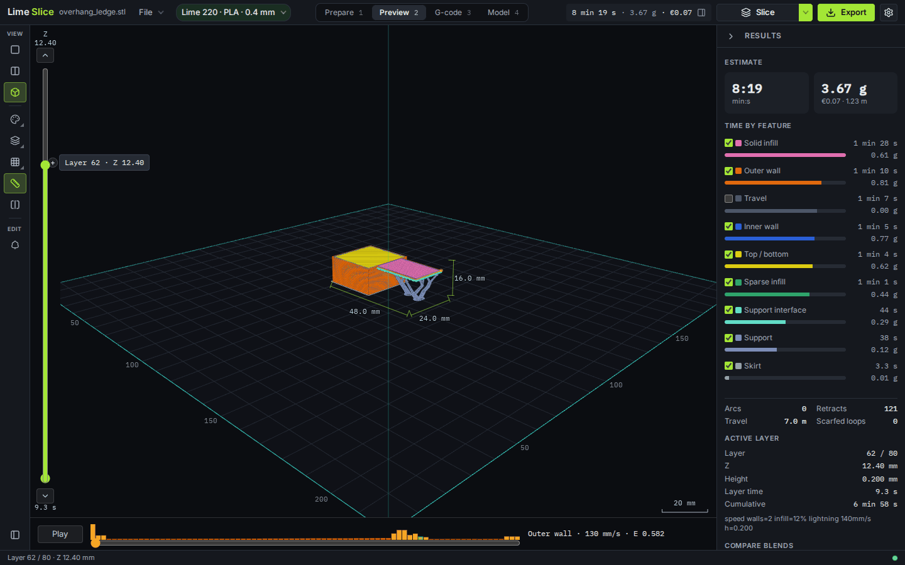

**Reinforce** paints a patch on the surface, or places a box or a cylinder, so that part of the model prints denser infill, up to solid. The rest of the part keeps the strategy.

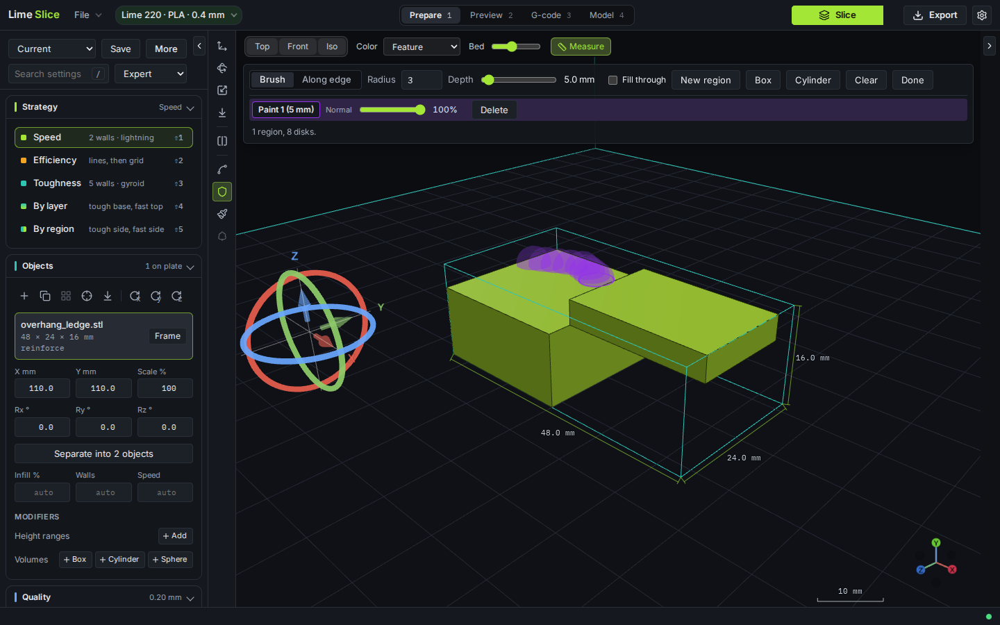

**Printer, filament, and nozzle** sit in the chip at the top. The library includes a generic 45° belt and the Ideaformer IR3 V2. On a belt the part rides along the belt, and the layer readout's Z is position along the belt, not height above the bed. The 20 mm cube on the IR3 V2, same speed strategy, is 3 min 46 s and 2.11 g.

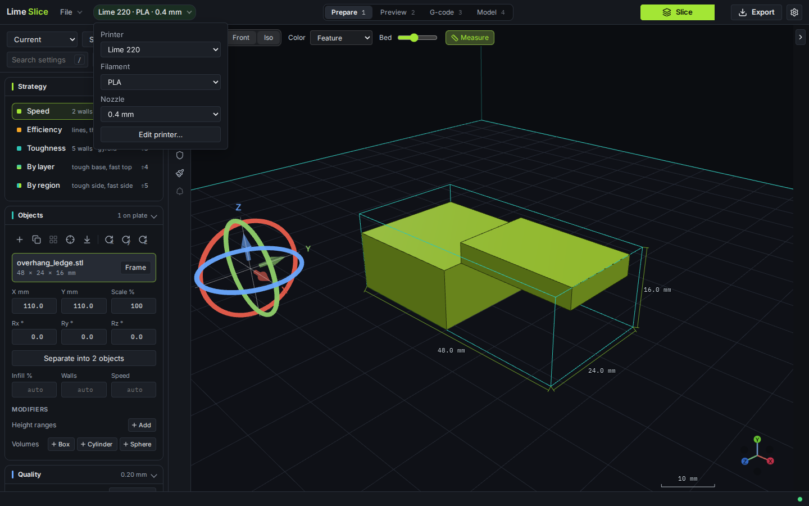

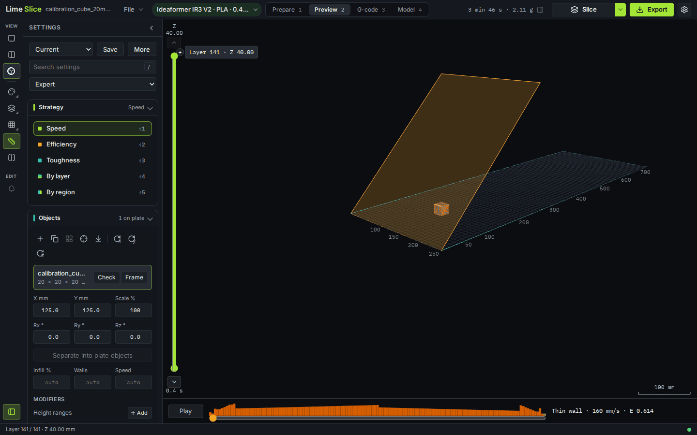


**Supports.** Automatic, painted only, or off. The default style is organic tree (`supportStyle: "tree"`). With supports on, the vertical gap, the sideways gap, the dense layers under the part, and a brim around trunks that stand on the bed are their own settings. Zero keeps the usual gap (one layer vertically, at least 0.12 mm, and 0.55 mm sideways), three dense interface layers, and trunks with no brim.

**Bridges and cooling.** With overhang control on, bridge flow, bridge speed, and bridge fan are their own settings. Zero keeps full flow, the usual bridge slowdown, and Overhang fan %. Fan %, Overhang fan %, Support fan %, and Fan off for first layers set the part-cooling fan (`M106`). The first layers print with the fan off, then Fan % runs. Overhang spans and bridges take Overhang fan %, unless Bridge fan % is set. Supports, including tree branches, tips, and interface, take Support fan %. Left empty, Support fan % follows Fan %. Belt-contact walls stay off. Each filament carries its own values. The built-in numbers come from OrcaSlicer's generic profiles: PLA and TPU 100 / 100 % with 1 layer off, ABS 10 / 80 % with 3 layers off, PETG 20 / 100 % with 3 layers off (IdeaFormer's Generic PETG for the IR3 V2). A saved filament of another material reads OrcaSlicer's values for PCTG, ASA, PC, or PA by its name, and PLA's otherwise. The engine writes the fan into the G-code without planning the toolpaths again, and the fan costs no print time in the estimate.

**Layer pause.** Mark a layer to pause the print, or to change filament. The G-code uses that printer's pause or filament-change command.

**Foreign 3MF.** A project from PrusaSlicer, OrcaSlicer, Bambu Studio, or Cura opens as a mesh. You can copy its layer height, wall count, infill, and whether supports are on. Temperatures, speeds, and the infill pattern stay as they are.

**Send to printer.** Send uploads the current G-code to a Prusa Link, Moonraker, or OctoPrint host stored on the printer, and can start the job after the upload. The MCP server has no send-to-printer tool.

**Settings search.** The box at the top of the settings panel filters every setting. `/` or Ctrl+F focuses it. `and` and `&` match the same word.


**Opening files.** The desktop app opens a `.lime`, `.stl`, `.3mf`, or `.step` file named on its command line. The installer registers `.lime`, so a double-click opens the project. Starting the app again while it is open hands the file to the open window, and the window asks before dropping unsaved changes. File > New project (Ctrl+N) starts a blank document without restarting. A saved `.lime` can carry a small PNG and a one-line summary for Windows Explorer. See [docs/lime-explorer-preview.md](docs/lime-explorer-preview.md).

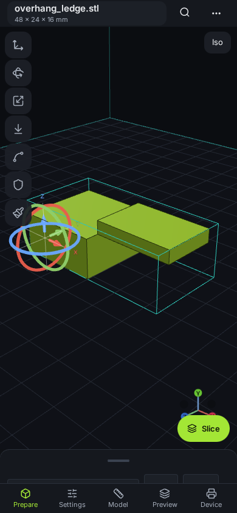

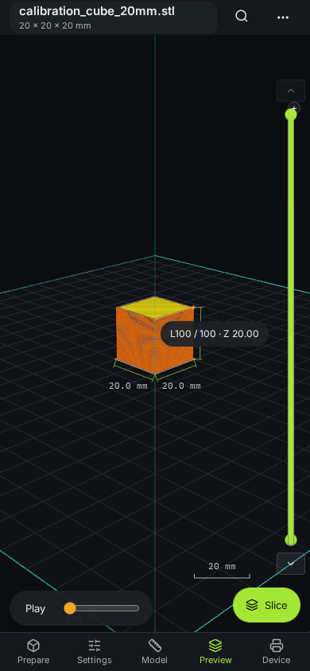

Phone layout is `?layout=compact`, or Interface layout set to Compact. Auto uses it when the window is 600 px wide or less. It is the same web UI, not an iOS app. Details are under [Phone / compact layout](#phone--compact-layout).

## Run the UI

Two processes. The slicer is the Rust binary; the window is either the browser dev server or Tauri.

```bash
cargo run -p lime-slice --release -- serve
npm install
npm run dev
```

Open [http://127.0.0.1:43117](http://127.0.0.1:43117). Load a sample, pick a blend, slice, scrub layers, export G-code.

The stage defaults to **Split**: the existing 2D toolpath preview on the left, and a 3D view of the same slice on the right. **2D** and **3D** hide the other pane. The layer slider (and the wheel over the 2D canvas) moves the active layer in both views. In 3D the active layer is drawn solid, with an amber band of that layer's thickness, and every other layer is ghosted. Drag to orbit, right-drag to pan, wheel to zoom. Support and interface paths use the same colors as the 2D legend. Adaptive layers keep their real Z spacing.

Desktop shell:

```bash
npm run tauri dev
```

The API listens on `127.0.0.1:43118`. Inside Tauri the UI calls `slice_model` instead of HTTP. Each request runs on its own thread. A new slice supersedes the one in flight, and `POST /api/cancel` stops it at the planner's next check.

## MCP server

An LLM client such as Claude can drive Lime Slice over MCP. It can import or build a part, edit it in Model, place it, change settings, slice, and write G-code. There is no send-to-printer tool.

### Set up on Windows (installed app)

The installer puts the server in `%LOCALAPPDATA%\Lime Slice\mcp\`, with its engine beside it and Open CASCADE in `%LOCALAPPDATA%\Lime Slice\occt\lib\`. You need nothing else from the repository.

1. Install Node 22.6 or later. The installer does not include Node. Check the version in a terminal:

   ```powershell
   node --version
   ```

   It must print `v22.6.0` or higher.

2. Make a folder for the files the server writes, for example `C:\Users\you\lime-workspace`. The server saves projects, STEP files, and G-code only inside this folder.

3. Add the server to your client.

   **Claude Desktop.** Open `%APPDATA%\Claude\claude_desktop_config.json` (Settings > Developer > Edit Config opens it). Add this block, with your user name in both paths. Write every backslash twice.

   ```json
   {
     "mcpServers": {
       "lime-slice": {
         "command": "node",
         "args": ["C:\\Users\\you\\AppData\\Local\\Lime Slice\\mcp\\server.mjs"],
         "env": {
           "LIME_MCP_WORKSPACE": "C:\\Users\\you\\lime-workspace"
         }
       }
     }
   }
   ```

   If the file already has an `mcpServers` object, add only the `"lime-slice"` entry to it.

   **Claude Code.** Run this once in PowerShell. `--scope user` makes the server available in every project:

   ```powershell
   claude mcp add lime-slice --scope user -e LIME_MCP_WORKSPACE=C:\Users\you\lime-workspace -- node "C:\Users\you\AppData\Local\Lime Slice\mcp\server.mjs"
   ```

   For one project only, put the same JSON block as above in a file named `.mcp.json` in that project's folder.

4. Restart Claude Desktop, or run `/mcp` in Claude Code and reconnect `lime-slice`. A client reads its config only when it starts.

5. Check that it works. Ask the client to call `session_info`. The reply must show `"occt": true` and an `engine` version that equals `serverVersion`. If `occt` is false, Model edits will not work: reinstall the app.

Point the client at `server.mjs` in the installed app. Do not point it at `mcp\server.ts` from a checkout unless you build the engine yourself (see "From a checkout").

After you install a new version of the app, restart the client too, so it runs the new server.

### macOS and Linux

The setup is the same. Only the paths differ:

- macOS: `/Applications/Lime Slice.app/Contents/Resources/mcp/server.mjs`. Claude Desktop's config is `~/Library/Application Support/Claude/claude_desktop_config.json`.
- Linux (`.deb`): `/usr/lib/Lime Slice/mcp/server.mjs`. Claude Desktop's config is `~/.config/Claude/claude_desktop_config.json`.

Paths use forward slashes. Set `LIME_MCP_WORKSPACE` the same way.

### What it does

The server drives the same plate, settings, paint, and Model operations the window commits. The builders are shared (`src/modeling`, `src/model-request`): extrude, revolve, loft, sweep, shell, push/pull (`faceExtrude`, `moveFaces`), holes, fillet, chamfer, split, scale, boolean, pocket, boss, texture, pattern, mirror, text, array, and ribs, plus history edit, parameters, and STEP export. An LLM session therefore builds the same solids and the same G-code. The interactive sketch and its constraint solver stay in the window. The server takes numeric profiles and the feature operations, not pointer drags. There is no send-to-printer tool. `render_view` and `layer_image` give the client a picture of the solid or a layer.

A typical slice is `machine_list`, `machine_select`, `mesh_import`, `slice_start`, `slice_wait`, `gcode_summary`. A hole is `faces_find`, `workplane_set`, `model_probe`, `model_apply`, `model_commit`, then `slice_start`. The guides `lime://guide/slice`, `lime://guide/model`, `lime://guide/paint`, and `lime://guide/calibrate` hold the same sequences. `guide {topic: "ops"}` lists every Model op with an example. `model_apply` names each op kind in one line to keep the tool list small, and `guide {kind: "fillet"}` returns that kind's full schema.

A stress study is `sim_setup`, `sim_run`, then `sim_sweep {reslice: true}` to compare variants: each row has the slicer's time and grams next to the margins. `layer_image {colourBy: "stress"}` draws a layer's toolpaths coloured by the solved stress. `guide {topic: "sim"}` gives the order of calls and what to change for each failure mode.

`model_build` makes a solid, runs a batch of edits, and commits it in one call. Each edit is checked before it is applied. A step that Open CASCADE reports as done but that loses the part, or leaves pieces that meet only along an edge, is taken back and refused. A commit refuses a mesh that does not close, and `model_check` lists open and touching edges with where they are.

A long call sends progress notifications, so a client that restarts its timeout on progress keeps waiting. A cancelled batch is taken back whole. The server autosaves the plate, with every object's Model history, to `autosave-<process id>.lime` in the workspace. Each server writes its own file, so Claude Desktop and Claude Code can share a workspace. If the client restarts the server, the new server moves the newest file of a server that has ended to `autosave-previous.lime` and names it in `session_info` and `plate_list`. Call `project_open` on it to carry on.

Writes stay inside `LIME_MCP_WORKSPACE`. A path can be absolute, or relative to that workspace. Saving a project may overwrite a `.lime` file already in that folder. `app_open` saves the plate in the workspace and opens it in the desktop app. If no running app answers the live bridge, it starts the installed app with the file.

Tool groups are an opt-in for clients that pay for every listed tool. Set `LIME_MCP_TOOL_GROUPS=1` in the server's `env`. The first tool list then has only the core tools: session, project, import, place, machine list and select, settings, slice, export, `render_view`, `guide`, and `plan_run`, plus `tools_enable`. That list is about 16 KB instead of about 60 KB. `tools_enable {groups: ["model"]}` adds a group, and the server sends `notifications/tools/list_changed`, so the client reads the list again. The groups are `model`, `paint`, `supports`, `plate`, `layers`, `calibration`, `machines` (machine load, read, set, and save), and `stress` (the `sim_*` tools). The `tools_enable` description says what each group holds. A call to a tool whose group is not enabled is refused, and the refusal names the `tools_enable` call to make. Without the variable, every tool is listed, as before. A client that ignores `list_changed` should not use groups.

`plan_run {steps: [{tool, args}, ...]}` runs up to 25 calls in one request. Each step is checked and applied as if it were called alone. An argument that is exactly `"$N.path"` becomes step N's result at that path: `"$1.object"` or `"$2.faces.0.index"`. N counts from 1, and the path is field names and list indexes split by dots. The plan stops at the first refused step and returns every step's result so far, with `failedStep`. A plan that runs past about 45 seconds answers with a job, like any long call. No code from the client runs. `guide {topic: "plans"}` has a worked example.

MCP release notes from 2.1.0 to 2.6.0. Later changes are in `docs/mcp-server.md`:

- 2.1.0: `model_build`, extrude, revolve, shell, pocket, boss, texture, pattern, mirror, labels, `model_params`, `render_view`, `model_check`.
- 2.2.0: `array` and `ribs` over a face; lit, edge-lined renders.
- 2.3.0: `loft` and `sweep`, spline profiles, resumable builds, `onError: "skip"`, located refusals.
- 2.4.0: anchors, `each` loops, `model_define` parts, recipe reruns, `text`, path patterns, colours and sections in renders, thin-wall checks.
- 2.5.0: `ellipsoid`, sweep caps, face colours, the organic guide.
- 2.6.0: `app_open`.

### From a checkout

For development. The server is `mcp/server.ts`. It speaks newline-delimited JSON on stdin and stdout, and loads the slicer in-process from `crates/lime-mcp-engine`. It does not need `lime-slice serve`.

Build the engine first:

```bash
cargo build -p lime-mcp-engine --release
```

The engine library is `target/release/liblime_mcp_engine.so` (`.dylib` on macOS, `lime_mcp_engine.dll` on Windows). Set `LIME_MCP_ENGINE` if it is somewhere else. If a checkout has no engine built, the server uses the installed app's engine and Open CASCADE, but only when their version equals the checkout's. `session_info` then names that engine's path. While that server runs, it holds the installed engine open, so close the client before you install a new version. A different version is refused before it is loaded, with a message that says what to do. An engine that was missing is looked for again on the next call, so you do not need to reconnect after a build.

```json
{
  "mcpServers": {
    "lime-slice": {
      "command": "node",
      "args": ["--experimental-strip-types", "/absolute/path/to/lime-slice/mcp/server.ts"],
      "env": {
        "LIME_MCP_WORKSPACE": "/absolute/path/to/a/workspace",
        "LIME_OCCT_BRIDGE": "/absolute/path/to/lime-slice/target/release/liblime_model_occt.so"
      }
    }
  }
}
```

Node prints an `ExperimentalWarning` on every start of the TypeScript server. That warning is expected. `npm run build:mcp` writes the bundle the installer ships to `src-tauri/resources/mcp`.

Model edits need the Open CASCADE bridge. From a checkout, the server looks next to the `node` program, not next to the desktop app. Set `LIME_OCCT_BRIDGE` to the bridge library. `LIME_MCP_ENGINE` and `LIME_OCCT_BRIDGE` also override what the installed server finds. `LIME_SLICE_BIN` is only for the golden comparison; the server does not run it.

### Live desktop bridge

The live desktop bridge is off unless you opt in. The app listens on `127.0.0.1` only, and only when both variables are set:

```bash
LIME_BRIDGE=1 LIME_BRIDGE_TOKEN=choose-a-token npm run tauri dev
```

The variables must be set in the environment the app starts from; an app that is already open does not read them. For an installed app on Windows, from PowerShell:

```powershell
$env:LIME_BRIDGE = "1"; $env:LIME_BRIDGE_TOKEN = "choose-a-token"; & "$env:LOCALAPPDATA\Lime Slice\lime-slice-desktop.exe"
```

Point the MCP process at that listener with `LIME_MCP_BRIDGE=http://127.0.0.1:43119/` and the same `LIME_MCP_BRIDGE_TOKEN`. Port 43119 is `LIME_BRIDGE_PORT`. Both sides must run this version: an older app or server does not speak the mesh-carrying message. `app_open` asks the window to open a file with `{"open": "<path>"}`, only when the window's answers name `open` in `X-Lime-Bridge-Features`; an older window is started again with the file instead.

Each mirror is the whole plate after the tool, with the server's session id and a sequence number, so a missed message is repaired by the next one. A mesh the desktop does not have rides along once: the file bytes and the triangles the server read from them. A commit therefore shows the Open CASCADE triangles the server slices, not a fresh read of the STEP. A new solid appears at its first commit, and the window switches to Prepare to show it. The desktop adds, moves, and removes the objects the server sent; parts you opened yourself stay. A committed mesh drops that object's own Model history in the window, since the history no longer builds it. Each answer names the window's instance; a restarted app or a reloaded page gets every mesh again on the next tool. A mirror that cannot connect does not fail the tool, and closing the app leaves the headless session as it was.

`docs/mcp-server.md` lists the tools and what is deferred. `docs/mcp-server-review-2.md` records the resolution of each review finding.

## Run on another device (iPhone/iPad over LAN or Tailscale)

The engine stays on loopback until you set `--host`. On the computer that will slice:

```bash
cargo run -p lime-slice --release -- serve --host 0.0.0.0 --token "$LIME_SLICE_TOKEN"
LIME_DEV_HOST=0.0.0.0 npm run dev
```

`--host` defaults to `127.0.0.1`. `0.0.0.0` accepts connections from the LAN. On Tailscale, bind `0.0.0.0` or the machine's Tailscale address. `--token` is optional; the same secret can be supplied with `LIME_SLICE_TOKEN` when the flag is omitted. The flag wins when both are set.

On the phone, open `http://<computer-ip>:43117` (the LAN address or the Tailscale IP, port 43117). A page that is not served from localhost calls `http://<that-host>:43118` on its own. To point at a different engine, open `http://<computer-ip>:43117/?api=http://<engine-host>:43118` or set the URL in the gear menu under Connection and press Test connection. A saved Connection URL wins over `?api=`, which wins over `VITE_LIME_API`. `LIME_DEV_HOST` only changes the Vite dev server (default `127.0.0.1`). Playwright still starts preview on `127.0.0.1`.

Without a token, a non-loopback bind has no authentication: anyone who can reach the port can submit meshes and download G-code. The process prints that warning when it binds. Set a token on a shared network. The UI sends `Authorization: Bearer <token>`, and the engine also accepts `?token=` on a request. CORS stays `*` until a token is set; with a token the engine echoes the page's Origin and allows the Authorization header. Do not expose port 43118 to the public internet.

## Phone / compact layout

The same web UI can draw an iPhone-sized shell. It is not an iOS app. Open it with `?layout=compact`, or set Interface layout to Compact (phone) in the gear menu (and on the Device tab). Auto uses compact when the window is 600px wide or less, and when a phone-sized touch screen is in landscape. An iPad-sized window stays on the desktop shell.

Chrome device mode: open devtools, toggle the device toolbar, pick iPhone 14 (390×844), and load `http://127.0.0.1:43117/?layout=compact`. Touch orbit is one finger, pinch and pan are two fingers, a tap on empty canvas hides the chrome, and a double-tap fits the view. The settings sheet peeks at 56px and drags to half or full. At half, the model is the area above the sheet, about 48% of the screen. The default Prepare view keeps the 3D canvas at 70% or more.

On a phone over the LAN, use the remote-engine commands above and add `&layout=compact` (or `?layout=compact` if there is no other query).

### iOS port later: what's already prepared and what's still TODO

Prepared in the web layer:

- Compact layout, safe-area insets on the phone chrome only, `100dvh`, and `viewport-fit=cover`
- `src/platform.ts` chooses `invoke` inside Tauri and `http` in the browser, and skips window decorations unless `isDesktopShell()`
- File open and G-code save go through `pickModelFile` and `saveGcode`
- Haptics call `navigator.vibrate` and otherwise do nothing

Still TODO before a native shell:

- `tauri ios init` and an Xcode project. Not started here
- `#[cfg(desktop)]` around `tauri-plugin-window-state` and `set_decorations` in src-tauri
- Capabilities split per platform
- `Info.plist` local-network usage string
- iOS file and share plugins behind `pickModelFile` / `saveGcode`
- A Tauri haptics plugin behind `haptic()`
- Whether the phone embeds an engine or keeps using the HTTP engine on another computer

## Build

`rust-toolchain.toml` pins stable Rust **1.88.0**, and the workspace `rust-version` matches. 1.83 cannot build this lockfile: `serde_spanned` 1.1 and `clap_lex` 1.1 need edition 2024 (Rust 1.85), and the resolved `time`, `icu_*`, `darling`, and `plist` crates require 1.88. `cargo +1.87.0 check` stops on those `rust-version` fields.

Clipper2's C++ binding needs `g++` and libstdc++. `.cargo/config.toml` points the Linux linker at GCC 13 (`/usr/lib/gcc/x86_64-linux-gnu/13`), which is the default on Ubuntu 24.04.

**Linux** (GTK 3 and WebKitGTK 4.1, the Tauri 2 webview):

```bash
sudo apt-get update
sudo apt-get install -y \
  build-essential \
  pkg-config \
  libssl-dev \
  patchelf \
  libgtk-3-dev \
  libwebkit2gtk-4.1-dev \
  libayatana-appindicator3-dev \
  librsvg2-dev \
  libsoup-3.0-dev
cargo build -p lime-slice-desktop
```

`libwebkit2gtk-4.1-dev` pulls in JavaScriptCore and libsoup 3. `libgtk-3-dev` is the window toolkit. `libayatana-appindicator3-dev` is the tray icon, `librsvg2-dev` rasterizes the bundle icons, and `patchelf` is used when packaging a deb.

**Windows:** Visual Studio Build Tools with the "Desktop development with C++" workload, and the WebView2 runtime (already present on current Windows 10 and 11). The NSIS installer target in `src-tauri/tauri.windows.conf.json` needs [NSIS](https://nsis.sourceforge.io/) on `PATH` when bundling. The Windows icon (`icons/icon.ico`) stays in `src-tauri/tauri.conf.json`. `src-tauri/build.rs` calls `tauri_build::build()`, which embeds that `.ico` as the application icon resource in `target/release/lime-slice-desktop.exe` itself, so Explorer and the NSIS installer use the same file.

**macOS:** Xcode Command Line Tools (`xcode-select --install`). The shell uses the system WebKit; no extra GTK packages. `src-tauri/tauri.macos.conf.json` bundles a `.dmg`. A local `tauri build` on Linux still follows `src-tauri/tauri.conf.json` and produces a `.deb` only.

Clipper2 (`clipper2c-sys`) compiles its C++ sources with the Rust `cc` crate. The build does not need CMake. Linux needs `g++` and libstdc++ (GCC 13 on Ubuntu 24.04, as in `.cargo/config.toml`). Windows needs the MSVC C++ toolset (`cl.exe`). macOS needs Apple `clang` and `libc++`, including when an Apple silicon machine cross-compiles the Intel target.

## Releases

`.github/workflows/release.yml` builds unsigned installers when a tag named `v*` is pushed, and when someone runs the workflow by hand. The artifacts are attached to a **draft** GitHub Release. Linux is a `.deb` plus an `.AppImage` (Ubuntu 24.04). macOS is two `.dmg` files, Apple silicon and Intel, rather than one universal binary. Windows is an NSIS installer. The existing CI jobs are unchanged.

These builds are unsigned. macOS Gatekeeper and Windows SmartScreen will warn, and the AppImage is not signed either. Code signing, notarization, and the Tauri updater plugin are not part of this workflow. A later signing setup would fill these secrets; none of them are read today:

| Secret | Would be used for |
| --- | --- |
| `APPLE_CERTIFICATE` | Apple Developer ID application certificate (base64 `.p12`) |
| `APPLE_CERTIFICATE_PASSWORD` | Password for that `.p12` |
| `APPLE_SIGNING_IDENTITY` | Developer ID Application identity |
| `APPLE_ID` | Apple ID for notarization |
| `APPLE_PASSWORD` | App-specific password for notarization |
| `APPLE_TEAM_ID` | Apple team id |
| `TAURI_SIGNING_PRIVATE_KEY` | Updater minisign private key |
| `TAURI_SIGNING_PRIVATE_KEY_PASSWORD` | Password for that updater key |

A Windows Authenticode certificate is not configured either. A manual run creates or updates the draft release `v<app version>` from `src-tauri/tauri.conf.json` (3.9.2). Publishing that draft is a separate step. Draft releases through v3.9.1 are already on the repository.

## Headless slice and bench

```bash
cargo run -p lime-slice --release -- bench samples/lime_hull.stl
cargo run -p lime-slice --release -- slice samples/calibration_cube_20mm.stl --blend region --at 10 -o cube.gcode
cargo run -p lime-slice --release -- slice samples/slope_ramp.stl --blend speed --adaptive -o ramp.gcode
cargo run -p lime-slice --release -- slice samples/overhang_ledge.stl --blend speed --supports -o ledge.gcode
```

Blend names: `speed`, `toughness`, `weight` (alias `efficiency`), `layer`, `region`. A region blend is still an axis-aligned half-space (`ByRegion { axis, at_mm }`). Modifier volumes and Reinforce are separate from that split: a volume can change walls and speed inside a box, cylinder, or sphere, and Reinforce raises infill under a painted patch or inside its own box or cylinder.

The preview follows the system theme, or an explicit light or dark theme. IBM Plex is self-hosted under `public/fonts` (SIL Open Font License). A per-layer time sparkline marks layers slower than twice the median, and layers under 8 s. Minimum layer time is off (0) until you set it. A value above 0 slows a layer that would finish sooner than that. The move scrubber plays the active layer and keeps the G-code tab on the matching command. Slice presets live in `localStorage` and diff against the factory defaults. The Slice button follows the slice cache: Slice when this recipe has no saved result, Show result when that saved result will be used, and Re-slice only when the settings changed and a new plan will run. Force re-slice plans a cached recipe again.

Feature knobs default on. Turn one off with `--variable-width false`, `--arc-fit false`, `--travel-opt false`, `--overhang-control false`, `--infill-combine false`, `--combing false`, or `--feature-speeds false`. `--classic-estimator` times the same G-code with the old stop-at-every-segment model. `--junction-deviation` (default 0.02 mm) is the Klipper cornering allowance for the default lookahead estimator. `--firmware klipper` times the print with Klipper's toolhead model and writes no arcs unless `--firmware-arcs true` (a stock printer.cfg has no `[gcode_arcs]`). `--firmware-arcs false` writes no G2/G3 whatever `--arc-fit` says; left out, any firmware but Klipper takes arcs. `--fan-percent`, `--overhang-fan-percent`, `--support-fan-percent`, and `--fan-off-layers` set the part fan; the header's features line names each one set. Left out, each strategy keeps its own fan (100% on speed, 59% on toughness, blended by weight), overhangs run at 86% or full, bridges at full, and the first layer is off and the second at half. `--scarf-seam blend|off|outer|all` chooses the scarf joint (default `blend`). Length and step count are `--scarf-length` (10 mm) and `--scarf-steps` (8). `--classic` is the baseline planner: line infill for the full height, one feed for every feature, no variable walls, no arcs, no overhang slowdown, no infill combining, no combing, no scarf, and grid supports only.

Adaptive layers and overhang supports are off unless you ask for them, so a bench stays comparable to a fixed 0.2 mm slice. Without `--supports` nothing gets support, not even a floating island: a contour that does not rest on the layer below, and is not connected on that layer to material that does. The slice then warns how many islands, and how many overhangs too long to bridge, would print in the air. `--adaptive` varies each layer inside `--adaptive-min` (default 0.08 mm) and `--adaptive-max` (default: the nominal layer height). Vertical walls take the thick end of that band; slopes that turn toward horizontal take the thin end. `--supports` builds support under overhangs steeper than `--support-angle` (default 45° from horizontal), with three denser interface layers, a 0.55 mm XY gap, and a one-layer air gap. `--support-style tree` (the default, alias `organic`) grows branching trunks from the bed or from an already-supported mesh face. Tips stay thin, trunks thicken and merge as they drop, and each branch leans at most `--branch-angle` degrees off vertical (default 40) so it can curve around the part. A trunk moves at most one lean step per layer, even when it steps around the part, and two trunks merge only when the merged disk covers both. Beside the part a disk is drawn thinner instead of being skipped, so every trunk layer stands on the one below. `--tip-diameter` (0.8 mm) and `--trunk-diameter` (4.2 mm) set the taper. The dense interface, XY gap, and Z gap stay. `--support-height-mult` (default 1) prints sparse shafts at a thicker layer height; the interface stays at the model layer height. Tip spacing and speed still follow the resolved strategy: toughness is denser and slower than speed. `--support-style grid` is the sparse column under the whole overhang.

`--infill-combine` (default on) emits sparse and lightning infill every 3 layers on the speed blend and every 2 layers on a low-weight efficiency blend, at that multiple of the layer height, capped near 0.75 × the nozzle diameter. The thick bead is parked on the top of each group, flush with the next solid shell, so the layers under a top skin are not left empty. Walls, top skins, and bottom skins stay at the nominal height. 2D toughness and `--classic` leave combining off. 3D gyroid on toughness combines every 2 layers when that bead is no thicker than the nozzle (0.4 mm at the default 0.2 mm layer). Bottom skins are solid rectilinear even when the strategy's interior pattern is lightning.

Per-feature feeds are on unless `--feature-speeds false` or `--classic`. The speed blend runs sparse infill and travel fast and keeps the outer wall slower. The estimator uses those feeds and accels.

Combing (default on) routes travels through an inset of the filled contours and retracts when a straight move would cross a hole or leave the part. The inside test is a segment-versus-polygon intersection, so a long travel cannot jump a hole between sample points. Smart z-hop still lifts only the blocked travels it already would (toughness by default, not speed), and it skips scarf ramps and travels shorter than the hop minimum. `--combing false` keeps the straight hop.

With `--travel-opt` on (the default), a layer prints its skirt and support first, then one island at a time: a nearest-neighbor tour of the islands, polished with 2-opt on the gaps between them, and each island's walls, gap fill, infill, and skin in plan order. Gap fill is ordered with the solid infill it lies beside, as one run, so its beads are visited from the nearest solid row instead of on a tour of their own. A travel between two islands always retracts; combing only searches the inset of the island a travel stays in. Aligned seams stay where the planner put them, on a real corner (30° or more) or else the +X vertex. Nearest seams move to a real corner near the nozzle, else the nearest vertex, and hidden inner walls start at the vertex nearest the previous wall. A scarfed wall is scarfed as soon as its seam is set, so the next path starts from the end of the overlap.

Every triangle is cut. Each layer's outline then drops vertices closer than `--simplify-error` to the line through their neighbors. The default is a sixteenth of the nozzle, 0.025 mm at 0.4 mm, so two outlines could only touch if they were closer than 0.05 mm, which no nozzle prints apart. `--simplify false` keeps the raw cut.

`--z-hop off|blend|always|smart` lifts the nozzle on a travel. The default `blend` is smart for toughness and for a weight mix at or above 50% toughness, and off for speed: a hop costs time and the speed blend's combing already stays inside the part. Smart hops only when a travel longer than `--z-hop-min-travel` (2 mm) crosses a printed top or perimeter that combing could not avoid, or when leaving a top skin. It does not hop inside infill, on scarf ramps, or on short moves. The lift happens with the retract. Travels long enough for a slope rise and fall along the move; shorter hops lift vertically. `--z-hop-height` defaults to 0.4 mm. `--classic` forces z-hop off.

`--scarf-seam blend` (the default) follows the strategy. Toughness, and a weight mix at or above 50% toughness, scarf outer walls. Speed and lighter efficiency mixes leave the butt seam, because the extra overlap is not free and the speed blend is timed against the previous default. `--scarf-seam outer` forces the joint on every outer wall (and on `wall` paths when per-feature feeds are off). `--scarf-seam all` adds inner walls. `--classic` forces it off. A sharp convex corner still wins: the seam stays on that corner and the scarf is skipped. Smooth loops ramp the start from 15% of the layer height and 0.55 flow up to a full bead over the scarf length, then retrace that length at full Z while flow ramps back down. The second pass never drops below the Z already deposited on that overlap. Loops under 8 mm, the first layer, bridges, and overhang spans stay butt seams. The start ramp is linear G1 moves with Z; the constant-Z body and the full-Z retrace can still become G2/G3. Nozzle Z on a layer stays inside `[layer Z − layer height, layer Z]`. Extrusion volume for a scarf segment is `width × height × flow`, with height the average nozzle fraction of the layer and flow the average of the segment's flow ramp.

## Samples

| File | What it is |
| --- | --- |
| `samples/calibration_cube_20mm.stl` | 20 mm cube, 12 triangles |
| `samples/calibration_cube_20mm.3mf` | The same cube as 3MF |
| `samples/step_cube.step` | 10 mm cube as STEP AP214, tessellated on load |
| `samples/lime_hull.stl` | Original 60 × 24 × 28 mm superellipse prism, 4800 triangles |
| `samples/overhang_ledge.stl` | 24 mm base plus a 24 mm shelf at Z = 12, 24 triangles |
| `samples/slope_ramp.stl` | Vertical block with a roof rising from Z = 8 to Z = 20, 12 triangles |
| `samples/thin_fin.stl` | 18 mm pad with a 0.7 mm fin, 24 triangles |
| `samples/bridge_span.stl` | Two towers and a 14 mm deck, 36 triangles |
| `samples/arc_post.stl` | 64-gon cylinder, 12 mm radius, 256 triangles |
| `samples/dragon_2_5.stl` | Dragon 2.5. Checked in. The default sample sweep skips it. |

Regenerate the checked-in meshes with `python3 tools/gen_samples.py`. Dragon 2.5 is not generated here.

## Measured timings

Release build (`lto = "thin"`, codegen-units 1, `cargo +stable`), one machine, layer height 0.2 mm, line width 0.45 mm, adaptive layers off. The first table is supports off. **Slice** is plan + G-code for the new path. **Classic** is the same blend on the baseline planner (full-height line infill, one feed, no variable walls, no arcs, no overhang control, no infill combine, no combing). Print time and filament mass come from the motion estimator (trapezoid with junction deviation, volumetric cap 12 mm³/s on the new path). Scores are `speed = 60 / minutes`, `efficiency = 8 / grams`, `toughness` = structural mm³ weighted by pattern (gyroid above lightning).

Each layer is cut at its mid-height. Contours are cut from a welded mesh and stitched by shared edge, not by rounded coordinates. A chain broken by a hole in the mesh is closed across gaps up to 1.25 mm, and overlapping shells are merged with a nonzero union instead of cancelling into holes. A 1.5 mm opening stays open. `slice --audit` reports the sliced volume against the mesh volume with bridged millimetres beside the coverage, repaired and dropped chains, support volume that is inside the part or has trunk or column with nothing under it, top area no solid bead covers, and open skin: outline band that no bead covers, which shows as a hole through the part. A membrane thinner than the narrowest bead, where its two faces meet, still gets one bead down its spine wherever no wall is within half a bead. `--line-width` sets the extrusion width; the UI uses 1.125 × the nozzle. The test `every_sample_audits_clean` holds every sample to those checks. `tools/golden.sh` hashes the G-code for every sample under six configs, so a refactor can prove it left the output byte-identical. `GOLDEN_EXTRA=path/to/mesh.stl` adds meshes.

`samples/dragon_2_5.stl` is checked in. SHA-256 `20733ff536695ec13304c66f642dc1bbd3c2abf8e70ac3c57ae955ba96b3bd91`. `every_sample_audits_clean`, `tools/golden.sh`, and the CI smoke bench skip that filename, so the default run stays on the small samples. The opt-in audit is:

```bash
cargo test -p lime-slice-core --release -- dragon_2_5_headlines --ignored --nocapture
```

`GOLDEN_DRAGON=1 bash tools/golden.sh` runs that same test. It slices speed and toughness with supports on (tree style: `slice --blend speed --supports` and `slice --blend toughness --supports`) and prints core slice milliseconds, coverage percent, support inside the part, floating support, unskinned top area, and open skin. If the file is missing, the harness prints one skip line and exits 0.

`samples/calibration_cube_20mm.stl` — 12 triangles, 100 layers:

| Mode | Slice ms | Classic ms | Print s | Classic s | Filament g | Classic g | Travel mm | Classic travel | Retracts | Classic retracts | Toughness | Classic tough |
| --- | ---: | ---: | ---: | ---: | ---: | ---: | ---: | ---: | ---: | ---: | ---: | ---: |
| speed | 2.55 | 1.80 | 221.2 | 331.6 | 2.14 | 3.13 | 677 | 3630 | 1 | 200 | 1855 | 2535 |
| toughness | 87.9 | 38.54 | 2134.4 | 6039.1 | 9.98 | 10.32 | 3586 | 53558 | 2 | 4236 | 11577 | 10891 |
| layer blend | 24.37 | 10.15 | 740.4 | 1685.5 | 4.68 | 5.46 | 1622 | 14420 | 2 | 1005 | 4877 | 5173 |
| region blend | 38.19 | 17.67 | 1317.7 | 2933.6 | 6.01 | 6.69 | 5377 | 22554 | 1 | 2653 | 6465 | 6604 |

Cube speed is 33% less print time than classic (221.2 s vs 331.6 s) and 32% less filament (2.14 g vs 3.13 g). The speed floor is solid, so the cube uses more filament than the lightning-only bottom it printed before. Travel and retracts stay with the old lightning path (677 mm, 1 retract). Toughness is on recovered 3D gyroid: arcs, a 110 mm/s infill feed, one full-density lattice, and a two-layer combine.

`samples/lime_hull.stl` — 4800 triangles, 140 layers. The hull is convex, so hole-aware combing matches straight travel: **2001.9 mm and 1 retract** either way. The drop versus classic is the travel planner.

| Mode | Slice ms | Classic ms | Print s | Classic s | Filament g | Classic g | Travel mm | Classic travel | Retracts | Classic retracts | Toughness | Classic tough |
| --- | ---: | ---: | ---: | ---: | ---: | ---: | ---: | ---: | ---: | ---: | ---: | ---: |
| speed | 45.56 | 33.80 | 772.0 | 1464.8 | 5.72 | 9.76 | 2002 | 29339 | 1 | 828 | 4806 | 7497 |
| toughness | 675.1 | 264.90 | 8727.9 | 29010.5 | 41.90 | 43.73 | 16193 | 270759 | 2 | 11681 | 49182 | 46705 |
| layer blend | 201.10 | 88.53 | 3020.2 | 8321.6 | 17.62 | 20.86 | 6512 | 84190 | 2 | 3309 | 18645 | 19818 |
| region blend | 310.16 | 130.10 | 4838.4 | 14854.7 | 24.01 | 26.86 | 10812 | 137800 | 1 | 7540 | 27389 | 27066 |

Hull speed is 47% less print time than classic (772.0 s vs 1464.8 s) and 41% less filament (5.72 g vs 9.76 g). The speed slice emits 2008 arcs. Toughness is recovered 3D gyroid with the scarf on. A 30 mm window frame (four walls around a 14 mm hole, covered by the combing test) retracts on any travel that enters the hole. Smart z-hop lifts those crossings on toughness and stays down on speed.

`samples/overhang_ledge.stl` speed, supports on, 45°:

| Style | Print s | Filament g | Travel mm | Retracts |
| --- | ---: | ---: | ---: | ---: |
| sparse grid | 494.1 | 3.76 | 5484 | 570 |
| tree | 354.3 | 2.72 | 4416 | 232 |
| tree, shaft ×2 | 331.2 | 2.72 | 3013 | 124 |

Tree uses 28% less filament and 28% less time than the grid on the same ledge. Doubling the sparse shaft height keeps the filament and cuts another 23 s, with the interface still at the model layer height. The cube and hull have no overhang, so grid and tree match there.

### Comparing G-code from different slicers

Each slicer times its own file with its own model, so two estimates are not comparable. `tools/gcode_profile.py` times any file with one move model: a trapezoid per move at the acceleration in force (`M204 S` or Klipper `SET_VELOCITY_LIMIT ACCEL=`), with junction speeds from the angle between moves. It reads `;TYPE:` (Orca, Prusa, Cura) and `; TYPE:` (Lime Slice), relative and absolute E, and G2/G3 arcs. It prints time, length, moves, volume and flow per feature. It ignores layer-time slowdowns and firmware smoothing.

```bash
python tools/gcode_profile.py --max-speed X=500,Y=500,Z=12 --travel-by-feature ours.gcode theirs.gcode
```

`--max-speed` caps each axis (a belt printer's belt axis is slow), `--max-accel` caps acceleration, `--junction-deviation` defaults to 0.02 mm, and `--travel-by-feature` splits travel by the feature it occurs in.

`tools/klipper_time.py` times a file the way a Klipper printer runs it: a port of the toolhead lookahead with junction deviation from `square_corner_velocity`, `minimum_cruise_ratio`, the extruder's corner velocity, extrude-only moves, the Z limits, and the stop at each `SET_PRESSURE_ADVANCE`. Its defaults are the Ideaformer IR3 V2's `printer.cfg`. `--at-layer N` and `--at-fraction 0.76` print the elapsed time at a layer or at that share of the file, for comparing with a print in progress. The engine uses the same model for a printer whose firmware is Klipper (`--firmware klipper` on the CLI); on a Telo cover it agreed with the tool within 0.1%.

## Scarf seams

A scarf replaces a butt seam on a closed wall when the seam is not already on a sharp convex corner. The loop starts at 15% of the layer height and 0.55 flow, rises to a full bead over 10 mm in 8 steps, then retraces that 10 mm at full Z while flow ramps back down. The second pass does not dip below plastic the start ramp already laid down. The seam metric is that overlap length, plus the largest Z step along the ramp. A butt seam has overlap 0. With the defaults the start-ramp step is `(1 − 0.15) × 0.2 / 8 = 0.021` mm, against a 0.20 mm layer. Nozzle Z stays inside the layer slab. The constant-Z body and the full-Z retrace can still be a G2/G3; the start ramp itself is linear.

`blend` (the default) turns this on for toughness and for a weight mix at or above 50% toughness. Speed stays off: forcing it on costs print time and does not save filament. `--classic` is off. The cube's corners hide the seam, so scarf-on and scarf-off match there, and the speed rows above are unchanged (cube 221.2 s, hull 772.0 s).

`samples/arc_post.stl` is the smooth case (64-gon, 12 mm radius, 6 mm tall). `samples/lime_hull.stl` is smooth enough that the outer wall scarfs once the seam is not on a sharp vertex.

| Mesh | Mode | Off s | Outer s | Off g | Outer g | Off arcs | Outer arcs | Off slice ms | Outer slice ms | Overlap mm | Max Z step mm |
| --- | --- | ---: | ---: | ---: | ---: | ---: | ---: | ---: | ---: | ---: | ---: |
| cube | speed | 221.2 | 221.2 | 2.14 | 2.14 | 2 | 2 | 2.34 | 2.64 | 0 | 0 |
| cube | toughness | 2134.4 | 2134.4 | 9.98 | 9.98 | 19699 | 19699 | 85.1 | 93.0 | 0 | 0 |
| arc post | speed | 122.2 | 134.6 | 0.96 | 0.97 | 118 | 118 | 6.26 | 6.43 | 10.00 | 0.021 |
| arc post | toughness | 941.7 | 968.8 | 3.32 | 3.33 | 7639 | 7660 | 45.9 | 46.8 | 10.00 | 0.021 |
| hull | speed | 772.0 | 813.5 | 5.72 | 5.76 | 2008 | 2109 | 41.29 | 42.18 | 10.00 | 0.021 |
| hull | toughness | 8614.7 | 8727.9 | 41.86 | 41.90 | 109172 | 109224 | 700.0 | 673.2 | 10.00 | 0.021 |

Speed forced to outer is 12.4 s slower on the post (122.2 → 134.6) and 41 s slower on the hull (772.0 → 813.5). That is why the speed blend leaves the scarf off. Toughness pays about 27 s on the post (941.7 → 968.8) and 113 s on the hull (8614.7 → 8727.9), and keeps the 10 mm overlap. The cube's corners hide the seam, so scarf-on and scarf-off match. Classic on the post is 210.5 s / 1.11 g (speed). The default hull toughness row above includes the scarf and recovered 3D gyroid, so that print is 8728 s.

## True 3D gyroid

`--gyroid-3d blend` (the default) cuts `sin(x)cos(y)+sin(y)cos(z)+sin(z)cos(x)=0` at the layer Z wherever the pattern is already gyroid. Speed stays on lightning, so the speed rows above are unchanged (cube 221.2 s / 2.14 g, hull 772.0 s / 5.72 g). The 2D sine is `--gyroid-3d off`. Classic is the line planner. The cell period is 2.45 times the infill spacing, which extrudes as much as lines that far apart, so 48% covers 48% of the layer. The 2D sine scales its spacing by 2.2 for the same reason. Sampling runs per layer and per grid row.

Recovered 3D gyroid keeps that section, then spends less time on it. Open ends that clipping split are bridged when the gap stays inside the part. Locally circular runs become one G2/G3. The section is simplified to 0.04 mm so the curve stays long enough to count as toughness and still round enough for those arcs. A looser 0.08 mm kinked it into short chords, which both the estimator and the score treated as less path. Toughness infill uses its own feed and accel (110 mm/s, 4000 mm/s²), still under the 12 mm³/s cap, including when two layers are combined into a bead no thicker than the nozzle. On a 0.45 × 0.40 mm combined bead the cap is about 67 mm/s. The 2D sine keeps 55 mm/s and 1000 mm/s². The lattice is one full-density gyroid. Splitting a 2.4 mm skin from a 0.985 core dropped extruded length and added travel at the boundary, so that grade is gone. Interior gyroid combines every two layers when the bead fits the nozzle. `--gyroid-3d off` does none of this.

The print-time estimator now follows Klipper junction deviation (default 0.02 mm) and carries a feasible exit speed into the next move, still capped by the segment accel and the 12 mm³/s flow limit. A retract, a layer change, or a pure Z move breaks the chain, so those still start from rest. `--classic-estimator` keeps the old model, which stopped at the end of every segment. On the unrecovered cube that model reported 5861 s; a lookahead replay of the same G-code was about 3938 s. The tables above still quote classic-estimator times. On the recovered paths, lookahead vs that classic model (same G-code) is:

| Mesh | Mode | Classic s | Lookahead s | Ratio |
| --- | --- | ---: | ---: | ---: |
| cube | speed | 221.2 | 212.7 | 0.96 |
| cube | toughness 3D | 2134.4 | 1933.6 | 0.91 |
| cube | toughness 2D | 4696.0 | 3440.6 | 0.73 |
| hull | speed | 772.0 | 609.3 | 0.79 |
| hull | toughness 3D | 8727.9 | 7262.3 | 0.83 |
| hull | toughness 2D | 22332.3 | 15160.8 | 0.68 |
| column | speed | 514.0 | 497.2 | 0.97 |
| column | toughness 3D | 5744.3 | 5235.3 | 0.91 |
| column | toughness 2D | 14111.8 | 10268.2 | 0.73 |

Speed stays faster than toughness, and 3D gyroid stays faster than the 2D sine. The estimator does not change the toolpath.

Release bench, same machine, layer height 0.2 mm. Tall column is a 20 × 20 × 60 mm box. "Before" is unrecovered 3D gyroid (short chords, no arcs, 55 mm/s). "Recovered" is this tree. "2D" is `--gyroid-3d off`. The previous recovery (a 2.4 mm skin, 0.985 core, 0.08 mm simplify) was cube 2378.8 s / 11354, hull 9989.4 s / 47924, column 6497.4 s / 33863.

| Mesh | Infill | Slice ms | Print s | Filament g | Travel mm | Retracts | Toughness | Per hour |
| --- | --- | ---: | ---: | ---: | ---: | ---: | ---: | ---: |
| cube | 3D before | 128.4 | 5860.7 | 10.05 | 6376 | 2 | 11572 | 7106 |
| cube | 3D recovered | 87.9 | 2134.4 | 9.98 | 3586 | 2 | 11577 | 19526 |
| cube | 2D gyroid | 40.1 | 4696.0 | 10.33 | 6609 | 2 | 10891 | 8349 |
| hull | 3D before | 915.8 | 28705.7 | 42.18 | 29686 | 2 | 49067 | 6154 |
| hull | 3D recovered | 675.1 | 8727.9 | 41.90 | 16193 | 2 | 49182 | 20286 |
| hull | 2D gyroid | 329.3 | 22332.3 | 43.77 | 22939 | 2 | 45642 | 7358 |
| column | 3D before | 362.6 | 17666.9 | 29.94 | 19716 | 2 | — | — |
| column | 3D recovered | 261.8 | 5744.3 | 29.75 | 10433 | 2 | 34594 | 21680 |
| column | 2D gyroid | 122.6 | 14111.8 | 30.82 | 20553 | 2 | 32570 | 8309 |

Cube score is back to the unrecovered 3D number (11577 vs 11572) and prints in 2134 s instead of 5861 s, under the 2D time of 4696 s. Hull is 49182 vs 49067 unrecovered and 8728 s vs 28706 s, under the 2D time of 22332 s. Those print seconds are the classic estimator. Lookahead on the same recovered G-code is 1934 s on the cube and 7262 s on the hull, still under the 2D lookahead times (3441 s and 15161 s). Toughness per hour on the classic model is about 19500 on the cube and 20300 on the hull, against about 8300 and 7400 for the 2D sine and about 17200 for the previous recovery. Speed keeps lightning.

## Z-hop

`--z-hop blend` is smart on toughness and off on speed. Smart on the cube hops 0 times, because combing already stays inside. On the hull it hops 0 times. Forcing smart on the speed blend adds a little time (cube 221.2 → 221.3 s, 3 hops; hull 772.0 → 772.7 s, 13 hops) without a toughness job to pay for, so speed stays off. Always on recovered toughness adds 16 s on the cube (2150 s vs 2134 s) and 86 s on the hull (8814 s vs 8728 s). A hole crossing retracts either way; smart lifts it only when the existing rules already would (not on speed, not on a scarf ramp, not under the hop minimum).

| Mesh | Mode | Print s | Hops | Travel mm | Retracts |
| --- | --- | ---: | ---: | ---: | ---: |
| cube | speed blend (off) | 221.2 | 0 | 677 | 1 |
| cube | speed smart | 221.3 | 3 | 677 | 1 |
| cube | toughness smart | 2134 | 0 | 3586 | 2 |
| cube | toughness always | 2150 | 174 | 3586 | 2 |
| hull | speed blend (off) | 772.0 | 0 | 2002 | 1 |
| hull | speed smart | 772.7 | 13 | 2002 | 1 |
| hull | toughness smart | 8728 | 0 | 16193 | 2 |
| hull | toughness always | 8814 | 1039 | 16193 | 2 |
| ledge, supports | toughness off | 3984 | 0 | 5162 | 179 |
| ledge, supports | toughness smart | 3996 | 116 | 5162 | 179 |

## Pressure-advance calibration

`lime-slice calibrate pa` writes a tower. Each band is a slow 40 mm/s frame and a slow-fast-slow line. The fast feed is the volumetric cap (here 133.3 mm/s at 0.45 × 0.2 mm and 12 mm³/s). A sample `--start 0 --end 0.04 --step 0.02 --band-height 1` produced three Klipper bands and 88.7 mm of filament:

| Band | K | Z |
| --- | ---: | --- |
| 0 | 0.0000 | 0.200–1.000 |
| 1 | 0.0200 | 1.200–2.000 |
| 2 | 0.0400 | 2.200–3.000 |

## Layout

- `crates/lime-slice-core` — mesh load, contour slice, strategy blend, toolpaths, G-code
- `crates/lime-slice` — `slice`, `bench`, `serve`, `calibrate pa`
- `crates/lime-model`, `crates/lime-model-occt`, `crates/lime-model-load` — Model mode's Open CASCADE bridge and the loader that finds it at run time
- `crates/lime-mcp-engine` — the slicer loaded in-process by the MCP server
- `src-tauri` — Tauri 2 shell over the same core, including the live-bridge listener
- `src` — TypeScript preview UI (2D layer canvas plus a Three.js 3D slice view)
- `mcp` — the MCP server (`mcp/server.ts`) and its tests
- `samples` — checked-in meshes
- `docs/mcp-server.md` — the MCP server's design, its tools, and what is deferred

## Strategies

- **Speed:** 2 walls, lightning infill within 4 mm of a roof combined every 3 layers and capped near 0.75 × the nozzle, outer 130 mm/s, inner 160 mm/s, sparse 220 mm/s, travel 300 mm/s, nearest seam on a sharp corner, scarf off, short retract, 1 skirt. The first layers are a solid floor.
- **Efficiency:** the weight mix. Low toughness keeps lightning and combining (every 2 layers under 45% toughness). The middle band is lines then grid. Infill density is the share of the layer the infill covers for every pattern, so a grid lays each direction at twice the line spacing. From 99% the infill is solid for every pattern: lines one bead apart, turning a quarter each layer, printed as solid. A solid island nowhere more than three beads from its edge, such as the wall of a cover, prints as loops along its edge, filled to its area with almost no travel (with variable width on). Where such a band is joined to ribs, bosses or thicker corners, the band's strips still print as loops and only the wide parts, the places three beads or more from any edge, print as rows. A thin stretch of a wide part prints along its length instead of across it. The score uses estimated time and filament mass.
- **Toughness:** 5 walls, 48% true 3D gyroid for the full height, outer 40 mm/s, generic sparse 55 mm/s, 3D gyroid infill 110 mm/s at 4000 mm/s² under the volumetric cap, seam stacked on +X, scarf on smooth outer walls, longer retract, 2 skirts. The gyroid is one full-density lattice, simplified to 0.04 mm and emitted as arcs. Interior gyroid combines two layers when the bead is no thicker than the nozzle. `--gyroid-3d blend` (the default) uses the TPMS section `sin(x)cos(y)+sin(y)cos(z)+sin(z)cos(x)=0` wherever the pattern is gyroid, including a weight mix at or above 75% toughness. Speed stays on lightning. `--gyroid-3d off` keeps the old 2D sine at 55 mm/s, one layer at a time, with no arc coarsen and no two-layer gyroid combine. `--gyroid-3d on` forces the 3D section. `--classic` is off.
- **Weight:** interpolates walls, density, speed, accel, seam, and the pattern bands above.
- **By layer:** bottom band is toughness, then a linear transition into speed.
- **By region:** each layer is clipped on X or Y. The low side is toughness toolpaths; the high side is speed toolpaths. The outer wall on the cut is a single bead.
- **Adaptive layers:** layer height follows local slope inside a min/max band. The first layer stays at the nominal height. Each `;LAYER:` line records `Z` and `H` (that layer's thickness), and extrusion volume uses `H`.
- **Supports:** Automatic, Painted only, or Off. Automatic projects overhangs past the support angle down to the bed, stopped against the model with a 0.55 mm XY gap and a nominal-layer Z gap. Grid fills that column. Tree keeps an interface tip and replaces the column with leaning shafts. Painted only skips the angle and grows supports just where you paint Enforce (`supportSource: "paint"`). Preview kinds are `support` and `support-interface`.
- **Per-feature speeds:** outer, inner, sparse, solid, top, and travel each have a feed and an accel. The print-time estimator consumes them. Preview kinds are `outer`, `inner`, `sparse`, `solid`, and `top`.
- **Combing:** travels that can stay inside an inset of the layer do, and those hops do not retract. A segment that crosses a hole retracts.

Printer profile: generic Marlin, 0.4 mm nozzle, 1.75 mm PLA at 1.24 g/cm³, 200 °C / 60 °C, volumetric cap 12 mm³/s. Optional `pressureAdvance` emits Klipper `SET_PRESSURE_ADVANCE` and optional `linearAdvance` emits Marlin `M900`, at the start and again when the feature scale changes (outer and top use the full factor, sparse uses 0.65). Both default to 0, which emits nothing. `lime-slice calibrate pa` prints a tower of slow-fast-slow lines, one K per band, for Klipper or Marlin. The UI lists the band-to-K map and writes the chosen K back into the profile so the next slice emits it. The fast feed is limited by the volumetric cap so it stays faster than the 40 mm/s anchor. UI checkboxes mirror the CLI knobs. The timing bar shows core milliseconds, estimated minutes, and filament grams.

## Tests

```bash
cargo test -p lime-slice-core
cargo run -p lime-slice --release -- bench samples/calibration_cube_20mm.stl
npx tsc --noEmit
npx tsc --noEmit -p mcp
npm run test:unit
```

`npm run test:unit` runs the files listed in `tools/unit-tests.txt`: the TypeScript unit tests and the MCP server tests. The native-load test needs `cargo build -p lime-mcp-engine --release` first. The Model edits against real Open CASCADE are a separate run, `node --experimental-strip-types mcp/occt.test.ts`, with `LIME_OCCT_BRIDGE` pointing at the bridge; it skips without it.

The browser specs need `npx vite build` first. `npm run test:smoke` runs the per-pull-request set, and CI splits it into four shards (`npm run test:smoke -- --shard=1/4`). `npm run test:engine` runs the specs that need a real engine. The frame-timing specs, tagged `@perf` in `e2e/model-speed.spec.ts`, are left out of smoke. `npm run test:perf` runs them, and `.github/workflows/perf.yml` runs them nightly, by hand, and on a pull request that carries the `ci:perf` label. The slicer's own tests build at opt-level 2 (`[profile.test.package.lime-slice-core]` in `Cargo.toml`), so `cargo test -p lime-slice-core` stays fast.

## Not in this slice

Multi-extruder stays out. Region splits still keep each side's inner walls; the outer bead on the cut is one wall. Tree supports are stacked shafts with an interface tip, not a volumetric organic mesh. The first layer is slowed to 30 mm/s. A scarf spreads a smooth seam; it does not move a seam that already sits on a sharp corner, and the retrace stays at the layer Z. `--gyroid-3d off` is the previous 2D sine gyroid. Speed leaves z-hop off.
