# Lime Slice

Lime Slice 7.6.1 is a filament slicer and a solid modeler in one window. Open an STL, 3MF, or STEP file, or start a solid from a sketch, then slice it to G-code. A Rust planner builds the toolpaths. Model edits go through Open CASCADE when its bridge is installed. The window is a Tauri 2 desktop app, and the same pages run in a browser against a local engine.

You can draw a part, put parts together into a mechanism and check that it moves, slice for a flat bed or a 45° belt printer, and let an AI agent do any of it for you over MCP.

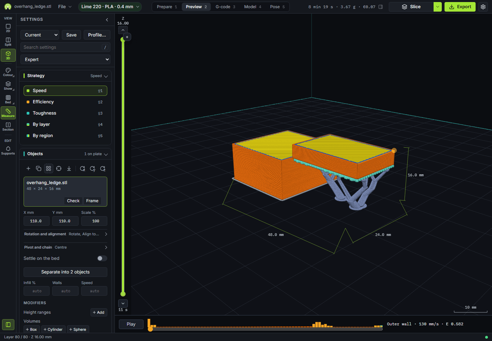

**Contents:** [Model a part](#model-a-part) · [Assemble, animate and run](#assemble-animate-and-run) · [Plugins and recipes](#plugins-and-recipes) · [Slice](#slice) · [Supports](#supports) · [Belt printers](#belt-printers) · [Stress](#stress) · [Drive it from an AI agent](#drive-it-from-an-ai-agent-mcp) · [Phone layout](#phone-layout) · [Install](#install) · [Run from source](#run-from-source) · [Build](#build) · [Releases](#releases) · [Samples](#samples) · [Layout](#layout) · [Tests](#tests) · [More documents](#more-documents)

The pictures are the web UI in the dark theme against a local engine with the Open CASCADE bridge, at 1440×1000 (the phone pictures at 390×844). [docs/readme-media.md](docs/readme-media.md) says how to make them again.

## What you can do

### Model a part

Model edits a STEP solid, or starts one from a primitive, a gear, a part, or a sketch on the bed or on a flat face. The sketcher has its own constraint solver: it keeps lines horizontal, vertical, square or equal as you draw, and a size can be a number or an expression that names a parameter. From a sketch you extrude, revolve, loft, sweep, or drill holes. On the solid you push and pull faces, fillet and chamfer edges, draft walls, shell, split, pattern, mirror and join, and add text. Every step goes into History, where you can reopen it with new numbers and the steps after it are built again. Ctrl+Z undoes the last step of the part you have open (the rail's Undo and Redo are the same history). Inside a sketch, Ctrl+Z undoes the sketch. The command palette names that step when History has a name for it. Model updates faster on the desktop, because only the faces an edit changed are meshed again (7.4.0).

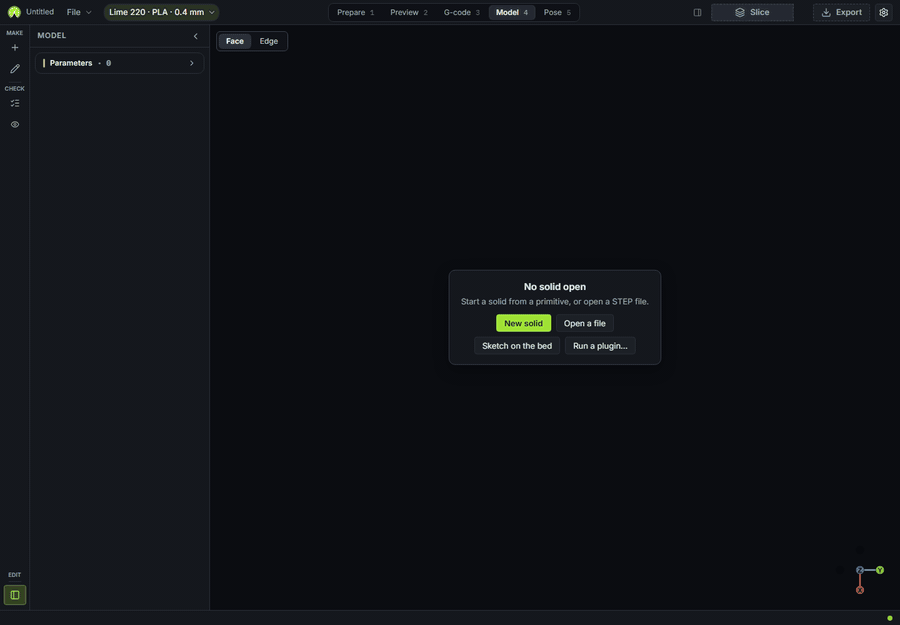

- **Text** in Inter, IBM Plex Mono and Serif, Allerta Stencil, two pen fonts and five Hershey fonts, or a font file of your own. Letters go on flat faces and wrap round cylinders, cones, spheres, tori and freeform faces at their true size, raised or engraved.
- **Gears.** New solid makes an involute spur gear, a ring (internal) gear or a rack. The gear card says whether it meshes with the gear it reaches, or how far off it is.
- **Parts.** New solid's Part has four groups. Fasteners: a hex nut (ISO 4032), a socket-head cap screw (ISO 4762), a hex-head screw (ISO 4017) or a washer (ISO 7089), from the standard's row. The shank is plain. A modelled thread is not available yet. Fittings: a spacer, a shaft printed at an ISO 286 fit (running, sliding or press), a collar with a set screw, and a heat-set boss for a Ruthex RX insert. Brackets: a plate and an L-bracket, with holes sized by screw from the ISO 273 medium clearance, plus an allowance, or a free diameter. Pulleys: a GT2 pulley, 12 to 60 teeth, with an approximate GT2 groove. The V pulley is listed and waits on the ISO 4183 table. Each part is one History step you reopen with new sizes, and it works as a boolean tool.

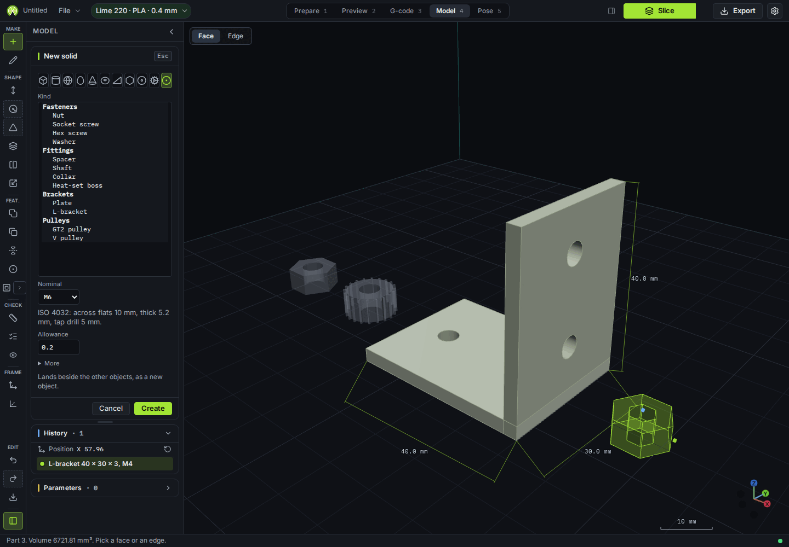

- **Split to print** cuts a part that is too large for the printer into pieces that fit, with straight or shaped cuts (lap, zig-zag, tongue, dovetail, or a sketched line) and dowels, plugs, keys or hardware holes to join them. The pieces become plate objects, each with its number on a cut face. It can also cut for the Formlabs Form 4 and export STEP, 3MF or STL.
- **NURBS surfaces (7.2.0).** New NURBS surface in the Model tool's NURBS panel makes an 8 × 8 surface you shape by dragging poles, rows or columns, with soft falloff, symmetry about the part's X = 0 plane, and an Exact NURBS drawer for weights, degrees, knots and creases. Thicken or Cap & Sew makes it a solid. Over MCP, `solid_new {feature}` starts a part from a NURBS surface or a sheet.
- **Draft** tilts walls that are already there, a STEP part's included, so a moulded or cast part releases: pick the walls, then Draft in the face menu, an angle and the pull direction. A positive angle opens them toward the pull.
- **Smooth surfaces (7.2.0).** The Look menu shades a part with Zebra stripes or a curvature map and can draw its surface grid, so a G1 seam and a G2 seam look different. Sketch splines are exact NURBS: control-point (the default) or through-point, with a curvature comb, weights, sharp creases and inserted knots. Fillets can be circular (G1), smooth (G2) or conic, and vary their radius along the edge. An open sheet shows Thicken and Cap & Sew to make it a printable solid, and Patch (G0 or G1) and Blend (G1 or G2) to fill or bridge its open edges; it is not sliced or exported while it is open. Sheets themselves, the kernel sweep along a 3D curve, guided lofts, trim, replace-face and split-face are made over MCP and in recipes, not yet from the window; see [docs/plan-organic-surfaces.md](docs/plan-organic-surfaces.md).
- **Print transition** adds a flat wedge in a concave corner, or a gusset under a lip, so each row stands on the row before.
- **STEP in and out.** A STEP file with several solids can open as one object per solid. File → Export… writes a part, an assembly, or the plate. The Model rail's STEP button opens that dialog on the solid on screen, as STEP.
- **Measure, Check, Section view**, and a part you hide to reach the one behind it.

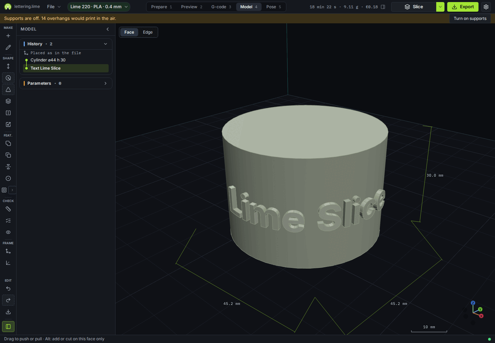

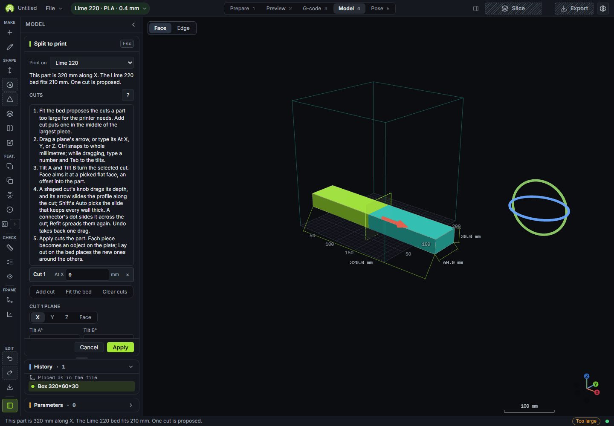

The desktop release includes the Open CASCADE libraries. A build without them still slices an unedited STEP file, and Model stays off. Every tool, with its keys and limits, is in [docs/modeler-guide.md](docs/modeler-guide.md). Step-by-step revolves, lofts and sweeps are in [docs/tutorials](docs/tutorials/README.md).

### Assemble, animate and run

Link two parts in **Pose** to make an assembly, then give them joints: fixed, hinge, slide, ball, or held. **Move** (M) moves a part in design space, a free part included, and snaps it to the other parts. **Pose** is the assembled view: Prepare shows only the print layout, and Edit in Pose or the Pose tab opens the assembly. Turn a part by its ring or type an angle, and **Until contact** turns or slides it until it meets another part and stops there. Ctrl+Z in Pose undoes the last design-space step (a Move, a Link, a joint). In Prepare, Preview and G-code the same key undoes the last plate step.

- **Couplings.** **Couple gears** finds every pair of gears that mesh, gives each a hinge about its own axis, and couples them, so turning one turns the whole train at the tooth ratios. Ring gears, planetary stages and rack and pinion couple the same way. The Couplings form couples any two parts by a ratio, a winch (a drum that winds a cord), a ratchet with its click, or a friction clutch.
- **Animations** are plugins that set joint angles over time. Pose prepares the frames in the background and plays them. You can keep a frame, save the animation as a GIF or PNG frames, or keep it in the plugin library to play on another assembly.
- **Mass and Run.** Pose shows the selected part's mass from its filament's density, its centre of gravity, its inertia about its hinge, and its period for small swings. **Run** runs the assembly in time: gravity, a torque or a falling weight as the drive, friction at the pins, and a Graham escapement. The answer is in sentences: whether it starts, the swing and period, where each beat's energy goes, and where it stalls.
- **Clock parts** ship as built-in plugins: Ratchet wheel, Ratchet click, Escape wheel, Graham anchor, and Clock wheel and pinion, each made in its working position.

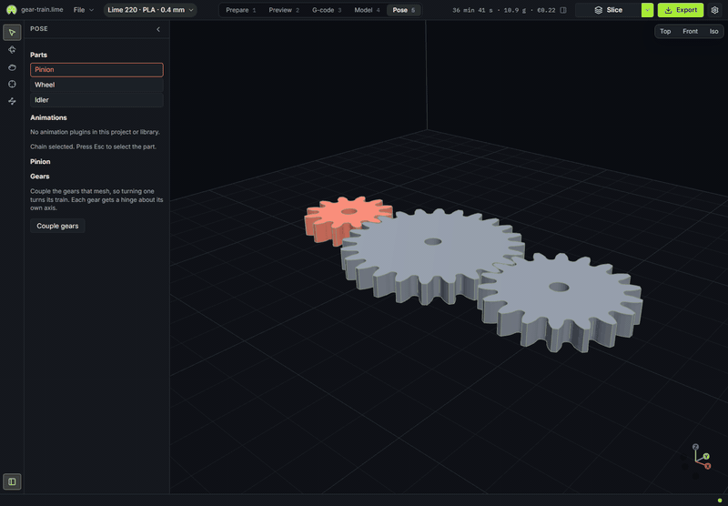

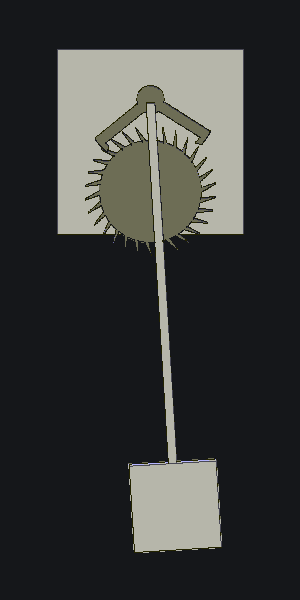

The escapement above was built and run over MCP with `motion_run`: from a 3.5° push it settles at a swing of 3.1° each side with a period of 0.78 s. File → Export…, and Pose's Export…, write an assembly as STEP, glTF, 3MF, STL, OBJ, or a pose sheet. An interference check lists parts that cross.

### Plugins and recipes

A recipe is a short Rust program that builds a part or a whole assembly. The desktop app compiles it with lust 0.3.2. Checks and rebuilds are faster. A recipe kept as a plugin goes into your plugin library, and **Features → Plugins…** (Ctrl+Alt+L) runs it on the open part or as a new one, with a form for its values, a face or an outline you pick, and saved presets. A plugin's step stays live in History: change a value and it is built again. The same panel lists ingredients (shared code), presets, and lessons, the notes an agent left about each kind of step, and `guide {kind}` shows the built-in lessons for that kind after a person's own (25 technique lessons ship). From 7.4.0, a queued step the kernel refuses, and that the recipe never reads, fails the run and nothing is kept, both over MCP and in the Plugins panel. `//! strict: false` was removed after 7.5.1: a recipe that carries it runs strict and gets one note. `guide {topic:"recipes", section:"api"}` lists every public type and function of `lime_recipe`, generated from the crate. Plugins export as one file you can share, and an imported plugin shows its code before its first run. Recipes run in the desktop app and over MCP, not in a plain browser.

### Slice

**Prepare** puts parts on the plate. Move, turn and scale them, lay a face flat, snap one part against another, and choose a strategy: speed, efficiency, toughness, or a blend of them by weight, by layer, or by region. Each strategy is a real set of walls, infill, speeds, acceleration, seam and retraction. **Preview** draws the toolpaths in 2D, 3D, or both, with the time and filament by feature, and the G-code tab shows the file. The stage tabs follow the work: Model is 1, Pose is 2, then Prepare is 3, Preview is 4 and G-code is 5.

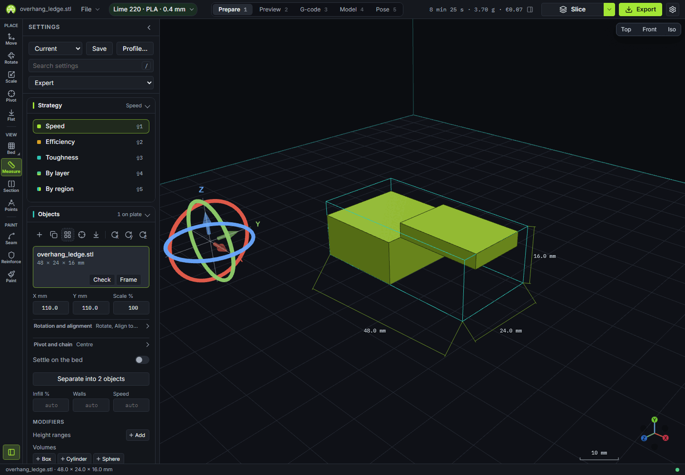

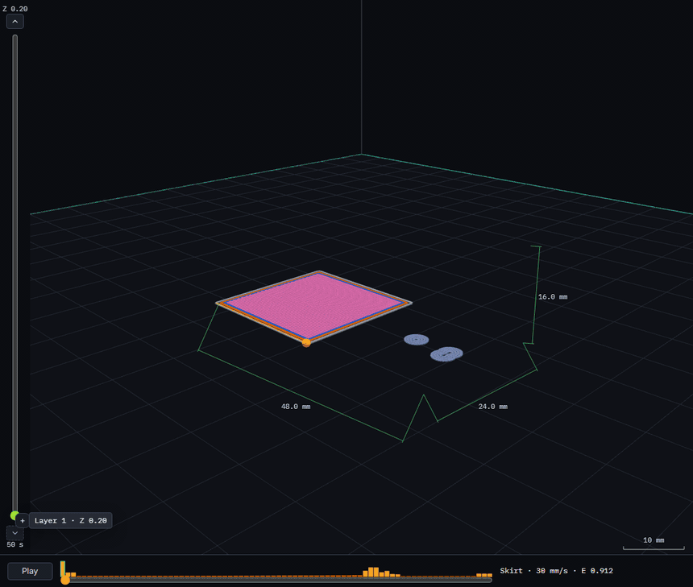

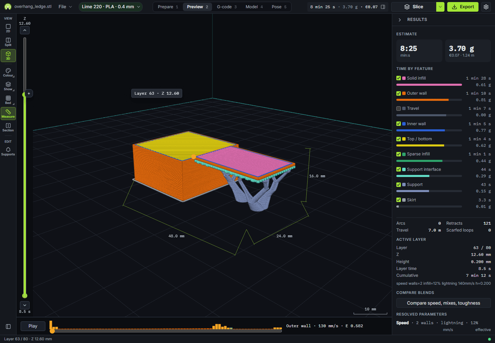

Also in the window:

- **Settings search** filters every setting (`/` or Ctrl+F).
- **Painting**: seams, supports (enforce or block) and Reinforce, which prints a painted patch, a box or a cylinder with denser infill, up to solid.
- **Per-object settings, height ranges and modifier volumes**, and a print order of all at once or one object at a time.
- **Ironing, fuzzy skin, scarf seams, adaptive layers, arc fitting**, Klipper or Marlin pressure advance, and fan control by feature.
- **Calibrate** on Prepare's rail: pressure advance, flow, temperature and retraction towers. It adds the test parts to the plate. Off Prepare the command stays in the palette, disabled.
- **Layer pause** or filament change at a marked layer.
- **Printers**, the menu beside File: the current printer and filament, the printer and filament library, and machine settings. The printer chip opens the same menu. The library has the Lime 220, a generic 45° belt and the Ideaformer IR3 V2, plus New printer… from any of them.
- **Foreign 3MF**: a PrusaSlicer, OrcaSlicer, Bambu Studio or Cura project opens as a mesh, and you can copy its layer height, walls, infill and supports.
- **Send** uploads the G-code to a Prusa Link, Moonraker or OctoPrint host and can start the job.
- **Projects** (`.lime`) keep the plate, settings, painting, Model history and assemblies. The installer registers `.lime`. Hover the lime icon at the top left to see the installed version.

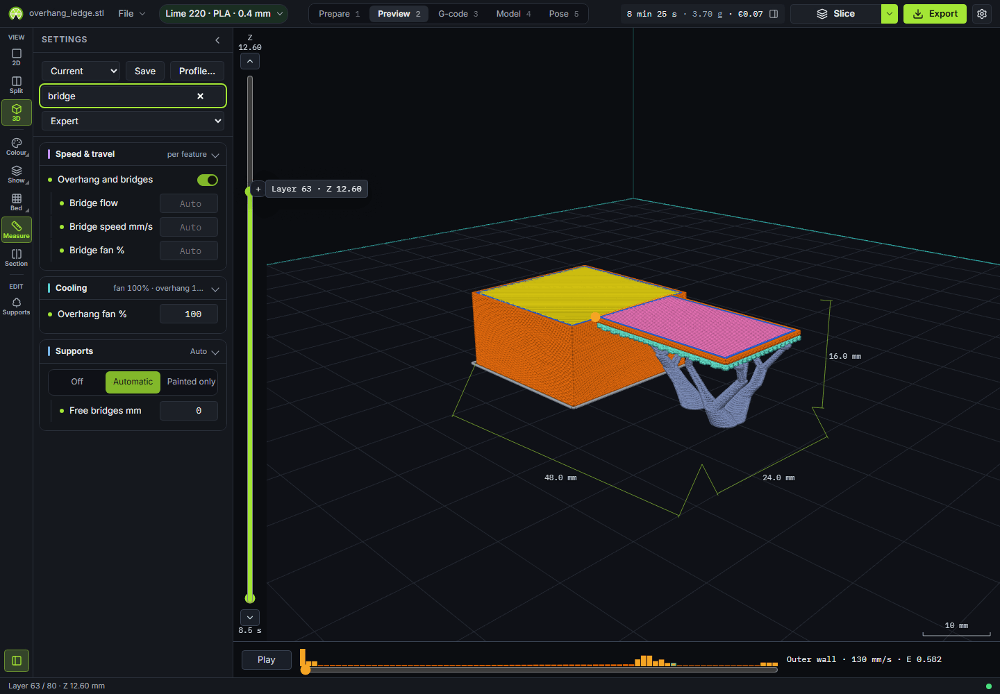

The settings, the command line and the planner's details are in [docs/slicing-guide.md](docs/slicing-guide.md). Measured timings and the notes on scarf seams, 3D gyroid, Z-hop and pressure advance are in [docs/slicer-measurements.md](docs/slicer-measurements.md).

### Supports

Supports are automatic, painted only, or off. The default style is organic tree; grid columns are the other. With supports on, the window shows Auto in the gap and interface boxes until you type a value.

- **Tree feet are filled** on a flat bed, and the trunk narrows from the foot over a few layers, so every loop rests on the one below it.
- **Tall supports keep a sturdy base.** A free-standing tree or grid column taller than 15 mm stands at most 10 times taller than its base is wide, measured along real gravity.
- **Free bridges mm** (Advanced, off at 0): an overhang held at both ends and no longer than this across gets no support, and its first rows run post to post.
- **Gentle supports and a tree brim** slow the head and widen the foot so trees are not knocked over.
- **Support editing** in Preview: delete a tree or a branch, regrow a range of layers, or grow more branches on a tree.

The filled feet, the height-against-width limit and the two settings above were measured on sliced output, not yet on printed parts.

### Belt printers

On a 45° belt printer the part rides along the belt, and the layer readout's Z is the position along the belt. The library has the Ideaformer IR3 V2 (Klipper) and a generic 45° belt. Belt supports stand on the belt and are tied to it with anchor lines across it. **Support thin belt edges** (Advanced, belt printers only, off by default) supports a flat-bottomed ledge under its first bead and prints belt grid supports under a thin strip as a continuous column. The IR3 V2's start G-code lays a line across the belt that the first layer prints into.

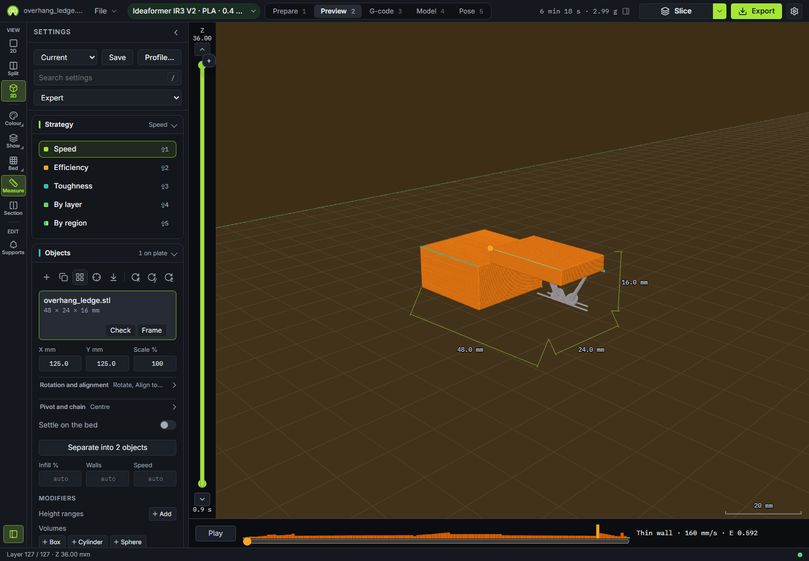

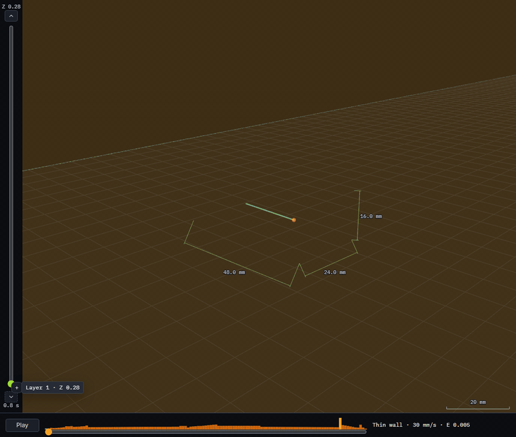

### Stress

Model → Stress… estimates how a part takes a load, solved as it will be printed rather than as a solid block. Pick held faces or the bed, add a force or a pressure, and choose a material card and targets such as a minimum safety factor or a maximum deflection. Run slices the part and solves its real beads, so walls, infill, bead direction and the bond between layers all count. The result is painted on the part, with one row per target giving the margin and the failure mode that governs it. The four material cards (PLA, PETG, ABS, TPU) are placeholders, not measured data, so every result is marked `rough` for now.

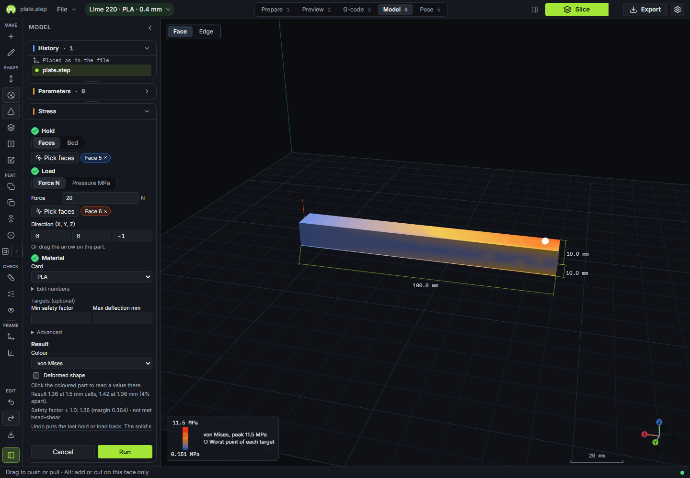

The worked example and the trust levels are in [docs/modeler-guide.md](docs/modeler-guide.md#stress-estimate).

**Auto ribs** (Features → Auto ribs, next to Stress) plans ribs on a wall so it bends less for the least added material: click the wall, Run, and Apply puts the ribs in History as one step. The plan says how much stiffer the wall gets and compares the ribs with a thicker wall and an even grid of the same stiffness. Planning is faster; the ribs are the same.

- **Load cases.** Add a load case gives up to eight named cases with a weight each; the ribs serve all of them, and the result gives each case's stiffness, with Check with Stress run once per case.
- **Resist buckling.** Beside Stiffer and Higher frequency. The slider asks the wall to hold 1.5×, 2×, 3×, 4× or 5× the load before it buckles; the middle, 3×, is the default. The result says the factor before and after, and that the number is the ideal buckling load. With several load cases the card says Against case and names the one it solved.
- **Side walls.** Include side walls (folded) takes a cover's side walls into the same wall across its sharp edges, so ribs can run over a crease. It is off unless checked.
- **Moulding checks.** With the moulded process, the result lists each moulding rule a rib breaks: base thickness, root radius, height, draft, the junction where ribs meet, and the gap between ribs. It is a report and changes nothing.

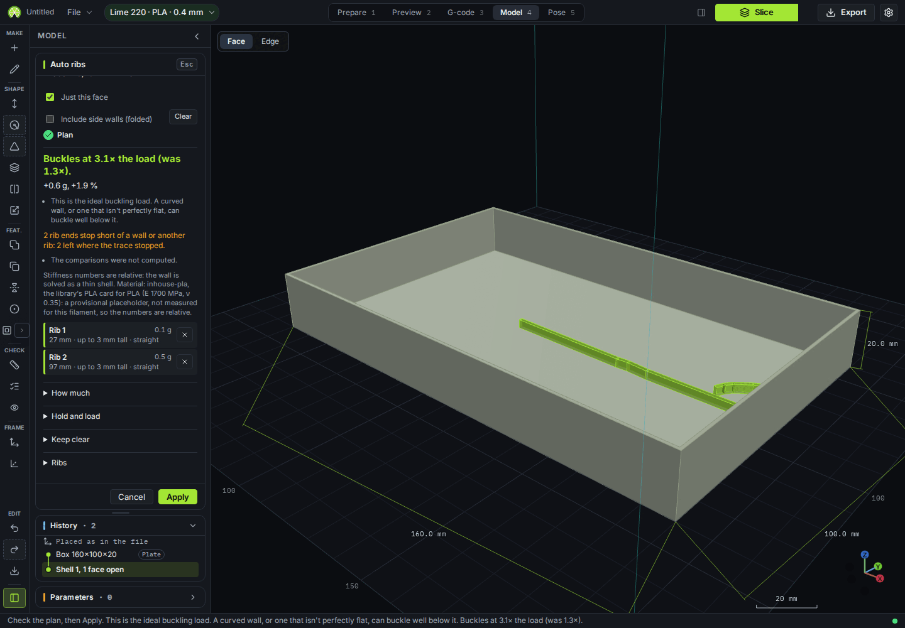

The stiffness numbers are relative, since the material cards are placeholders. Over MCP the same planner is `ribs_plan` and `ribs_apply`.

### Drive it from an AI agent (MCP)

An LLM client such as Claude can drive Lime Slice over MCP: import or build a part, edit it in Model, place it, assemble and pose it, change settings, slice, and write G-code, with pictures of the solid or of a layer to check its work. There is no send-to-printer tool.

- **Four tools to start.** The server lists `guide`, `call`, `plan_run` and `session_info`. `guide {query: "couple gears"}` finds the tools for a task, `guide {tool: "model_place"}` reads one in full with an example, and `call {tool, args}` runs any of its tools. `plan_run` runs up to 25 calls in one request, each step able to use an earlier step's result.
- **Organic surfaces (7.2.0).** Exact NURBS curves in profiles and in 3D, the kernel sweep along a 3D spine, lofts with apex points, guide rails and end conditions, G2, conic and variable fillets (G2 and conic on a straight edge between two flat faces), open sheets with sew, thicken, trim, replace-face and split-face, and patch (G0, G1) and blend (G1, G2) fills, with `model_check {surfaces: true}` counting G0, G1 and G2 seams. Recipe API 1.18 has the same steps.
- **MCP 2026-07-28 (7.4.0).** The server speaks the stateless revision (`server/discover`, per-request `_meta`), and clients on the older revisions keep working unchanged.
- **Long calls become jobs.** A slice, an animation export or a `motion_run` answers with a job, and `slice_wait` returns the result. **Tasks (7.4.0).** A client that supports tasks gets that work as a native task with progress. Other clients still get the job and `slice_wait`.
- **orient_compare (7.4.0).** It ranks candidate orientations of a part for the belt printer before slicing, at every 90° of yaw. On a flat bed it tries the six faces down. It moves nothing.
- **Exact volumes (7.4.0).** `model_describe`, `model_mass`, `model_check` and the Part card measure volume exactly. Lofted parts used to read about 0.6% low.
- **The same builders as the window**, so an agent's part and G-code match what you would make by hand. Recipes, plugins and clock parts run over MCP too.
- **Autosaves** are kept per project in the workspace, so a restarted client can carry on.
- **Tandem.** With the live bridge on (the Tandem light in the top bar), an agent's changes appear in your window as they happen, each one undoable.

Setup for Claude Desktop and Claude Code on Windows, macOS and Linux is in [docs/mcp-setup.md](docs/mcp-setup.md). [docs/mcp-server.md](docs/mcp-server.md) lists every tool.

### Phone layout

The same web UI draws a phone-sized shell with `?layout=compact`, or Interface layout set to Compact. Auto uses it when the window is 600 px wide or less. It is not an iOS app. Running the engine on one computer and the window on a phone or tablet is described in [docs/devices.md](docs/devices.md).

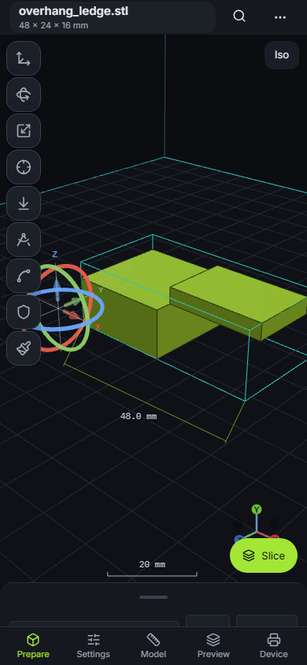 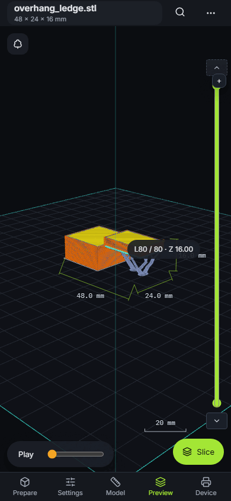 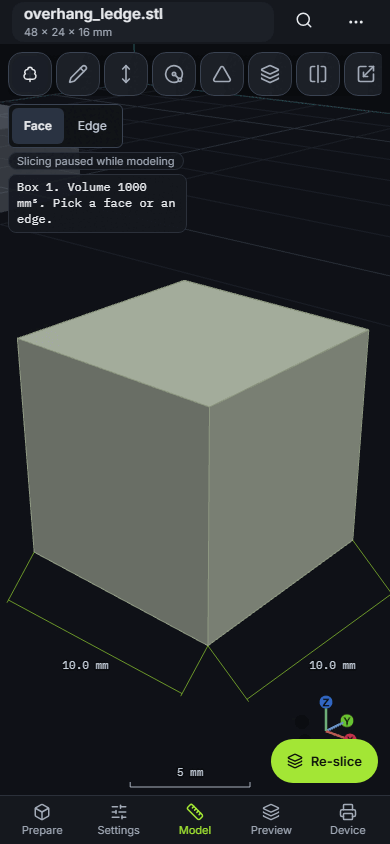

## Install

Installers are attached to each GitHub Release: an NSIS installer for Windows, a `.deb` and an `.AppImage` for Linux, and a `.dmg` each for Apple silicon and Intel Macs. They are unsigned, so Windows SmartScreen and macOS Gatekeeper warn on first start. The desktop app carries the engine, Open CASCADE, the MCP server and, except on Intel Macs, the lust compiler that recipes need.

## Run from source

Two processes. The slicer is the Rust binary; the window is either the browser dev server or Tauri.

```bash
cargo run -p lime-slice --release -- serve
npm install
npm run dev
```

Open [http://127.0.0.1:43117](http://127.0.0.1:43117). Load a sample from File → Samples, pick a strategy, slice, scrub the layers, export G-code.

Desktop shell:

```bash
npm run tauri dev
```

The API listens on `127.0.0.1:43118`. Inside Tauri the UI calls `slice_model` instead of HTTP. Each request runs on its own thread. A new slice supersedes the one in flight, and `POST /api/cancel` stops it at the planner's next check. If Model stays off in the browser, start the engine with `LIME_OCCT_BRIDGE` set to the Open CASCADE bridge library (`lime_model_occt`). `serve --host` and `--token` open the engine to other devices; see [docs/devices.md](docs/devices.md).

## Build

`rust-toolchain.toml` pins stable Rust **1.88.0**, and the workspace `rust-version` matches. 1.83 cannot build this lockfile: `serde_spanned` 1.1 and `clap_lex` 1.1 need edition 2024 (Rust 1.85), and the resolved `time`, `icu_*`, `darling`, and `plist` crates require 1.88. `cargo +1.87.0 check` stops on those `rust-version` fields.

Clipper2's C++ binding needs `g++` and libstdc++. `.cargo/config.toml` points the Linux linker at GCC 13 (`/usr/lib/gcc/x86_64-linux-gnu/13`), which is the default on Ubuntu 24.04.

**Linux** (GTK 3 and WebKitGTK 4.1, the Tauri 2 webview):

```bash
sudo apt-get update
sudo apt-get install -y \
  build-essential \
  pkg-config \
  libssl-dev \
  patchelf \
  libgtk-3-dev \
  libwebkit2gtk-4.1-dev \
  libayatana-appindicator3-dev \
  librsvg2-dev \
  libsoup-3.0-dev
cargo build -p lime-slice-desktop
```

`libwebkit2gtk-4.1-dev` pulls in JavaScriptCore and libsoup 3. `libgtk-3-dev` is the window toolkit. `libayatana-appindicator3-dev` is the tray icon, `librsvg2-dev` rasterizes the bundle icons, and `patchelf` is used when packaging a deb.

**Windows:** Visual Studio Build Tools with the "Desktop development with C++" workload, and the WebView2 runtime (already present on current Windows 10 and 11). The NSIS installer target in `src-tauri/tauri.windows.conf.json` needs [NSIS](https://nsis.sourceforge.io/) on `PATH` when bundling. The Windows icon (`icons/icon.ico`) stays in `src-tauri/tauri.conf.json`. `src-tauri/build.rs` calls `tauri_build::build()`, which embeds that `.ico` as the application icon resource in `target/release/lime-slice-desktop.exe` itself, so Explorer and the NSIS installer use the same file.

**macOS:** Xcode Command Line Tools (`xcode-select --install`). The shell uses the system WebKit; no extra GTK packages. `src-tauri/tauri.macos.conf.json` bundles a `.dmg`. A local `tauri build` on Linux still follows `src-tauri/tauri.conf.json` and produces a `.deb` only.

Clipper2 (`clipper2c-sys`) compiles its C++ sources with the Rust `cc` crate. The build does not need CMake. Linux needs `g++` and libstdc++ (GCC 13 on Ubuntu 24.04, as in `.cargo/config.toml`). Windows needs the MSVC C++ toolset (`cl.exe`). macOS needs Apple `clang` and `libc++`, including when an Apple silicon machine cross-compiles the Intel target.

## Releases

`.github/workflows/release.yml` builds unsigned installers when a tag named `v*` is pushed, and when someone runs the workflow by hand. The artifacts are attached to a **draft** GitHub Release. Linux is a `.deb` plus an `.AppImage` (Ubuntu 24.04). macOS is two `.dmg` files, Apple silicon and Intel, rather than one universal binary; only the Apple silicon one carries lust, which recipes need, because lust's macOS build is proven on arm64 only. Windows is an NSIS installer. The existing CI jobs are unchanged.

These builds are unsigned. macOS Gatekeeper and Windows SmartScreen will warn, and the AppImage is not signed either. Code signing, notarization, and the Tauri updater plugin are not part of this workflow. A later signing setup would fill these secrets; none of them are read today:

| Secret | Would be used for |
| --- | --- |
| `APPLE_CERTIFICATE` | Apple Developer ID application certificate (base64 `.p12`) |
| `APPLE_CERTIFICATE_PASSWORD` | Password for that `.p12` |
| `APPLE_SIGNING_IDENTITY` | Developer ID Application identity |
| `APPLE_ID` | Apple ID for notarization |
| `APPLE_PASSWORD` | App-specific password for notarization |
| `APPLE_TEAM_ID` | Apple team id |
| `TAURI_SIGNING_PRIVATE_KEY` | Updater minisign private key |
| `TAURI_SIGNING_PRIVATE_KEY_PASSWORD` | Password for that updater key |

A Windows Authenticode certificate is not configured either. A manual run creates or updates the draft release `v<app version>` from `src-tauri/tauri.conf.json` (7.6.1). Publishing that draft is a separate step. Releases through v7.2.0 are on the repository.

## Samples

| File | What it is |
| --- | --- |
| `samples/calibration_cube_20mm.stl` | 20 mm cube, 12 triangles |
| `samples/calibration_cube_20mm.3mf` | The same cube as 3MF |
| `samples/step_cube.step` | 10 mm cube as STEP AP214, tessellated on load |
| `samples/lime_hull.stl` | Original 60 × 24 × 28 mm superellipse prism, 4800 triangles |
| `samples/overhang_ledge.stl` | 24 mm base plus a 24 mm shelf at Z = 12, 24 triangles |
| `samples/slope_ramp.stl` | Vertical block with a roof rising from Z = 8 to Z = 20, 12 triangles |
| `samples/thin_fin.stl` | 18 mm pad with a 0.7 mm fin, 24 triangles |
| `samples/bridge_span.stl` | Two towers and a 14 mm deck, 36 triangles |
| `samples/belt_bridge.stl` | A deck on two walls, for belt support tests |
| `samples/arc_post.stl` | 64-gon cylinder, 12 mm radius, 256 triangles |
| `samples/dragon_2_5.stl` | Dragon 2.5. Checked in. The default sample sweep skips it. |
| `samples/recipes/` | Two sample recipes: label a face, and a text plate |

Regenerate the checked-in meshes with `python3 tools/gen_samples.py`. Dragon 2.5 is not generated here.

## Layout

- `crates/lime-slice-core` — mesh load, contour slice, strategy blend, toolpaths, G-code
- `crates/lime-slice` — `slice`, `bench`, `serve`, `calibrate pa`
- `crates/lime-model`, `crates/lime-model-occt`, `crates/lime-model-load` — Model mode's Open CASCADE bridge and the loader that finds it at run time
- `crates/lime-mcp-engine` — the slicer loaded in-process by the MCP server
- `crates/lime-sim`, `crates/lime-sim-bridge` — the stress solver and its link to the slicer
- `src-tauri` — Tauri 2 shell over the same core, including the live-bridge listener
- `src` — TypeScript UI (2D layer canvas, Three.js views, Model, Pose)
- `mcp` — the MCP server (`mcp/server.ts`) and its tests
- `samples` — checked-in meshes and sample recipes
- `docs/mcp-server.md` — the MCP server's design, its tools, and what is deferred

## Tests

```bash
cargo test -p lime-slice-core
cargo run -p lime-slice --release -- bench samples/calibration_cube_20mm.stl
npx tsc --noEmit
npx tsc --noEmit -p mcp
npm run test:unit
```

`npm run test:unit` runs the files listed in `tools/unit-tests.txt`: the TypeScript unit tests and the MCP server tests. It runs several at once (the smaller of the machine's cores and 8, or `LIME_UNIT_JOBS`; `1` is one at a time). A file whose line ends in `# serial` runs alone afterwards. Every file runs; failures are listed at the end with their exit codes. The native-load test needs `cargo build -p lime-mcp-engine --release` first. The Model edits against real Open CASCADE are a separate run, `node --experimental-strip-types mcp/occt.test.ts`, with `LIME_OCCT_BRIDGE` pointing at the bridge; it skips without it.

The browser specs need `npx vite build` first. `npm run test:smoke` runs the per-pull-request set, and CI splits it into four shards of equal time (`npm run test:smoke:1` to `test:smoke:4`; `tools/ci/smoke-shards.mjs` reads the spec times in `e2e/durations.json`, and a new spec goes into `test:smoke` as before). `npm run test:engine` runs the specs that need a real engine. The frame-timing specs, tagged `@perf` in `e2e/model-speed.spec.ts`, are left out of smoke. `npm run test:perf` runs them, and `.github/workflows/perf.yml` runs them nightly, by hand, and on a pull request that carries the `ci:perf` label. CI starts with a `what changed` job (`.github/workflows/ci.yml`) that decides what runs. A change to `docs/` or Markdown alone skips every other job. A version bump alone takes a fast lane: `tools/ci/bump-only.mjs` answers true only when every changed file is a version file (`package.json`, `package-lock.json`, `src-tauri/tauri.conf.json`, `Cargo.toml`, `Cargo.lock`, `README.md`, plus docs), every changed line is an app-version line, old and new are one version pair across all files, and every version at the new commit agrees. Then only `what changed` and `version check` run (the second runs `bump-only.mjs --check` and `cargo metadata --locked`); the heavy jobs and macOS are skipped. A dependency version, a non-workspace crate in `Cargo.lock`, or any other edit makes it false and the full CI runs. The same rule applies to the merge commit on `main`. The script's test is `tools/ci/bump-only.test.mjs`. The `typecheck and frontend build` job also runs `node tools/ci/bundle-budget.mjs` after `vite build`: it fails when the first chunk (the script `dist/index.html` loads, plus any modulepreload) is more than 5 % over the figure in `tools/ci/bundle-budget.json` (test: `tools/ci/bundle-budget.test.mjs`). To change the budget on purpose, build and run `npx vite build && node tools/ci/bundle-budget.mjs --update`, and commit the JSON. `npm run build:analyze` builds with a per-chunk, per-module size report (also in `dist-analysis.json`).

The slicer's own tests build at opt-level 2 (`[profile.test.package.lime-slice-core]` in `Cargo.toml`), so `cargo test -p lime-slice-core` stays fast.

The README's pictures and clips are made by `tools/readme-media`; [docs/readme-media.md](docs/readme-media.md) says how to run it.

## More documents

- [docs/modeler-guide.md](docs/modeler-guide.md) — every Model tool: the sketcher and its solver, extrude to holes, push/pull, parameters, section view, split to print, STEP, and the stress estimate with its worked example
- [docs/slicing-guide.md](docs/slicing-guide.md) — placing and measuring, Preview, supports, bridges and cooling, the command line (`slice`, `bench`), and the strategies
- [docs/slicer-measurements.md](docs/slicer-measurements.md) — measured timings, comparing G-code between slicers, scarf seams, true 3D gyroid, Z-hop, pressure-advance calibration
- [docs/mcp-setup.md](docs/mcp-setup.md) — connecting an AI client, what the server does, running it from a checkout, and the live desktop bridge
- [docs/mcp-server.md](docs/mcp-server.md) — the MCP server's tools and design
- [docs/devices.md](docs/devices.md) — another device over the LAN or Tailscale, the phone layout, and the iOS port notes
- [docs/tutorials](docs/tutorials/README.md) — revolve, loft and sweep, step by step
- [docs/step-modeler.md](docs/step-modeler.md) — the modeler's contract and the `.lime` format
