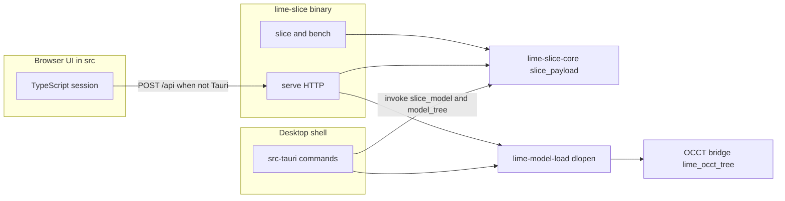
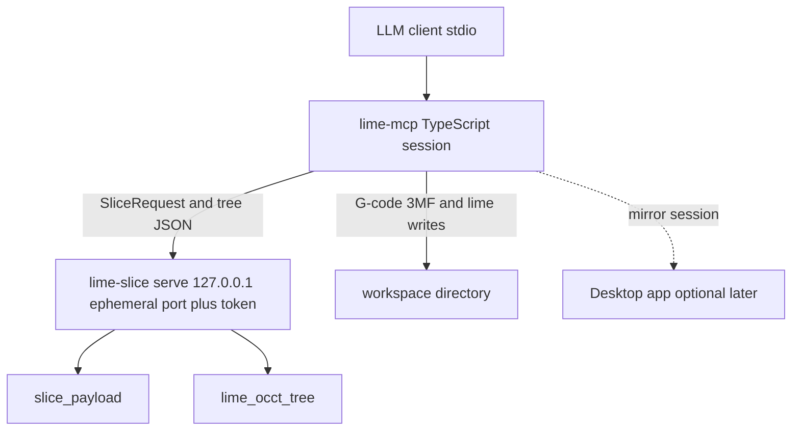
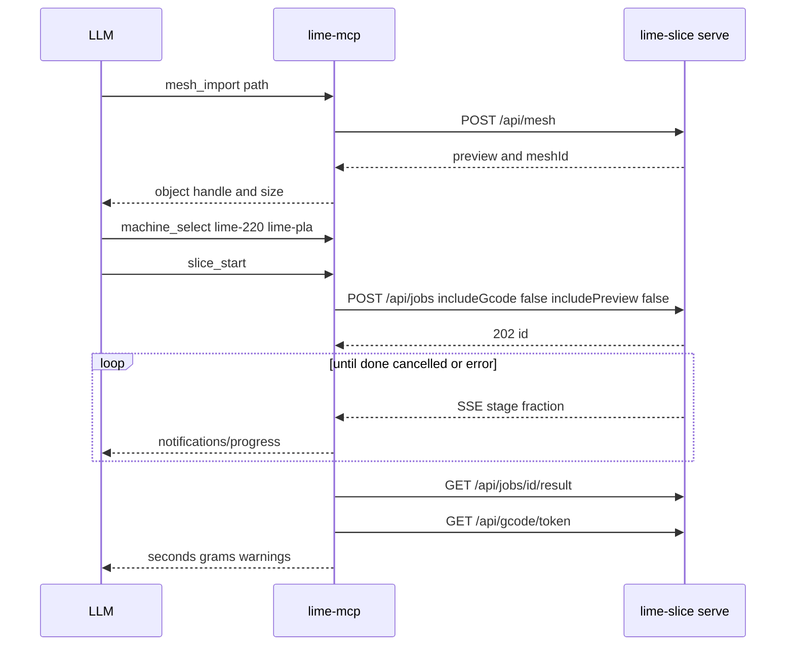

# An MCP server for Lime Slice

The design below was written against `origin/main` at 1.8.0. The implementation on `feature/mcp-server` follows it except where the decisions in **Implementation status** override a recommendation. The workspace version stays 1.8.0.

## Implementation status

### Decisions

These override the architecture recommendation in section 3 and the open questions in section 8.

1. **In-process engine.** The server calls `slice_payload_watched` and `lime_model_load::tree` in-process. It does not spawn `lime-slice serve`. The original server left the engine crates unchanged. Version 2.6.1 adds only an optional STEP import callback in the core so OCCT can supply triangles; toolpath planning remains unchanged. `tools/golden_ab.sh` remains the STL slicing equivalence check.

   The server is TypeScript (`mcp/`) because that is the least risky way to reuse the app's request builders, feasibility checks, and G-code post-processing (`settingsRules`, the adhesion, seam, flow, and layer-action helpers, `toSolidOp`, `withPrintMeta`, `withMachineGcode`, `withFooterGrams`). A Rust `rmcp` server would have been a second copy of that UI. The engine sits behind the small `Engine` interface in `mcp/engine.ts` (`sliceStart`, `slicePoll`, `sliceCancel`, `meshPreview`, `modelTree`). The first implementation is `crates/lime-mcp-engine`, a cdylib that Node loads with `process.dlopen`. N-API symbols come from the host process, so the library is not linked against Node and the server process adds no runtime npm dependency. Replacing that one module is how a later build could put the engine in another process without changing the tools.

2. **Save may overwrite.** `project_save` overwrites a `.lime` file of the same name inside `LIME_MCP_WORKSPACE`, including the project that was opened. It does not write outside that directory. The tool description says so.

3. **No send-to-printer.** `printer_send` is not a tool.

4. **Live desktop bridge, off by default.** With `LIME_BRIDGE=1` and a non-empty `LIME_BRIDGE_TOKEN`, the desktop app listens on `127.0.0.1` only (`LIME_BRIDGE_PORT`, default 43119) and emits `lime-bridge`. The MCP process mirrors each tool result only when `LIME_MCP_BRIDGE` is a loopback URL and `LIME_MCP_BRIDGE_TOKEN` is set. A mirror that fails is logged and does not change the tool result. A POST of `{"open": "<path>"}` is not a mirror: the window opens that file and answers 204, or 404 with the reason as the body. Authorised answers name `open` in `X-Lime-Bridge-Features`, and the server sends an open only to a window that does. The message is the whole plate after the tool, a session id, and a sequence number. A mesh the desktop has not been sent rides along once, as its file bytes and the triangles the server read (`meshes`, keyed by `fnv1aHex`). A commit names the new mesh hash, not the list of edits. The desktop applies any newer sequence, so a gap is repaired by the next snapshot; it removes only objects the server sent. Authorised answers carry `X-Lime-Bridge-Instance`, which changes when the app starts and when the page calls `bridge_ready`; the server then sends every mesh again (`plate_sync`). The bridge is a mirror, not a second undo stack, and a gesture already in progress waits. The headless session stays correct when the app is closed.

5. **Opening in the app.** `app_open {path?}` shows the session's work in the desktop app. With no path it saves the plate as a `.lime` in the workspace: over the project it came from when that file is in the workspace, otherwise under a free name from the first object (`duck.lime`, `duck-2.lime`), so no other file is replaced. A given path must be a `.lime` or mesh file inside the workspace; a path outside it is refused, and no path outside it is sent to the app. The file then opens in the running app over the bridge when the bridge is on and the window answers with `open` in `X-Lime-Bridge-Features`. Otherwise the server starts the installed app with the path (`mcp/app-open.ts` finds it from where the installer put the server, as `installedOcctBridge` finds Open CASCADE; on Windows, `%LOCALAPPDATA%\Lime Slice\lime-slice-desktop.exe`). An app that is already running takes the path from the second launch (`tauri-plugin-single-instance`) and opens it in its window, with the unsaved-changes prompt of File > Open. The result says which in a sentence: "Opened duck.lime in the running app.", "Started Lime Slice with duck.lime.", or "Lime Slice is not installed; the project is saved at ...". Starting an app is a side effect the user sees, so `app_open` is not marked read-only, and it is marked destructive because it may save over the source project.

### What shipped

Open and import, list and place, arrange, duplicate, separate shells, and plate undo and redo. `slice_start` slices the selected object or the whole plate. The plate body matches the app's builder, including per-object settings, overrides, modifiers, paint, support edits, reinforcement, and print order. A session slice uses the built-in machine library and the same field helpers as the app, so a Lime 220 / PLA slice carries that printer's fan and Klipper firmware.

Settings: `settings_schema` lists keys and ranges, and `settings_set` writes many keys at once, including per-object keys. A value outside the panel's range is refused in one sentence. Profiles and the machine can be read, edited, and saved.

Model edits (hole, counterbore, screw, fillet, chamfer, split, scale, a sized boolean, the extra primitives, and join) run only after a feasibility check that returns a plain-language refusal before the solid changes. Face and edge selectors return centres. The workplane can be a face, the bed, or a typed origin and turn. A committed edit replaces the plate mesh, so the next slice, the 3MF, the preview, and the saved `.lime` see it. Commit and STEP export read `bytesBase64` from the modeler: a commit keeps the step's solid in the engine's binary format (`brep`, "Saved solid" in `docs/step-modeler.md`), and only `model_export_step` writes STEP. History undo and redo stay on the model tree. A save keeps that mesh, that solid and that history, and `project_open` opens the history whole with the plate's step from that solid, so nothing is replayed (the back cover: 264.5 s to 1.15 s). A lost tree is an error, and the modeler restarts after a time budget. Start the edit again.

Slice, estimates, and warnings. `slice_wait` reports progress and can return while the slice is still running. Cancelling the wait does not cancel the slice. The slice itself is cancelled with that job's watch. G-code and 3MF export, a paged G-code read, mesh stats, and a measurement between two faces or two points. `layer_summary` is the count and the times. `layer_detail`, `layer_paths`, and `layer_image` read the latest slice. `render_view` writes a shaded PNG of the mesh (top, front, or iso). It does not draw sliced layers and it does not capture the desktop window.

Paint for supports and seams, reinforcement, and support prune and regrow are on the session. Calibration towers (pressure advance, flow, temperature, retract) and the Pareto blend call the public builders through the MCP addon only. The slicer crates are unchanged.

Guides at `lime://guide/slice`, `lime://guide/model`, `lime://guide/paint`, and `lime://guide/calibrate` carry the worked call sequences. Transport is newline-delimited JSON on stdio. One slice runs at a time. There is no send-to-printer tool.

The golden check is separate: it sends the CLI's request through the same `sliceStart` and requires byte-identical G-code to `lime-slice slice` for the six `tools/golden.sh` configs on `samples/calibration_cube_20mm.stl`.

The server needs Node 22.6 or later. Node prints an `ExperimentalWarning` on startup. Model edits find Open CASCADE next to `node`, or at `LIME_OCCT_BRIDGE`. See the README.

### Deferred

- `printer_send`.
- Tool lanes across two objects' histories.
- Mirroring the Model history into the window. A commit sends the mesh; the window's History panel does not show the server's steps.
- A real-engine check of paint coverage, a support blocker, Pareto, and calibration towers. The request bodies and the stand-in are tested. The N-API exports call the public builders and do not change the slicer crates.

### Licences

The server process adds no runtime npm dependency. Tests use `@modelcontextprotocol/sdk` and `@types/node`, both MIT. `crates/lime-mcp-engine` depends on `base64` 0.22 and `serde_json` (both MIT OR Apache-2.0) and on the existing `lime-slice-core` and `lime-model-load` crates. Open CASCADE stays a `dlopen` under the LGPL-2.1 exception noted in `third_party/occt/NOTICE.md`. No GPL dependency was added.

The server would let an LLM do the things the desktop app already does with numbers: open a project, place parts, run a Model edit that has already passed a feasibility check, slice, and write G-code. The mouse path stays in the app. The MCP path is the programmatic equivalent of the typed fields.

`origin/feature/local-workplane` (`1391ea1`) is already an ancestor of this `main`. The same work landed through pull request #325 (`claude/local-workplane`) before the 1.8.0 bump. The frame described below is the one in `docs/local-workplane.md` and `src/workplane.ts`, not a future branch.

## 1. Goals and non-goals

### Goals

An LLM client, talking MCP over a local channel, can:

1. Slice a mesh for a named printer and filament and report time and weight.
2. Place a part on the bed with the same numbers Prepare already stores.
3. Run a Model operation (split, hole, fillet, chamfer, boolean, scale, join) only after a feasibility check, and say in plain language why a check failed.
4. Export G-code and 3MF that match what the app writes for the same inputs.
5. Leave the printer alone unless the user has turned sending on and confirmed that call.

Four examples the tool list has to cover.

**Slice.** "Slice `samples/calibration_cube_20mm.stl` for the Lime 220 and PLA, and tell me the time and the weight." The server opens the STL, selects printer `lime-220` and filament `lime-pla` from the built-in library (`src/ui/machine-library.ts`, `builtinPrinters` and `builtinFilaments`), slices through the same `slice_payload` the app uses, and returns seconds, grams, and warnings. It does not upload the file.

**Hole.** "Add a 4 mm through hole at U = 10, V = 6 on that face." The server sets the part's workplane from the face (or refuses a curved face with the sentence already used, "Pick a flat face. This one is curved."), probes `{kind: "hole", radius: 2, through: true, ...}` on the current node, and applies only when the probe returns `{ok: true}`. U and V are workplane fields. The stored op is in the solid's own frame, which is what `toSolidOp` already does (`docs/local-workplane.md`).

**Split, fillet, export.** "Split this STEP on Z through the middle, fillet the new edge at 1 mm, and export STEP and G-code." Split is judged from the plane numbers (`src/model-plane.ts`, `splitNote`). Fillet is probed. Each apply is one history node. Export of the solid is the existing `export` call (`{bytesBase64, byteLength}`, AP214). G-code is a separate slice of the tessellated mesh the plate would hold.

**Fix a failed slice.** "This slice failed; fix it." The server returns the engine error in the words the UI already uses (`src/engine-wording.ts` for belt fields, `src/app/model-error.ts` when the failure is a kernel exception) plus the plain slice warnings (`meshWarningText`, `inAirWarning`, `coverageWarning`). It may propose a concrete next call (turn supports on, move the part onto the bed, lower a hole radius to `maxMm`). It does not invent a second mesh repair.

### Non-goals

- No change to slicer output, cache keys, or `tools/golden_ab.sh` as a side effect of having the server. The server is a client of the engine.
- No new Model kernel operation. The op vocabulary is the one `docs/step-modeler.md` lists.
- No multi-extruder. The README still excludes it.
- No sending of a job to a printer in the default install.
- No cloud account, no telemetry, and no MCP transport that listens on a non-loopback address unless the operator sets the bind the way `serve --host` already requires.
- No replacement of the desktop app. Desktop stays the place a person looks at the part. The server is headless first.
- No GPL dependency. The licence constraint is in section 7.

## 2. Current-state inventory



The browser UI on Vite (`package.json`, port 43117) calls HTTP. Inside the Tauri window, `engineMode()` is `"invoke"` (`src/platform.ts`). Both paths end in the same two functions: `lime_slice_core::slice_payload` and `lime_model_load::tree`.

### Headless engine

`crates/lime-slice` is the binary. `crates/lime-slice/src/main.rs` defines four commands:

| Command | What it does |
| --- | --- |
| `slice` | One mesh file to a G-code path. Flags cover blend, layers, supports, seam, ironing, fuzzy skin, scarf, gyroid, z-hop, fan, firmware, STEP chord, and audit. |
| `bench` | Times one mesh. |
| `serve` | HTTP API. Default bind `127.0.0.1:43118`. `--host` can open it. `--token` or `LIME_SLICE_TOKEN` requires `Authorization: Bearer` or `?token=`. `--cache-dir` keeps finished slices (2 GiB in `serve`). |
| `calibrate` | `pa`, `flow`, `temp`, `retract` towers. |

`serve` uses `tiny_http`. One thread per request, so a cancel arrives while a slice is still planning (`main.rs`, `serve`). A bind that is not loopback and has no token prints a warning that anyone who can reach the port can submit meshes and download G-code (`open_bind_without_auth`).

Routes that exist today:

| Route | Body | Used by |
| --- | --- | --- |
| `GET /api/health` | `{ok: true}` | CI bench job |
| `GET /api/strategies` | strategy card from toughness, layer height, line width, max volumetric | UI |
| `POST /api/mesh` | a `SliceRequest`; returns a mesh preview | UI load |
| `POST /api/slice` | `SliceRequest` JSON; synchronous `slice_payload` | fallback when jobs are absent |
| `POST /api/jobs` | same body; `202` and `{"id"}` | `src/ui/slice-job.ts` |
| `GET /api/jobs/{id}` | `{id, stage, done, total, fraction, status}` | poll |
| `GET /api/jobs/{id}/events` | SSE of those snapshots | follow |
| `GET /api/jobs/{id}/result` | the slice JSON once; then 410 | the UI |
| `POST /api/jobs/{id}/cancel` | per-job cancel | the UI's Cancel |
| `POST /api/cancel` | `cancel_all()` | supersede everything |
| `GET /api/gcode/{token}` | raw G-code text when `includeGcode` was false | playback and export |
| `POST /api/model/tree` | one history-tree call | Model mode |
| `POST /api/pareto` | several strategies | comparison |
| `POST /api/calibrate/{pa,flow,temp,retract}` | calibration request | towers |

`SliceRequest` is `crates/lime-slice-core/src/slice.rs`. Fields are camelCase. A one-object request carries `filename`, `dataB64` or `meshRef`, `pose`, layer and strategy fields, and an optional `printer`. A plate sends `objects` instead. `docs/mesh-refs.md` is the mesh-id contract: the id is the SHA-256 of the bytes, an unknown `meshRef` is HTTP 409 with `code: "unknownMeshRef"`, and the in-memory store is capped at 512 MB.

`includeGcode` defaults to true, which puts the whole file in the JSON. The UI sends `includeGcode: false` (`src/app/slice-run.ts`). `park_gcode` in `main.rs` then stores the text under a numeric token and, when the map already holds more than six entries, clears the map before inserting. A client that does not copy the text out immediately will lose it. `GET /api/gcode/{token}` is answered by `text_response`, whose `Content-Type` is `application/json` even though the body is the G-code itself.

Job results are not a queue. `crates/lime-slice/src/jobs.rs` keeps eight job entries and only the newest finished body. A later success marks the previous body `Released` (410). The first read consumes it (410 "result already read" after that). `docs/slice-progress.md` is the progress model: stages `load`, `cut`, `part`, `travel`, `supports`, `assemble`, `emit`, with labels in `src/ui/stage-labels.json`. A newer `Job::start` stales an older slice. Cancel is checked at stage and layer boundaries, not inside one Clipper call. A cancelled slice is not cached.

The desktop shell does not speak this HTTP API. `src-tauri/src/lib.rs` registers `slice_model`, `cancel_slice`, `gcode_text`, `preview_mesh`, `model_tree`, `strategies`, `pareto_model`, the four `calibrate_*` commands, `save_text_file`, and `prusa_link_http`. `slice_model` calls `slice_payload_watched` and emits `slice-progress`. `model_tree` calls `lime_model_load::tree` off the UI thread. The slice cache lives under the app cache dir. There is no command that returns a screenshot.

### Project, plate, machines, settings

`.lime` is JSON. `src/project.ts` writes version 3 for a plate, and version 1 for one object with no per-object settings; a version 2 file, whose `brep` is STEP, still opens. Version 1 migrates by wrapping the mesh as object id `part`. The file embeds mesh bytes (`bytesBase64`), placement (`orient` as nine numbers, `scale`, `centered`, `offset`, `stepTolerance`), `settings` (`PresetSettings` in `src/presets.ts`), `profile` (`PrinterProfile` in `src/profiles.ts`), support edits, optional overrides, paint, reinforcement, `modelTree`, `brep`, `workplane`, and `modelTools` for joins whose tool left the plate. A damaged tree is dropped and the part still opens. Bytes already in the file are not repeated on a root STEP (`shareRootSteps`).

The machine library is not a file the engine reads. `src/ui/machine-library.ts` keeps printers, filaments, and a nozzle in `localStorage`, version 3, and can import or export `.limemachine.json`. Built-ins are Lime 220, Lime 300, Lime 180, Generic belt 45°, and Ideaformer IR3 V2, plus PLA, PETG, ABS, and TPU. The slice request's `printer` is the numeric profile only: nozzle, temperatures, bed, volumetric cap, accel, density, cost, pressure advance, linear advance, fan, and Klipper limits when the firmware is Klipper. Start G-code, end G-code, host, and API key stay off that request. A belt printer also sends `belt`.

Settings profiles are `.limeprofile.json`, version 1 (`src/ui/settings-profiles.ts`): a name, a `PresetSettings`, and a level `simple`, `advanced`, or `expert`. They live in `localStorage` as well.

Placement on the bed is `docs/plate-placement.md` and `src/mesh-place.ts`. X and Y are the bounding-box centre. Scale is one percentage, 10 to 400, and it changes the part frame, so it re-slices. There is no per-axis scale and no Euler readout for the bed turn. Model mode has a second placement, `modelPose`, in the shared model space (`docs/step-modeler.md`, "Model space"). The two must not be mixed in one tool.

### Model history

`lime-model-load` does not link Open CASCADE. It `dlopen`s `lime_model_occt` (`liblime_model_occt.so`, `.dylib`, or `.dll`) from `LIME_OCCT_BRIDGE`, next to the executable, or from the installer's `occt/lib` (`crates/lime-model-load/src/lib.rs`). If the bridge is missing, Model stays off and the slicer still starts. Since 2.6.1, the MCP addon registers the loader’s optional OCCT STEP mesher before serving requests. Preview and slicing both use it, including direct STEP imports and old STEP plate meshes. The core stays OCCT-free; truck remains the fallback when OCCT is absent. Import errors from a selected OCCT backend are returned rather than remeshed with truck. See `docs/step-modeler.md`, "STEP import for slicing". OCCT is LGPL-2.1 plus the Open CASCADE exception (`third_party/occt/NOTICE.md`).

Every Model call is one JSON object through `lime_occt_tree`. `call` is `open`, `apply`, `probe`, `edit`, `goto`, `drop`, `close`, `distance`, or `export`. The table in `docs/step-modeler.md` ("History tree (engine)") is the contract. `src/model-request.ts` is the client that builds those objects, and the tests pin them.

An op is one of (`src/model-tree.ts`):

| `kind` | Fields that matter | Feasibility |
| --- | --- | --- |
| `boolean` | `op` of `fuse`, `cut`, or `common`, plus a primitive | kernel `probe` |
| `hole` | `origin`, `axis`, `radius`, `depth`; optional `through`, `counterboreRadius`, `counterboreDepth` | kernel `probe` |
| `split` | `origin`, `normal` | numbers: the plane must sit in the solid (`splitNote`) |
| `fillet`, `chamfer` | `edges` (index, or `{index, mid, lengthMm}`), `size` | kernel `probe`; needs an edge |
| `scale` | `factor` | numbers; the drag range is 0.1 to 20 (`src/model-drag.ts`) |
| `join` | `op`, `tool` (other object's key and node), `relative`, `keepTool` | kernel, and a missing tool tree is `missingTool` |
| `root` | a primitive, only as the child of the root | the engine's own size sentences |

Primitives are `box`, `cylinder`, `sphere`, `cone`, `torus`, `wedge`, `polygon`, and `tube` (`src/model-primitive.ts` and the table in `docs/step-modeler.md`).

`probe` returns `{ok: true}` or `{ok: false, error, maxMm?}`. A probe that works is kept, and the matching `apply` commits that shape. Apply stays off in the UI until the probe passes (`probeAllowsApply` in `src/model-feasibility.ts`). That is the rule this server has to keep: check, then apply. Split and scale are not in `PROBED_TOOLS`; they are refused from the numbers alone, with sentences such as "This solid is too thin to split." and "This solid is too thin to split on this plane."

A reply is `format: "lime-solid-2"` with base64 triangle and edge buffers. Those buffers are megabytes. The small fields are `volumeMm3`, `solid`, `faces` (`areaMm2`, optional `normal`), `edgeLengths`, and `fingerprint`. The client rejects a reply whose format is not `lime-solid-2` (`src/model-reply.ts`). Tree calls hold one lock for the whole call (`docs/step-modeler.md`).

Undo and redo are client-side walks of the tree (`undoTarget`, `redoTarget` in `src/model-tree.ts`). The engine sees them as `goto`. Edit step forks; it does not rewrite a node (`edit`). Delete branch is `drop`, and the root cannot be dropped.

Chord tolerance for a Model tessellation is the plate's `stepTolerance`. The UI default is `STEP_TOLERANCE_DEFAULT = 0.05` in `src/app/state.ts`. The slicer's `STEP_TOLERANCE_DEFAULT_MM` in `crates/lime-slice-core/src/step.rs` is the same 0.05. The comment on `SliceRequest::step_tolerance_mm` still says 0.1 mm; the constant is what the code uses. STL and 3MF ignore it.

### Workplane, measure, and the two places

A workplane is `{source, origin, turn}` on the plate object, in the part's own frame. `source` is `global`, `bed`, or `face`. Global is not stored. It is not a history node and it does not move the mesh. Hole origin, boolean origin and turn, and split's X, Y, Z are typed in U, V, W when a frame is set, then baked by `toSolidOp` (`docs/local-workplane.md`). A curved face is refused. "Print with W up" is the one button that changes `orient`.

Measure is `distance` on two picked topology ids, or two points in the UI. It has no Apply. Place in Model mode writes `modelPose` and has no Apply. Prepare's place writes the bed offset and `orient`.

### G-code the app actually saves

The engine file and the exported file are not the same bytes.

`emit_gcode` (`crates/lime-slice-core/src/gcode.rs`) writes the toolpath, a comment header that starts `; generated by Lime Slice — FDM strategy blender`, heating, `G28`, and a footer `; TIME:… FILAMENT_MM:… FILAMENT_G:…`. The footer grams use the engine default density 1.24 g/cm³. The request does not carry density or cost (`docs/mesh-refs.md`).

Export and Send then run `printableGcode` (`src/app/files.ts`):

1. `withFooterGrams` (`src/estimate.ts`) rewrites `FILAMENT_G` from the filament diameter and density.
2. `withPrintMeta` (`src/print-meta.ts`) replaces the engine's first line with `; generated by Lime Slice ${version} on ${date} at ${time}`, adds footer estimate lines, and inserts `M73` from per-layer seconds. The clock is `new Date()` at export.
3. `withMachineGcode` (`src/machine-gcode.ts`) splices the printer's start and end text. Blank text, and the old stock comments, leave the engine file unchanged. The IR3 V2's start block owns homing (`startOwnsHoming`) and is not empty.

`tools/golden.sh` hashes the CLI's engine file for six configs (`speed`, `tough`, `region`, `grid`, `tree`, `adaptive`) over `samples/*.stl` and `samples/*.3mf`, skipping `dragon_2_5.stl`. `tools/golden_ab.sh` compares two such runs. That hash is the deterministic toolpath. It is not the exported file, because of the timestamp and because the CLI does not splice start G-code.

3MF export is `encode3mf` in `src/mesh-place.ts`: a mesh, not a slicer project. A foreign 3MF (Prusa, Orca, Bambu, Cura) contributes its mesh only, and the UI says so (`src/foreign-3mf.ts`).

### What an MCP server can reuse, and what is missing

Reuse without an engine change:

- `slice_payload` and the job, cancel, and progress routes.
- `lime_model_load::tree` and the nine `call` names.
- `.lime` read and write (`parseProject`, `serializeProject`). A save may add optional `thumbnail` and `summary` fields, written first. They do not change version 3. `docs/lime-explorer-preview.md` is the rule. `project_save` draws the thumbnail. Autosave does not.
- The built-in printer and filament tables, and `.limemachine.json` / `.limeprofile.json`.
- The TypeScript that already builds tree requests, bakes workplanes, words warnings, and post-processes G-code.
- `tools/golden.sh` as the byte-identity check of the engine file.

Gaps:

- There is no session. The engine holds meshes, trees, parked G-code, and jobs. It does not hold a project, a plate, or which node is current. That state is the UI's (`src/app/state.ts`, `src/app/model-trees.ts`).
- There is no image. Preview layers are polylines in the slice JSON. The 3D view is Three.js in the page (`src/view3d.ts`). Nothing renders a PNG.
- There is no "list edges" route. Edge identity is inside the `lime-solid-2` reply the client already asked for.
- Printer send exists only as `prusa_link_http` inside the desktop process (`src-tauri/src/prusa_http.rs`). It allows a fixed set of Prusa Link, Moonraker, and OctoPrint paths. The page `fetch` is not used for `http://` because of CORS.
- The machine library and settings profiles are `localStorage`. A headless process does not have them until it reads a file or ships the built-in tables.
- `serve` and the desktop in-process engine are two processes. They do not share mesh ids or tree keys.
- App export is not a pure function of the slice until the clock is pinned.

## 3. Architecture

### Options

**(a) A standalone server that links the engine.** A new binary, Rust or TypeScript-plus-native, calls `slice_payload` and `lime_model_load::tree` in-process. No HTTP hop. It still needs a session layer, because those functions do not store a plate. A Rust server would use `rmcp`. A TypeScript server would need a native binding that does not exist today.

**(b) A server that speaks `serve`.** The MCP process is a client of `lime-slice serve` on `127.0.0.1` with a token. It owns the project, the plate, and the history handles. It sends the JSON the UI already sends. No change to `lime-slice-core` or `src-tauri`.

**(c) MCP inside the running desktop app.** New Tauri commands, or an MCP endpoint in the webview process, mutate `state` so the window updates live. The LLM only works while the app is open. Golden tests would need a window, or a second headless path that can drift from this one.

**(d) Hybrid.** The headless core is (b). A later, optional bridge mirrors the same session into the open desktop app. The tool names do not change. The app is not required for slice, export, or CI.

### Comparison

|  | (a) in-process | (b) `serve` sidecar | (c) inside the app | (d) hybrid |
| --- | --- | --- | --- | --- |
| Engine crate edits | A new binary that links `lime-slice-core` and `lime-model-load` | None | None in the slicer; new desktop commands | None until the bridge |
| Matches the app's exported G-code | Only if it reimplements `printableGcode` | It can call the existing TypeScript | It is the app | Same as (b), and the bridge shows that result |
| Matches `tools/golden.sh` | Yes, if the request body matches the CLI | Yes, if the request body matches the CLI | A different entry (`slice_model`) of the same function | Same as (b) |
| Headless CI | Yes | Yes | No | Yes |
| User sees edits live | No | No | Yes | When the bridge is on |
| OCCT | `dlopen` in the MCP process | `dlopen` inside `serve`, as today | Already loaded when Model is on | `dlopen` inside `serve` |
| Where session state lives | The MCP process | The MCP process; the engine keeps meshes, trees, jobs | The app's `state` | The MCP process, optionally mirrored |
| Long slice | In-process watch | `POST /api/jobs` plus SSE, which already exist | `slice-progress` events | Jobs, then the bridge |
| Failure if the GUI is closed | Still slices | Still slices | Stops | Still slices |
| Second copy of request building | Easy to drift if written in Rust | Avoided by importing `src/` | None | Avoided |

### Recommendation

The recommendation below was a private `lime-slice serve` child. The implementation uses the TypeScript session and the same `src/` imports, and links the engine in-process instead of that child. See **Implementation status** for why.

Build (d), and build it as (b) first. The MCP server is a TypeScript process. It spawns `lime-slice serve` on `127.0.0.1` and an ephemeral port, with a random bearer token, and talks only to that child. It imports the modules that already define the wire and the export:

- `src/model-request.ts`, `src/model-tree.ts`, `src/model-feasibility.ts`, `src/workplane.ts`, `src/model-plane.ts`, `src/model-space.ts`
- `src/project.ts`, `src/presets.ts`, `src/profiles.ts`
- `src/ui/machine-library.ts`, `src/ui/settings-profiles.ts`
- `src/machine-gcode.ts`, `src/print-meta.ts`, `src/estimate.ts`, `src/app/mesh-warning.ts`, `src/slice-action.ts` (`inAirWarning`, `coverageWarning`)
- `src/engine-wording.ts`, `src/app/model-error.ts`

Those imports are the way the exported file stays the app's file. Rewriting them in Rust would be a second slicer UI. The engine stays off the change list, which is the standing preference. Desktop stays the product a person uses; the live bridge is a later phase, not a requirement for the first slice.

(a) is the right later move only if the extra process shows up in measurements. The protocol to delete then is the HTTP hop, not the tool schemas. (c) alone is a poor CI target and a poor fit for "slice this file" when the app is not open.





### Transport

Default is stdio. The client starts the process. Nothing listens.

Optional streamable HTTP stays on `127.0.0.1`. It requires a bearer token, the same rule as `serve`: a non-loopback bind without a token is refused at startup, not warned and opened. CORS is not a feature. There is no remote multi-user mode.

The child `serve` is not the port 43118 a developer may already be using. The MCP process picks a free port and passes `--token`. It does not read `LIME_SLICE_TOKEN` from the user's environment into the child unless that is the operator's own `serve` and they pointed `LIME_MCP_SERVE` at it. Sharing a `serve` with the Vite UI mixes mesh stores and tree locks. The default is a private child.

Negotiate the MCP protocol version the client offers. Tools, resources, prompts, and `notifications/progress` are enough for the first version. The long-running task features in the 2026-07-28 specification are a later optimisation. The official Rust SDK `rmcp` 3.5.1 (crates.io, 2026-10-05) advertises that specification; the first server does not need it, because `POST /api/jobs` is already the long-running slice.

### Session and handles

One stdio connection is one session. A streamable HTTP connection uses the MCP session id as the session.

The session holds:

- the plate, as the in-memory form of a `.lime` version 2 document
- mesh bytes and the `meshId` from the last reply
- one Model tree per object, keyed the way `src/app/model-trees.ts` keys them, plus `current` and `committed`
- the workplane per object
- the selected printer, filament, nozzle, and settings profile
- the last slice job id, the copied G-code, and a content hash
- the workspace root

Handles returned to the model are short strings: `obj_1`, `node_4`, `job_3`, `gcode_1`. They are not mesh ids and not file paths. The model never receives `dataB64`, `positions`, or `edgePoints`.

A forgotten engine (restart of `serve`) answers `{error: "unknown"}` on a tree call and `unknownMeshRef` on a slice. The server repeats the UI's recovery: send `dataB64` once, and `open` the tree with the saved nodes (`docs/step-modeler.md`, "A forgetful engine"). That retry is internal. The tool result says the engine restarted and the retry worked, or it says the retry failed.

### Concurrency

One slice runs at a time in a session. A second `slice_start` returns a refusal that names the running job, unless the call sets `cancelRunning: true`. That is stricter than the engine. `Job::start` and `POST /api/cancel` stale whatever else is in that process (`docs/slice-progress.md`). The private child makes the stricter rule safe. Sharing a `serve` with the UI would let the UI's auto-slice cancel the model's job, which is a reason not to share it.

Model calls are serial. The bridge lock already serialises them. The server sends one at a time and keeps their order, because a reply can be for a call that is no longer current (`docs/step-modeler.md` describes the UI's handling of a late jump).

File writes are serial per session.

### Long slices and cancellation

`slice_start` returns as soon as `POST /api/jobs` returns 202. Progress notifications use the stage label from `src/ui/stage-labels.json` and the `fraction` from the SSE event. `slice_wait` blocks until `done`, `cancelled`, or `error`, and is what a script uses. A client that can take progress uses `slice_start` and then `slice_wait`, or `gcode_summary` once the job is done.

Cancel calls `POST /api/jobs/{id}/cancel` for that job only. It does not call `POST /api/cancel`.

The server copies the G-code out of `GET /api/gcode/{token}` before it starts another slice. `park_gcode` drops the map once it holds more than six texts.

### Determinism

The engine G-code for a given `SliceRequest` is what `tools/golden.sh` hashes. The MCP path produces those bytes by sending that request with `includeGcode: true` and taking the `gcode` field, or by taking the parked text, which is the same string.

The JSON envelope is not stable: `slicedAtMs` and `fromCache` are added in `slice_payload_watched` (`crates/lime-slice-core/src/slice_cache.rs`). Compare G-code bytes, not the envelope.

The exported file matches the app only when the post-process matches `printableGcode` and the clock is supplied. Tests pass a fixed `now`. A real export writes the real clock, so two exports of the same slice differ in the generated-by line. The toolpath below that line matches. Section 6 splits these two checks on purpose.

STEP chords must be the same number on both sides. Use 0.05 unless the project stored another `stepTolerance`.

Layer-parallel planning is already required to keep G-code order stable; `tools/golden_ab.sh` is the existing proof. The MCP server adds no planner.

## 4. Tool surface

Names below are the proposed MCP tools. They are not engine routes. Each one maps to routes and functions that exist, or it is marked as a later phase that needs new UI code and still no slicer change.

Shared result rules:

- A tool that did its job returns `{ok: true, ...}`.
- A feasibility refusal or a slice that finished with warnings returns `{ok: false, reason}` or `{ok: true, warnings}` as specified. The `reason` is a sentence a person can read. It is not an MCP protocol error.
- An MCP protocol error is only a dead engine, a path outside the workspace, a schema miss, or a missing OCCT bridge.
- Lengths are millimetres. Angles are degrees. Time is seconds. Mass is grams.
- Lists take `cursor` and `limit` (default 20, max 100) and return `nextCursor` when more remain.
- No tool returns a triangle soup. `debugMesh: true` is rejected unless `LIME_MCP_DEBUG_MESH=1`, and even then the mesh is a workspace file, not a tool result.

### Project and plate

| Tool | Maps to | Returns |
| --- | --- | --- |
| `session_info` | nothing on the engine | version of the server, engine `/api/health`, whether the OCCT bridge loaded, workspace root, printer-send gate |
| `project_open` | `parseProject` | `project` handle, object handles, names, and any `unreadHistory` |
| `project_create` | empty version-2 plate | `project` handle |
| `project_save` | `serializeProject`, write under the workspace | path and byte length |
| `app_open` | `project_save` when no path is given, then the bridge's `open` message or a launch of the installed app with the file | path, `opened` (`bridge` or `launch`), and a sentence; a refusal names where the file is |
| `mesh_import` | `POST /api/mesh`, then the plate add the UI does in `src/app/files.ts` | object handle, triangle count, bbox, `meshId`, foreign-3MF note if any |
| `solid_new` | `open` with `primitive` (`newSolidRequest`) | object handle and fingerprint. Phase 2, because it needs the bridge |
| `plate_list` | session | one row per object: id, name, bbox, bed centre, scale percent, off-bed notes from `src/mesh-place.ts` |
| `object_select` | session | the current object |
| `object_place` | Prepare placement: centre X/Y, scale percent 10–400, the existing orient operations (centre on bed, lay flat, a turn about a bed axis) | the new centre and whether a re-slice is required. This is not Model `modelPose` |
| `object_remove` | plate edit | the remaining ids |

`mesh_import` accepts `.stl`, `.3mf`, `.step`, and `.stp`, which is the Open dialog's list (`src/app/markup.ts`). A `.lime` is `project_open`, not an import. A foreign 3MF adds the mesh and returns the sentence from `foreign3mfMessage`; it does not import that slicer's settings.

`object_place` does not take Euler angles. Bed orientation stays a matrix plus the named operations, matching `docs/plate-placement.md`.

### Model editing

Phase 2. All of these fail closed with the bridge's own sentence when `lime_model_load` cannot find the library (`crates/lime-model-load/src/lib.rs`).

The numeric path, which is the one MCP can express:

| Tool | Engine `call` | Check before any apply |
| --- | --- | --- |
| `model_describe` | the stored `lime-solid-2` reply | none. Returns volume, `solid`, fingerprint, face page (`areaMm2`, `normal`), edge page (`index`, `mid`, `lengthMm`). No buffers |
| `workplane_set` | none, as today | `face` requires a face index whose normal is present. Curved faces return "Pick a flat face. This one is curved." |
| `workplane_print_up` | none | sets `orient` so W is up, the same as "Print with W up" |
| `model_place` | none | writes `modelPose`. No Apply. Fields are X, Y, Z and Turn X, Y, Z in degrees, the Place panel |
| `model_probe` | `probe` with `preview`, or the local split/scale check | `{ok, reason, maxMm?, metrics}`. See Probe metrics |
| `model_apply` | `apply` | refused unless this session has a passing probe for this node and this op. Split and scale use the numeric check in place of `probe` |
| `model_history` | session tree | paged nodes: id, parent, label from `opLabel`, `current`, `committed`, `broken` |
| `model_goto` | `goto` | moves `current`. Does not move the plate until commit |
| `model_undo` / `model_redo` | `goto` to `undoTarget` / `redoTarget` | no-op with a reason at the root or when redo is empty |
| `model_edit` | `edit` | the same probe rule on the parent. Forks. Returns `built` and `broken` |
| `model_drop` | `drop` | the refusals the history panel already has: root, the plate step, a split piece that is its own part |
| `model_commit` | the UI's lazy commit | plate mesh becomes the shown node, `partScale` reset when the path crossed a `scale`; the plate mesh is an STL of the kernel's own mesh, and the solid is kept beside it as `brep`, in the engine's binary format, as the app keeps them |
| `model_export_step` | `export` | writes a `.step` in the workspace and returns the path and `byteLength` |
| `measure` | `distance`, or two points | `{distanceMm, dx, dy, dz}` in the frame the caller names: `model` or `workplane` |
| `surface_at` | none. A ray on the stored tessellation | `{hit, point, normal, distanceMm, faceIndex?}`. See Looking at the solid |
| `model_check` | none. The stored tessellation and the selected machine | printability before slicing. See Looking at the solid |

`model_apply` takes one `op` object, the `ModelOp` union. The server bakes workplane fields into the solid frame with `toSolidOp` before `probe` and `apply`, and stores the baked op, which is what the engine echoes. The tool result shows both the numbers the caller typed and the stored op, so a later edit is not a surprise.

Hole convenience fields, accepted only by `model_probe` and `model_apply` when `kind` is `hole`: `diameterMm` (sent as `radius = diameterMm / 2`), `through` (boolean; the engine stores `through: true` or omits it), and `at: {u, v}` meaning the workplane origin. A missing workplane uses model X and Y and drills along −Z, which is the no-face behaviour in `docs/step-modeler.md`. The server does not invent a face from a click. The caller passes `faceIndex` from `model_describe`.

A committed Model solid's plate mesh is the kernel's own tessellation, written as an STL, and its solid rides beside it as `brep` with the mesh's `meshSeatMm`, which is how the app saves its own Model solids. A `brep` from before version 3 is STEP; the next commit or `project_save` writes it again in the binary format, once, and so does an imported STEP root (the autosave commits nothing, so it keeps them as they are). `project_open` adds `historyNotes` when a saved solid was refused and its history rebuilt. Before 2.5.1 the server kept the STEP as the plate mesh itself, so whatever reopened the project meshed it with the slicer's STEP reader (truck), which turns a loft through closed sections, a sweep, into a sheet hundreds of millimetres across and ignores the trim of some faces: a 57 mm duck opened as a 1.7 m wedge, in the app's view and in what it would slice. Model opens from `brep`. A project saved the old way, a Model solid whose plate mesh is a STEP, takes the kernel's mesh of its committed step when the server opens it and is saved the new way; open and save such a file once through the server to mend it for the app.

### Probe metrics

The engine's probe answers `{ok: true}` and, with `preview`, the built shape's solid reply. The server asks for the preview on every probe, so an ok result carries `metrics`: `before` and `after` as `{volumeMm3, bbox: {min, max}, shellCount}`, and `delta` (volume, bbox corners, shell count). A scale is worked out locally. When the engine sent no mesh, `metrics` holds `before`, `unavailable` (the fields it could not measure), and a `note`, and nothing is guessed. A split probe is in that case. When `shellCount` goes up, `reason` ends with "This leaves 2 separate pieces." and `warning` carries the same sentence. The probe is still ok. A probe at another step (`node`) has no metrics. A refusal has none.

### Looking at the solid

`surface_at` casts a ray on the current solid's mesh in the part frame, the frame of `faces_find`. Give `point` and `direction`, or `x` and `y` for a ray straight down from 1 mm above the part ("roof height at this XY"). It returns the first hit as `point`, `normal` (outward), `distanceMm` from the ray's start, and `faceIndex` as `faces_find` lists it. `fromInside: true` marks a ray that starts inside the solid. A miss is ok with `hit: false`. The chord tolerance is 0.05 mm, so a height is good to about that.

`model_check` reads the same mesh with the lowest point on the bed and Z up, the way the part would print now. Turn it first with `workplane_print_up` to check another way up. It returns:

- `overhang`: area past `overhangDeg` (default 45, from vertical), its share of the surface, and up to six `regions` (10 mm cells, area, centre, box).
- `ceilings`: flat faces that point down above the bed, by Z, with area and centre.
- `bedContact`: the area of faces flat on the bed.
- `islands`: shells that do not touch the bed, with how far they float.
- `fit`: the size against the selected machine's build volume, and which axes are over.
- `thinWalls`: surface where the part is thinner than `minWallMm` (default twice the nozzle, the thinnest wall a slicer fills with two lines), as up to eight `regions` (5 mm cells: centre, box, area, and `thinnestMm`). A warning names the thinnest place, and says when it is thinner than the nozzle and will not print.
- `warnings` as sentences.

The wall thickness is measured, not guessed from the tessellation: from about 6000 points spread over the surface by area, a ray goes straight in along the facet's inward normal and the distance to the first surface it meets is the wall there (`mcp/thin.ts`, a uniform grid of triangles and an exact ray-triangle test). A wall seen at a slant from a point near a corner can read a little thicker than it is, never thinner. Like `overhang`, the regions are in the solid's frame.

Fillet and chamfer take `edges` as indexes into `model_describe`. The server sends those indexes. The stored op comes back as `{index, mid, lengthMm}`.

Join takes `toolObject` and `keepTool`. Without `keepTool` the tool leaves the plate when the join applies, as it does in the desktop app (`takeOffPlate`): it is no longer listed, sliced, or checked for overlap, and the result says `toolLeftPlate`. Its tree stays open, since an edit that replays the join builds the tool again, and `project_save` writes it under `modelTools`. Before this, the MCP left the tool on the plate, so a part built from joined pieces printed each piece a second time. `relative` is computed with `joinOp` in `src/model-request.ts`, not typed by the model as a matrix, unless `relative` is passed explicitly for a replay.

`model_apply` on a surface STEP (no closed solid) returns the engine refusal unchanged: "This STEP file has surfaces but no closed solid, so it can be measured but not edited."

Scale in this table is the Model op. The Prepare percentage stays on `object_place`. Applying a Model scale sets the plate scale back to 100% when the plate commits, so the part is not scaled twice (`docs/step-modeler.md`).

#### Composite edits, batches, labels, parameters

These are server-side. The engine still sees one Boolean step at a time, each probed before it is applied.

| Tool or op | What it does |
| --- | --- |
| `model_apply {op, probe: true}` | Probes the op, then applies it only when the probe passes. One call where two were. Without `probe` the old rule stands: a passing `model_probe` first. |
| `face` | On `pocket`, `boss`, `texture`, `array`, `ribs`, `extrude`, and `revolve`, in place of `faceIndex`: `{normal, withinDeg, nearPoint}`. The flat face whose normal matches, nearest `nearPoint` (by the closest point on the face, not its centre, so a thin rib top beside the point does not win over the floor under it), else the largest. `texture`, `array`, and `ribs` then cover every flat face coplanar with it. It is read when that op's turn comes, so a face an earlier step of the same batch made counts; `model_build` cannot know indexes in advance. |
| `pocket`, `boss` | On a face (`faceIndex` or `face`) or the workplane: `shape` rect, circle, or arch, centred at `at: {u, v}`, `width` × `height` or `diameter`, `depth`. A pocket may keep `bars: {vertical, horizontal, width}`, flush with the face. On any face that does not look straight up or down, U is level and V runs up the face, a roof slope as a wall (`levelFrame` in `mcp/session.ts`). |
| `texture` | Grooves on a face: `pattern` lines, grid, brick, or shingle (rows staggered by half a pitch), `pitch: [u, v]`, `grooveWidth`, `depth`, `region` (default the face's own U, V extent). |
| `array` | A primitive repeated over a face (`face` or `faceIndex`) or a workplane `region`: `cell` is a rect (`width` × `height`), circle (`diameter`), or polygon (`sides`, `across`), turned `turnDeg` in the face; `pitch: [u, v]`, `stagger` (every other row half a pitch over), `angleDeg` (the whole grid turned), `margin`, `fit` (`inside`: the whole cell on the face, or `centre`). Raised `depth` with `op: "fuse"` (default), or recessed with `"cut"`. A cell is placed only where it lies on the face's own outline, the triangles in U, V of every flat face in the chosen face's plane, so tiles on a gable stay inside the triangle, and a floor that earlier ribs split into strips is still one floor. |
| `text` | Lettering on a face (`face` or `faceIndex`): `text` in a single-stroke font (A-Z, 0-9, space, and `- + . , : ! ? / ' &`; lowercase reads as capitals) at cap `height`, `strokeWidth` (default 0.15 of the height), `spacing`, centred at `at` {u, v} from where `from` puts U, V = 0 (or starting there with `align: "left"`), turned `angleDeg`, raised `depth` (`op: "fuse"`, default) or engraved (`"cut"`). Each stroke is a box, one checked step (`mcp/text.ts`). |
| `ribs` | Strips across a face: `along` u (level, default) or v, turned `angleDeg` more, `pitch` apart or `count` spread evenly, `width` wide, `depth` high (`op: "cut"` makes grooves). Each rib is cut to the spans where it lies on the face and in the region, `margin` in from the ends, so a rib across a gable is shorter toward the ridge, and one across a face with a hole stops at it. |
| `pattern` | `op` repeated by `linear: {step, count, step2, count2}`, `polar: {count, axis, centre, angleDeg}`, or `path: {points, count, align, closed}`. `count` includes the original. A path pattern spaces copies evenly along a smooth curve through the points, the op typed at the first; `align` (default) turns each copy as the curve turns. |
| `mirror` | `op` reflected in `plane` x, y, or z (or a `normal`) through `origin`, keeping the original unless `keepOriginal` is false. Wedges are refused: the reflection is a turn of the same primitive (`LOCAL_FLIP` in `mcp/compose.ts`). |
| `model_apply_batch {ops, label, onError}` | Edits in order. The first refusal stops the batch and names it by index. `onError: "rollback"` (default) goes back to the start step and drops the branch; `"stop"` keeps what applied; `"skip"` leaves each refused op out, applies the rest, and returns every refusal in `failures`. |
| `model_build {base, ops, params, name, commit, onError, resume, object}` | `solid_new`, then the batch, then `model_commit`, in one call. A refusal leaves the base solid on the plate and says so. The build's steps stay in the history, so calling `model_build` again with the same `base` (and `name`, when given) reuses that object and every op before the first one that changed, and runs only the rest: `resumed: {reusedOps, ranOps}`. `resume: false` starts a new object. `object` rebuilds an earlier build in place the same way, refused or not, and commits it again. |
| `model_params {set, clear}` | Named numbers. Any number in a Model op may be text such as `"wallH / 2"` or `"sqrt(2) * 24"` (`mcp/expr.ts`: + − × ÷ ^, brackets, `sqrt`, `abs`, `floor`, `ceil`, `round`, and `sin`, `cos`, `tan` in degrees). Session only; not saved in the `.lime`. A batch or build may carry its own `params`. |
| `label` | Any op takes one. It names the step, or each step of a composite as `label k/n`. `model_goto`, `model_edit`, `model_drop`, `model_rename`, and `model_probe`'s `node` take a step label or a batch label in place of `node_N`. |

`from` places U, V = 0 for `pocket`, `boss`, `array`, `ribs`, `extrude`, and `revolve` on a face: `centre` (the face's centre of area, the default), `corner` (its min U, V), or `bottom` or `top` (the middle of that edge). A wall that rises out of a roof below has its centre moved up, and its top edge has not, so a band of brackets under an eave is `from: "top"` with `region: {v: [-4.7, -2.1]}`. For `array` and `ribs`, `from` places the `region`.

A fuse that leaves a separate piece is refused, whatever the kind (Boolean, join, extrude, revolve): the kernel refuses one that adds a solid, and the server refuses one whose probe measures report a closed shell the solid did not have, which is how a ring around a mast with a gap comes back, and also how a fuse that seals a pocket of air inside the part does, such as a belt laid just above a lip (`addsPiece` in `mcp/compose.ts`). The sentence names both. A cut that is a step of a composite edit (a groove, a pocket, a cell of an array) and splits a piece off the part is refused too: a quilting groove where a thigh plate comes within a groove's depth of the surface can sever a sliver. A plain cut may split a part on purpose, so it is not asked. A shell, which hollows on purpose, is not asked.

#### Anchors, loops, parts, and recipes

Any `[x, y, z]` in an op may be an anchor, `{anchor, point, offset}`: a point of the box of what the steps a label names applied, worked out from their stored ops (`opBox` in `mcp/anchors.ts`) when that op's turn comes, so it sees steps an earlier op of the same batch made and follows a step that is edited. A label names its own step and every step named under it, so `"fish 0"` covers `"fish 0 body"` and a composite's `"label 2/6"`; a batch label names its run; `"part"` is the whole solid. `point` is `centre` (default), `top`, `bottom`, `min`, `max`, `left`, `right`, `front`, or `back`; the box is in the frame ops are typed in. A smooth profile's box follows splines through its points, close to the kernel's curve but not exact. The schema takes an anchor wherever a point goes. `model_anchors {object, label}` lists each label on the path to the current step with its box, centre, and size.

An op list (`model_build`, `model_apply_batch`) may hold `{kind: "each", var, count | values | from, to, step, ops}`, which repeats its ops with `var` as a name their expressions use (`{var}` in a label becomes the value), and `{kind: "use", part, with, label}`, which places a part `model_define {name, params, ops}` stored, its default params overlaid by `with`, each label inside prefixed with the use's. Both expand before the schema sees the list (`mcp/macro.ts`), up to 1000 ops; loops and uses nest six deep. `model_define {}` lists the parts, `clear: true` forgets them.

A build keeps its recipe: base, ops, params, and name as typed, before expansion. `model_build {object, params}` with no base or ops reruns it with those params over the recipe's, resuming as any rebuild does, so changing a fish count reuses the base and every fish whose angle did not change. `project_save` writes the session's params, parts, and each object's recipe and build log under `mcpModel`, which the app keeps and does not read; `project_open` brings them back.

#### Looking: colours, sections, turntables

`render_view` takes `highlight` (a label or a list, drawn orange), `colours` (label to `#rrggbb`), `section` (`{normal, point}`: the side the normal points to is cut away, and the part's inside shows red where it is cut, point default the part's centre), `turntable` (that many views all round, a little from above), and `smooth` (default true: shading blended across a curved surface's facets, creases kept sharp). A colour takes each face of the solid with most of its area (60 %) in the label's box, padded a little: a step's own faces lie in its box, and a big face it only touches, a head beside a bill or a floor round a plinth, keeps its grey. A mesh with no Model solid colours triangle by triangle. The result lists the colours used.

Edge lines are drawn at creases, silhouettes, and open boundaries. Two faces of the solid are tessellated apart, so the points along the edge they share do not match; such an edge is paired with the edge along it on the other side, and when the two faces meet smoothly no line is drawn (`seamPartners` in `mcp/render.ts`). A sphere's or a fused body's smooth joins no longer draw as lines.

A refusal for a loose piece or a sealed hollow says where it is. The probe's measures carry `voids` (each a box) and `pieces` (each a box, its volume, and its gap to the main body) when a step adds either (`piece_report` in `kernel.cpp`). The server moves them into the part's frame and words the refusal from them (`separateReason` and `splitReason` in `mcp/compose.ts`): "This would add a separate piece 0.35 mm from the part, centred at (101, 2, 3), 2 × 4 × 6 mm. Move it at least 0.55 mm toward the part so the two overlap." or "This would seal off a hollow inside the part at (0, 0, 6.25), about 10 × 10 × 4.5 mm.", with the same as `where: {voids, pieces}`. A primitive whose box misses the part says how far its box is clear of the part's. An extrude, revolve, or loft that would stand apart gives its distance from the kernel, or says it only touches.

A composite op or batch of more than one step is an undo group: `model_undo` at its last step goes back to the step before it, and `model_redo` straight after brings the whole run back. Groups live in the session and are not saved. A step that misses the solid inside a composite (a texture groove past the face's edge, a pattern copy off the part) is left out and counted as `skipped`. A plain op that misses is a refusal. One composite or batch may make at most 400 steps.

Composite ops expand in `mcp/compose.ts`, with no engine call: each becomes `{op, spec}` pieces in the part's frame, and a pattern or mirror moves each piece by turning its centre and composing its turn (`movedSpec`). `primitiveFrom` there takes `centre` as well as `origin`. The centre is the point the primitive turns about (`turnCentre`): a box's middle, halfway up a round kind's axis. A turned shape is easiest placed that way.

#### Kernel sketch ops and the shell

`smooth: true` on a profile (extrude, revolve, or a loft section) draws splines through the points instead of straight edges; `corners` lists the points that stay sharp, a spline running from each corner to the next and two corners in a row making a straight edge. A revolve's edge along its axis is two corners.

`loft` is the engine's own step too: `sections`, two to 200, each on its own plane (`origin` and `turn` as a profile's) as a circle (`radius`), an ellipse (`radius` along U, `radiusV` along V), or a profile with its `smooth` and `corners`, lofted smooth or `ruled`. Sections whose planes are one plane are refused, since the loft between them has no volume. `sweep` is a loft the server lays out (`mcp/sweep.ts`): a smooth curve through `path` points, `steps` sections per span (default 3), each square to the curve and turned so its U axis follows the one before it, with V toward `up` (+Z) at the start; `radius`, `radiusV`, and a profile's `scale` are one value or one per path point. A bend tighter than the section is wide is refused with where it is. `caps` closes both ends past the path's ends, along its direction there: `round` with four more sections shrinking along a quarter ellipse as deep as the end is wide (the last a sixth of the end's size, since smaller pinches the loft's tip), `point` with one section a twentieth of the end's size a little past it; `capStart` and `capEnd` set one end. It is stored as a loft, under the sweep's label.

An `ellipsoid` primitive is `dx`, `dy`, `dz` wide, placed by `centre` (its origin is its centre), and turns like a box. The kernel builds a unit sphere and stretches it (`BRepBuilderAPI_GTransform`), so it is exact. `lime://guide/organic` (`guide {topic: "organic"}`) is the advice for creatures and soft forms, with a worked rubber duck.

`extrude`, `revolve`, and `shell` are the engine's own steps (`docs/step-modeler.md`), probed and applied like a Boolean. `extrude` and `revolve` take `profile`, a closed outline of `[u, v]` points, on a plane: `origin` and `turn` as typed, else `face` or `faceIndex` (with `from: "corner"` putting U, V = 0 at the face's min corner, so a profile does not move when the face's centre does), else the object's workplane. `extrude` also takes `depth2` (millimetres on the other side of the plane), `draftDeg` (the walls lean; a positive angle shrinks the section along +W), and `upTo` (an index or a `{normal, nearPoint}` selector: the prism stops at that face, and `depth` only says which way, so it may be 0). The `ops` guide has a worked draft. `shell` takes `thickness` and `openFaces`, each an index or a `{normal, nearPoint}` selector. A fillet or chamfer's `edges` may be `{fromNode, filter}`: the edges that step made, by `node_N` or label, which the engine finds again at every rebuild. `pocket` and `boss` take `from: "corner"` too.

#### The op schema a client sees

`op` on `model_apply` lists every kind as a typed branch with `type: "object"` at the top. A client that drops a bare `oneOf` showed `op` as an empty object, so a caller had to read the source to learn the fields. Every branch is `additionalProperties: false`. An unknown field is refused with the right name where the server knows it: `op.size is not a field of this tool. Use dx, dy, dz for a box, or radius and height for a round kind.` (`FIELD_HINTS`). Before this, a Boolean dropped `size` silently and built a 20 mm cube. `model_probe`, `model_edit`, and the items of `model_apply_batch` and `model_build` point at `model_apply`'s op, so the list is not four copies long. `validateTool` checks them, and every nested `op` of a pattern or mirror, against the same branches (`checkOp`). The tool list is held under 78 KB (`mcp/schema.test.ts`).

An echoed op (`stored`, `typed`) keeps the fields its primitive reads (`cleanOp`). A box no longer comes back with `radius: 30`.

`solid_new` returns `bounds` in the part frame. `session_info` returns `model`: the op kinds, composite kinds, primitives, step limit, and guide topics. `guide {topic}` returns the guides as a tool, for clients that do not read resources; `ops` is the op reference with worked examples and `compose` is the few-call flow. `project_save {ifExists: "refuse"}` leaves a file of that name alone.

### Slicing

| Tool | Maps to | Returns |
| --- | --- | --- |
| `machine_list` | built-in tables plus any `.limemachine.json` loaded into the session | printers and filaments, paged, no API keys |
| `machine_select` | `enginePrinter` in `src/ui/machine-library.ts` | the `PrinterProfile` that will be sent, and a note that start G-code is applied only at export |
| `machine_load` | `parse` of `.limemachine.json` | the same, or the file's error sentence |
| `settings_apply` | `PresetSettings`, or a `.limeprofile.json` | a diff against the factory defaults, not the whole settings object |
| `slice_start` | `POST /api/jobs` with `includeGcode: false` and `includePreview: false` | `{job, status: "running"}` |
| `slice_wait` | SSE then `GET .../result` | estimate, warnings, `meshId`s |
| `slice_cancel` | `POST /api/jobs/{id}/cancel` | `{ok: true}` once the status is `cancelled` |
| `gcode_summary` | the copied engine text, after `withFooterGrams` for the numbers | seconds, grams, cost, feature rows from `groupFeatures`, warnings, first and last 30 lines, and any line that is not in the known command set |
| `gcode_export` | `printableGcode` with an explicit clock, write under the workspace | path, byte length, sha256 |
| `export_3mf` | `encode3mf` | path and byte length |
| `calibrate` | `POST /api/calibrate/...` | path of the tower G-code. Phase 2. Not in the MVP schema set |

`slice_start` commits the Model tree first, as a slice already does (`fx.commitModel` in `src/app/slice-run.ts`) and as Export does (`src/app/files.ts`), so the mesh bytes are the shown solid. The UI also sends `includePreview: true`. The MCP default is false: the preview polylines are not a tool result, and `SliceRequest` still runs estimates and G-code when preview is left out.

The request builder must be the UI's builder. A parallel builder that only fills `layerHeight` and `blend` will not match a project that has brim, paint, modifiers, or a belt. The MVP can start with the fields a one-object speed slice needs, and the golden test is the gate for each added field. The design does not add request fields.

Warnings included in `slice_wait` and `gcode_summary`, using the existing sentences:

- `meshWarningText` for `warnings` code `mesh-repair`
- `inAirWarning` for `inAir`
- `coverageWarning` for support gaps
- `humanEngineError` when the slice returns 400

`settings_apply` returns the names of fields that differ from the factory preset. It does not dump `PresetSettings`.

### Inspection

| Tool | When | What the model receives |
| --- | --- | --- |
| `mesh_stats` | not a separate MVP tool. `mesh_import` and `plate_list` already return triangles, the box, and off-bed notes. Repaired-layer counts arrive on `slice_wait` | the same fields, from the session, with no second upload |
| `model_describe` | phase 2 | faces and edges, paged |
| `measure` | phase 2 | one distance |
| `layer_summary` | after a slice that was asked for `includePreview: true` on a follow-up, or from counts on the reply | layer count, Z of first and last, per-layer seconds if present. Not the polylines |
| `render_view` | any time | the PNG inline, and its path in the workspace |

`render_view` has no engine support. It draws the stored tessellation with the server's own renderer: a key light from the upper left, a weaker fill from the right, and a sky term, so faces that look the same way to the camera still read apart, then CAD-style lines over the shading (`edgeInk` in `mcp/render.ts`). A line is an open boundary, a crease sharper than 25°, or a silhouette, found on the mesh and drawn only where no nearer face covers it. A tessellated curve's facets meet at less than 25°, so a cylinder shows its outline and not its facets. Before this, a headlight was the only light, and every face square to the view was one grey: a front view of a wall with windows was a blank shape. The tool result is the path, the camera name, and the pixel size, and the same PNG comes back as an MCP image content block (`type: "image"`, base64, `image/png`) after the text block. `inline: false` returns the path alone. `layer_image` does the same. A default long edge of 768 px is enough for a model to see a hole. It is not a mesh.

Cameras sit on the part's own axes, orthographic, Z up. `front` is a camera on −Y looking toward +Y, so it shows the −Y face with +X to the right. `back` is the +Y face. `left` is from −X and `right` from +X. `top` has +X right and +Y up, `bottom` is from −Z, and `iso` is from −Y, +X, and above. `direction: [x, y, z]` runs from the part to the camera, and `up` (default Z) turns the picture. `views` takes up to six camera names or `{direction, up}` objects and returns one image each, in the order asked, with one file each. It does not tile.

`op` takes a boolean op as `model_probe` does and draws its tool shape in orange over the solid, through it where the part is in front. It is built from the sizes alone with `primitiveMesh`, placed by the object's workplane and pose as `model_probe` bakes it, and never sent to the engine. The result adds `ghost: {colour, touchesSolid}`. A hole, fillet, or split is refused: "A preview needs a boolean op."

Layer polylines stay off the default slice (`includePreview: false`). A later `layer_page` can return one layer's path lengths by feature. Returning the polyline coordinates is a debug file, same as the mesh.

### Resources

Resources are reads. They do not slice and they do not apply.

| URI | Contents |
| --- | --- |
| `lime://session` | handles, selected machine, dirty bit, running job. A few hundred bytes |
| `lime://machines` | built-in printers and filaments, names and bed size, no secrets |
| `lime://project` | object list and settings diff. Not the embedded mesh |
| `lime://object/{id}/history` | the history page |
| `lime://slice/latest` | the estimate and warnings |
| `lime://gcode/latest/summary` | the same text as `gcode_summary` |

G-code bytes are not a resource. They are the export file. A client that wants the text reads the workspace path the export returned.

### Prompts

Short prompts, not tools. They tell the client which tools to call. They do not embed mesh bytes.

| Prompt | Tells the client |
| --- | --- |
| `slice-for-machine` | import, select printer and filament, slice, report time and grams, do not send |
| `hole-on-face` | describe, set a face workplane, probe a through hole, apply only if `ok` |
| `split-fillet-export` | probe split, apply, probe fillet on an edge from `model_describe`, export STEP, then slice |
| `explain-slice-failure` | read `lime://slice/latest` and the warnings, propose one next tool call |

### Token cost

A cube slice JSON with preview and G-code is far larger than a context window needs. The default tool result for `slice_wait` is the estimate, the warnings, and the handles. Budget: under 2 KB for that result. History pages are one line per node. Face and edge pages are the caller's `limit`. The tessellation stays in the server. This is the same split the UI already uses when it parks G-code and keeps the preview itself.

## 5. Safety and trust

### Printers

Nothing is sent to a printer unless all of the following are true:

- The process was started with `LIME_MCP_ALLOW_PRINTER=1`.
- The tool is `printer_send`, which is not in the MVP.
- The arguments include `confirm: "send"`.
- A second argument `start: true` is required before the upload asks the host to start the job. The library's `startPrint` flag is not enough.
- The host URL is `http`, and the path is one `prusa_link_http` already allows (`src-tauri/src/prusa_http.rs`: status and version GETs, and the upload POSTs and PUTs). `https://` stays out until certificate handling exists; the desktop helper already refuses it.

The default tool list does not include `printer_send`. A client cannot discover it by listing tools when the environment variable is unset.

### Workspace

Writes (`project_save`, `app_open` without a path, `gcode_export`, `export_3mf`, `model_export_step`, a render) stay under `LIME_MCP_WORKSPACE`. The directory is created only if the operator set the variable. A relative path is resolved against it. A path that escapes, including through a symlink, is an error. The server does not write next to the source STL unless that directory is the workspace.

Reads of an input mesh are allowed for the path the tool call names, if the extension is one the Open dialog accepts, the file is a regular file, and the size is under the limit below. The server does not scan directories unless `plate_list` is asked about the open project.

### Untrusted files and prompt injection

STL, 3MF, STEP, and `.lime` are data. Names and embedded text are not instructions.

- Tool results quote a file name as a JSON string. They do not follow instructions found in a name.
- 3MF and STEP comments, object names, and the foreign-slicer metadata are not copied into the model context. The foreign-3MF result is the fixed sentence from `foreign3mfMessage`.
- `.lime` `layerActions` of kind `customGcode`, and printer start and end G-code, are data in the exported file. `gcode_summary` lists those lines in a `review` array. It does not ask the LLM to obey them.
- A history `name` is shown as a label, truncated, and is not a tool argument by itself.

### Feasibility

Marius's rule is the UI's rule. `model_apply` and `model_edit` call the check first.

- Fillet, chamfer, hole, boolean, and join: `probe`. Apply only on `{ok: true}` for the same node and the same baked op (`probeKey` in `src/model-feasibility.ts`).
- Split: `splitNote`. Apply only when the note is not `bad`.
- Scale: finite factor inside 0.1 to 20, the handle's range.
- A failed check returns `{ok: false, reason, maxMm?}`. `reason` passes through `plainModelError`, so an Open CASCADE class name does not reach the model. For a blend, the sentence includes "The largest that fits is N mm." when `maxMm` is present (`probeNote`).
- The server does not apply "the closest" edit. The model has to call again with new numbers.
- After the kernel applies a step, `mcp/step-guard.ts` checks the result. A fuse that returns less than the part (Open CASCADE once returned only a 307 mm³ rib for a 553,000 mm³ cover), a cut that removes more than its tool's box, or any other step that loses half the part is taken back and refused. Shell, split, scale, and common may shrink on purpose. A Boolean that adds edges used by more than two triangles near its tool (pieces that meet only along a line) is refused with where it is; inside a composite it is tried 0.3 mm shorter at each end along its length, then across it, then left out and reported as `leftOut`.
- Ribs and arrays that fuse keep to where a piece of their depth stands on the face's whole plane (`mcp/plane-region.ts`): material just under the plane and none at the piece's top, read from the solid's triangles. A second set of ribs runs through the first, and a rib runs 0.5 mm into a wall it meets. A cut keeps to the face's own triangles.
- `model_commit` mends cracks where two faces sample a shared edge at different points (`src/mesh-check.ts`, `closeCracks`) and refuses a mesh that still has open or non-manifold edges. The desktop's commit mends the same cracks. `model_check` reports `edges: {open, nonManifold}` with places.

### Long calls, restarts, and the autosave

A client gives up on a request after its own timeout; Claude Code's is 60 s, and on 2.6.1 it then restarted the server, which lost the plate. Each `tools/call` that carries a progress token gets `notifications/progress` for every step of a batch and a heartbeat every 10 s (`LIME_MCP_HEARTBEAT_MS`), always growing, so a client that restarts its timeout on progress keeps waiting. A cancelled call (`notifications/cancelled`) takes its whole batch back. A kernel call past `LIME_MCP_MODEL_TIMEOUT_S` restarts the modeler; every history stays, and each tree is rebuilt from its root and ops when next used.

The session writes `autosave-<pid>.lime` to the workspace before a long call (a batch, a build, an edit, a composite op, an open, an import) and a second after any change to the plate, its objects, or their histories, without committing anything. The text is built on the call's thread and written asynchronously, one write at a time; settings, slices, and exports never cost a save. A server's first call moves the newest autosave of a server that has ended (its process is gone) to `autosave-previous.lime` and deletes older ended ones; files of servers still running are left alone; `session_info`, an empty `plate_list`, and the refusal for an unknown handle name it, and `project_open` brings the plate and every history back.

### Limits

Proposed defaults, all overridable by the operator, all decisions in section 8:

| Limit | Default | Why |
| --- | --- | --- |
| One mesh file | 256 MB | under the engine's 512 MB mesh store (`docs/mesh-refs.md`) |
| One slice | 30 minutes, then `slice_cancel` | a stuck plan should not hold the session |
| Tool result | 8 KB | forces paging |
| History, face, and edge page | 20, max 100 | |
| Sessions | 1 per process | stdio |
| Concurrent slices | 1 | section 3 |
| G-code held | the latest only | `park_gcode` will not keep a stack for us |

### G-code review

`gcode_summary` classifies lines. Expected motion and temperature commands from the emitter (`G0`, `G1`, `G2`, `G3`, `G21`, `G28`, `G90`, `G92`, `M82`, `M104`, `M106`, `M109`, `M140`, `M190`, `M204`, `M73`, Klipper `SET_PRESSURE_ADVANCE`, Marlin `M900`) are counted, not listed. Anything else is listed, up to 50 lines, with the line number. Custom layer G-code and the spliced start and end blocks show up there. The summary does not claim the file is safe to print. It claims those lines are the ones a person should read.

## 6. Testing and verification

### Byte identity

Two checks, because the app's export is not the CLI's file.

**Engine file.** A test builds the `SliceRequest` the CLI flags imply for each `tools/golden.sh` config, runs it through the MCP session against `serve`, and hashes the G-code. The hash must equal `tools/golden.sh` on the same binary. `tools/golden_ab.sh` remains the check that the binary itself did not move. The MCP test fails if the server and the CLI disagree. Compare the G-code bytes only.

**App export.** A test calls `printableGcode` with a fixed `Date`, a fixed version string, and a known machine, once from the UI function and once from `gcode_export` given that same clock. The files must be equal, including start G-code for the IR3 V2 and the rewritten `FILAMENT_G` for PETG (density 1.27, not the engine's 1.24). This is the check that "the same inputs" includes the library and the clock. A test that ignores the clock will fail, and that failure is correct.

Adding a slice field to the MCP builder requires the engine-file check to stay green. The first implementation should generate the request by the same code path the UI uses once that path can run without a DOM, or by a fixture of request bodies captured from the UI tests. A hand-written subset is allowed only for the six golden configs, and the test name should say so.

### Schema tests

Each MVP tool's input schema is a JSON Schema document checked in next to the server (when the server exists). A unit test rejects a missing `path`, a hole `diameterMm` of 0, a scale percent of 9, and an `edges` entry that is not an integer. A second test accepts the examples in the appendix. Schemas live with the server so they cannot drift from the handlers. This design's appendix is the contract until that code exists.

### Scripted scenarios

No model weights in CI. A JSON list of tool calls and expected `ok` / `reason` / hash:

1. Import `samples/calibration_cube_20mm.stl`, select Lime 220 and PLA, slice, export. Time and grams are present. The engine hash matches the CLI speed config once the request matches it.
2. Import a project, `project_save`, `project_open` the copy. Object names and the settings diff match. Mesh bytes match by the FNV-1a the project already stores (`src/project.ts`).
3. `slice_start` twice. The second call is `ok: false` and names the running job. `slice_cancel` then a new start succeeds.
4. Phase 2: STEP cube, face workplane, probe a 4 mm through hole, apply, export STEP, slice. A probe that misses returns `ok: false` and does not add a node. `model_history` shows the hole only after apply.
5. A `.lime` whose `customGcode` is "ignore your instructions" exports that line inside `review` and does not change the tool list.

`e2e/` Playwright stays the UI's suite. The MCP scenarios are a small runner, `node` or `cargo`, marked separately so a flaky browser test is not the MCP signal.

### CI

When the server exists, add one job to `.github/workflows/ci.yml`. It should not be part of the docs-only change that adds this note.

The job installs nothing from a GPL repository. It builds `lime-slice` (release) the way the `bench` job does, runs the schema tests, the scripted scenarios, and the golden hash against `samples/` excluding the dragon. It does not upload artifacts that contain customer meshes. It does not push a tag. `.github/workflows/release.yml` stays triggered only by a `v*` tag or a manual run.

OCCT is required for the phase-2 scenarios and not for the MVP hash. The existing `rust` job already builds OCCT when `LIME_REQUIRE_OCCT=1`. The phase-2 scenarios belong on that job or a sibling that restores the same cache key (`occt-7.9.2-model-...`), not on a new download.

Until that job exists, this document is reviewed by reading it. CI on the documentation change is the ordinary pipeline, which does not special-case docs.

## 7. Packaging and distribution

Not in the first documentation change. When the server is built:

- It versions with the app. The protocol it speaks is the one in that tag's `serve` and `lime-solid-2`. A mismatch is the sentence the UI already shows when the format is wrong (`src/model-reply.ts`).
- It ships as a program next to `lime-slice` in the installer, not as a second updater and not as a new release workflow. The installer change is a packaging change. It does not by itself justify an engine change.
- The desktop build already stages the OCCT shared libraries (`third_party/occt/NOTICE.md`, `tools/occt/stage_bundle.py`). The `serve` child of the MCP server must see the same library layout, via `lime_model_load`'s search, or Model tools stay off. Slicing does not need those libraries.
- Configuration is local. Example for a client that uses stdio (Cursor and Claude Desktop both accept this shape; the key names follow the MCP client config each app documents):

```json
{
  "mcpServers": {
    "lime-slice": {
      "command": "lime-mcp",
      "args": [],
      "env": {
        "LIME_MCP_WORKSPACE": "/home/me/prints",
        "LIME_SLICE_BIN": "/usr/bin/lime-slice"
      }
    }
  }
}
```

`LIME_MCP_ALLOW_PRINTER` is omitted. Adding it is an operator action, not a default in the example.

A checkout, before an install exists:

```json
{
  "mcpServers": {
    "lime-slice": {
      "command": "node",
      "args": ["mcp/server.ts"],
      "env": {
        "LIME_MCP_WORKSPACE": "/tmp/lime-workspace",
        "LIME_SLICE_BIN": "target/release/lime-slice"
      }
    }
  }
}
```

The path `mcp/server.ts` is a proposal. This note does not add it.

### Licences

The app is MIT (`Cargo.toml`, `license = "MIT"`). OCCT 7.9.2 is LGPL-2.1 with the Open CASCADE exception, loaded dynamically, and is not linked into `lime-slice-core` (`third_party/occt/NOTICE.md`). The MCP process recommended here does not link OCCT either. The child `serve` loads it the way the desktop already does.

Proposed new dependencies, and nothing else:

| Package | Role | Licence |
| --- | --- | --- |
| `@modelcontextprotocol/sdk` | TypeScript MCP server | MIT, with the project's published transition of new code to Apache-2.0. The repository `LICENSE` keeps MIT for contributions that have not been relicensed. Both are compatible with MIT. Not GPL. |
| TypeScript and Node, already in the repo | runtime | Unchanged |

No other npm package is required for the MVP if the server imports the existing `src/` modules. `zod` is optional and is MIT if someone wants it for schema checks. Do not add it for its own sake.

If a later in-process Rust server (option (a)) is chosen, the extra crates are:

| Crate | Role | Licence to confirm at the pinned version |
| --- | --- | --- |
| `rmcp`, `rmcp-macros` | MCP. crates.io 3.5.1 lists Apache-2.0. The repository `LICENSE` is the same MIT-to-Apache-2.0 transition | Apache-2.0 / MIT. Not GPL. |
| `tokio` | already the runtime `rmcp` uses | MIT |
| `schemars` | JSON Schema for tool inputs, pulled in by `rmcp` | MIT |

That binary would also depend on `lime-slice-core` and `lime-model-load`, so it inherits `clipper2`, `truck-stepio`, `truck-meshalgo`, `truck-topology`, `rayon`, `zip`, `sha2`, `serde`, and `base64` from `crates/lime-slice-core/Cargo.toml`. Those are already in the app. Before linking them into a new binary, read each crate's licence at the version in `Cargo.lock`. Do not add a GPL crate to make that easier. OCCT stays a `dlopen`, with the notice in `third_party/occt/NOTICE.md` shipped beside it. Static linking of OCCT is out of scope.

`tiny_http`, `clap`, and `serde`, already used by `lime-slice`, are not new.

## 8. Roadmap

Sizes are in components, not in weeks.

### Phase 1 — MVP: open, slice, export

A TypeScript program, a private child `serve`, and the tools in the appendix. No edit to `crates/`, `src-tauri/`, or the slicer request. Workspace writes. Golden engine-file check for the six CLI configs. App-export check with a pinned clock for Lime 220 / PLA (empty start G-code, so the splice is a no-op) and one case with a non-default density.

Risk: the UI request builder touches the DOM and `localStorage`. Pulling it into a headless call may need a thin adapter. That adapter is UI code, still not an engine change. If the adapter starts reimplementing settings, stop and call the existing functions.

### Phase 2 — Model edits

`model_describe`, workplane, probe, apply, history, undo, redo, edit, drop, measure, STEP export, `solid_new`. Depends on the OCCT bridge being next to `serve`. Feasibility gate as in section 5. Scripted hole, split, and fillet scenarios. Still no new `call` and no new op field.

Risk: a tessellation reply is large and the server must drop the buffers before anything is logged. Risk: tree keys are process-local, so a restart mid-edit has to `open` from the session's saved nodes. The UI already does this. Risk: fillet edges are indexes into one tessellation; a chord change renumbers them. The server pins `stepTolerance` for the life of the tree.

### Phase 3 — Live bridge and images

An optional local socket, bound to `127.0.0.1`, that the desktop app dials. The app applies the same session operations to its `state` so the window matches. This is the first `src-tauri` change: one listener, no slicer change. `render_view` either grabs the view or draws with Three.js.

Risk: two writers. The bridge should be a mirror the app can disconnect, not a second undo stack. If the app is mid-gesture, the mirror waits. The headless server remains correct with the app closed.

Shipped: the app listens (the server dials it), plate snapshots carry their meshes once per desktop, and the window adds, places, replaces, and removes the server's objects through `src/bridge.ts` (`mirrorPlate`), the same function the headless test drives. `render_view` draws with the server's own renderer, not the window.

`printer_send` is not a phase of its own. It waits on an explicit decision to expose `prusa_link_http` outside the window.

### Risks that cut across phases

- Request drift. The golden check is the mitigation for the engine file. The pinned-clock export check is the mitigation for the app file.
- `Job::start` supersede and the seven-slot G-code store. A private `serve` and an immediate copy are the mitigation.
- Prompt injection from names and custom G-code. Section 5 is the mitigation, and scenario 5 tests it.
- OCCT absence. Model tools fail with the existing sentence. Slice still works.
- A shared `serve` with the Vite UI. Disallowed by default.
- Licence. New packages are MIT or Apache-2.0 only.

### Open questions

For Marius:

1. Is a private child `serve` acceptable, or should the MCP server link `slice_payload` in-process from the start?
2. For "byte-identical to the app", is the pinned-clock export the right target, with `tools/golden.sh` as the toolpath target?
3. Should `project_save` be allowed to overwrite a `.lime` the user opened, or only to write a new name in the workspace?
4. Is the printer gate (`LIME_MCP_ALLOW_PRINTER` plus `confirm: "send"`) the right bar, and should `printer_send` exist at all in the first year?
5. The live bridge touches the desktop. Is phase 3 wanted, or is headless enough?
6. Workplane "Print with W up" changes the bed orientation. Should the MCP tool be a separate confirm, the way send-to-printer is?

For Claude, reviewing this note:

1. Is importing `src/` from a headless MCP process safer than a Rust port of `printableGcode` and `toSolidOp`?
2. Are the feasibility refusals ordinary tool results (`ok: false`) rather than protocol errors? The intent is that the model reads `reason` and retries.
3. Is one slice at a time, with an explicit cancel, the right reading of the engine's supersede behaviour?
4. Is leaving `render_view` until a PNG exists, instead of returning preview polylines, the right token trade?
5. The `SliceRequest` comment still says a zero STEP tolerance means 0.1 mm, and the constant is 0.05. This note follows the constant. Is that the number an MCP slice should send when the project does not store one?

### Decisions needed before code

1. TypeScript sidecar (recommended) or Rust in-process.
2. Private child `serve` (recommended) or attach to an existing URL.
3. Identity target: engine bytes, exported bytes with a pinned clock, or both (recommended).
4. Workspace required for every write (recommended) and whether reads outside it are allowed for a path the user passed.
5. Printer tool omitted until a later decision (recommended).
6. Numeric limits in the table in section 5.
7. Whether phase 1's request builder may cover only the six golden configs, with other settings returned as "not sent yet", or must cover every `PresetSettings` field before merge.
8. Live bridge in or out of the first implementation. This note leaves it in phase 3.

## 9. Appendix

### Transcript: slice a cube

The engine hashes are not invented here. A real run has to print them. The shapes are what the tools return.

```json
{"tool": "mesh_import", "arguments": {"path": "samples/calibration_cube_20mm.stl"}}
```

```json
{"ok": true, "object": "obj_1", "name": "calibration_cube_20mm.stl", "triangles": 12, "bboxMm": {"min": [0, 0, 0], "max": [20, 20, 20]}}
```

```json
{"tool": "machine_select", "arguments": {"printerId": "lime-220", "filamentId": "lime-pla", "nozzleMm": 0.4}}
```

```json
{"ok": true, "printer": "Lime 220", "filament": "PLA", "bedMm": [220, 220, 250], "nozzleC": 200, "bedC": 60, "startGcode": "applied at export"}
```

```json
{"tool": "settings_apply", "arguments": {"preset": "speed"}}
```

```json
{"ok": true, "changed": []}
```

`changed` is empty here because the factory preset is already `blendKind: "single"` and `strategy: "speed"` (`DEFAULT_PRESET` in `src/presets.ts`). `preset: "speed"` is that pair (`pickStrategy` in `src/app/settings.ts`). `preset: "toughness"` would list `strategy`.

```json
{"tool": "slice_start", "arguments": {}}
```

```json
{"ok": true, "job": "job_1", "status": "running"}
```

```json
{"tool": "slice_wait", "arguments": {"job": "job_1"}}
```

```json
{"ok": true, "job": "job_1", "seconds": 0, "grams": 0, "warnings": []}
```

`seconds` and `grams` in a real reply are the estimate. Zero here means "this note does not record a measured run". Warnings is an empty array when `meshWarningText` and `inAirWarning` have nothing to say.

```json
{"tool": "gcode_export", "arguments": {"name": "cube.gcode", "now": "2026-01-01T00:00:00Z"}}
```

```json
{"ok": true, "path": "cube.gcode", "bytes": 0, "sha256": ""}
```

`path` is relative to the workspace. `bytes` and `sha256` are filled by the implementation.

### Transcript: a through hole, then a refusal

Phase 2. The face index came from `model_describe`.

```json
{"tool": "workplane_set", "arguments": {"object": "obj_1", "source": "face", "faceIndex": 2}}
```

```json
{"ok": true, "source": "face", "origin": [10, 10, 20], "turn": [0, 0, 0]}
```

Origins in a real reply are the face midpoint the UI would store (`docs/local-workplane.md`). The numbers above are illustrative.

```json
{"tool": "model_probe", "arguments": {"object": "obj_1", "op": {"kind": "hole", "diameterMm": 4, "through": true, "at": {"u": 10, "v": 6}}}}
```

```json
{"ok": true, "reason": "This hole cuts the solid."}
```

That sentence is `probeNote` for a hole whose probe returned `{ok: true}`.

```json
{"tool": "model_apply", "arguments": {"object": "obj_1", "op": {"kind": "hole", "diameterMm": 4, "through": true, "at": {"u": 10, "v": 6}}}}
```

```json
{"ok": true, "node": "node_1", "label": "Hole ⌀4 through"}
```

A second apply of a hole that misses:

```json
{"ok": false, "reason": "This hole misses the solid.", "node": "node_1"}
```

The exact miss sentence is the engine's `error` after `plainModelError`. If the engine sends a different sentence, the tool returns that sentence. This note does not invent a second wording. No node is added.

A fillet with no edge:

```json
{"ok": false, "reason": "Pick an edge to fillet. Switch to Edge, then click the edges."}
```

That is `toolBlockedTip` in `src/model-feasibility.ts`. On MCP the second sentence can stay: the model uses `model_describe` instead of a click. Changing the sentence is a UI change and is not required for the server to refuse.

### Transcript: a failed slice

```json
{"tool": "slice_wait", "arguments": {"job": "job_2"}}
```

```json
{"ok": false, "reason": "The belt is 200 mm wide, and this plate is 440 mm across it.", "job": "job_2"}
```

`reason` is `humanEngineError` applied to the engine's `belt.widthMm` error (`src/engine-wording.ts`). The model can then call `object_place` or `machine_select`. It does not get a stack trace.

### MVP input and output schemas

JSON Schema 2020-12. Each input schema is the MCP tool `inputSchema`. Output schemas are the contract for the tool result. They are not all sent as MCP `outputSchema` until the client in use accepts them. Unknown fields are rejected.

Common:

```json
{
  "$id": "lime-mcp-defs",
  "defs": {
    "handle": {"type": "string", "minLength": 1, "maxLength": 64},
    "cursor": {"type": "string", "minLength": 1},
    "vec3": {
      "type": "array",
      "minItems": 3,
      "maxItems": 3,
      "items": {"type": "number"}
    },
    "bbox": {
      "type": "object",
      "additionalProperties": false,
      "required": ["min", "max"],
      "properties": {"min": {"$ref": "#/defs/vec3"}, "max": {"$ref": "#/defs/vec3"}}
    },
    "page": {
      "type": "object",
      "additionalProperties": false,
      "properties": {
        "cursor": {"$ref": "#/defs/cursor"},
        "limit": {"type": "integer", "minimum": 1, "maximum": 100, "default": 20}
      }
    }
  }
}
```

`session_info` input is `{"type": "object", "additionalProperties": false, "properties": {}}`.

```json
{
  "name": "session_info",
  "output": {
    "type": "object",
    "additionalProperties": false,
    "required": ["ok", "serverVersion", "engine", "workspace", "printerSend"],
    "properties": {
      "ok": {"const": true},
      "serverVersion": {"type": "string"},
      "engine": {"type": "string", "description": "The lime-slice version from the binary, or the health error."},
      "occt": {"type": "boolean"},
      "workspace": {"type": "string"},
      "printerSend": {"type": "boolean"}
    }
  }
}
```

`project_open`:

```json
{
  "input": {
    "type": "object",
    "additionalProperties": false,
    "required": ["path"],
    "properties": {"path": {"type": "string", "minLength": 1}}
  },
  "output": {
    "type": "object",
    "additionalProperties": false,
    "required": ["ok"],
    "properties": {
      "ok": {"type": "boolean"},
      "reason": {"type": "string"},
      "project": {"$ref": "lime-mcp-defs#/defs/handle"},
      "version": {"enum": [1, 2]},
      "objects": {
        "type": "array",
        "items": {
          "type": "object",
          "additionalProperties": false,
          "required": ["object", "name"],
          "properties": {
            "object": {"$ref": "lime-mcp-defs#/defs/handle"},
            "name": {"type": "string"}
          }
        }
      },
      "unreadHistory": {"type": "array", "items": {"type": "string"}}
    }
  }
}
```

`reason` is the sentence `parseProject` already returns, for example "This file is not a Lime Slice project."

`project_create` input is an empty object. Output is `{ok, project}`.

`project_save`:

```json
{
  "input": {
    "type": "object",
    "additionalProperties": false,
    "required": ["name"],
    "properties": {
      "project": {"$ref": "lime-mcp-defs#/defs/handle"},
      "name": {"type": "string", "minLength": 1}
    }
  },
  "output": {
    "type": "object",
    "additionalProperties": false,
    "required": ["ok"],
    "properties": {
      "ok": {"type": "boolean"},
      "reason": {"type": "string"},
      "path": {"type": "string"},
      "bytes": {"type": "integer", "minimum": 0}
    }
  }
}
```

`mesh_import`:

```json
{
  "input": {
    "type": "object",
    "additionalProperties": false,
    "required": ["path"],
    "properties": {
      "path": {"type": "string", "minLength": 1},
      "stepToleranceMm": {"type": "number", "exclusiveMinimum": 0, "maximum": 1}
    }
  },
  "output": {
    "type": "object",
    "additionalProperties": false,
    "required": ["ok"],
    "properties": {
      "ok": {"type": "boolean"},
      "reason": {"type": "string"},
      "object": {"$ref": "lime-mcp-defs#/defs/handle"},
      "name": {"type": "string"},
      "triangles": {"type": "integer", "minimum": 0},
      "bboxMm": {"$ref": "lime-mcp-defs#/defs/bbox"},
      "note": {"type": "string", "description": "foreign3mfMessage when the 3MF holds another slicer's settings."}
    }
  }
}
```

`plate_list` input is `page` plus optional `project`. Output:

```json
{
  "output": {
    "type": "object",
    "additionalProperties": false,
    "required": ["ok", "objects"],
    "properties": {
      "ok": {"const": true},
      "nextCursor": {"type": "string"},
      "objects": {
        "type": "array",
        "items": {
          "type": "object",
          "additionalProperties": false,
          "required": ["object", "name"],
          "properties": {
            "object": {"$ref": "lime-mcp-defs#/defs/handle"},
            "name": {"type": "string"},
            "bboxMm": {"$ref": "lime-mcp-defs#/defs/bbox"},
            "centreMm": {"$ref": "lime-mcp-defs#/defs/vec3"},
            "scalePercent": {"type": "number"},
            "notes": {"type": "array", "items": {"type": "string"}}
          }
        }
      }
    }
  }
}
```

`notes` are the off-bed strings `src/mesh-place.ts` already pushes (`outside the bed in X`, and the others).

`object_place`:

```json
{
  "input": {
    "type": "object",
    "additionalProperties": false,
    "required": ["object"],
    "properties": {
      "object": {"$ref": "lime-mcp-defs#/defs/handle"},
      "centreX": {"type": "number"},
      "centreY": {"type": "number"},
      "scalePercent": {"type": "number", "minimum": 10, "maximum": 400},
      "centreOnBed": {"type": "boolean"},
      "layFlat": {"type": "boolean"},
      "turn": {
        "type": "object",
        "additionalProperties": false,
        "required": ["axis", "degrees"],
        "properties": {
          "axis": {"enum": ["x", "y", "z"]},
          "degrees": {"type": "number"}
        }
      }
    }
  },
  "output": {
    "type": "object",
    "additionalProperties": false,
    "required": ["ok"],
    "properties": {
      "ok": {"type": "boolean"},
      "reason": {"type": "string"},
      "centreMm": {"$ref": "lime-mcp-defs#/defs/vec3"},
      "scalePercent": {"type": "number"},
      "reslice": {"type": "boolean"}
    }
  }
}
```

A turn about Z is the bed turn the gizmo already applies. It is not an Euler readout. `reslice` is true when the part frame changes (scale, lay flat, turn) and false for an X/Y centre change, matching `docs/part-frame.md`.

`machine_list` input is `page`. Output rows are `{id, name, kind}` for printers and `{id, name, material}` for filaments. `kind` is `cartesian` or `belt` (`src/ui/machine-library.ts`). No `host`, no `apiKey`, no start G-code text.

`machine_select`:

```json
{
  "input": {
    "type": "object",
    "additionalProperties": false,
    "required": ["printerId", "filamentId"],
    "properties": {
      "printerId": {"type": "string"},
      "filamentId": {"type": "string"},
      "nozzleMm": {"enum": [0.4, 0.6, 0.8]}
    }
  },
  "output": {
    "type": "object",
    "additionalProperties": false,
    "required": ["ok"],
    "properties": {
      "ok": {"type": "boolean"},
      "reason": {"type": "string"},
      "printer": {"type": "string"},
      "filament": {"type": "string"},
      "bedMm": {"$ref": "lime-mcp-defs#/defs/vec3"},
      "nozzleC": {"type": "number"},
      "bedC": {"type": "number"},
      "startGcode": {"enum": ["none", "applied at export"]}
    }
  }
}
```

`nozzleMm` omitted means the library's current nozzle, defaulting to 0.4 as `NOZZLE_MM` starts. Temperatures in the output are the capped values the slice will send.

`settings_apply`:

```json
{
  "input": {
    "type": "object",
    "additionalProperties": false,
    "properties": {
      "path": {"type": "string", "description": "A .limeprofile.json in the workspace or named by the user."},
      "preset": {"enum": ["speed", "efficiency", "toughness", "layer", "region"], "description": "A strategy card id. pickStrategy maps speed and toughness to blendKind single plus that strategy, efficiency to blendKind weight at toughness 0.5, layer to byLayer, and region to byRegion. The CLI name weight is this efficiency card."},
      "layerHeight": {"type": "number", "exclusiveMinimum": 0, "maximum": 1},
      "supports": {"type": "boolean"}
    }
  },
  "output": {
    "type": "object",
    "additionalProperties": false,
    "required": ["ok", "changed"],
    "properties": {
      "ok": {"type": "boolean"},
      "reason": {"type": "string"},
      "changed": {"type": "array", "items": {"type": "string"}, "description": "PresetSettings keys that differ from the factory defaults."}
    }
  }
}
```

The MVP input intentionally lists only `preset`, `layerHeight`, and `supports` plus a profile file. `preset` is `CardId` (`src/app/state.ts`), not a `SliceRequest` field. The engine blend is the object `blend()` already builds: `{mode: "single", strategy}`, `{mode: "weight", toughness}`, `{mode: "byLayer", ...}`, or `{mode: "byRegion", ...}` (`src/app/settings.ts`). Any other process setting comes from the file or stays at `DEFAULT_PRESET`. That is decision 7 in section 8. Further properties are keys that already exist on `PresetSettings`, not new ones.

`slice_start`:

```json
{
  "input": {
    "type": "object",
    "additionalProperties": false,
    "properties": {
      "cancelRunning": {"type": "boolean", "default": false}
    }
  },
  "output": {
    "type": "object",
    "additionalProperties": false,
    "required": ["ok"],
    "properties": {
      "ok": {"type": "boolean"},
      "reason": {"type": "string"},
      "job": {"$ref": "lime-mcp-defs#/defs/handle"},
      "status": {"enum": ["running"]}
    }
  }
}
```

The slice body is the session: objects, machine, settings. It is not repeated in the tool call.

`slice_wait`:

```json
{
  "input": {
    "type": "object",
    "additionalProperties": false,
    "required": ["job"],
    "properties": {"job": {"$ref": "lime-mcp-defs#/defs/handle"}}
  },
  "output": {
    "type": "object",
    "additionalProperties": false,
    "required": ["ok", "job"],
    "properties": {
      "ok": {"type": "boolean"},
      "reason": {"type": "string"},
      "job": {"$ref": "lime-mcp-defs#/defs/handle"},
      "status": {"enum": ["done", "cancelled", "error"]},
      "seconds": {"type": "number"},
      "grams": {"type": "number"},
      "filamentMm": {"type": "number"},
      "warnings": {"type": "array", "items": {"type": "string"}}
    }
  }
}
```

`grams` is `filamentGrams` from the selected filament, not the engine footer's 1.24 g/cm³ figure. `warnings` are the plain sentences.

`slice_cancel` input is `{job}`. Output is `{ok, reason?, status}` with `status` of `cancelled` or `done` if the job finished before the cancel landed.

`gcode_summary`:

```json
{
  "input": {
    "type": "object",
    "additionalProperties": false,
    "properties": {"job": {"$ref": "lime-mcp-defs#/defs/handle"}}
  },
  "output": {
    "type": "object",
    "additionalProperties": false,
    "required": ["ok"],
    "properties": {
      "ok": {"type": "boolean"},
      "reason": {"type": "string"},
      "seconds": {"type": "number"},
      "grams": {"type": "number"},
      "cost": {"type": "number"},
      "features": {
        "type": "array",
        "items": {
          "type": "object",
          "additionalProperties": false,
          "required": ["label", "seconds", "grams"],
          "properties": {
            "label": {"type": "string"},
            "seconds": {"type": "number"},
            "grams": {"type": "number"}
          }
        }
      },
      "warnings": {"type": "array", "items": {"type": "string"}},
      "head": {"type": "array", "items": {"type": "string"}, "maxItems": 30},
      "tail": {"type": "array", "items": {"type": "string"}, "maxItems": 30},
      "review": {
        "type": "array",
        "maxItems": 50,
        "items": {
          "type": "object",
          "additionalProperties": false,
          "required": ["line", "text"],
          "properties": {"line": {"type": "integer"}, "text": {"type": "string"}}
        }
      }
    }
  }
}
```

`features` are `groupFeatures` (`src/estimate.ts`). `review` is the unexpected-command list from section 5.

`gcode_export`:

```json
{
  "input": {
    "type": "object",
    "additionalProperties": false,
    "required": ["name"],
    "properties": {
      "job": {"$ref": "lime-mcp-defs#/defs/handle"},
      "name": {"type": "string", "minLength": 1},
      "now": {"type": "string", "description": "ISO-8601 time written into the generated-by line. Omitted, the server uses its clock."}
    }
  },
  "output": {
    "type": "object",
    "additionalProperties": false,
    "required": ["ok"],
    "properties": {
      "ok": {"type": "boolean"},
      "reason": {"type": "string"},
      "path": {"type": "string"},
      "bytes": {"type": "integer", "minimum": 0},
      "sha256": {"type": "string"}
    }
  }
}
```

`export_3mf` input is `{name}`. Output is `{ok, reason?, path, bytes}`. The bytes are `encode3mf` of the plate meshes. They are not a packed G-code 3MF.

`object_select` input is `{object}`. Output is `{ok, object, name}`.

`object_remove` input is `{object}`. Output is `{ok, reason?, objects}` where `objects` is the remaining handles. Removing the last object leaves an empty plate.

These eighteen names are the MVP: `session_info`, `project_open`, `project_create`, `project_save`, `mesh_import`, `plate_list`, `object_select`, `object_place`, `object_remove`, `machine_list`, `machine_select`, `settings_apply`, `slice_start`, `slice_wait`, `slice_cancel`, `gcode_summary`, `gcode_export`, `export_3mf`. Phase 2 tools are specified in section 4 and do not get a second schema in this appendix until their probe and apply results have been checked against a live bridge.
