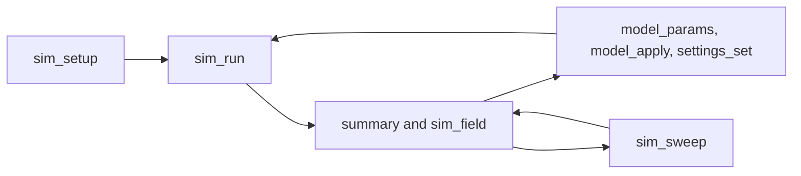

# Plan: in-house stress simulation

Status: plan, for implementation by agents. Written 2026-10-21 against `main` at v3.5.0 (`338aeb5`). No code in this change.

This adds a linear static stress study to a model open in Lime Slice, shows the result in the Model view, and exposes the same study through the MCP so a model can be set up, solved, read, changed with the tools that already exist, and solved again.

Marius's decisions, which the rest of this note follows:

- The first solve is linear statics. The types underneath it are the ones a later nonlinear, contact, buckling, modal, or thermal solve would use. Those later solves are not built here. The hooks they need are.
- The solver is ours. Precision is something we can measure and tighten. There is no certification and no vendor material table.
- The part is a print: layer direction, walls, and infill change the answer. The belt printer's layer direction is the nozzle-plane normal, including on the Ideaformer IR3 V2.
- No GPL. CalculiX, Gmsh, and FreeFEM are out by name. The licence survey is section 8.
- Offline. Desktop first. Every fixture, load, and material value can be typed or set with the mouse. New actions go in menus and the command palette, not on the tool rail, and this plan adds no shortcut.
- The slicer is not touched. Engine G-code stays byte-identical.
- The MCP can do everything the panel can do, in small replies, with an error estimate on every solve so a later call knows whether to trust the number.

## 1. Goal

A person, or an LLM using the MCP, can:

1. Hold a face (or the bed) and put a force or a pressure on another face.
2. Choose a material card, or type the moduli and the strengths.
3. Run a linear static solve of the solid as it would be printed: build direction, wall count, infill.
4. Read, in the Model view and in one MCP reply, the peak von Mises stress and where it is, the peak displacement and where it is, the lowest safety factor and where it is, and the mass.
5. Change the solid with the modeler (a parameter, a feature, a fillet) or change walls and infill with the settings that already exist, and run again.
6. Ask for a short batch of those variants and see which ones meet a deflection, a safety factor, or a mass limit.

The result is labelled **In-house estimate** everywhere it appears. It is not a guarantee that the part will survive.

### The loop

The LLM is the loop. The app does not search by itself.



`model_params`, `model_apply`, `model_probe`, `settings_set`, and `slice_start` stay the tools they are. Print time is the slicer's number, from `pareto` or `gcode_summary`, not a number the stress solver invents. A sweep can ask for that column. It still goes through the existing estimate.

### Non-goals

- No nonlinear material, contact, buckling, modal, or thermal solve in the first milestones. Section 5 says where each one attaches.
- No automatic shape optimizer inside the app. A sweep is a batch the caller lists.
- No new toolbar button and no new shortcut.
- No new `SliceRequest` field, no new G-code comment, no change to a cache key.
- No redistributed filament data sheet. Cards we have not measured are marked provisional.
- No cloud solver, no account, no download of a mesh or a material at run time.
- No second undo stack. The study is project state. The solid's history is untouched.
- No phone layout of its own. The menu item is the same one the desktop uses.

## 2. What this builds on

The Model workspace and the MCP already share a solid, a plate, and a settings recipe. The study is another reader of those. It is not another kernel.

| Piece | Where it lives | What the study uses it for |
|---|---|---|
| Model view | `src/model-view.ts` | A separate three.js group for the coloured, deformed surface. Picking stays on the solid. The section planes in `sectionClip` clip the result too. |
| Face and edge picks | `ModelPick` in `src/model-view.ts` | Fixtures and loads. The same pick the Hole tool uses. |
| Drag arrow and heads-up number | `DragHandle` in `src/model-view.ts`, `src/interact/hud.ts` | Direction and magnitude of a load, with a typed number while the arrow is dragged. |
| Model dock | `#modelDock` in `src/app/markup.ts` | The study panel. Parameters already open this dock from a menu item (`#modelMenuParameters`). Stress does the same. |
| Feature menu | `#modelFeatureMenu` | The menu item. Not a `data-tool` button, so `MODEL_TOOLS` and the drag-handle checklist stay as they are. |
| Commands | `src/ui/commands.ts` | A palette entry with no `keys`. The `?` sheet lists it only if it has a shortcut, and it does not. |
| History | `src/ui/model-history.ts`, `src/model-tree.ts` | Not used. A study is not an op. Undo of a study is the plate undo in `src/app/history.ts`. |
| Parameters | `model_params`, `src/modeling/expr.ts`, project `parameters` | The LLM changes a dimension with these, then solves again. The study does not grow its own expression language. |
| Settings recipe | `src/strategy.ts` `resolved`, object `walls` / `infill`, `src/overrides.ts`, `src/reinforcement.ts` | Wall count, infill fraction, pattern, modifiers, painted reinforcement. Read in TypeScript. The solver receives numbers. |
| Infill patterns | `InfillPattern` in `crates/lime-slice-core/src/strategy.rs` | `lines`, `grid`, `gyroid`, `lightning`. The `strength()` method on that enum is a toughness-blend heuristic (0.40, 0.72, 1.0, 1.35). It is not a modulus. The study does not call it. |
| Filaments | `FilamentRecord` in `src/ui/machine-library.ts` | Density and temperatures only (PLA 1.24, PETG 1.27, ABS 1.04, TPU 1.21 g/cm³). No modulus. Cards do not become fields of this record, because the record is what a slice profile is built from. |
| Belt frame | `crates/lime-slice-core/src/belt.rs`, `src/belt.ts` | Layer direction. IR3 V2 is `ideaformer-ir3-v2`: belt, 45°, firmware axis Z, direction +1, from `defaultBelt`. |
| Project file | `src/project.ts`, version 4 | An optional `sim` on the object, omitted when empty. Version stays 4, the same rule as `thumbnail`. A damaged study is dropped with a sentence and the part still opens. |
| MCP engine | `Engine` in `mcp/engine.ts`, exports in `crates/lime-mcp-engine/src/lib.rs` | New exports beside `pareto` and `calibrate`. Not inside `sliceStart`. |
| Jobs | `crates/lime-slice/src/jobs.rs` | Unchanged. A solve has its own cancel flag. It does not take a slice slot and it does not emit `slice-progress`. |
| Guides | `mcp/guides.ts` | A new `lime://guide/sim` next to `lime://guide/model`. |
| Licence gate | `.github/workflows/ci.yml`, the `mcp` job | `cargo tree` must not show GPL, AGPL, or SSPL. The study crate gets the same gate, plus LGPL. |

The display mesh is a surface tessellation (`lime-solid-2`, chord 0.05 mm, f32 in the view). It is the boundary the mesher sees. It is not the finite-element mesh, and the solve does not rewrite it. Positions are copied to f64 before any element is built.

An STL with no solid can be studied from the plate mesh. A mesh that is not a closed volume is refused in one sentence: "This mesh is open, so it has no interior to mesh."

## 3. Decisions

### D1. A new crate, and it does not link the slicer

`crates/lime-sim` is a workspace member, MIT, Rust 1.88, the same as the rest. It does not depend on `lime-slice-core`, `lime-slice`, or `lime-model-occt`. A test in the crate's `Cargo.toml` graph fails CI if that dependency appears (`cargo metadata`, the `lime-sim` node has none of those names).

The belt normal is six lines of arithmetic, copied into this crate with a comment that points at `Frame::lab` and `mirror_rotate_x`. Sharing the slicer crate to get those six lines would put the G-code crate on the solve path. The IR3 vector is locked by a test (section 6), so the copy cannot drift quietly.

The crate has no HTTP client. Cards are data the caller passes in.

### D2. One study document, three readers

The study is a JSON object, `format: "lime-sim-1"`. The panel, the `.lime` file, and the MCP all read and write that object. The TypeScript types live in `src/sim/`, with no DOM and no import from `mcp/` or `src/app/`, the same rule as `src/modeling/`. The Rust crate is the solver. TypeScript does not implement elements.

A study is project state, like reinforcement. It is not a kernel op, not a history row, and not a `SliceRequest` field. The solid fingerprint is not a function of the study. Changing a fixture does not replay the tree.

The in-memory result is keyed by the hash of the study, the solid fingerprint (or the mesh hash for an STL), and the recipe. A fingerprint change makes the result stale. `sim_run` solves again. It does not return the previous field.

### D3. Units

One unit system, written on the study and in the crate root:

- length in millimetres
- force in newtons
- stress and modulus in MPa, which is N/mm², so `E` in MPa and length in mm need no scale factor
- mass in grams
- density on the card in g/cm³, converted in one function

Gravity, if the user turns it on, is 9810 mm/s². The default is off, so a cantilever test is not carrying self-weight unless the study says so. The panel's gravity checkbox writes that number, and the field shows it.

### D4. Quadratic tetrahedra are the default, from the first solve

Linear tetrahedra (TET4) lock in bending: the element cannot represent the shear, so a beam comes out too stiff. The default element is the 10-node tetrahedron (TET10). TET4 stays in the crate for the patch test and for a regression that must show it stiffer than TET10 on the same beam. The panel does not offer TET4. A study that asks for it is refused with "This study uses quadratic tetrahedra. Linear tetrahedra lock in bending." A crate test can still construct a TET4 mesh directly.

TET10 on an edge length `h` has a node count in the neighbourhood of a TET4 mesh at `h/2`. The cap below exists so a fine TET10 mesh fails with a sentence instead of allocating until the process dies.

### D5. The driver loop is real when there is only one iteration

The first study is one load step and one linear iteration. The function that runs it is still a loop over steps and a loop over iterations. A later nonlinear solve sets `linear: false` and `maxIter` above 1. It does not replace the driver. Section 5 is the body of that loop and the traits it calls.

### D6. Fixed degrees of freedom are removed, not penalised

A fixed face is eliminated from the sparse matrix. The remaining matrix stays symmetric positive definite, which is what the LDLᵀ solver requires. A part that can still rigid-move fails Cholesky, and the reply is "This part is not held. Fix a face, or the bed." Penalty springs and Lagrange multipliers are other implementations of the same constraint trait. v1 does not use them.

### D7. Safety factor is orthotropic

von Mises is reported, with its location. The safety factor the constraint uses is max-stress in the build frame: in-plane tension against the in-plane allowable, and the layer-normal tension against the across-layer allowable. von Mises hides a weak Z. Both numbers are in the summary. The criterion's name is on the reply (`max-stress`), so a later Tsai–Wu number is a different field, not a silent change of meaning.

### D8. A provisional card cannot be "converged"

Until we have measured a polymer, the built-in card is `provisional: true` and the trust level is capped at `rough`. The panel and the MCP say "Provisional card, not a measurement." A constraint that needs a safety factor is not met while the card is provisional. The machinery can ship before the measurements. The measurements are not invented to make the badge green.

### D9. Where the action sits

Stress is a section of the Model dock, opened from:

- **Stress…** in `#modelFeatureMenu`, directly under Parameters. That menu already holds one item that is not a solid tool.
- the command palette, command id `model-stress`, group Model, no `keys`, keywords `stress fem load fixture safety`.

It is not a rail button, not a `ModelTool`, and not a View-flyout toggle. The View flyout (`#modelLookPanel`) is section, colour, and the bed. A study is not a view flag.

No shortcut is added. `src/ui/commands.test.ts` stays a proof that no key runs two commands, because this command has no key.

### D10. Slicer output is a non-change

`crates/lime-slice-core`, the emitter, and `jobs.rs` are not edited by this work. A project with a study and the same project with the study removed produce the same slice body. That is a unit test on the request builder: the `sim` key is absent from the JSON that `slice_start` sends. `mcp/golden.test.ts` and `tools/golden.sh` keep their hashes. An implementation PR that diffs `lime-slice-core` has left this plan.

This document does not bump the version and does not tag. A later milestone that a person can see bumps the version in the usual files when that milestone lands. It still does not tag, and it does not run the release workflow.

## 4. Crate layout

```text
crates/lime-sim/
  src/lib.rs            driver loop
  src/element.rs        Element, Tet10, Tet4 (tests)
  src/material.rs       MaterialModel, LinearOrthotropic, FailureCriterion
  src/assemble.rs       triplets, DofMap, Constraint
  src/solve.rs          LinearSolver, FaerLdlt, EigenSolver stub
  src/mesh.rs           Mesh, structured mesher, Mesher trait
  src/estimate.rs       Estimator, ZZ
  src/fields.rs         sim-result-1
  src/recipe.rs         smear of walls and infill
  src/units.rs
  tests/patch.rs
  tests/cantilever.rs
  tests/kirsch.rs
  tests/lame.rs
  tests/baselines/*.json
src/sim/                 study types, recipe builder, no DOM
mcp/                     sim_setup, sim_run, sim_field, sim_sweep
```

`lime-mcp-engine` gains `simStart`, `simPoll`, and `simCancel`. They call `lime-sim` on a worker that is not the slice worker. One solve at a time. Cancel is checked between the factor and the recovery. The desktop command is `stress_solve` in `src-tauri`, off the UI thread, the same way `model_tree` is. The page talks to that command. It does not link a second copy of the solver in TypeScript.

Progress events are `sim-progress` with stages `mesh`, `assemble`, `factor`, `recover`. They are not slice stages and they do not move the slice button.

## 5. The solver, and how it grows

Five seams are fixed in the first milestone. Everything in the "later" column is a new type that implements a trait the loop already calls. None of it requires a new driver.

### 5.1 Element

```rust
trait Element {
    fn kind(&self) -> ElementKind;
    fn nodes(&self) -> usize;
    fn dofs_per_node(&self) -> usize;
    fn shape(&self, xi: [f64; 3]) -> Shape;       // N and dN/dξ
    fn quadrature(&self) -> &'static [GaussPoint];
    fn contribute(&self, at: &GaussPoint, ctx: &GaussContext, out: &mut ElementOut);
}

struct ElementOut {
    ke: Dense,            // tangent, faer small matrix
    fe: Vec<f64>,         // internal force; K u for a linear step
    me: Option<Dense>,    // consistent mass; filled in v1, solved with later
}
```

`ElementKind` is a serde enum: `tet4`, `tet10`, and later `hex8`, `hex20`, `wedge6`, `wedge15`, `shell-quad`. A mesh stores the kind on each cell, so a mixed mesh is representable before any hex exists. An unknown kind refuses the study with the kind's name. It is not dropped.

`DofMap` is a table from (node, local dof) to a column. v1 has three translations per node. Call sites ask the map. They do not write `node * 3` themselves. A shell, which adds rotations, is a different row width in that table and a new `Element`. The assembler does not change.

| Later element | What is new | What stays |
|---|---|---|
| Hex8, hex20, wedges | Shape functions and a quadrature rule | Assembler, solver, fields |
| Shell | `dofs_per_node` of 6, a drilling treatment written down in the element file | `DofMap`, constraints, the view (the shell surface is already a surface) |
| Hierarchic p | More modes on the same nodes, `p` on the cell | The estimator already carries `p` (2 for TET10) |

TET10 shape functions are the standard quadratic tetrahedron: four corners and six mid-edge nodes. Quadrature is 4 points for the stiffness (exact for the quadratic terms we integrate with a linear material) and a 5-point rule available behind the same method when a nonlinear material needs it. The rule is data on the element, not a constant in the assembler.

### 5.2 Material

```rust
trait MaterialModel {
    fn stress_tangent(
        &self,
        strain: &Strain,
        state: &mut MatState,
        ctx: &MaterialContext,
    ) -> (Stress, Tangent);
}

struct MaterialContext {
    build_axis: [f64; 3],             // unit layer normal, section 6
    temperature_c: Option<f64>,       // None until a thermal step exists
    fibre_axis: Option<[f64; 3]>,     // None in v1; a wall-tangent later
    volume_fraction: f64,             // 1 in a wall, the smear in the core
}
```

v1 implements `LinearOrthotropic`. The tangent `C` is constant, in the build frame, and rotated into the element. `LinearIsotropic` is that model with the three moduli equal. A nonlinear model implements the same method and returns a tangent that depends on `state` (plastic strain, damage). The Newton loop already calls `stress_tangent` and assembles `ke` from it.

Failure is a second trait, so a criterion can change without a new stress model:

```rust
trait FailureCriterion {
    fn safety(&self, stress: &Stress, allow: &Allowables, ctx: &MaterialContext) -> f64;
}
```

v1 is `MaxStress` in the build frame. von Mises is a field, computed beside it, not the criterion.

| Later material | What is new | What stays |
|---|---|---|
| Plasticity, damage, hyperelasticity | A `MaterialModel` and the fields it writes (`plastic-strain`, …) | The iteration loop, with `maxIter` raised |
| Tsai–Wu, puck, a printed-interlayer criterion | A `FailureCriterion` | Stress recovery |
| A local wall direction | `fibre_axis` filled from the perimeter tangent | `MaterialContext` already has the slot |
| Thermal strain | `temperature_c` set, and `stress_tangent` subtracts `α ΔT` | The mechanical step is the next load step, not a new program |

### 5.3 Assembly and solvers

```rust
trait Assembler {
    fn assemble(&self, mesh: &Mesh, material: &dyn MaterialModel, u: &Dofs, constraints: &[ConstraintBox]) -> System;
}

struct System {
    k: Triplets,          // i, j, value, f64. No faer type in this struct.
    residual: Vec<f64>,
    dof: DofMap,
}

trait LinearSolver {
    fn factor(&mut self, k: &Csc) -> Result<(), SolveFailure>;
    fn solve(&self, b: &[f64], x: &mut [f64]) -> Result<(), SolveFailure>;
}

trait EigenSolver {
    fn smallest(&self, k: &Csc, m: &Csc, n: usize) -> Result<EigenPairs, NotInThisVersion>;
}

trait Constraint {
    fn kind(&self) -> ConstraintKind; // fixed, prescribed, later tie, contact
    fn apply(&self, dof: &DofMap, system: &mut System);
}
```

The triplets are the boundary. `FaerLdlt` converts them to faer's column matrix, runs AMD, and factorises simplicial LDLᵀ. A different solver implements `LinearSolver` and is chosen by `Study::solver`, which v1 only accepts as `faer-ldlt`.

`EigenSolver` is a real trait with one implementation that returns `NotInThisVersion { analysis: "modal" }`. The MCP maps that to a refusal, "Modal analysis is not in this version." The method exists so a buckling or modal milestone does not add the trait later and thread it through every call.

| Later solver need | What is new | What stays |
|---|---|---|
| Contact, finite strain, a non-symmetric tangent | `FaerLu` as another `LinearSolver`. The driver asks the step whether the matrix is symmetric and picks the solver. | Triplets, assembler |
| Large models | CG or GMRES behind `LinearSolver`, plus a `Preconditioner` the iterative solver holds | The SPD Cholesky stays the default under a few hundred thousand dofs |
| Buckling | A `PostStep` that builds geometric stiffness from the stress we already store at Gauss points, then `EigenSolver` | The linear solve is the preload |
| Modal | `AnalysisKind::Modal` skips the load and calls `EigenSolver` on `K` and `M`. `ElementOut.me` is already filled. | Mesh, material, fixtures |

### 5.4 Load steps

```rust
fn solve(study: &Study) -> Result<Solution, SimError> {
    let mut state = State::start(study);
    for step in &study.steps {                 // v1: one step, factor 1
        for _ in 0..step.max_iter {            // v1: 1
            let system = assemble(&state);
            let du = factor_and_solve(&system)?;
            state.add(du);
            if study.linear || state.residual() < step.tol { break; }
        }
        for hook in &study.post_steps {        // v1: empty
            hook.after(&mut state)?;
        }
    }
    recover(&state)
}
```

A v1 study serialises `"linear": true`, `"steps": [{ "factor": 1.0, "maxIter": 1 }]`. The loops are not comments. A test runs the driver on a one-step study and on a hand-built two-step study whose second factor is 0, and checks that the second step does not move the displacement. That is the regression that the loop is alive.

| Later analysis | How it uses the loop |
|---|---|
| Nonlinear material | `linear: false`, `maxIter` 15, same assemble. The residual is `f_ext − f_int`. |
| Contact | A `Constraint` whose active set changes inside the iteration. The step marks the matrix unsymmetric when the active set needs it. |
| Arc-length, or a preload then a live load | More entries in `steps`. |
| Thermal then stress | Step 0 is a scalar thermal element (`dofs_per_node` 1, same `contribute` shape). Step 1 is mechanical, with `temperature_c` taken from step 0. |
| Buckling | The linear step, then a `PostStep`. |

### 5.5 Result fields

A solution is a list of fields, not a hard-coded von Mises blob. Format `sim-result-1`:

```json
{
  "format": "sim-result-1",
  "label": "In-house estimate",
  "fields": [
    { "name": "displacement", "location": "node", "rank": "vector", "unit": "mm" },
    { "name": "von_mises", "location": "node", "rank": "scalar", "unit": "MPa" },
    { "name": "stress", "location": "gauss", "rank": "tensor", "unit": "MPa" },
    { "name": "safety_factor", "location": "node", "rank": "scalar", "unit": "1" },
    { "name": "element_error", "location": "element", "rank": "scalar", "unit": "1" }
  ]
}
```

The value arrays are not in the MCP summary and not in the `.lime` file. The file keeps the study. A result is recomputed. Recovery from Gauss points to nodes is one function (`Recovery`), v1 an average of the elements around the node. A later superconvergent patch recovery replaces that function. The field list does not change shape.

The viewport colours any nodal scalar whose name it is given. A field added in a later milestone appears in the colour menu without a change to the mesh drawing, as long as it is a nodal scalar. Contact pressure, temperature, a buckling mode, and a plastic strain are that kind of field.

The summary, which is the small object `sim_run` returns, is in section 10.

### 5.6 What v1 deliberately leaves unimplemented

The trait or the loop arm exists. The behaviour does not.

- `EigenSolver::smallest` returns `NotInThisVersion`.
- `post_steps` is an empty vec the deserializer accepts.
- `temperature_c` and `fibre_axis` are `None`. A study that sets them is refused with "Temperature is not in this version." rather than ignored.
- `solver` other than `faer-ldlt` is refused the same way.
- `representation` other than `smear` is refused ("A bead-by-bead model is not in this version.").

Refusing is the point. A silent ignore would let an LLM believe a thermal study had run.

## 6. Print-aware model

### 6.1 Build direction

The weak axis is the normal to the layers, not "machine Z" and not the firmware axis that advances a belt.

- **Cartesian.** After the part's `orient` (and after Print with W up, which writes that orient), the layer normal is bed +Z, expressed in the part frame the picks use.
- **Belt.** `mirror_rotate_x` in `belt.rs` takes a design point to the slice frame, where slice +Z stacks the layers. `Frame::lab` maps slice back to the lab. A unit slice-Z lands on `(0, −sin α, cos α)` in the lab. At 45° that is `(0, −√2/2, √2/2)`. The layers stack toward low Y and up. The firmware belt axis on the IR3 is Z, and the belt carries the part toward +Y (`docs/belt-slicing.md`). That direction is 45° away from the layer normal. Using it as the weak axis would rotate the material by 45°.

A unit test in `lime-sim` asserts the IR3 vector `(0, -0.7071067811865476, 0.7071067811865476)` within `1e-12`, for `angleDeg: 45`, `axis: "z"`, `direction: 1`. Copies and the gap move whole parts along the belt. They do not change this vector. The study is of one object.

The panel's "This printer" reads the selected printer, including a belt block, and writes `buildAxis`. A typed vector writes the same field. Both are unit-checked. A zero vector is refused.

### 6.2 Walls and infill

The solver never plans a bead. TypeScript builds a `Recipe` from the numbers the slice would already have used, and the crate smears that recipe into an orthotropic continuum.

The recipe is resolved in `src/sim/recipe.ts` by calling the functions the app already has:

- `resolved` in `src/strategy.ts` for the blend of toughness into `walls`, `pattern`, and `density`
- the object's `walls` and `infill` when they are set (`src/overrides.ts`)
- a height range or a modifier volume on the fields it sets
- reinforcement, which raises infill inside its region and does not lower it (`docs/reinforcement.md`)

Line width and layer height are the same numbers the slice request carries. Top and bottom skins are not a user "top layers" count. The app has no such setting. Roofs and floors are the faces whose outward normal is within 45° of the build axis, given a solid skin of three layer heights in v1, and the side skin is `walls * lineWidth` measured inward. Three layers is a stand-in, written on the recipe as `skinLayers: 3`, so a later reading of the real skin bands replaces the constant without a new schema. The summary repeats the number it used.

Inside the core, the infill fraction scales the in-plane modulus. The across-layer modulus scales by the same fraction and stays the weak one. A part at 100% infill is still layered: the across-layer allowable does not become the in-plane allowable. Only a card the user marks isotropic (`E` equal, and `isotropic: true`) drops the distinction, and the summary says it did.

Pattern factors are ours, stored on the recipe, and they start as 1.0 for grid, with the others marked `unmeasured`. An unmeasured pattern does not invent a stiffness. It uses the grid factor and adds a trust note: "Gyroid infill is modelled as a grid of the same density. The factor has not been measured." Lightning is the same, plus a stronger note, because a tree of struts is a poor smear. Those notes cap trust at `usable` even after the mesh has converged, and at `rough` while the card is also provisional.

`InfillPattern::strength` is not read.

A later bead-resolved model is `representation: "voxel"`. The local `volume_fraction` on `MaterialContext` is the seam: a smear writes a constant per region, a voxel writes a sample. v1 accepts `smear` only.

### 6.3 Material cards

A card is not a filament.

```json
{
  "id": "inhouse-petg",
  "polymer": "PETG",
  "provisional": true,
  "EInPlaneMPa": 1800,
  "EAcrossLayersMPa": 1500,
  "nu": 0.35,
  "strengthInPlaneMPa": 30,
  "strengthAcrossLayersMPa": 15,
  "densityGCm3": 1.27,
  "measuredAtC": null,
  "specimen": "not measured",
  "method": null,
  "source": "in-house"
}
```

The numbers on a provisional card are order-of-magnitude placeholders so the units can be tested. They are not a data sheet. The trust cap in D8 is what stops them being used as a result. PLA, PETG, ABS, and TPU each get one provisional card, named `inhouse-pla` and so on, matching the polymers we already ship. No other polymer is invented. Density may match the filament record. The modulus may not be copied from a vendor, a paper, or PrusaSlicer.

When a bar is measured, the card loses `provisional`, gains `measuredAtC`, the specimen (print orientation, walls, infill, layer height), the method, and a date. The study stores a snapshot of the card it used. Editing the library afterwards does not change an open result until the user runs again, and the run says the card changed.

Cards live in an optional `materialCards` array beside the filaments in the machine library. The library version stays 3. The reader keeps the array. A 3.5.0 build that round-trips the library drops unknown keys, because `readPrinterBody` rebuilds the record. The snapshot on the study is the copy that matters. A `.lime` from this work still opens in 3.5.0: `sim` is an extra key the old reader ignores, and the part comes back. Saving from 3.5.0 drops the study. That is the same trade the thumbnail rule already accepts, and it is why the project version stays 4.

The panel lists the cards (a click fills the fields) and the fields are editable. Typing a modulus marks the study's snapshot as a custom card and does not write back to the library unless the user picks "Save card". Saving a card is the mouse path. The typed path is the numbers.

### 6.4 Mass

Printed mass is the smeared volume times the card density, in grams. Solid mass is the CAD volume times the same density, reported next to it so a hollow part does not look as heavy as the STEP file. If the caller has a slice, `slicerGrams` may be copied from `gcode_summary` into the reply and labelled "Slicer estimate". The solver does not write `FILAMENT_G` and does not call `withFooterGrams`.

## 7. Verification and validation

Targets are formulas we write down in the test, derived from beam theory, Kirsch, and Lamé. No NAFEMS handbook text, figure, or table is copied into the repo. A case whose only published target sits in a paid NAFEMS PDF is not used. The three textbook cases below are the same family those benchmarks use (a beam, a hole, a pressurised cylinder). The test name may say the family. It cites the formula in our words.

Every solve is f64. A baseline is a JSON row with a relative tolerance, not a hash of the floats. Updating a row is a reviewed change to the test.

### 7.1 Patch test

One distorted TET4 and one distorted TET10, a linear displacement field imposed on the boundary, constant stress inside. The stress matches the analytic value to a relative `1e-9`. This lands before the beam. A solver that fails it does not get a cantilever baseline.

### 7.2 Cantilever

Length `L`, rectangular section `b × h`, end load `P`, fixed at the root.

- Tip deflection `δ = P L³ / (3 E I) + (6/5) P L / (A G)`, with `I = b h³ / 12` and `G = E / (2 (1 + ν))` for the isotropic card this test uses.
- Root bending stress `σ = P L (h / 2) / I`.

Three structured meshes, edge length `h`, `h/2`, `h/4`. TET10's tip error falls. The observed order on the last pair is recorded in the baseline. TET4 on a mesh with a similar node count is stiffer, and the test asserts its tip error is larger than the TET10 error. That is the locking regression, and it is why TET10 is the default in D4.

The structured mesher builds this beam by splitting each brick of a regular grid into six tetrahedra. No CAD kernel and no OCCT.

### 7.3 Plate with a hole

A finite plate, width at least ten hole diameters, remote uniaxial tension `σ`, plane stress. For an infinite plate Kirsch's hoop stress is

`σ_θ = (σ / 2) (1 + a² / r²) − (σ / 2) (1 + 3 a⁴ / r⁴) cos 2θ`

with `θ` measured from the load axis. At the flank (`r = a`, `θ = π / 2`) that is `3σ`, so `Kt = 3`. A finite plate sits a little above 3. The test writes that gap down and checks the flank stress over `σ` against 3, tightening as the edge length at the hole is halved twice. This is also the first adaptive case, once the estimator exists: the elements at the hole are the ones the estimator marks.

### 7.4 Thick cylinder

Lamé's solution for a long cylinder, inner radius `a`, outer radius `b`, internal pressure `p`, open ends (no axial force from the pressure):

`σ_r(r) = (a² p) / (b² − a²) · (1 − b² / r²)`

`σ_θ(r) = (a² p) / (b² − a²) · (1 + b² / r²)`

At the inner surface `σ_r = −p` and `σ_θ = p (a² + b²) / (b² − a²)`. The mesh is a wedge of the cylinder with symmetry constraints (the `prescribed` and `fixed` kinds, already on the constraint trait, with a normal direction). A coarse mesh should already be close, because the field is smooth in the angle. That makes it a check that we are not only accurate on beams.

### 7.5 Estimator

Zienkiewicz–Zhu: recover a smoothed stress, compare it with the raw Gauss stress, and integrate the energy of the difference. The global number is `relativeEnergyError`. Each element writes `element_error`. v1 reports both and does not remesh yet. The trait is:

```rust
trait Estimator {
    fn element_error(&self, solution: &Solution) -> Vec<f64>;
    fn relative(&self, element_error: &[f64]) -> f64;
}
```

A later goal-oriented estimator is another implementation. The summary already has a place for the number.

### 7.6 Adaptive refinement

`Mesher::refine(&self, mesh: &Mesh, size: &SizeField) -> Mesh` is on the trait in the first mesher milestone. The structured mesher's `refine` halves every edge (uniform h). That is enough to automate the cantilever table.

Local refinement waits for the boundary-constrained mesher (section 8). The size field is `h_new = h * (error / target)^(-1/p)` with `p = 2` for TET10, a floor so an element cannot shrink without limit, at most three passes, and a stop when the global error is under the target or the node cap is hit. The node cap is 200_000 nodes. Over the cap, the solve refuses: "This mesh has N nodes. Raise the edge length, or the cap." The cap is one constant.

### 7.7 Trust

One function maps the solve onto a word. The thresholds are a starting point, in that function, not scattered.

| Level | When |
|---|---|
| `rough` | Provisional card, or TET4, or relative energy error above 0.15, or the rigid-body check failed, or the estimator did not run |
| `usable` | Error from 0.05 to 0.15, card not provisional. An unmeasured infill pattern cannot rise above this. |
| `converged` | Error at or under 0.05, TET10 or higher, card not provisional, pattern factor measured or the part has no infill core, estimator ran |

A constraint is met only when the number is inside the limit and the level is `usable` or `converged`. A `rough` pass is `met: false` with the reason "The error estimate is 22%, which is only a rough result." The LLM is not told it succeeded.

### 7.8 CI

- `cargo test -p lime-sim` in the existing `rust` job. No OCCT. A typical debug run of the patch test and the coarsest beam is the acceptance bar for "the job stays tolerable". The `h/4` beam is `#[ignore]`d behind `LIME_SIM_FINE=1` so a pull request does not grow a multi-minute factorisation. The baseline for `h/4` is still in the file, updated when someone runs the fine set on purpose.
- Licence grep, next to the MCP one: `cargo tree -p lime-sim -e normal` fails on GPL, AGPL, SSPL, or LGPL.
- The graph test from D1.
- The slice-body test from D10, in the MCP suite, so a study cannot leak into `slice_start`.
- Golden hashes are not regenerated for this work. If a later PR claims it must, it has changed the slicer.

## 8. Licensing

Checked in October 2026 against the project pages and crates.io. The rule in this repo is the one `docs/mcp-server.md` and `docs/app-enhancements-study.md` already use: new Rust dependencies are MIT or Apache-2.0, GPL-family is rejected by CI, and LGPL is only the OCCT shared library we already load. This work adds no second LGPL library.

### 8.1 Linear algebra

| Candidate | Version seen | Licence | Verdict |
|---|---|---|---|
| faer | 0.24.4 (2026-06-24), MSRV 1.84 | MIT. Pure Rust. Sparse simplicial LDLᵀ and LLᵀ, AMD ordering, f64. | **Use this.** Element matrices and the global factorisation both go through it. |
| sprs | 0.11.6 (2026-10-13), MSRV 1.88 | MIT OR Apache-2.0 | Not added. faer already holds the sparse matrix. |
| sprs-ldl | 0.10.0 | LGPL-2.1. sprs's own README says the Cholesky feature opts into that licence. | Out. Do not enable the feature. |
| nalgebra, nalgebra-sparse | nalgebra-sparse 0.12.0 (2026-05-24) | Apache-2.0 | Licence-ok, and redundant once faer is linked. Not added. |
| SuiteSparse, CHOLMOD, UMFPACK | — | CHOLMOD is LGPL. UMFPACK's historical terms are GPL for the non-commercial build. | Out. |
| Eigen | — | MPL-2.0, file copyleft | Out. Not needed. |
| MKL, Pardiso | — | Proprietary | Out. |

faer's MIT text is the crate's `license` field. The implementation PR pins the version in `Cargo.lock` and re-runs the licence grep. A newer faer that grew an optional SuiteSparse feature stays off that feature.

### 8.2 Meshing

A production tet mesher that recovers an arbitrary CAD boundary is the long pole. The verification meshes do not need one: the structured brick-to-six-tets splitter is a few dozen lines of ours, and it builds the beam, the plate, and the cylinder wedge.

For a real STEP or STL solid, the recommendation is to write a boundary-constrained Delaunay in `lime-sim`, behind the `Mesher` trait, and not to vendor a mesher. Predicates are adaptive-precision arithmetic we write. Shewchuk's predicates are public domain and may be used as the reference for the cases. Triangle itself is not vendored: its licence is not MIT.

| Candidate | Licence | Why it is out |
|---|---|---|
| Gmsh | GPL-2.0-or-later | Named out. GPL. |
| CalculiX | GPL-2.0 | Named out. Also a solver, not a mesher, and the same answer. |
| FreeFEM | LGPL-3.0-or-later | Named out. LGPL-3 is stricter than the OCCT exception, and we would be linking a framework rather than a solver we can test. |
| TetGen 1.5+ | AGPL-3.0 | AGPL. The older 1.4.3 terms are non-commercial. Neither is acceptable. |
| Triangle | Non-commercial custom licence | Out. |
| Netgen | LGPL-2.1 | Would be a second `dlopen` exception. Not taken. The structured mesher and our own Delaunay are the plan instead. |
| MMG | LGPL-3.0-or-later | Out. |
| fTetWild | MPL-2.0 | File copyleft, and the algorithm envelopes the surface instead of conforming to it. A thin wall can disappear into the envelope. |
| Geogram | BSD-3 on the core | The distribution bundles LGPL (LM6) and can be built with AGPL TetGen. We do not vendor the tree. |
| CGAL mesh generation | GPL-3.0, or a commercial licence | Out. |
| libigl | MPL-2.0 | Its tet path wraps TetGen. Out. |
| MFEM | BSD-3-Clause, LLNL-CODE-806117 | Licence-ok as a library. Not used. It is a large C++ stack, its optional METIS is non-commercial, and it knows nothing of a print. It is a useful reference for how an element space is shaped. It is not a dependency. |
| deal.II | LGPL-2.1 | Out. |
| tpt-fem-mesh-gen 0.1.0 | MIT OR Apache-2.0 | Convex-hull Delaunay and a box splitter, f64 predicates, no dependents worth following. The box splitter is the idea we implement ourselves. We do not depend on the crate. |
| rapidmesh | GitHub metadata says MIT. The README says "Proprietary. All rights reserved." | Out until that contradiction is gone, and not needed. |

### 8.3 Recommendation

Link **faer**, pin it, and keep every other new line in `lime-sim` and `src/sim/` written here. The first meshes are structured. The CAD mesher is ours, later, behind `Mesher`, so the solver, the MCP, and the panel do not change when it arrives. Do not `dlopen` Netgen "just for the first solids." That would be a licence decision slipped into a milestone, and the solids the first milestones solve do not need it.

## 9. Desktop

### 9.1 Panel

The dock section has three groups. Each value is a number field. Each geometric choice is also a pick or a drag.

**Hold.** A list of fixtures. "Bed" fixes every face that lies on Z = 0 within 0.05 mm. "Faces" uses the current face picks and lists the count ("2 faces fixed"). A typed face index adds the same entry. A fixture with no face and no bed is the rigid-body refusal from D6.

**Load.** A force (newtons) or a pressure (MPa) on picked faces. The arrow on the face is a `DragHandle` of kind `axis`, seated on the pick, the same idea as push/pull's in-place arrow. Dragging it sets the direction. The heads-up field (`src/interact/hud.ts`) edits the magnitude while the drag is live, and the dock field shows the same number. Typing in the dock moves the arrow. Gravity is the checkbox in D3, off by default.

**Material.** The card list, the moduli, the strengths, and "This printer" or a typed build direction (section 6). "Save card" writes the library. A provisional card shows the sentence from D8 in the section, not only in the result.

Apply is not the modeler's Apply. The study does not edit the solid. The button is **Run**. Cancel drops the solve and leaves the previous result, or nothing. Esc closes the section the way it closes a tool panel.

The study is included in the plate snapshot `src/app/history.ts` already takes, once `sim` is a field of the object. Undo of a fixture is that undo. Undo of a fillet stays the history undo. They do not share a stack, and a sentence in the section says "Undo puts the last hold or load back. The solid's history is the History list."

### 9.2 The view

`src/model-view.ts` gains a group beside `ghosts`, not inside the pick mesh.

- The surface of the volume mesh, vertices moved by `u * scale`.
- Vertex colours for the active nodal scalar. The menu is von Mises, displacement magnitude, and safety factor, plus any other nodal scalar on the result.
- Scale defaults so the peak displacement is about 5% of the part's diagonal, which is the only way a stiff part shows a shape. "True scale" sets the factor to 1. The factor is also a number field.
- A legend: the colour ramp, the unit, the peak, the trust word, and the words **In-house estimate**. The words stay when the legend is the only thing on screen.
- A click probes the nearest surface node and writes the value next to the point, the way Measure writes a distance. Typed X Y Z in the section calls the same probe.
- The existing section planes clip this group.
- Closing the section hides the group. The solid's colour, the picks, and the tessellation the slicer uses are unchanged.

A canned result (a beam with a known displacement field) is what the Playwright spec draws, so the screenshot and the click do not wait on a factorisation. The spec checks the menu path, a typed force landing in the field, the legend text, and a probe readout. The real factorisation is the Rust tests and one MCP test that solves the generated beam with no OCCT.

### 9.3 What the user sees when it is too coarse

The trust word is on the legend. `rough` is a full sentence under it, the same sentence `sim_run` returns. We do not draw a green part over a provisional card.

## 10. MCP

Four tools, in `mcp/schema.ts`, handled next to the model tools, described in `lime://guide/sim`. Replies are small. `model_describe` already pages faces at 100 a page and `mesh_stats` refuses to return coordinates. The same economy applies here. A refusal is one sentence, the way `model_probe` refuses.

The guide's worked sequence is: open the part, `sim_setup`, `sim_run`, read the trust, `model_params` or `settings_set`, `sim_run` again, then `sim_sweep` if the next step is a batch. Print time, when wanted, is `slice_start` and `gcode_summary` on the variant the user keeps.

### 10.1 `sim_setup`

Writes the study on the object. The fields are the panel's fields: fixtures (bed, or face indexes, or a typed plane), loads (face indexes, force or pressure, direction), card id or an inline card, build axis or `printer: true`, edge length, and the element (only `tet10` is accepted). Returns the study and one sentence ("Held 1 face, 10 N on face 3, provisional PETG."). Does not solve. A value the panel would refuse is refused here, in the same words.

### 10.2 `sim_run`

Solves the current study. Returns:

| Field | Meaning |
|---|---|
| `label` | `"In-house estimate"` |
| `maxVonMisesMPa`, `maxVonMisesAt` | Peak, and the point in the part frame, millimetres |
| `maxDisplacementMm`, `maxDisplacementAt` | Peak magnitude and where |
| `minSafetyFactor`, `minSafetyAt`, `criterion` | `max-stress` in v1 |
| `massG`, `solidMassG` | Printed and solid, section 6.4 |
| `slicerGrams` | Only if the caller passed `includeSlicerMass: true` and a slice exists |
| `trust` | `level`, `relativeEnergyError`, `residual`, `element`, `hMm`, `nodes`, `dofs`, `notes` |
| `stale` | False when this reply matches the current fingerprint |

No node array, no triangles, no stiffness matrix. Residual is the relative `‖Ku − f‖ / ‖f‖` after the solve, so a caller can see a factorisation that "succeeded" on a bad matrix.

### 10.3 `sim_field`

One field name, and one of: a list of points, a box, a face index, or a stride over nodes. `limit` and `cursor` match `model_describe` (1 to 100). Each row is a location and a value. A face index returns the nodes of that face on the volume-mesh surface, paged. An unknown field name lists the names the result actually has, in the refusal.

### 10.4 `sim_sweep`

Up to 16 variants. Each variant is a patch on a copy of the current study and the current solid:

- `parameters`: names that already exist, applied with the same evaluation as `model_params`
- `walls`, `infill`, `pattern`: the object settings `settings_set` already accepts
- `loadScale`

`commit` defaults to false. The history cursor, the saved study, and the plate do not move. `commit: true` applies one chosen variant through `model_params` and `settings_set`, so it is one undo. The reply is one `sim_run` summary per variant, plus `met` and a reason per constraint. Constraints are `maxDeflectionMm`, `minSafetyFactor`, `maxMassG`, `minMassG`. A `rough` row is not met (section 7.7).

`includePrintTime: true` adds `slicerSeconds` from the existing estimate (`pareto`, or a slice if the caller sets `slice: true`). The column is labelled as the slicer's estimate. Sixteen slices is the expensive path, and the tool description says so. The sweep does not invent a time.

Over 16 variants is refused: "A sweep takes up to 16 variants."

### 10.5 Parity

| Panel | MCP |
|---|---|
| Bed, picked faces, typed face index | `sim_setup` fixtures |
| Force or pressure, arrow or typed numbers | `sim_setup` loads |
| Card list, typed moduli, save card | `sim_setup` card, and the library field the next `sim_setup` can name |
| This printer, or a typed axis | `buildAxis` or `printer: true` |
| Edge length | `hMm` |
| Run, Cancel | `sim_run`, `simCancel` |
| Legend peaks, trust, mass | `sim_run` |
| Probe, colour menu | `sim_field` |
| Variant table in the same dock section | `sim_sweep` |

The variant table is part of the dock section, not a second tool. A person can run the batch the LLM runs. There is still no optimizer: the table is the list the person typed.

The bridge already mirrors the plate. Once `sim` is on the object, the snapshot carries it. No second socket. The headless session is correct with the app closed, as model edits are.

### 10.6 What an LLM should do with trust

The guide says this in one paragraph, so it is not left to the tool description to imply:

A `rough` result is a reason to refine `hMm` or to stop using a provisional card. It is not a reason to change the solid. A `usable` result can reject a variant that fails by a wide margin. A `converged` result is the one to keep. None of the three is a promise that the printed part will hold the load.

## 11. Milestones

Each milestone is one PR. It does not tag, and it does not run `workflow_dispatch`. The release workflow stays on tag pushes and manual runs, neither of which these PRs do.

### S0. Crate, traits, TET10, one real loop

- Scope: section 4 and section 5, with TET10 and the test-only TET4. Faer LDLᵀ. Structured beam mesher. The `Mesher` trait includes `refine`, implemented here as a uniform split of that grid, not yet driven by the estimator. Driver loop. Patch test. No UI and no MCP.
- Accept when: the patch test passes to `1e-9`. A one-step cantilever runs. A two-step study with a zero second factor does not move the tip. `refine` returns a mesh with half the edge length. `EigenSolver` and a thermal key refuse with the sentences in section 5.6. The licence grep is clean. `lime-sim` does not depend on the slicer crates. `lime-slice-core` has an empty diff.

### S1. Verification baselines

- Scope: section 7.2, 7.3, 7.4, and the ZZ estimator reporting a number. Baselines checked in. TET4 locking regression.
- Accept when: the coarse and mid cantilever rows match their tolerances. TET4's tip error is worse than TET10's. The hole's concentration moves toward 3 as the local edge length is halved. The cylinder matches Lamé at the inner radius on the coarsest listed wedge. The fine `h/4` test is ignored unless `LIME_SIM_FINE=1`. The estimator returns a finite `relativeEnergyError` on the beam.

### S2. Print recipe, cards, belt axis

- Scope: section 6. Recipe builder in `src/sim/recipe.ts`. Provisional cards. Mass. No viewport yet.
- Accept when: a box with more walls deflects less than the same box with fewer, on the same mesh and the same card. Turning the build axis from Z to X changes the deflection of a bending load. The IR3 vector matches section 6.1. A 100% infill part still uses the across-layer allowable. `InfillPattern::strength` is not referenced from `lime-sim` or `src/sim`. A provisional card forces `rough`. Lightning adds the trust note. The slice-body test shows `sim` is not sent.

### S3. Desktop

- Scope: section 9. Menu item, palette entry, dock section, arrow plus typed loads, coloured deformed surface, probe, legend.
- Accept when: no new entry in `MODEL_TOOLS`, no new key in `COMMANDS`. Playwright opens Stress… from the menu, types a force, and sees "In-house estimate" on a canned result. A click reports a value. The section plane hides the cut half of the result. Undo restores a fixture and does not add a history row. A project with a study slices to the same request as without. Golden hashes are unchanged.

### S4. MCP

- Scope: section 10, including the variant table in the dock so the panel can do what `sim_sweep` does.
- Accept when: the guide's sequence runs against the generated beam with no OCCT. `sim_run` has the summary fields and no triangles. `sim_field` pages at 100. A 17th variant is refused. A `rough` constraint is `met: false`. `commit: false` leaves the history cursor where it was. `printer: true` on an IR3 profile writes the section 6.1 axis. The bridge snapshot of a plate with a study contains `sim`, and a slice of that plate does not.

### S5. Adaptive path and the measured-card slot

- Scope: `Mesher::refine` on the structured mesher, three uniform passes driven by the estimator, wired so `sim_run` can take `adapt: true` and return the error after the last pass. The local CAD mesher is not this milestone. It is the open question in section 12.
- Accept when: `adapt: true` on the cantilever reduces `relativeEnergyError` against the single-pass mesh, or stops on the node cap with the sentence. The colour menu still works. A card with `provisional: false` and a measured specimen can reach `converged` on that beam. No slicer diff.

## 12. Risks and open questions

Risks we are already choosing a side on:

- **The CAD mesher is the long pole.** S0 through S5 solve generated meshes and, for the panel, a canned or generated result. A dragon STL does not get a trustworthy volume mesh in these milestones. Shipping the menu before the mesher exists is acceptable only because a mesh that cannot be built refuses with a sentence, and the verification suite does not need it. Starting Netgen or Gmsh to close that gap is the outcome section 8 says not to take.
- **TET10 is heavier than TET4.** That cost is accepted. The node cap and the `rough` word are the safety valve, not a fallback to linear tets.
- **A smear is not a gyroid.** Unmeasured patterns stay below `converged`. The risk is a user treating `usable` as a design sign-off. The label and the guide are the mitigation, not a finer smear.
- **Provisional numbers look like data.** D8 caps them. The risk is a later PR "filling in" moduli from a blog. Section 6.3 forbids that. A measured card names the specimen.
- **Two undos.** Plate undo for the study, history undo for the solid. The section states it. The risk is a fixture that seems to vanish inside a fillet undo. They are different gestures, and the tests in S3 keep them apart.
- **faer changes its sparse API.** We pin the version. The solver trait is the seam if we ever wrap a different MIT factorisation.
- **Self-weight unit bug.** 9.81 in a millimetre model is a 1000× error. Gravity defaults off, and the field shows 9810 when it is on.

Open, for Marius:

1. **Provisional cards in the menu.** This plan ships them, capped at `rough`, so the panel can be tried. The alternative is to hide Run until a measured card exists. The recommendation is to ship them visibly marked, not to hide the tool.
2. **The safety-factor constraint.** This plan binds `minSafetyFactor` to max-stress in the build frame, and still reports von Mises. If the number an LLM optimises should be von Mises instead, that is a one-line change to which field the constraint reads. It should be explicit before S4.
3. **Sweeps that slice.** `includePrintTime` can run sixteen estimates. The default is off. Confirm that a sweep may call `pareto` at all, or that print time stays a separate `slice_start` the LLM does itself.
4. **Local adaptivity's mesher.** S5 only refines the structured grid. The boundary-constrained Delaunay is a project of its own after these milestones. Confirm that it stays in-house, and that a slipped date does not add Netgen.
5. **Prepare.** This plan edits and draws the study in Model only. Prepare keeps the solid it slices today. A one-line "In-house estimate" on the object card in Prepare, deep-linking to Model, is as far as a second surface should go. Two editors would drift.
6. **The estimate sentence.** "In-house estimate" is the label. If the legal line needs to be longer ("not a certification, not a warranty"), the legend and `label` should carry the same string. One string, in `src/sim/label.ts`, used by the view and the MCP.
