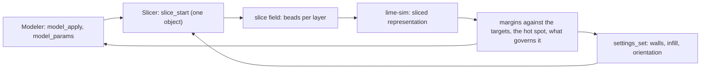

# Plan: solving the part as it is sliced

Status: design, for implementation by agents. Written 2026-10-21 against `dev/stress-sim` at `509daeb`. It extends
`docs/plan-stress-simulation.md` and replaces nothing in it. No code in this change.

## 1. The idea

The study should be able to solve **the part the slicer produced**, not only the solid the modeler holds. Then the
loop that matters can run end to end:



The caller, a person or an LLM, changes the model or the print settings. The slicer re-slices. `lime-sim` solves the
beads it will print and says how far each target is: "safety factor 1.62 against 2.0, 81% of the target, governed by
tension across layers at layer 112 in the outer wall, nearest model face 7". The next change is aimed by that sentence.

## 2. Why this also solves the plan's long pole

`plan-stress-simulation.md` §12 calls the CAD tet mesher "the long pole". Until it exists, nothing but generated shapes
can be solved. The sliced path doesn't need it:

- **The slicer already produces a robust volume of every part it can print.** It works on STEP and on STL, including
  the STLs it repairs. Each layer's beads are inside the part by construction. A layer-aligned grid filled from those
  beads is a valid finite-element mesh with no boundary recovery, no Delaunay and no predicates.
- **The material comes from the real beads.** Walls, the actual infill pattern and density, gap fill, bridges, height
  ranges, modifier volumes, painted reinforcement, variable-width walls: all of these are already in the paths.
  SR-02's "regions are dropped" problem and the "unmeasured pattern factor" note go away for this representation,
  because nothing is smeared from settings.
- **The plan already reserved the slot.** §6.2 says a later bead-resolved model is `representation: "voxel"`, and
  `MaterialContext` has `volume_fraction` and `fibre_axis` for exactly this. This design names it `"sliced"` and fills
  those slots.

The smear (`representation: "smear"`) stays for the generated verification shapes and for a fast early look before
any slice exists. The CAD mesher becomes optional: a later improvement for a smooth boundary, not a prerequisite.

## 3. Decisions

### P-D1. `lime-sim` still does not link the slicer

D1 of the main plan holds. A new interchange document, `slice-field-1`, is built **by the engine** (`lime-mcp-engine`
and the Tauri command), which links both crates. `lime-sim` receives it as data, like a card. The graph test keeps
`lime-slice-core` out of `lime-sim`'s dependencies.

### P-D2. The slicer is not changed

D10 holds for behaviour. No field is added to `SliceRequest`, `Extrusion` or the G-code, and the golden hashes
don't move.

**The source is the G-code writer's own input.** The field is built from the job's `PlateLayer`s, exactly as
`emit_gcode` in `crates/lime-slice-core/src/gcode.rs` receives them. On the way out the writer applies:

- the job's global `flow` multiplier;
- the per-object `offsets`;
- the belt transform;
- per-point `flow_frac` and `z_frac`;
- scarf ramps, and fuzzy skin, which is applied once the seam and any scarf are final.

The export must see every one of those, or the solved part isn't the printed part.

So the expansion from a path to the beads the nozzle lays down is **one function, used by both**. Add a read-only
iterator to `lime-slice-core`, `emitted_beads(layers, profile, flow, offsets, belt)`. It yields
`(layer, role, from, to, width, bead_height, flow)` per extruding segment, after every one of those steps. `emit_gcode`
is refactored to draw its extrusion moves from that iterator, and the engine's export draws from it too. That's the
one change this design makes inside the slicer crate. It changes no output, and the golden hashes are the proof: the
refactor PR must leave `mcp/golden.test.ts` and `tools/golden.sh` byte-identical. A second test asserts that the
export's total bead volume equals the writer's total extrusion, as filament length × filament area, within `1e-9`.

The engine calls the iterator on a finished job's layers, from the same store `layer_paths` and `layer_image` read.
`lime-sim` still never links the slicer (P-D1): the engine turns the iterator's output into `slice-field-1`.

### P-D3. One object, sliced alone

`Extrusion` carries no object id, so a plate slice can't be split per object reliably. The study asks the engine for a
slice of **its object alone**, with the plate's settings for that object (the same `input.one` path a single-object
slice uses). The slicer's cache key decides whether it reuses a slice. A study on an object that the plate slices with
others says so in its notes, and the margins are for the object as if printed alone.

### P-D4. Supports, skirt and ironing carry nothing

`Skirt`, `Support`, `SupportInterface` and `Ironing` beads are dropped. Supports are removed after printing, and
ironing deposits no structural material. `Bridge` beads are kept, flagged, because they're weaker across their width.

## 4. The data: `slice-field-1`

Built by the engine from a one-object job, through `emitted_beads` (P-D2), so it holds the segments the G-code will
extrude and nothing else. It's binary, because a part has millions of bead vertices. The MCP never returns it; it's
an input to the solve.

```text
header (JSON)
  format: "slice-field-1"
  sliceHash         the job's request hash, the cache key of the study
  frame             4×4 slice frame → part frame (the belt's Frame::lab composition, or the orient on a Cartesian)
  layerNormal       unit vector in the part frame (the main plan's §6.1 build axis, now read from the job)
  layers: [ { index, zMm, heightMm, beadStart, beadCount } ]
  roles: ["outer","inner","wall","thin-wall","gap-fill","infill","sparse","solid","top","bridge"]
buffers (little-endian)
  segments: u32 layer, u8 role, f32 x0, f32 y0, f32 z0, f32 x1, f32 y1, f32 z1,
            f32 widthMm, f32 beadHeightMm, f32 flow
            one row per extruding segment, as `emitted_beads` yields it: in the slice frame, after offsets,
            fuzzy skin and scarf, with the per-point z and flow already resolved and the global flow applied
```

The width, bead height and flow give the bead's cross-section. Because the segments are the writer's own, their total
volume is the writer's total extrusion. The smeared mass and the slicer's `FILAMENT_G` agree to the rounding of the
cross-section model, which §9 tests.

## 5. From beads to a mesh

### 5.1 The grid

A grid aligned with the layers, in the slice frame:

- **In-plane cell** `hXY`. The default is chosen so the TET10 node count stays under the cap: about 8 nodes per cell
  after the six-tet split. For a 50 mm cube under the 200,000-node cap that's about 1.9 mm, roughly 4 bead widths.
- **Through-layer cell** `n × layer height`, with `n` chosen so the cell is as close to cubic as the layer height
  allows. Variable layer heights keep whole layers per cell, so a cell boundary is always a layer boundary.

### 5.2 Rasterising beads into cells

Each bead segment is a stadium: width × length × bead height. For every cell it overlaps, add:

- `volume`: the deposited volume inside the cell. Use clipped segment length × width × bead height × flow, with the
  width clipped against the cell's edges.
- `orientation`: the 2×2 in-plane tensor `Σ volume · t ⊗ t`, where `t` is the segment's unit direction.
- `role volume`: per role, so a cell knows it's mostly outer wall, mostly sparse infill, or a bridge.

Then per cell:

- `φ = volume / cell volume`, the **actual** volume fraction from the beads, clamped to 1 to absorb overlap.
- `A = orientation / volume`, the normalised orientation tensor. Its eigenvalues `λ1 ≥ λ2` (summing to 1) say how
  aligned the beads are. Its first eigenvector is the cell's `fibre_axis`, lifted into 3D within the layer plane.

A cell with `φ` under `φ_min` (default 0.02) is void. The remaining cells are split into six tets each by the
structured mesher's brick split, so the mesh is conforming without any boundary work. Hex8 and hex20 can come later
as new `Element`s behind the same trait.

### 5.3 The boundary

The part's surface is the boundary of the solid cells: a staircase within half a cell of the true surface. The
solver needs no other surface. The view draws the boundary, smoothed for display only (§8).

## 6. Material per cell

A cell is a layered, partly filled, oriented composite. v1 of `sliced` uses a transversely orthotropic cell built
from bead constants, a **new provisional card section** with the same rules as §6.3 (provisional, never copied from
a data sheet, capping trust):

| Constant | Meaning |
|---|---|
| `EAlongBeadMPa` | Along a bead |
| `EAcrossBeadMPa` | In the layer plane, across a bead (the bead-to-bead bond) |
| `EAcrossLayersMPa` | Along the layer normal (the layer-to-layer bond) |
| `strengthAlongBeadMPa`, `strengthAcrossBeadMPa`, `strengthAcrossLayersMPa`, `shearAcrossLayersMPa` | The four allowables the max-stress criterion reads |
| `bridgeFactor` | Multiplies the across-bead modulus and strength in a bridge cell |

The cell's in-plane stiffness interpolates by the orientation tensor:

- `E(t) = φ · (λ1 · E_along + λ2 · E_across)` along the first eigenvector;
- the mirror of that, `φ · (λ2 · E_along + λ1 · E_across)`, along the second;
- `E_z = φ · E_acrossLayers`.

The allowables scale the same way (SR-01's rule, now from the real fraction). A grid or gyroid cell (`λ1 ≈ λ2`)
comes out in-plane isotropic. An outer-wall cell (`λ1 ≈ 1`) comes out strongly aligned along the wall. That's
the difference a smear can't express.

The failure check is max-stress in the cell's own frame: along the bead, across the bead, across the layers, and
interlayer shear. The summary names which one governs (§7). The main plan's `FailureCriterion` trait already admits
this as a new criterion, `max-stress-bead`. It sits beside `max-stress`, it doesn't change it.

## 7. The loop's feedback: margins, hot spots, and what governs

`sim_run` on a `sliced` study adds a `margins` block. A margin is signed and relative, so an LLM can compare it
across constraints and across runs:

| Constraint | `value` | `margin` |
|---|---|---|
| `minSafetyFactor: S` | lowest safety factor | `(value − S) / S` |
| `maxDeflectionMm: D` | peak displacement magnitude | `(D − value) / D` |
| `maxMassG: M` | printed mass from `φ` | `(M − value) / M` |
| `minMassG: M` | printed mass | `(value − M) / M` |

`margin ≥ 0` is inside the limit. `met` still needs the trust gate from §7.7.

### 7.1 Targets on a region: stiff here, flexible there

A real part rarely has one target. A clip has to be **stiff** at its mount and **flexible** at its latch. A bracket
has to hold its bolt face still while a living hinge bends. So a constraint can name **where** it applies, and a
target can be a **band** rather than a ceiling.

A region is one of:
- `faces`: model face indexes, the same picks the fixtures and loads use;
- `box`: a box in the part frame;
- `near`: a point and a radius.

`sliced` maps a region onto the boundary cells and the nodes inside it. For `faces`, that's the cells within half a
cell of those faces' triangles, with a matching normal.

| Constraint | Reads | Use |
|---|---|---|
| `maxDeflectionMm` on a region | the peak displacement of the region's nodes | "the mount face moves under 0.05 mm" |
| `deflectionBandMm: [lo, hi]` on a region | the same peak | "the latch tip travels 1.5 to 2.5 mm under the snap load", elastic **enough** but not too much |
| `minStiffnessNPerMm` on a region | the load's force over the region's displacement along the load | "the button face is at least 40 N/mm" |
| `stiffnessBandNPerMm: [lo, hi]` on a region | the same ratio | a spring arm that must feel like a spring |
| `relativeDeflectionMm` between two regions | the change in distance between their centroids | "the two jaws close by at most 0.2 mm" |
| `minSafetyFactor` on a region | the lowest safety factor inside it | "the hinge may bend, but it must not crack", often the partner of a band |

A band's margin is the distance to the **nearer** edge, over the band's half-width: `min(value − lo, hi − value) /
((hi − lo) / 2)`. It's positive inside, 1 at the centre and negative outside. Its hot-spot sentence says which side
it missed: "Too stiff: the latch moves 0.9 mm, the band starts at 1.5 mm."

**Several load cases.** Stiff here and flexible there are often under **different loads**: the mount under the
working load, the latch under the snap force. So a study can hold several `loadCases`, each with its loads and the
constraints that read it. Linear statics makes this cheap: the matrix is factored **once**, and each case is one more
back-substitution. The driver's step loop already holds the matrix between steps. A load case is a right-hand side,
not a new solve.

**What it steers.** A too-stiff region with `governs` irrelevant (it isn't near failure) points at **less material
there**: fewer walls, lower infill or a thinner section at `nearestFace`, through a height range or a modifier volume
on that region. That's `settings_set` with a range or `modifier_add`, which the sliced representation now actually
sees. A too-flexible region points the other way: reinforcement, more walls in a modifier, or geometry. Per-region
print settings are exactly the tool the slicer already has. The loop now has a reason to use them.

The panel (the main plan's §9.1) gets the same: a target row has a region picker (faces, as for loads), a kind, and
one number or two. `sim_setup` takes `constraints: [{ region, kind, value | band, loadCase }]`. `sim_sweep`'s
constraints become the same objects.

### 7.2 The hot spot

Each failing or tightest constraint carries a **hot spot**:

- `at`: the point in the part frame, plus its layer index and height;
- `role`: the dominant role of the cell (`outer`, `sparse`, `bridge` and so on);
- `governs`: which allowable decided it (`along-bead`, `across-bead`, `across-layers` or `interlayer-shear`);
- `nearestFace`: the model face index nearest `at`, through the existing `surface_at` and `faces_find` mapping. For an
  STL with no B-rep, it's the mesh triangle instead.

`governs` is what makes the feedback steer the right tool:

| `governs` | The change it points at |
|---|---|
| `across-layers` or `interlayer-shear` | **Orientation**: `workplane_print_up` or the object's orient. More walls rarely help here. |
| `across-bead` | Wall count, line width, or an infill pattern with more crossing (`settings_set`) |
| `along-bead` with `role: sparse` | Infill density or reinforcement at the hot spot (`reinforce_add`) |
| `along-bead` with `role: outer` or `wall` | Geometry: a fillet or a thicker section at `nearestFace` (`model_apply`) |

The guide (`lime://guide/sim`) carries that table. The app still doesn't search; the LLM is the loop (main plan §1).

`sim_sweep` gains `reslice: true`. Each variant re-slices its object alone before solving, and the reply carries
`slicerSeconds` and `slicerGrams` for free, because the slice happened anyway. That answers open question 3 of the main
plan for this representation: a sliced sweep has to slice. The 16-variant cap stays, and the tool description says
each variant is a slice plus a solve.

## 8. Seeing it

The same heatmap the main plan's §9.2 describes, plus one that only this representation allows:

- **Model view.** The coloured boundary of the solid cells, displaced, smoothed for display by the same nodal
  recovery SR-04 added. The legend names the representation: "In-house estimate · as sliced".
- **Preview, coloured by stress.** `layer_image` and the Preview already colour beads by `feature`, `speed` and
  `weight`. Add `stress` and `safety`: each bead segment takes the value of the cell it sits in. You see the stress
  **on the toolpaths that will be printed**, layer by layer, with the existing layer slider. For a person, this is the
  most direct answer to "which of my walls is doing the work".

Both read the same per-cell result. No second solve.

## 9. Verification

Formulas in the test, as in the main plan's §7. No copied benchmark text.

1. **The slice field is faithful.** For a sliced box, the sum of segment volumes equals the writer's extrusion
   (filament length × filament area) within `1e-9`, with fuzzy skin and scarf seams on. The cells' `φ` integrated over the grid equals that same volume, within 2%. Skirt and supports
   contribute 0.
2. **Sliced and smeared agree where the smear is right.** A box under bending, 100% infill, on the same card
   (`E_along = E_across`): the sliced and smeared tip deflections agree within 3% at the same cell size.
3. **Orientation shows.** A beam of outer walls only (vase-like, single wall) under axial load is stiffer along the
   walls than across them, by the ratio the card states, within 5%.
4. **The staircase is honest.** A sliced cylinder in torsion: the peak shear at the surface converges between two
   cell sizes to within 5% of `T r / J`. The trust level isn't `converged` until it has.
5. **Belt frame.** An IR3 V2 slice's `layerNormal` equals the main plan's §6.1 vector within `1e-12`.
6. **D10.** A project solved as sliced produces the same slice request and G-code as before. The engine reads the
   job; it doesn't change it.
7. **Regions and bands.** A cantilever with a band on its tip region has a margin of 1 at the band's centre and 0 at
   each edge, and the reply names the side it missed when outside. Two load cases on one beam give the same
   displacements as two separate solves, within `1e-10`, with one factorisation (count the factor calls).

## 10. Trust for the sliced representation

The staircase puts false stress peaks at re-entrant steps on sloped surfaces. Three rules keep them from deciding a
result:

- **The peak used for margins is a grid-cell average**: the six tetrahedra of a cell, weighted by volume. (Added in
  L4.) A Gauss point beside a step sits at a re-entrant corner whose stress has no finite limit. On the §9.4 shaft
  (radius 8 mm, `T r / J` 0.746 MPa) the Gauss-point peak read +20% and didn't fall with the cell size. The cell
  average read −3.2% at 1 mm, +0.6% at 0.71 mm and +1.9% at 0.5 mm.
- **The peak used for margins excludes boundary cells with `φ` under 0.5**: a cell mostly outside the part.
  The unfiltered Gauss-point minimum is still reported as `rawMinSafetyFactor`, so the filter is visible.
- **Trust comes from a two-resolution check.** The solve runs at `hXY` and at `hXY / √2` (about 2.8× the nodes,
  so it fits the cap only for small parts). The governing margin decides the word:
  - a move of 5% or less is `converged`;
  - up to 15% is `usable`;
  - past 15% is `rough`.

  Past 5%, the note says "The sliced result moved n% between two cell sizes." Larger parts that can't afford
  the second solve stay `usable` and say why. A provisional card or bead section is `rough`.

  The SR-04 estimator does **not** set the word for this representation. (Changed in L4.) Its recovery smooths across
  the staircase's corners and across the real stress jump between cells of different `φ`, and reads both as error. On
  the shaft it gave 0.34 and 0.25 globally and 0.64 and 0.61 near the peak, while the surface shear was within 3.2%
  and 0.6%. It would have made every sliced result `rough`. Its numbers stay on the solution.

## 11. Milestones

Each is one PR on top of the main plan's S2, and none tags. The ordering puts real parts on screen before the CAD
mesher exists.

| | Scope | Accept when |
|---|---|---|
| **L1a** | `emitted_beads` in `lime-slice-core`, and `emit_gcode` refactored to draw its extrusion moves from it | Golden hashes byte-identical. No other output change. |
| **L1** | `slice-field-1` export in `lime-mcp-engine` and the Tauri command, from a one-object job, through `emitted_beads` | §9.1 and §9.5 pass. D10 test passes. `lime-sim`'s graph test still has no slicer crate. |
| **L2** | Grid, rasteriser, void threshold, six-tet split, the `sliced` representation in `Request` | §9.2 passes. A sliced STL with no B-rep solves. The node cap refuses with the sentence and suggests `hXY`. |
| **L3** | Bead card section, orientation tensor, `max-stress-bead` | §9.3 passes. Provisional bead cards cap trust at `rough`. |
| **L4** | Margins, hot spot with `role`, `governs`, `nearestFace`, the §10 trust rules | §9.4 passes. A deliberately weak-across-layers part reports `governs: across-layers`. |
| **L4b** | Regions, bands, stiffness targets and load cases (§7.1): one factorisation, one back-substitution per case | §9.7 passes. A clip with a stiff mount and a latch band reports both margins from one factorisation. Too-stiff and too-flexible both say which side they missed. |
| **L5** | MCP: `representation: "sliced"` on `sim_setup`, the margins on `sim_run`, `reslice` on `sim_sweep`, the guide table | An LLM run against the generated beam, an STL and a STEP part follows the guide's loop with no OCCT for the first two. |
| **L6** | Preview `colourBy: stress / safety`, the Model heatmap labelled "as sliced" | Playwright on a canned sliced result: the Preview layer shows the stress colours and the legend text. |

L1 to L4 are engine and solver work. L5 is MCP plumbing. L6 is the main plan's S3 viewport work, which it shares.

## 12. Risks and open questions

Risks we choose a side on:

- **Bond constants are unknown.** `E_across` and `E_acrossLayers` are the numbers that decide most printed parts, and
  nobody has measured ours. They stay provisional and trust stays `rough` until they're measured. The machinery ships
  first, as in the main plan's D8.
- **Cost.** A large part can't be solved at bead resolution under the node cap. The grid is coarser than a bead by
  design, and §10's second solve is skipped above the cap, with a note. Hex20 elements, which are later, would give the
  same accuracy with fewer nodes.
- **Non-planar layers.** `z_frac` beads are placed at their mean height within the layer. Fine for small ramps, wrong
  for strongly non-planar paths, which add a note.
- **One object alone.** A part printed among others is solved alone. Different neighbours change cooling, not the
  geometry; that's out of scope.

Decided by Marius, 2026-10-21:

1. **`sliced` is the default for real parts.** A study on an STL or STEP part uses `representation: "sliced"`
   whenever a printer is chosen and the object can be sliced. `smear` is for the generated verification shapes, for a
   study before a printer is chosen, and when the caller asks for it by name. The panel shows which one ran, and so
   does the legend ("as sliced" or "as smeared").
2. **A sliced sweep reslices.** `reslice: true` is accepted, up to 16 variants, each a one-object slice plus a solve.
   It stays off by default, and the tool description states the cost.
3. **The Preview shows stress.** `stress` and `safety` join the Preview's colour menu and `layer_image`'s `colourBy`.
   They're available only when the open object has a current sliced result. Otherwise the menu item says why, in the
   same words as a disabled tool.
4. **No foreign G-code, and no G-code parser at all.** The slice field is built from the internal representation the
   G-code is written from (P-D2), so there's nothing to parse back. A G-code from another slicer is not solved.
