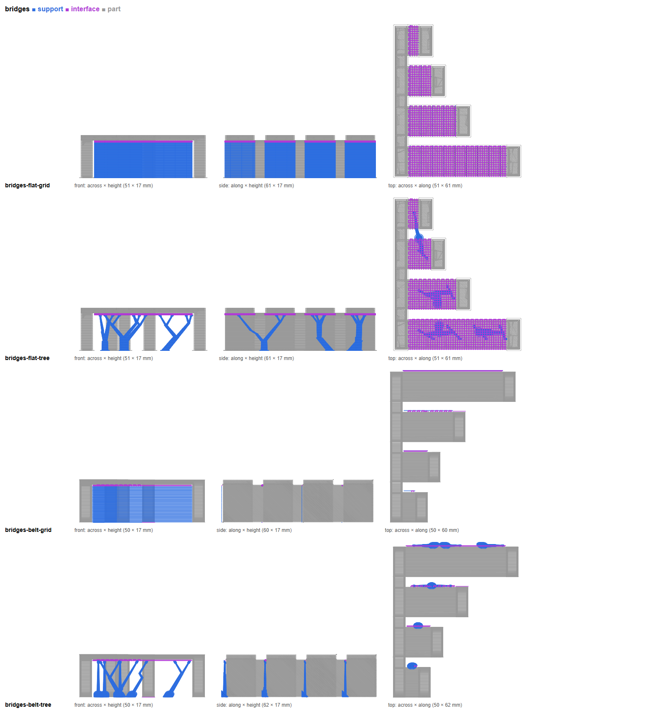
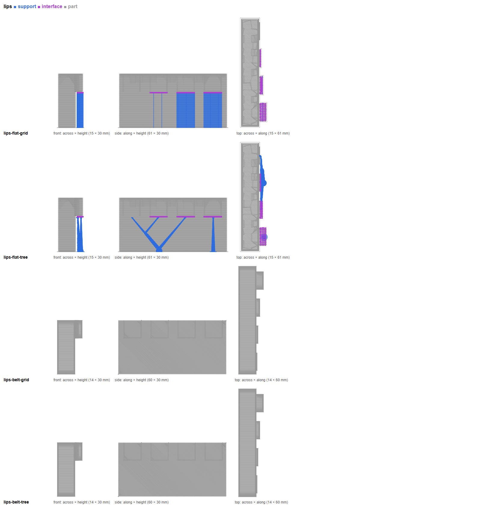
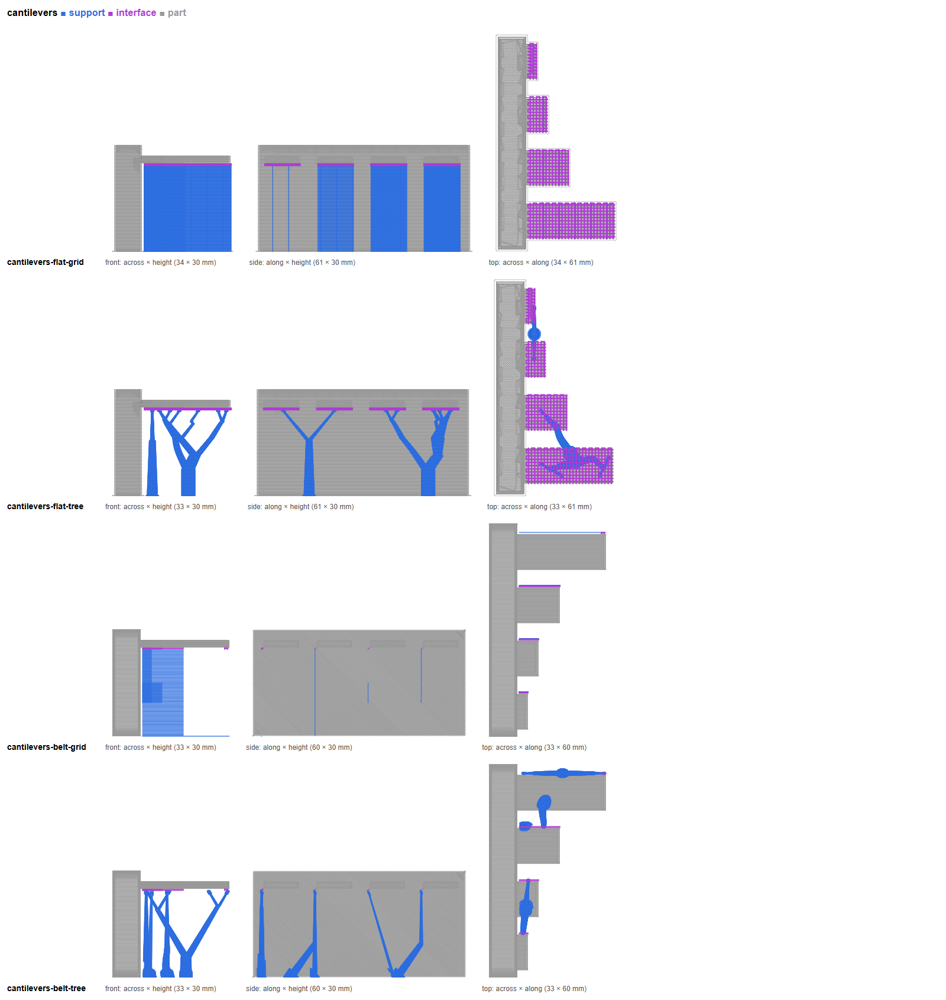
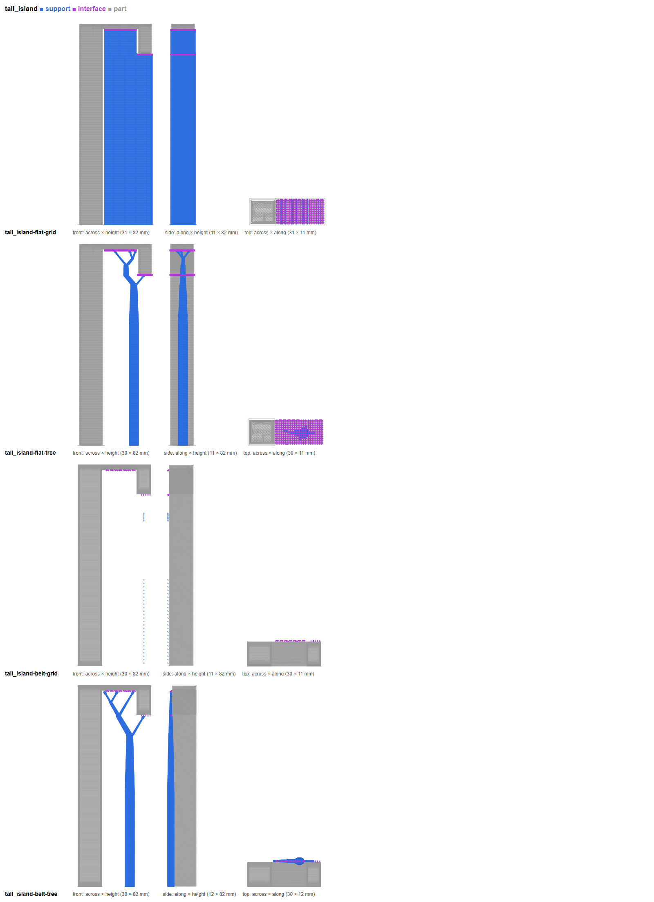
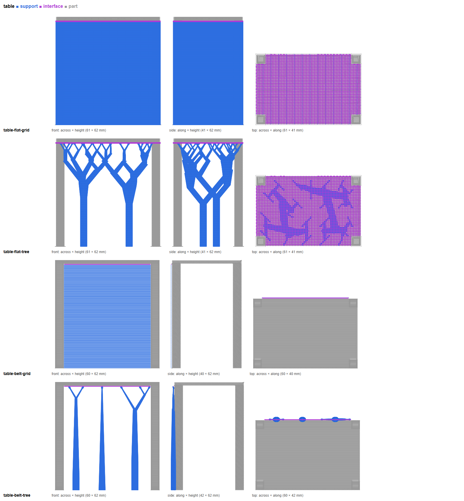

# Plan: supports that hold what gravity pulls, and that survive the print

Status: plan, for review. Written 2026-11-15 against `main` at c40c9905 (6.8.1). It changes no code. Each step below ships as its own small PR with before/after numbers; the steps marked **owner decides** wait for an answer.

The owner asked for two things, for both support styles (classic grid and organic tree):

1. **Support only what gravity would really pull down.** No support under things that print fine on their own, and no missed regions.
2. **Supports that survive the print.** Nothing the nozzle can knock over, nothing too thin for what it carries, and nothing printed so fast on itself that it never solidifies.

This plan says what the code does today, shows where it falls short on test parts, and lists the changes in order.

## 1. The short answer

- **Where support goes is decided by one flat test, shared by both styles**: the part of a layer that sticks out past the layer below by more than one step at the support angle, plus islands with nothing under them. It knows nothing about bridges, about how wide the overhang is, or about which way gravity points on the belt.
- **Short bridges always get support.** The slicer already has a "this is a bridge up to 18 mm, it will span" check, but only the *warning* uses it. The supports ignore it.
- **Nothing keeps a tall or thin support standing.** There is no limit on height against width, no tie between neighbouring trees, and no rule for layers that are only a few thin dots.
- **Two measured bugs:**
  - on a flat bed, the foot of a small tree is a hollow ring and the next layer is printed inside it, over bare bed, touching nothing;
  - on the belt, the first edge of a ledge that starts in the air is left almost unheld, and grid supports under a small hanging pad are loose dashes that reach neither the belt nor the part.

## 2. What the code does today

All in `crates/lime-slice-core/src/support.rs` unless a file is named.

**Where support is asked for (both styles).** `overhang_at` (line 1381) takes layer N, subtracts layer N−1 grown by `layer height / tan(angle)`, and drops pieces under 0.35 mm². `unsupported_islands` (line 3119) adds any piece of the layer with nothing under it and no neighbour within 0.8 mm. On the belt, `past_hairline` (line 1401, #480) also drops hairline strips. Enforce paint adds regions; block paint removes them.

**The belt.** The part is tilted so the 45° layers are flat for the planner. The overhang test runs in that tilted frame and treats every direction the same. Real gravity is used only *after* the demand is known: trunks and columns fall plumb to the belt (`FloorPlane::fall`). The part-hold audit (`audit.rs:138`) does know the direction (a bead may sag 0.5 mm downhill but reach only 0.3 mm uphill), so the checker and the generator disagree.

**Trees.** Tips are sampled on the demand (`sample_tips`), then every node steps down one layer at a time, leaning at most the branch angle (40°) toward a partner and merging when one trunk can carry both (`pair_steps`, `merge_nodes`). Thickness comes from the number of tips carried (`section_radius`) plus a small flare per mm of fall (`flare_per_mm`, 0.03–0.08 mm of radius per mm), capped at the trunk radius (2.1 mm). "Load" is a count of tips, not a force. At Toughness, merges skip the capacity check, so one trunk may carry any number of tips.

**Grid.** Demand is filled with sparse lines down to the bed, the belt, or the part. Columns have no outer wall and never widen toward the base.

**What already exists for fragile supports** (all off by default): gentle supports (#515: slower, lower acceleration, retract when leaving a support), support brim, belt anchor lines, "Tip under every row" (belt), "Avoid pockets". On by default: trunk-wide filled feet on the belt (#482).

## 3. Measured on test parts

Sliced with the release engine built from c40c9905, Speed strategy, 0.2 mm layers, 0.45 mm lines, default support settings, flat bed and 45° belt. Five purpose-made parts plus the repo samples. "Hanging" is the part-hold audit's longest stretch of part bead with nothing under it.

| Part | Bed | Style | Print time | Support time | Longest hanging span |
|---|---|---|---|---|---|
| Bridges 5/10/20/40 mm | flat | off | 12.7 min | 0 | 39.9 mm |
| | flat | grid | 22.2 min | 7.7 min | 12.4 mm |
| | flat | tree | 16.6 min | 2.7 min | 12.4 mm |
| `bridge_span` sample (14 mm) | flat | off | 3.0 min | 0 | 14.0 mm (warning: nothing in the air) |
| | flat | grid | 3.9 min | 0.65 min | 7.7 mm |
| Cantilevers 3/6/12/25 mm | belt | off | 12.1 min | 0 | 24.8 mm |
| | belt | grid | 12.9 min | 0.35 min | **23.4 mm** |
| | belt | tree | 14.4 min | 1.2 min | **23.4 mm** |
| Tall pad (70 mm up) | flat | grid | 18.0 min | 7.5 min | 9.2 mm |
| | flat | tree | 11.4 min | 2.2 min | 9.2 mm |
| | belt | grid | 6.7 min | **2 s** | 4.4 mm |
| Table (60×40 roof, 60 mm up) | flat | grid | 94 min | 69 min | 14.8 mm |
| | flat | tree | 35 min | 10.6 min | 14.8 mm |
| | belt | tree | 22 min | 2.4 min | 3.8 mm |

Tree shape, from the same slices:

| Part | Bed | Trees | Tallest | Height ÷ base width | Thinnest disk |
|---|---|---|---|---|---|
| Tall pad | flat | 1 | 79 mm | 18.8 | 0.32 mm radius |
| Table | flat | 2 | 59 mm | 14 | 0.41 mm |
| Table | belt | 3 | 59 mm | blades about 4 mm wide and 1.5–2 mm thick along the belt | 0.36 mm |

### 3.1 Support where none is needed

- **Short bridges are fully supported.** The 5 mm and 10 mm bridges get a full grid block or a tree each, on the flat bed and (at their first edge) on the belt. The 14 mm `bridge_span` sample is the plainest case: with supports off the slicer says nothing prints in the air, and with supports on it adds 21 % to the print for that same deck.
  Cause: `exclude_short_bridges` (line 3053) is called only from `in_air` (the warning), never from the demand.
- **Narrow ledges.** A 1 mm lip (about two beads) gets two grid lines or a tree branch; a 3 mm cantilever gets its own tree. The first bead of such a lip is laid against the wall bead beside it and the next one against that. This is the weakest of the "needless" cases and needs a coupon before any default moves.

### 3.2 Support that is missing

- **Belt: the first edge of a ledge born in the air.** With supports on, the 25 mm cantilever still has a 23.4 mm stretch of bead with nothing under it, in both styles. The pictures show why: grid lays one thin line and a dot at the far corner; the tree touches the two ends. This is the same family as the owner's housing lip ("starts in mid-air", 2026-10-29). The cause is not pinned yet; step 3 starts by instrumenting it.
- **Belt: grid under a small hanging pad is loose dashes.** On the tall-pad part the belt grid support is 2 seconds of short dashes that reach neither the belt nor the pad (bottom-left picture below). #477 fixed this for wide regions; narrow ones still fall through.
- **One-sided long spans** and **staircases of small steps** (each layer passes the angle test, the sum hangs far out) are not caught by a per-layer test. Not measured yet; step 0 adds the fixture.

### 3.3 Supports that may not survive

- **Flat bed: the tree foot floats free of its trunk (bug).** On `bridge_span` the first support layer is a ring 3.5 mm across made of two walls with nothing inside; layers 2 and up are a 1.7 mm disk whose outer bead sits inside the ring's inner bead. The trunk's second layer is printed over bare bed and is joined to nothing until the branch has thickened (about 23 mm of height at Speed). The planner and the audit both treat the ring as a full disk, so they pass it. Only belt feet are filled (`toolpath/support_emit.rs:110`, `slice/brims.rs:264`).
- **No limit on height against width.** A lone tree is 19 times taller than its base on the tall-pad part. From the growth rule alone: 6.5× at 10 mm, 14× at 60 mm, 29× at 120 mm, 36× at 150 mm. Nothing ties trees to each other or to the part.
- **Belt trees are thin blades standing ahead of the part.** On the belt table, three trees 59 mm tall stand in front of the part's leading face, about 4 mm wide across the belt and under 2 mm thick along it. They are the first thing printed, they stand alone, and the belt never lifts the nozzle over them. This matches the owner's "first pieces got knocked off".
- **Belt grid is a one-bead curtain.** Under the table's leading edge the grid support is a single line per layer: a sheet 60 mm wide, 62 mm tall and one bead thick.
- **Necks.** A trunk that brushes the part is printed at 0.3 mm radius whatever it carries (line 1659), and the disks above may then widen by 0.39 mm per layer, which leaves about 14 % of each bead resting on the one below.
- **Leaning on the belt.** A lean in the belt's direction adds to the plumb drift: 0.37 mm per layer, about 18 % bead overlap. Shaft height ×2 doubles the step, so thin rings stop touching. This is the mechanism behind the 2026-10-13 "shaft > 1 breaks trees on the belt" finding.
- **Grid columns** under a small island are a single 0.45 mm line stacked to full height.
- **Nothing gives a thin column time to cool.** Minimum layer time (off by default) slows whole layers and has a floor speed; there is no rule for a layer that is only a few support dots, and Speed travels at 300 mm/s with no lift.

What is *not* verified here: none of this was printed. The pictures and numbers are from the G-code.

## 4. The stated limits

These are the rules the rework holds supports to. The numbers are starting points and each is marked with where it comes from.

| Rule | Limit | From |
|---|---|---|
| A support bead rests on a support bead, the part, the bed or the belt | at least half a bead of overlap with what is under it, on every layer | the existing part-hold rule, applied to supports |
| Height against base width | a free-standing tree or column is at most 10× taller than its base is wide, measured in its thinnest direction | rule of thumb; a pillar coupon calibrates it |
| Thinnest printed section | no disk under 0.6 mm radius below the tip, and no widening faster than half a bead per layer | two beads side by side; half-bead overlap |
| Foot | filled, and at least as wide as rule 2 asks, for the first three layers | the belt foot of #482, extended |
| Solidify time | a spot on a support is not printed on again sooner than N seconds (N to be set from a coupon; first guess 4 s for PETG) | to be measured |
| Bridges | a deck held on two opposite sides and shorter than the bridge limit gets no support | the existing 18 mm warning rule; limit is the owner's choice |

When a support breaks a limit it is, in this order: merged with a neighbour, thickened toward the base, tied to a neighbour or the part, and only then slowed.

## 5. Steps

Each step is one PR with: a test for the rule, golden A/B through `tools/golden_ab.sh` against the stored run for its base commit, support time and weight on the test parts above, and before/after pictures from the same views.

**Step 0 — Measuring tools. No G-code change.**
- CLI flags for a belt slice and for the part-hold report, so `tools/golden.sh` style runs can cover the belt.
- A support stability report in the audit: for each tree and each grid column its height, base width, thinnest section, height ÷ width, and whether every bead rests on something (the check that would have caught the floating foot). The inputs are already in `Forest`, `Limb` and the emitted beads.
- The five test parts of section 3 as fixtures, plus a staircase and a one-sided span.
- A short-layer report: layers whose whole print time is under N seconds and hold only supports.

**Step 1 — Flat-bed tree foot (bug fix).** Fill the foot and keep the next two layers at least as wide as the foot's inner bead. Expected cost about 0.1 % time; every flat-bed tree G-code changes. **Owner decides** (decision A): on by default as a bug fix, as #482 was on the belt.

**Step 2 — Short bridges get no support.** Use the bridge check in the demand, with a better two-anchor test (today's judges by bounding-box sides, so a diagonal deck fails). A setting "Bridge without support up to … mm". Expected on the bridges part: −2 to −4 minutes of support on a 17–22 minute print. **Owner decides** the default (decision B).

**Step 3 — Belt: edges born in the air, and small grid regions.** Instrument the cantilever and tall-pad cases, find why the first edge is left unheld, fix it, and show the 23.4 mm span gone. The owner's housing lip project is the real-part check (read by path only).

**Step 4 — Height against width.** Apply rule 2 to trees and to grid columns: first merge neighbours that are both too slender, then thicken toward the base over the bottom third, then widen the foot. On the belt, measure thickness along the belt, so blades become round. Expected cost: about 1 minute and 0.5 g for a lone 120 mm trunk. **Owner decides** the default (decision C).

**Step 5 — No weak spots along a support.**
- Necks: a floor of 0.6 mm radius below the tip, and widening limited to half a bead per layer. Needs a coverage A/B first, since more disks get dropped beside walls.
- Tree supports ignore shaft height above ×1 (it breaks continuity on the belt).
- Small grid columns get one outer wall and a wider base.

**Step 6 — Ties.** A tie between tall neighbouring trunks, and from a lone tall trunk to the part's wall where one is near, every 10 mm of height. Built from the same disk layers, so prune, regrow and grow keep working. Adds print time: off by default.

**Step 7 — Time to solidify.** For layers that hold only thin supports: slow those supports, and if that is not enough, park away from them for the remainder. Local to those layers, so a long belt print does not pay on every layer (the reason the 8 s minimum layer time was rejected). Adds print time: off by default. **Owner decides** whether to build it now or after a coupon shows the need (decision D).

**Step 8 — Gravity on the belt.** Make the overhang test direction-aware in the belt frame: a step that leans the way gravity pulls is held to a tighter limit than one that leans away from it. Earlier attempts lost (demand from plumb faces only, +36 % time on the housing); an asymmetric limit has never been measured. It starts with a coupon of slopes in four directions, printed with supports off. **Needs a test print before any default moves.**

**Step 9 — Small things the walls already carry.** No tree tip where no interface survives under it; shallow one-layer ledges (text, emboss, lips under a bead and a half) dropped from the demand; narrow cavity tops and horizontal hole tops treated as bridges. Each behind the same measurements.

Out of scope here, noted so it is not lost: supports past the bed's edge at X < 0 and the export range check (`out-of-range-supports` note, not yet approved).

## 6. Decisions for the owner

**A. Flat-bed tree foot fix: on by default?**
- *On by default* (recommended): a bug fix, about +0.1 % time, every flat-bed tree slice changes.
- *A setting, off*: old slices keep their bytes; the floating second layer stays unless switched on.

**B. Short bridges without support: what default?**
- *Off* (today): every bridge is supported.
- *On up to 10 mm* (recommended): a conservative span that PETG and PLA bridge reliably; saves support time and scars under small decks and hole tops.
- *On up to 18 mm*: matches what the warning already calls a bridge; saves more, sags more.

**C. Height-against-width rule: what default?**
- *On at 10×* (recommended): small measured cost, aimed straight at "knocked over".
- *A setting, off*: no print-time change for anyone until switched on.
- *Wait for the pillar coupon*, then choose the ratio.

**D. Time to solidify (step 7): when?**
- *After steps 1–5, only if a coupon still shows soft columns* (recommended).
- *Build it now*, off by default.
- *Drop it.*

**E. Test prints.** Three small coupons would turn guesses into numbers: pillars of several widths and heights (rule 2), bridges of 5–25 mm with supports off (decision B), and slopes in four directions on the belt (step 8). About an hour of printing in all. They are prepared in step 0.

## 7. What still needs a real print

Everything in section 3.3 is read from G-code. The floating foot and the unheld belt edge are geometry and can be closed by the audit. Whether a 10× pillar stands, whether a 10 mm bridge sags, and how long a thin PETG column needs to set can only be settled on the printer.
