# Loft

Loft blends two or more closed sections in the order they are picked. The open sketch is the first section. A click on a pinned sketch card adds that sketch. **Ruled** (R) makes a straight blend. Leave it off for a smooth blend. Sections in one plane are refused.

Finish a sketch before starting the next one. **Sketch** on the card, then a plane, starts a new sketch only when none is being edited.

To raise a section before any solid exists, type an **Offset** on the "Sketch on" card and then pick XY, XZ, or YZ. The offset moves that plane along its normal. XY offset is +Z. The Workplane button is for a plane on a solid that already exists, so these examples use Offset instead.

A circle is Draw, then Circle. Click the centre and type the diameter.

## A square-to-round duct

A 40 mm square on the bed, a Ø22 mm circle 50 mm above it, ruled.

**Sketch**, XY plane, **Rectangle**. Hold Ctrl on the first click so the rectangle grows from its centre, click the origin, and type width 40 and height 40.

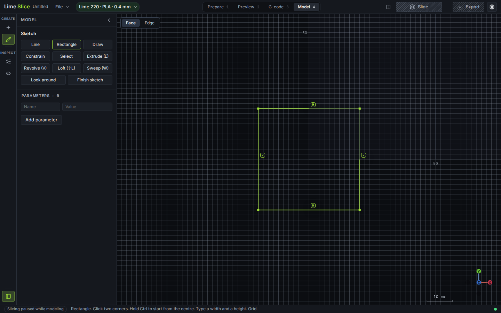

**Finish sketch**. The card keeps it as Sketch 1. **Sketch** again, type **50** in Offset, then click **XY plane**. The new sketch is 50 mm up.

**Draw**, then **Circle**. Click the origin and type diameter **22**.

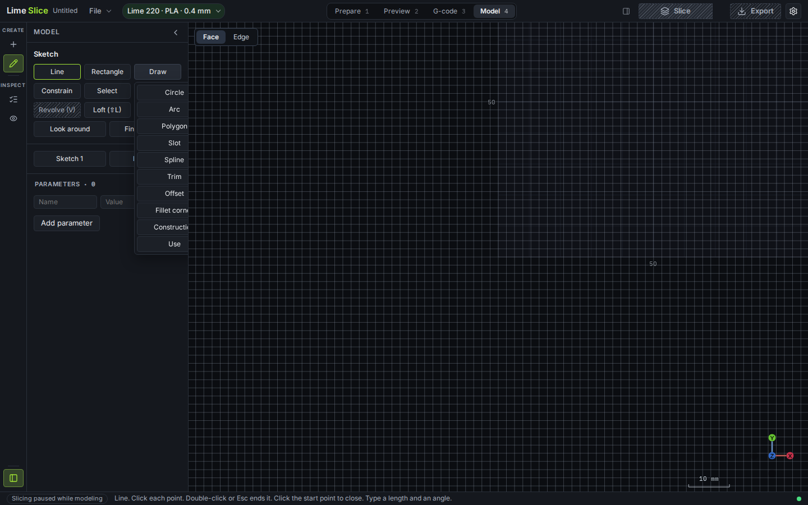

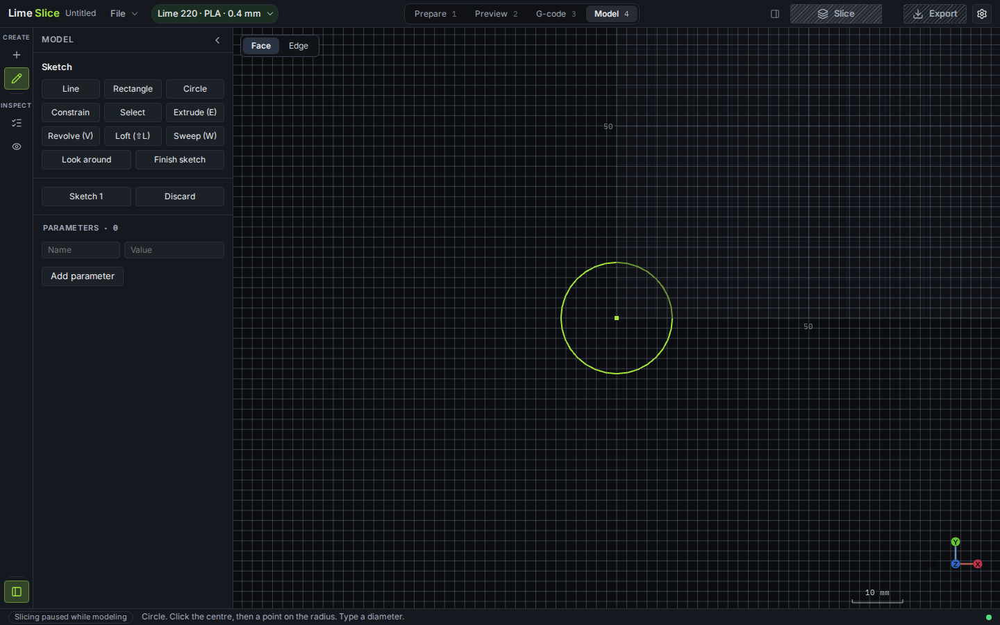

Click **Loft** (Shift+L). The open circle is section 1. Click the **Sketch 1** card to add the square. Click **Ruled**. Look around (O) and drag an empty part of the view to see the two sections apart. The ghost is the straight blend.

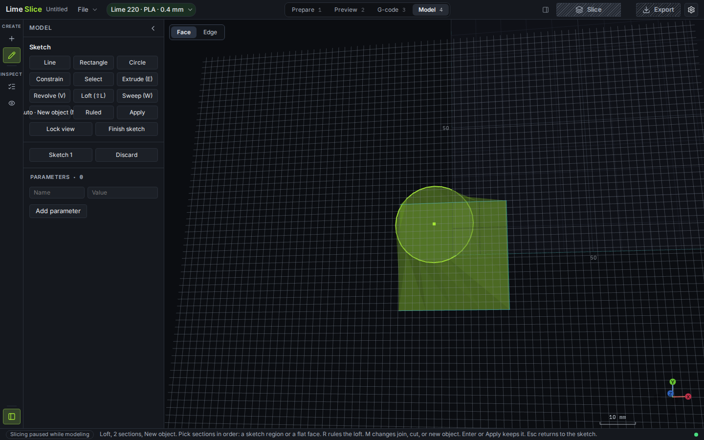

**Apply**. History reads "Loft through 2 sections, ruled". The adapter is 40 × 40 mm at the base and 50 mm tall.

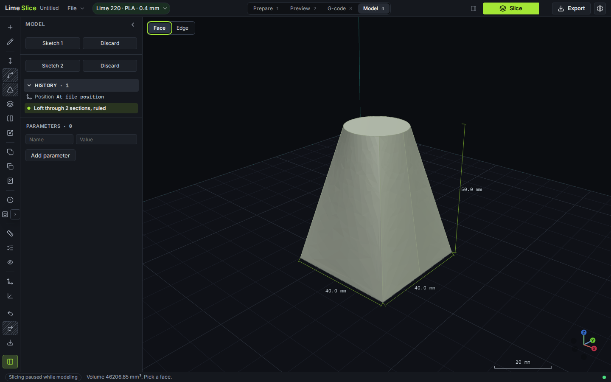

## A bottle from three sections

Three circles on the same axis, smooth. Draw the top first so the open sketch at the end can be the body, and the pinned cards add the shoulder and the neck in that order.

1. **Sketch**, Offset **78**, XY plane, Circle at the origin, diameter **16**. Finish. This is the neck, Sketch 1.
2. **Sketch**, Offset **46**, XY plane, Circle, diameter **34**. Finish. This is the shoulder, Sketch 2.
3. **Sketch**, XY plane with offset 0, Circle, diameter **42**. Leave this one open. It is the body and becomes section 1.

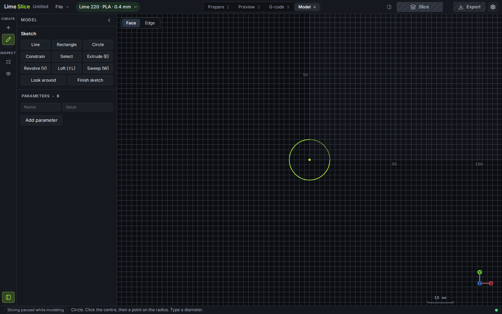

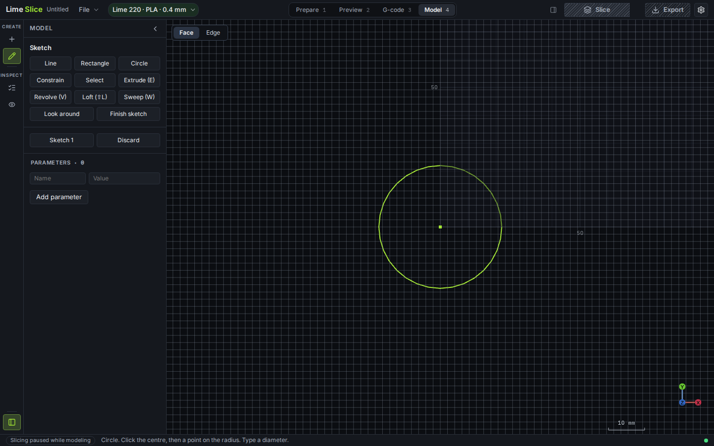

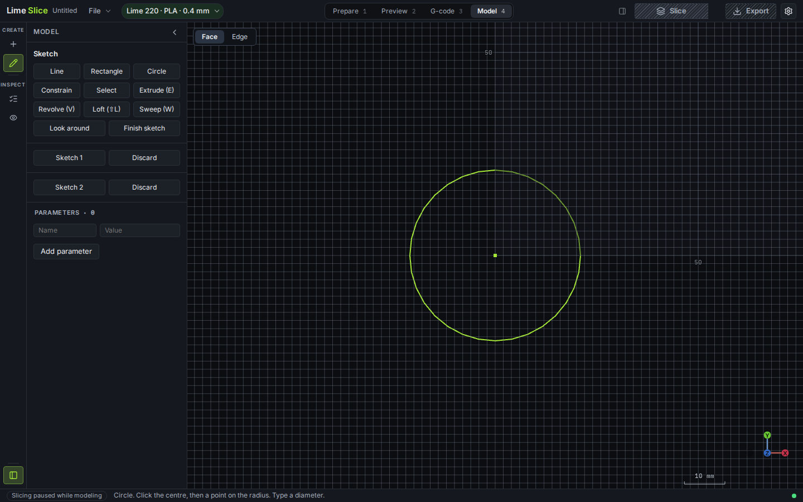

**Loft**. Click **Sketch 2** (shoulder), then **Sketch 1** (neck). Leave Ruled off, so the button reads Smooth. The order is body, shoulder, neck. Look around and drag to see the three rings.

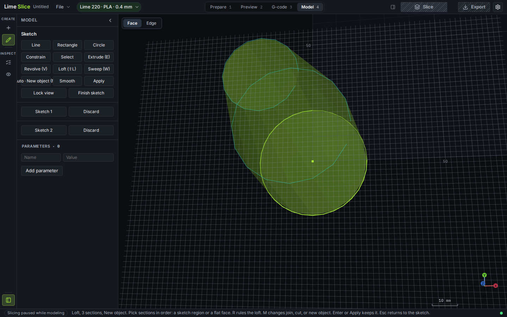

**Apply**. History reads "Loft through 3 sections". The bottle is 78 mm tall and about Ø42 mm at the base.

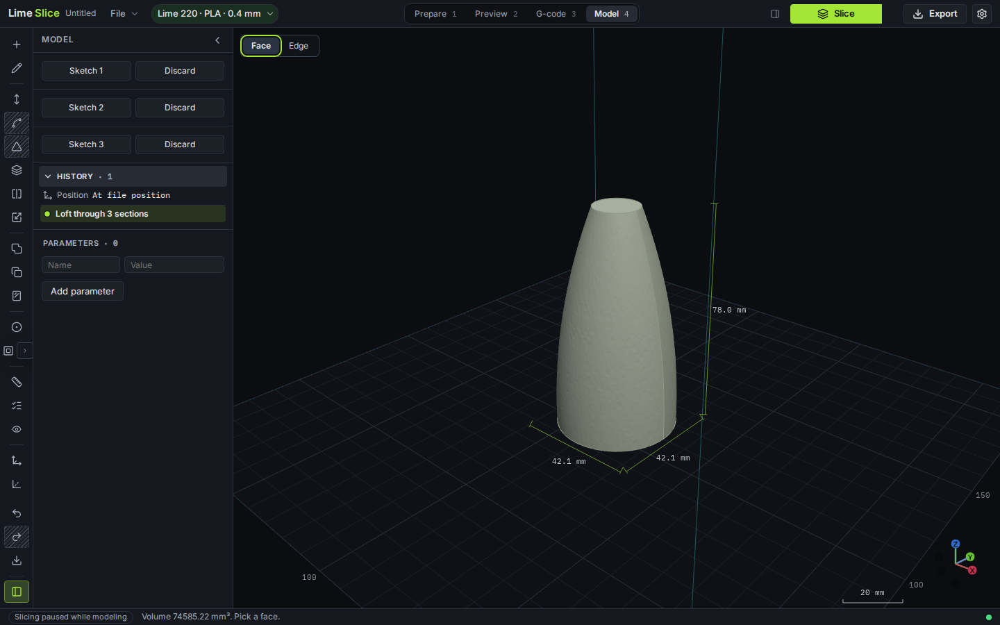

## A funnel shifted sideways

The small end is not above the middle of the large end. Offset only moves a plane along its normal, so the sideways shift is where you place the circle.

1. **Sketch**, Offset **42**, XY plane. Circle at U = 18, V = 0, diameter **14**. Finish. Sketch 1 is the small end, 18 mm off the origin.
2. **Sketch**, XY plane, offset 0. Circle at the origin, diameter **46**. Leave it open.

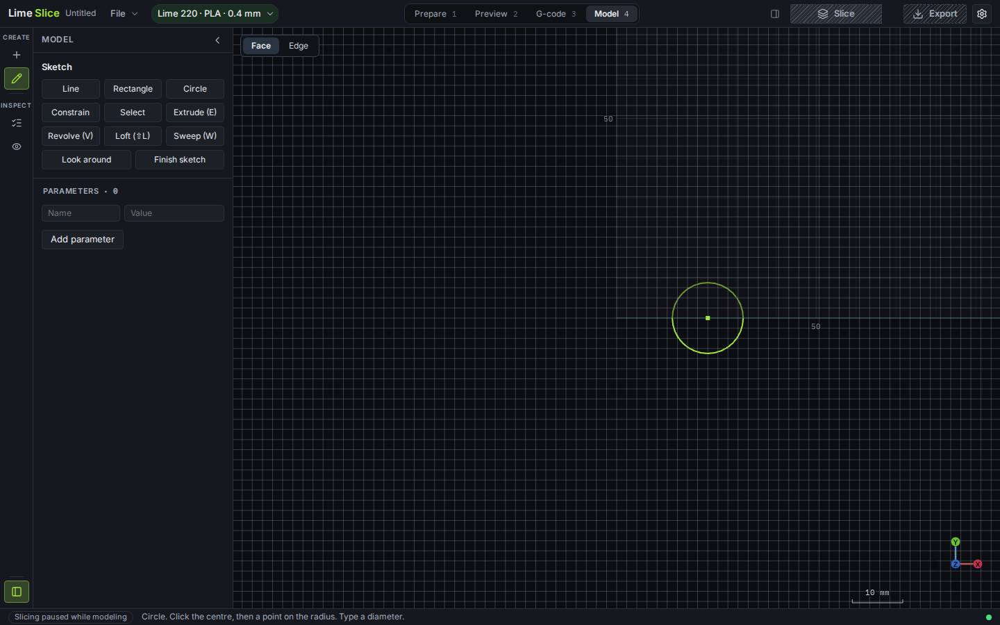

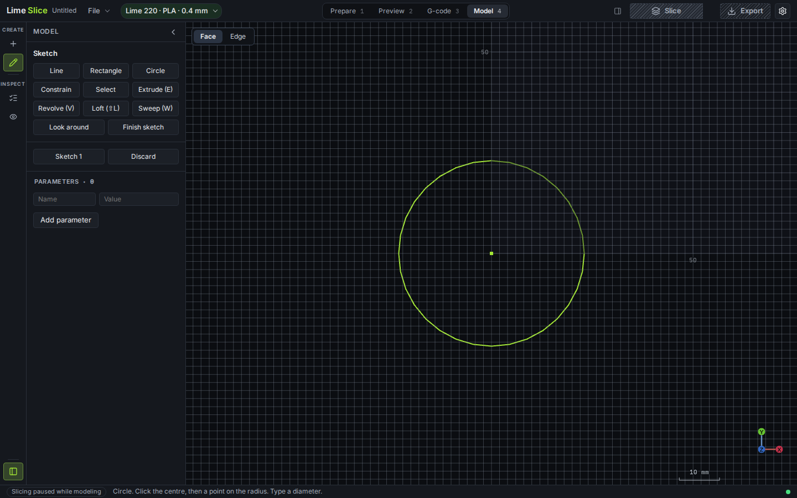

**Loft**, click **Sketch 1**, leave it smooth. Look around. The ghost leans because the upper circle is not on the same centre.

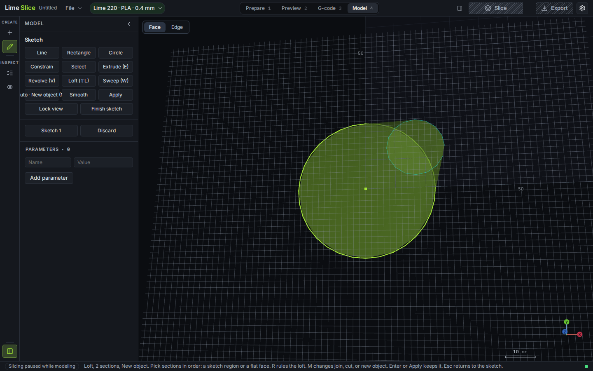

**Apply**. The funnel is 42 mm tall and leans toward the shifted end.

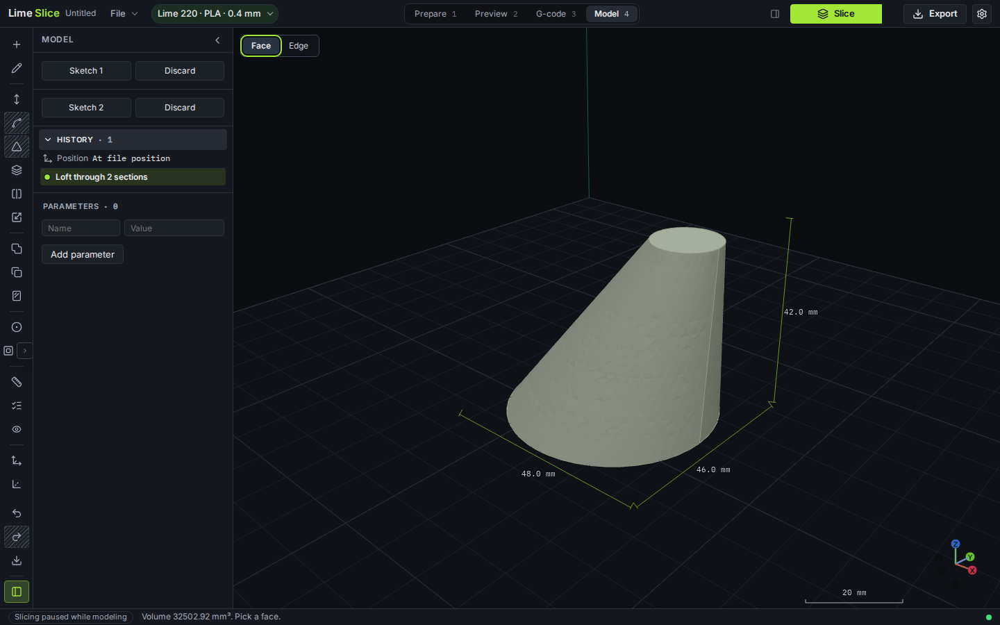
