# Revolve

Revolve spins a sketch region about an axis in its plane. Open a sketch, draw a closed profile that stays on one side of the axis, then press **Revolve** (V) on the sketch card.

The axis is whatever is under the pointer: a sketch line, a construction line, a projected edge, or the plane's U or V axis. A sketch line wins over a construction line, then an edge, then U or V. The first click locks it. Drag across the axis to set the angle, one pixel per degree. Ctrl snaps to 15°. The angle stays between 0.1° and 360°. Type 360 for a full turn. Enter or **Apply** keeps it.

On the XZ plane, U is X (angle 0° points right) and V is Z (angle 90° points up). A line's length and angle are typed in the heads-up box. Enter places the point and stays in the chain. Click the start point to close. Esc ends the chain.

## A cup, full turn

Sketch on the XZ plane and click **Line**. The profile is the right-hand wall of the cup, starting on the V axis so the floor meets the centre.

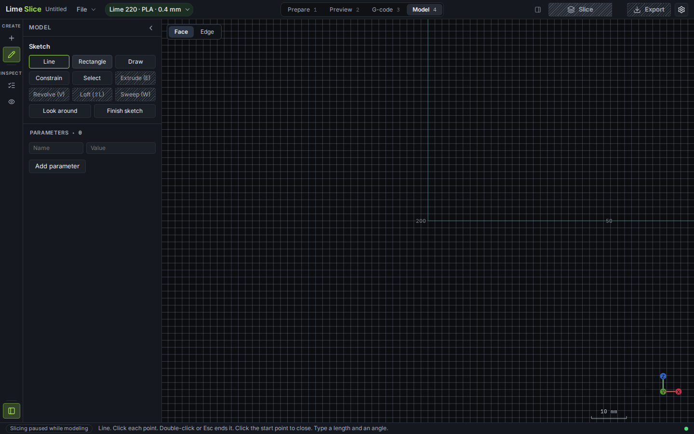

Click the origin and type the wall. Each pair is a length in millimetres and an angle in degrees:

1. 24 at 0° — out along the floor
2. 4 at 90° — floor thickness
3. 32 at 90° — up the inside
4. 4 at 180° — across the rim
5. 32 at −90° — down the outside
6. 20 at 180° — back toward the axis
7. 4 at −90° — down to the origin, which closes the profile

The outer radius is 24 mm, the wall and floor are 4 mm, and the cup is 36 mm tall.

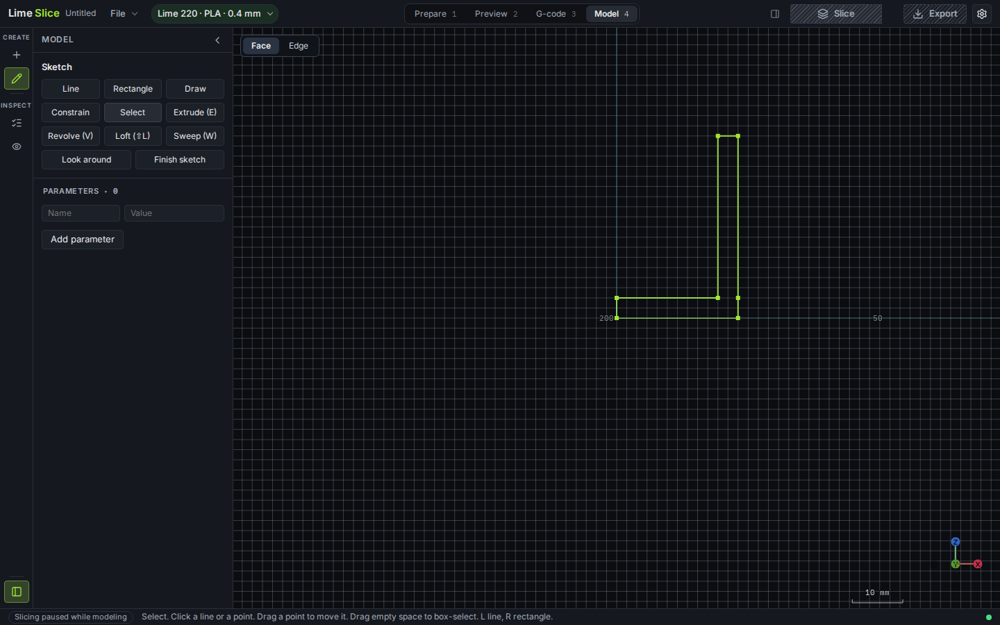

Click **Revolve**. The view tilts so the spin can be seen. Move the pointer onto the vertical centreline, away from the profile. That line is V. A profile line under the pointer would win, so stay off the wall. The ghost is a full turn because the angle opens at 360.

Click to lock the axis. The angle field already reads 360. Type **360** so the full turn is explicit, then **Apply**.

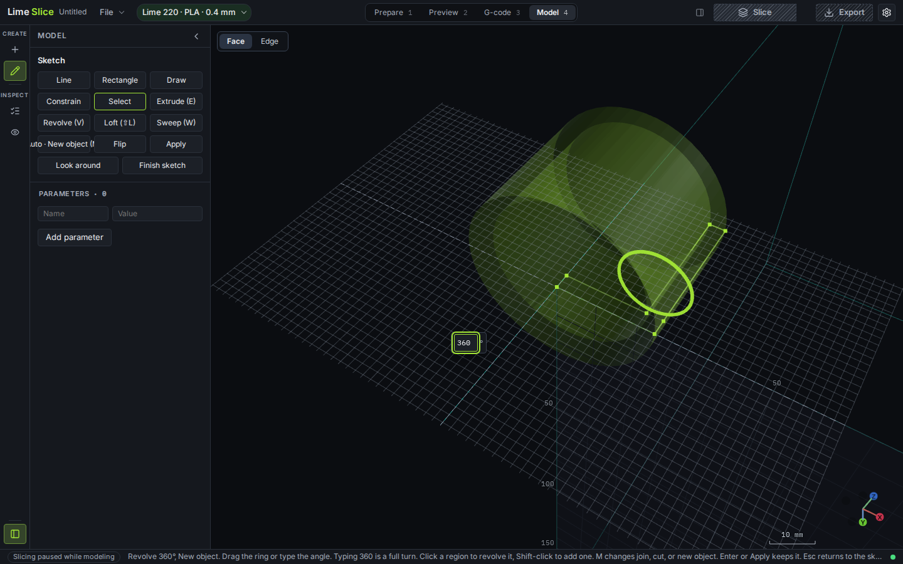

Home frames the solid. History reads "Revolve 1-loop profile 360°". The cup is 48 × 48 × 36 mm.

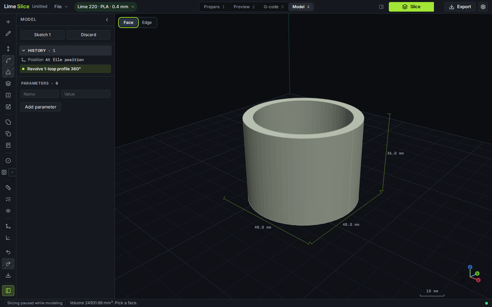

## A grooved pulley

The same plane, a profile that does not touch the axis, so the spin leaves a bore.

Start **Line** at U = 8, V = 0 and type:

1. 12 at 0° — out to the flange, radius 20
2. 6 at 90°
3. 6 at 180° — in to the groove, radius 14
4. 10 at 90° — up the groove
5. 6 at 0° — out to the upper flange
6. 6 at 90°
7. 12 at 180° — back to the bore
8. 22 at −90° — down the bore to the start, which closes it

The bore radius is 8 mm and the pulley is 22 mm tall.

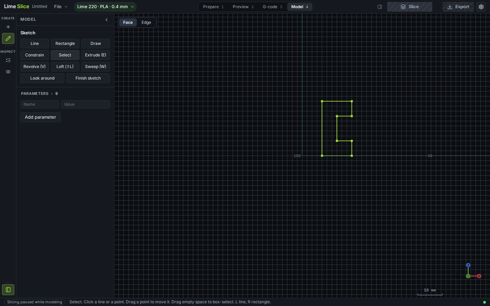

Click **Revolve** and aim the pointer at V *above* the profile. The base of this profile is a horizontal line, and a sketch line wins over the plane axis, so a pointer near that base would spin about the base instead of about Z. Click the centreline to lock V. The ghost opens at 360°.

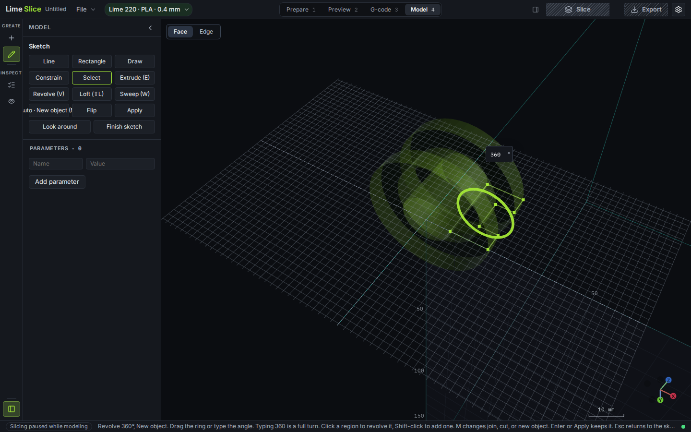

Drag across the axis with Ctrl held. One pixel is one degree, and Ctrl snaps to 15°. Dragging past 360° stays at 360°, so drag back from the full turn. This drag lands on 240°.

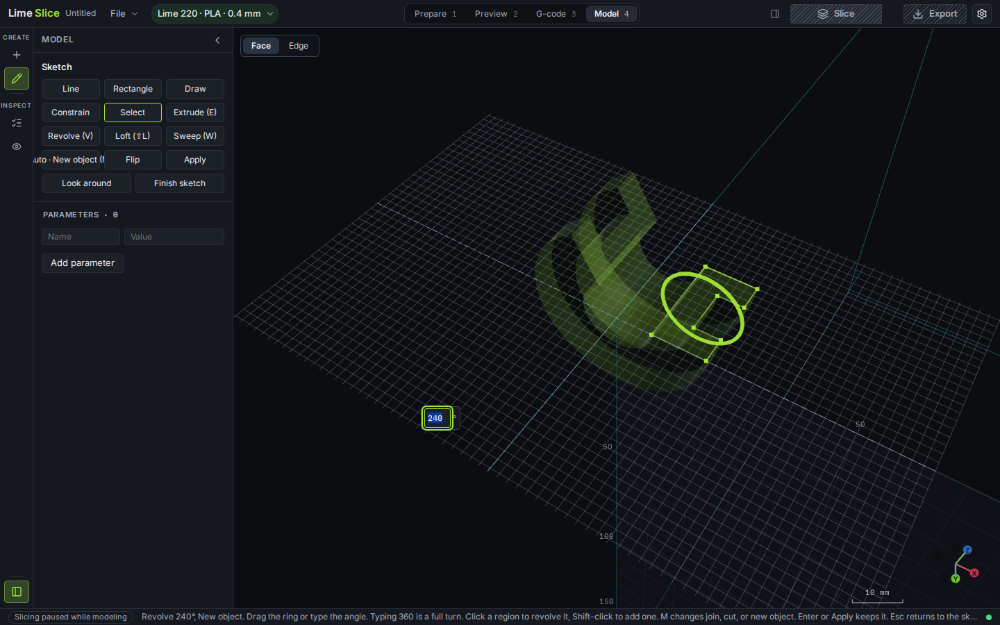

Type **360** in the angle field to finish the turn, then **Apply**.

The solid is Ø40 mm and 22 mm tall, with a through bore and a groove between the flanges.

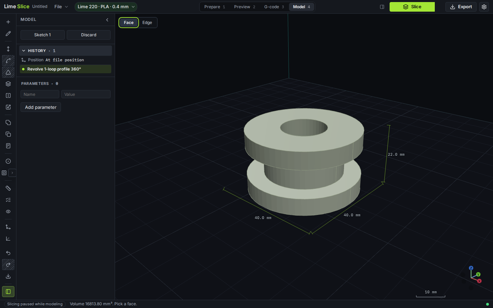

## A half bowl on an offset axis

A construction line can be the axis, and it does not have to be U or V. The profile is a bowl wall to the right of that line, and the angle is 180° so the result is a half shell.

On XZ, draw a **Line** from U = 6, V = −4, length 44 at 90°. Esc ends the chain. Select the line and press **X** (or Draw, then Construction). It turns orange and is left out of the region.

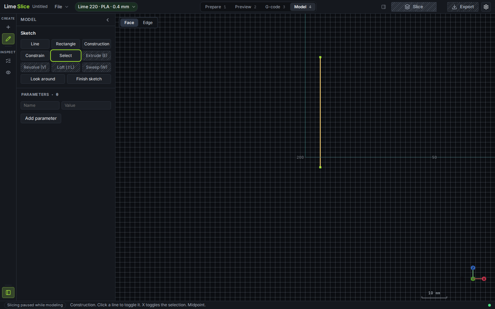

**Line** again, from U = 16, V = 0, and type a closed wall entirely to the right of the orange line:

1. 18 at 0°
2. 6 at 90°
3. 24 at 115°
4. 5 at 180°
5. 20 at −110°
6. Click the start point to close

A profile that crosses the axis is refused, so keep every point on one side.

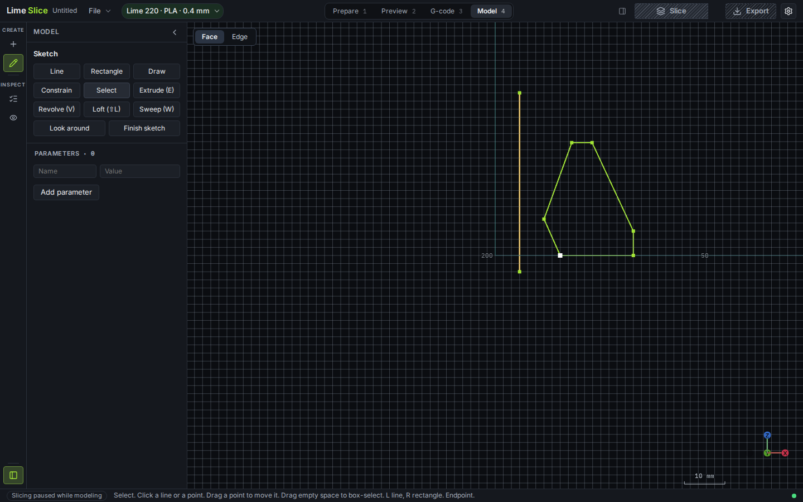

Click **Revolve**. The view tilts. Move the pointer onto the orange line, out past the profile. A profile line is nearer than a construction line, so the pointer has to be on the construction line itself, not on the wall. The status follows that axis.

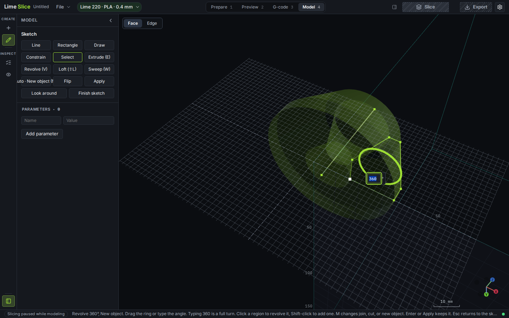

Click to lock it. Type **180** and **Apply**.

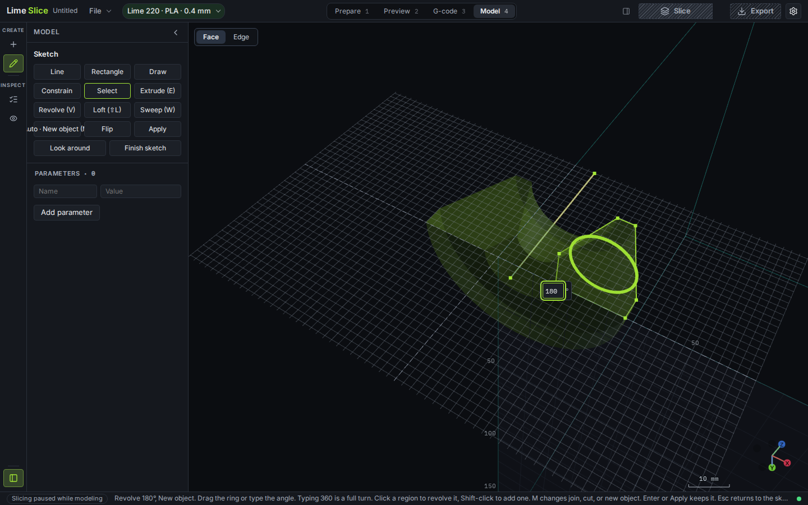

The solid is the bowl wall through half a turn. History reads "Revolve 1-loop profile 180°".

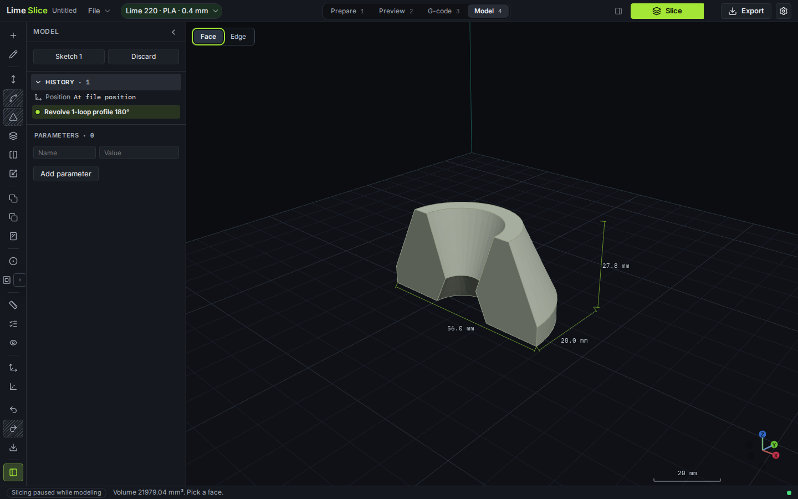
