# Sweep

Sweep carries one closed profile along an open path. Draw the profile and the path as two sketches. The open sketch supplies whichever of the two it is, and a pinned card supplies the other. **Sweep** (W) is on the sketch card.

The profile plane has to face the start of the path. A profile whose plane lies along the path is refused ("The profile lies along the path"). These examples draw the profile on YZ, whose normal is +X, and start the path on XY along +X (a line at 0°).

A corner that turns more than 25° is refused ("This path has a sharp corner"). Fillet the corner, or draw the bend as a tangent arc. Shift+A starts an arc tangent to the last line: type a radius and a sweep angle. G is Fillet corner: click the two lines and type a radius.

End scale is the profile's size at the end of the path. It opens at 1. Drag up to grow it, drag down to shrink it. 100 pixels is a factor of 1. Ctrl snaps to 0.1. Type the number in the same field.

History stores the sweep as a loft of sections along the path, and the row reads "Sweep along N points".

## A pipe along a bent path

Profile: a Ø8 mm circle on YZ. Path: 16 mm straight, then a tangent arc of radius 32 mm through 80°.

**Sketch**, **YZ plane**.

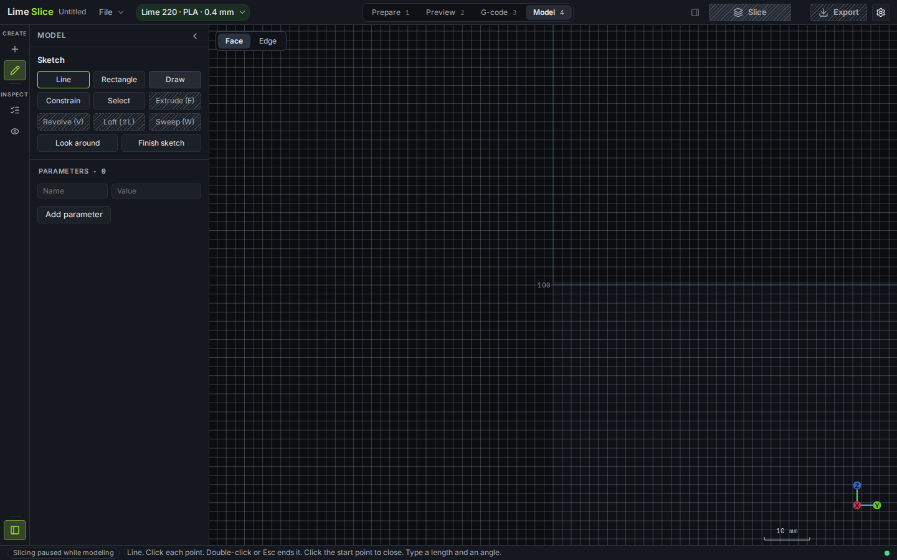

**Draw**, **Circle**, click the origin, type diameter **8**.

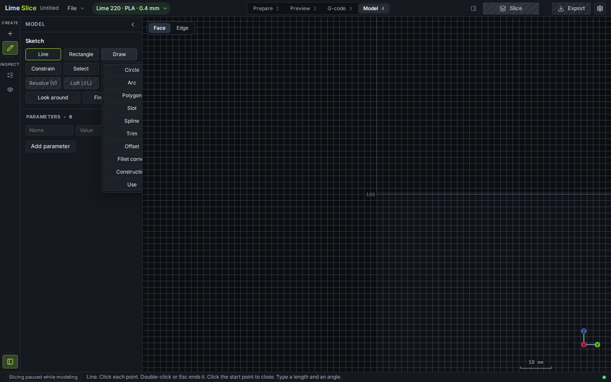

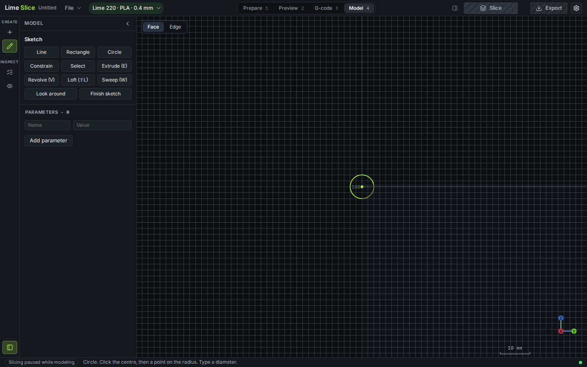

**Finish sketch**. **Sketch**, **XY plane**, **Line**. Click the origin and type length **16**, angle **0**. Esc ends the chain. The line is the straight run, and it is the start of the path, so it has to point along +X.

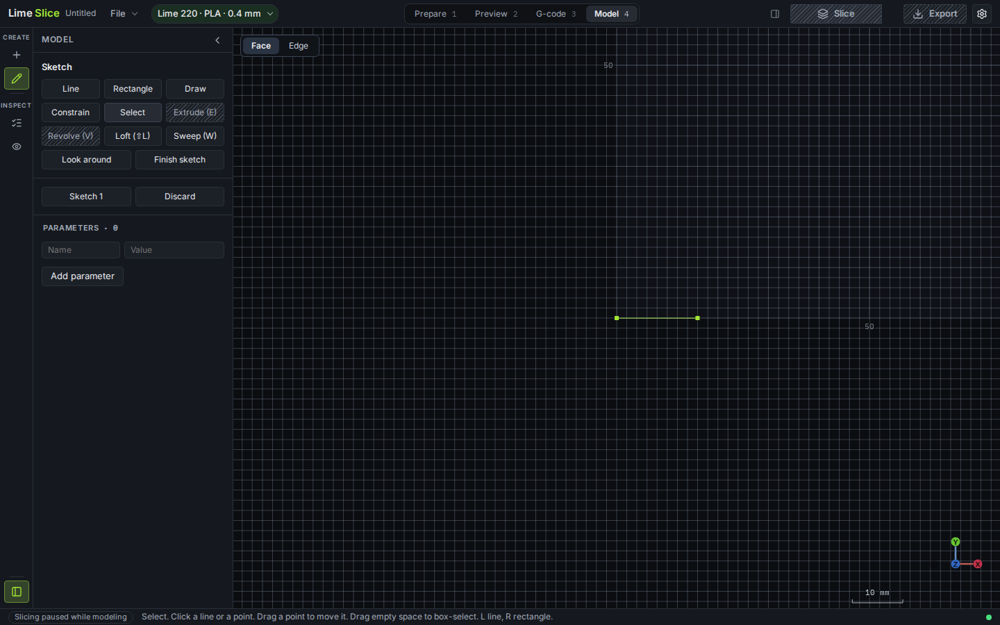

Press **Shift+A**. That arms a tangent arc from the end of the line. Type radius **32** and sweep **80**.

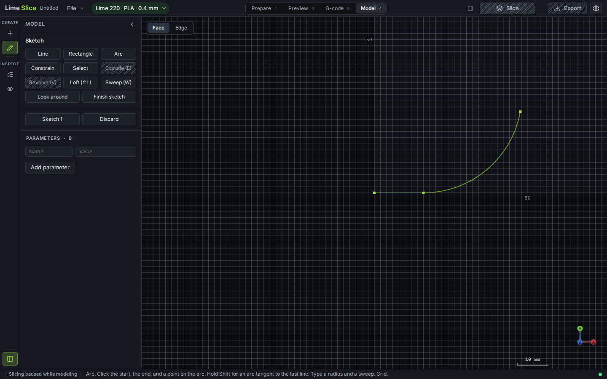

**Sweep**. The open path and the pinned circle are picked up. The end-scale field reads 1. Type **1** to keep the bore constant. Look around and drag to see the tube.

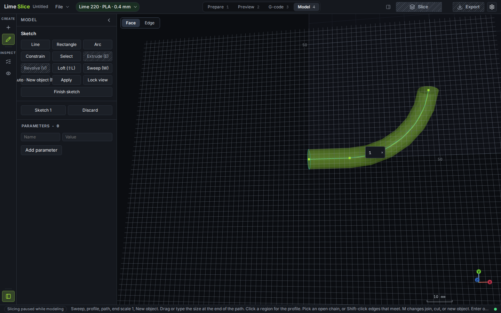

**Apply**. The pipe is Ø8 mm and follows the bend. History reads "Sweep along 8 points".

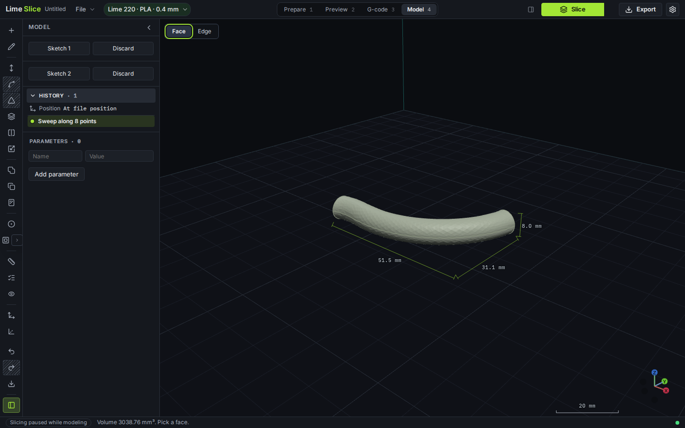

## A handle along an arc

Profile: a slot, 14 mm long and 8 mm wide, on YZ. Path: 12 mm straight, then a tangent arc of radius 46 mm through 100°. The handle tapers to 0.6 at the end.

**Sketch**, **YZ plane**, **Draw**, **Slot**. Click the two centres at (0, −7) and (0, 7), and type length **14** and width **8**.

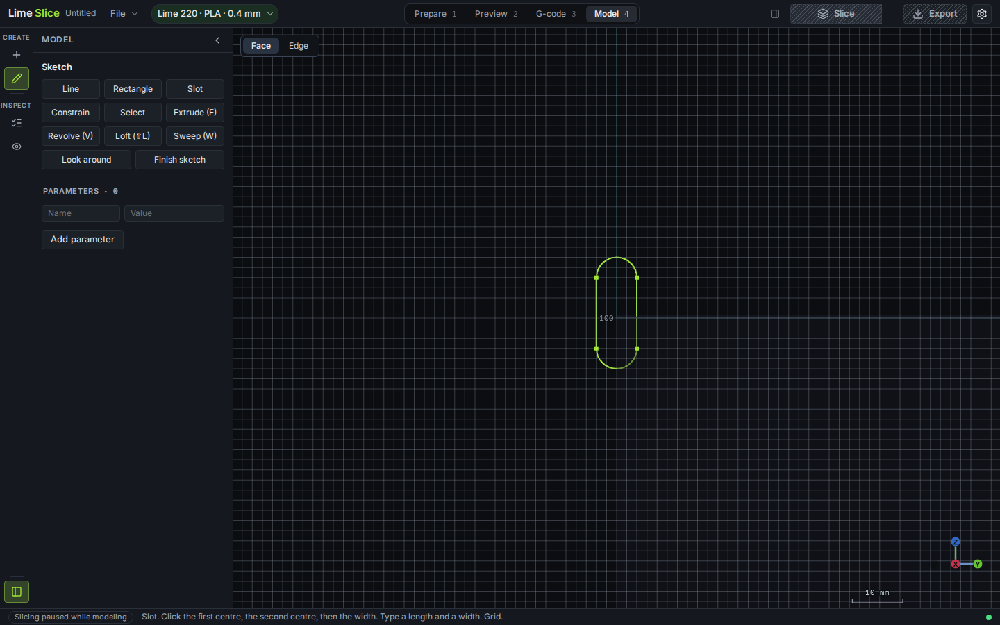

**Finish sketch**. **Sketch**, **XY plane**, **Line** from the origin, length **12** at **0°**. Esc. **Shift+A**, radius **46**, sweep **100**.

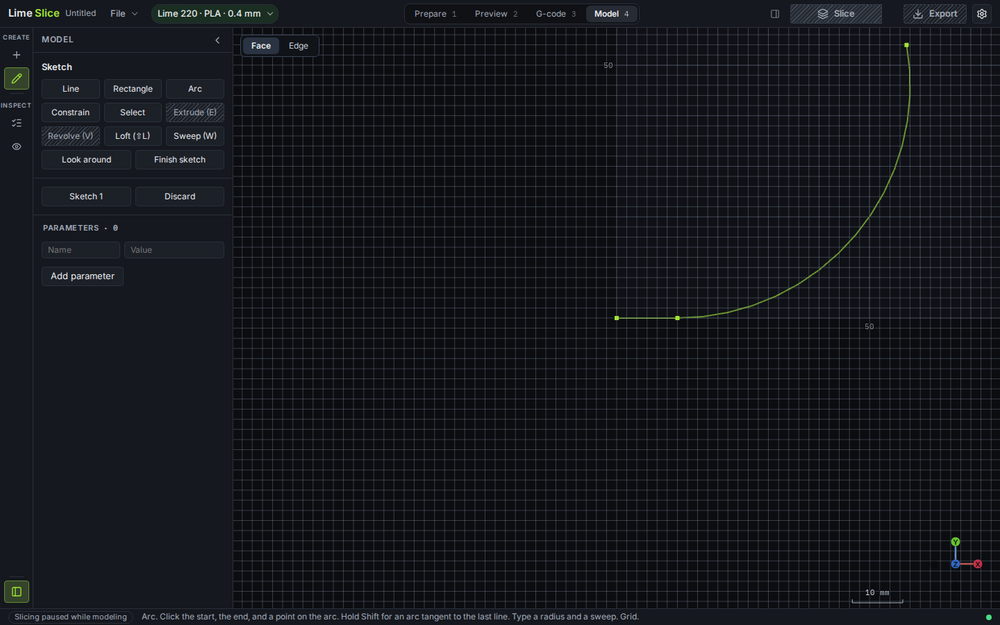

**Sweep**. Drag downward with Ctrl held. Dragging down shrinks the end, and Ctrl snaps to a tenth. The field lands on **0.6**.

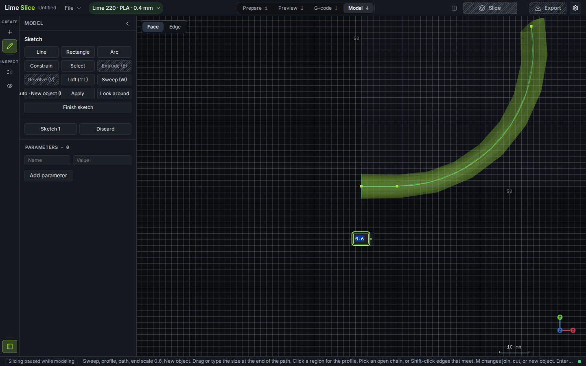

Type **0.6** in the same field so the value is exact. Look around to see the taper in depth.

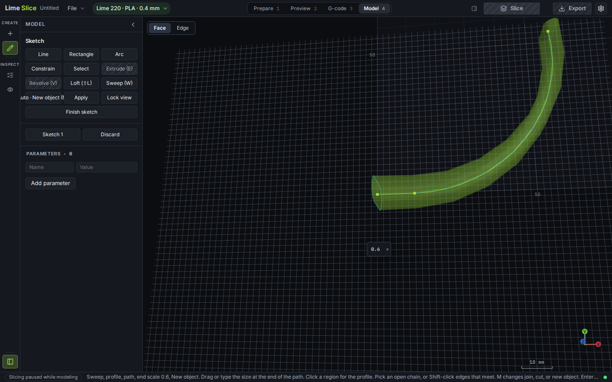

**Apply**.

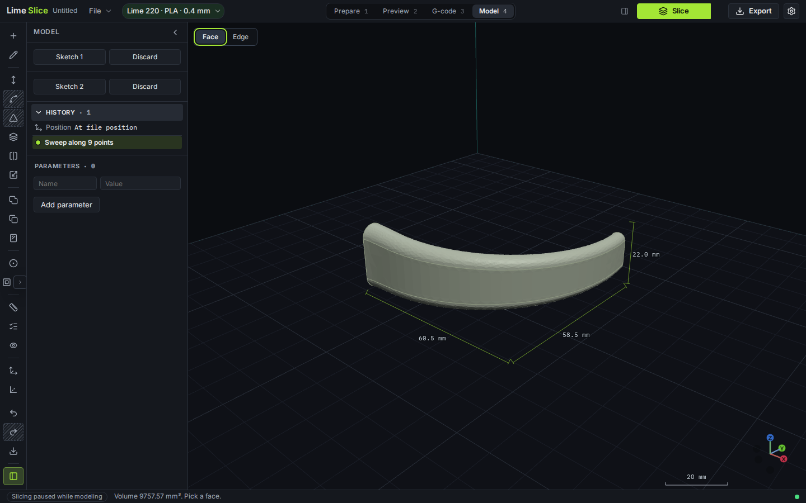

## A cable guide along a filleted corner

Profile: an 8 × 6 mm rectangle on YZ. Path: 36 mm along +X, then 30 mm at 70°. That corner is far past 25°, so Sweep will refuse it until it is filleted.

**Sketch**, **YZ plane**, **Rectangle** from (−4, −3), width **8**, height **6**. The rectangle is centred on the origin.

**Finish sketch**. **Sketch**, **XY plane**. **Line** from the origin, **36** at **0°**. Esc. **Line** again, click the end of that line, and type **30** at **70°**. Esc.

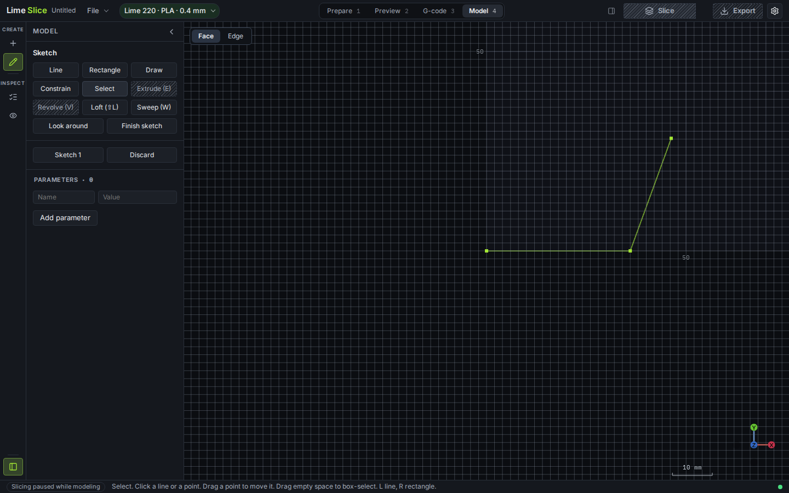

Press **G** (Fillet corner). Click each line, away from the shared corner, and type radius **14**. The setback fits in both lines, and the arc is tangent, so the path no longer has a sharp corner.

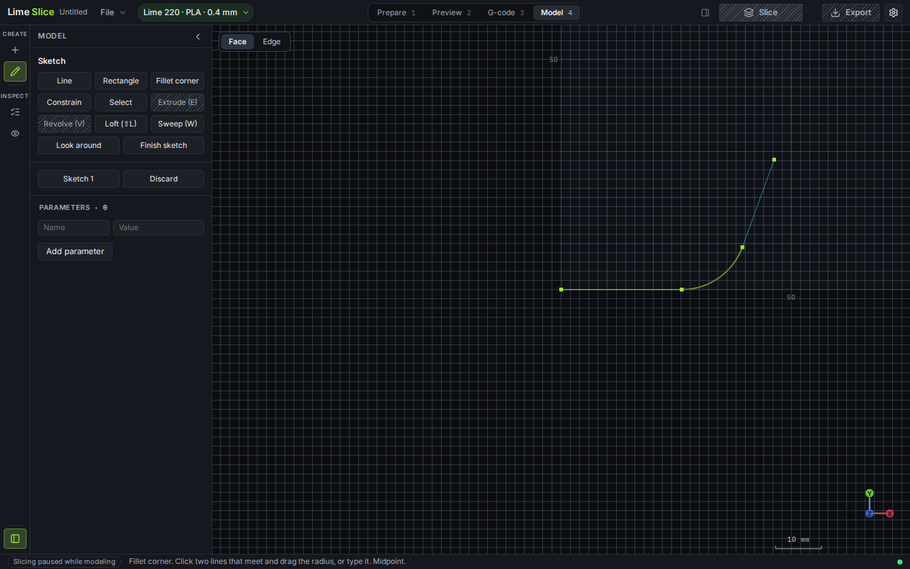

**Sweep**. The rectangle and the filleted path are both taken. End scale stays 1. Look around.

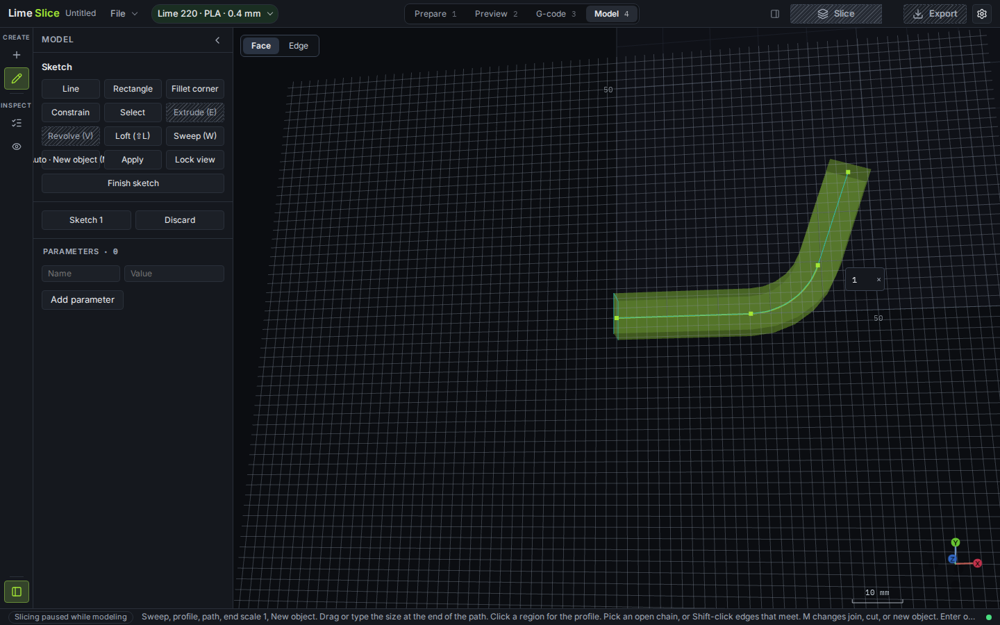

**Apply**.

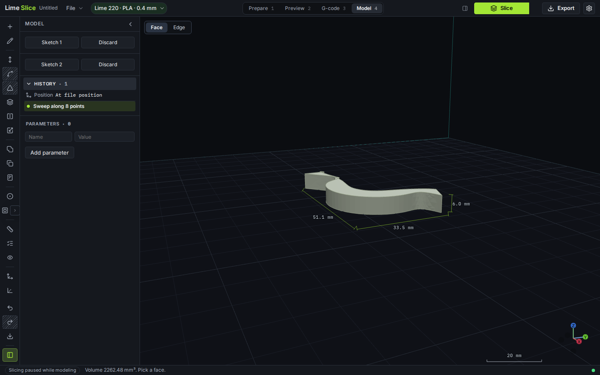
