# UI review — 3.1.0 (`dev/ui-review`)

Review of every surface that is on screen in 3.1.0 after the landscape facelift: Prepare, Preview, G-code, Model (including the sketch editor), settings, dialogs, menus, the context bar, and the docks. Driven with Playwright at 1440×900 and at a phone size of 390×844 (`?layout=compact`).

Engine output is untouched. This branch does not bump the version, tag, or open a pull request.

## What changed

| Area | Change |
| --- | --- |
| Sketch driving dimension | The field stays about 4.5rem wide and on screen. |
| Selection bar | After it fades, a **Selection** chip remains. Click, Tab, or Ctrl+. brings the actions back. Escape collapses to the chip. |
| Phone chrome | A canvas tap still hides the chrome. **Show controls** (44px, bottom centre) puts it back. Ctrl+. does the same. |
| Drawer widths (961–1200) | The status line names every closed dock and the key that opens it. The rail's Settings label was already there. |
| Narrow Results (≤960) | The Results button updates `aria-expanded`, same as Settings. |
| Tools that cannot run | Paint, seam, reinforce, edit-supports, and Sketch (when the solid cannot be edited) stay visible, look disabled, and the tooltip says why. A click toasts that reason. |
| Sketch card | Apply and Holes do the same when their action is not valid yet. |
| Focus and hit size | The model view and history menu show a focus ring. Layer marks are 24px. The Features opener stays inside Pocket, with its own border. |

## Findings

### 1. High — the driving-dimension field covered the whole viewport

**Where:** `.sketch-dim-input` in `src/styles.css`, created from `dimensionInput` in `src/app/sketch.ts`. The label is `position: fixed` inside `.sketch-dims`.

**What happens:** `input[type="text"] { width: 100% }` (specificity 0,1,1) beat `.sketch-dim-input { width: 4.5rem }` (0,1,0). The fixed input's containing block is the viewport, so the field became a white bar the full window wide and covered the sketch.

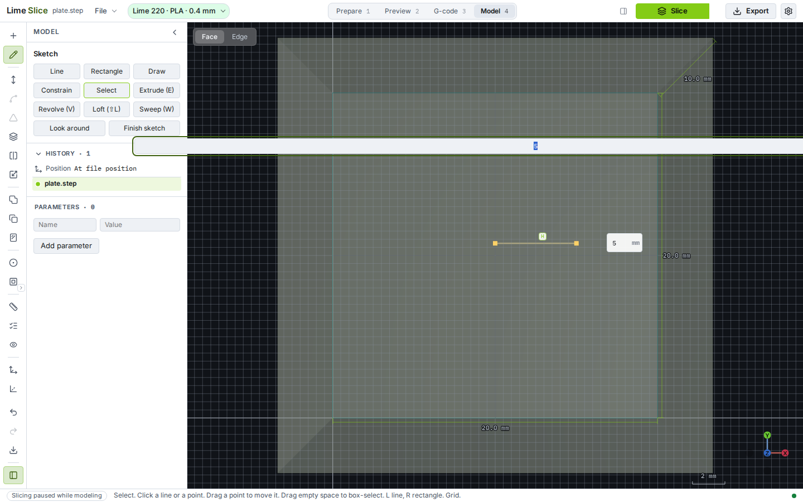

**Change:** The rule is now `input.sketch-dim-input`, which wins on width, height, padding, border, and background. `placeFixed` also keeps the label at least 8px inside the window. A typed length still commits on Enter and on blur, and the e2e asserts the field is between 40px and 120px wide.

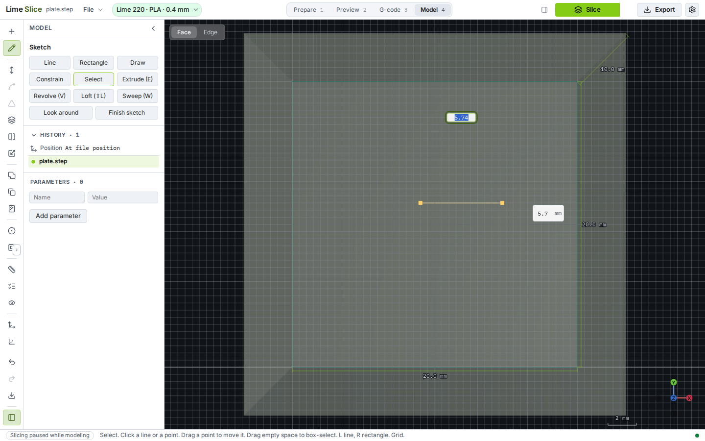

### 2. High — a faded selection bar could not be brought back

**Where:** `#modelContextBar` in `src/context-bar-ui.ts`. It faded after 3s (`opacity: 0; pointer-events: none`).

**What happens:** The actions for the current face or edge disappeared. The only way back was to move the pointer onto the selection again, which you cannot discover from the screen, and which a keyboard user cannot do.

**Change:** Fading hides the actions and leaves a **Selection** chip in the same place. It has the tooltip "Show selection actions". Clicking it, tabbing to it, or Ctrl+. (command `restore-hidden`) opens the actions and focuses the first one. Escape collapses the bar onto the chip; Escape again clears the selection, as Escape already did in Model. Hovering the selection still opens the bar. A focused bar does not fade.

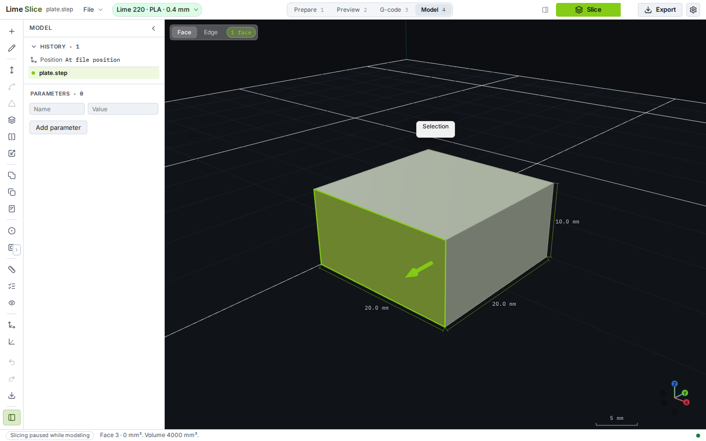

### 3. High — hidden phone chrome had no control to return

**Where:** `html.layout-compact.chrome-hidden` in `src/ui/compact/touch.ts`. One tap on the canvas hides the tabs, the sheet, and the tool rail.

**What happens:** After the tap, the only way back was another tap on the canvas. Nothing on screen said that.

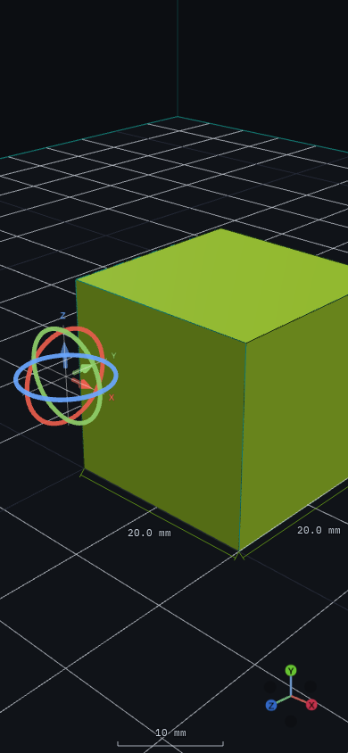

**Change:** **Show controls** is fixed to the bottom centre, 44px tall, with a border, a shadow, and the same tooltip. It is in the DOM only as a visible control while the compact chrome is hidden, so on the desktop it does not take a row (an earlier draft did, and that folded an extra Model tool group at 1366×768). Clicking it, or Ctrl+., restores the chrome and focuses the selected tab. The canvas share stays at least 0.7 of the phone viewport.

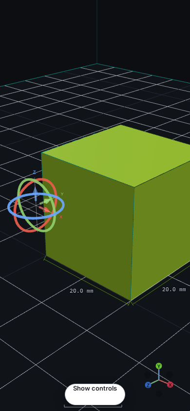

### 4. Medium — a closed Results drawer was easy to lose

**Where:** `#statusHint` and `#timing` / `#toggleRight`. From 961px to 1200px the docks are drawers. At 960px and below they stack.

**What happens:** The status line only said "Settings are in the drawer (Ctrl+B)" while the left drawer was closed, and it went away once Settings opened, even if Results was still closed. On a narrow window the Results button toggled `.show-right` without updating `aria-expanded`.

**Change:** The hint names each closed drawer and its shortcut, for example "Settings are in the drawer (Ctrl+B). Results are in the drawer (Ctrl+Alt+B)". In Model it says Model panel and Inspect. It is its own span, not the live status text. The rail already shows a Settings label on the closed left drawer. The narrow Results button goes through `toggleDock`, so `aria-expanded` follows the dock. Opening a drawer still does not resize the stage.

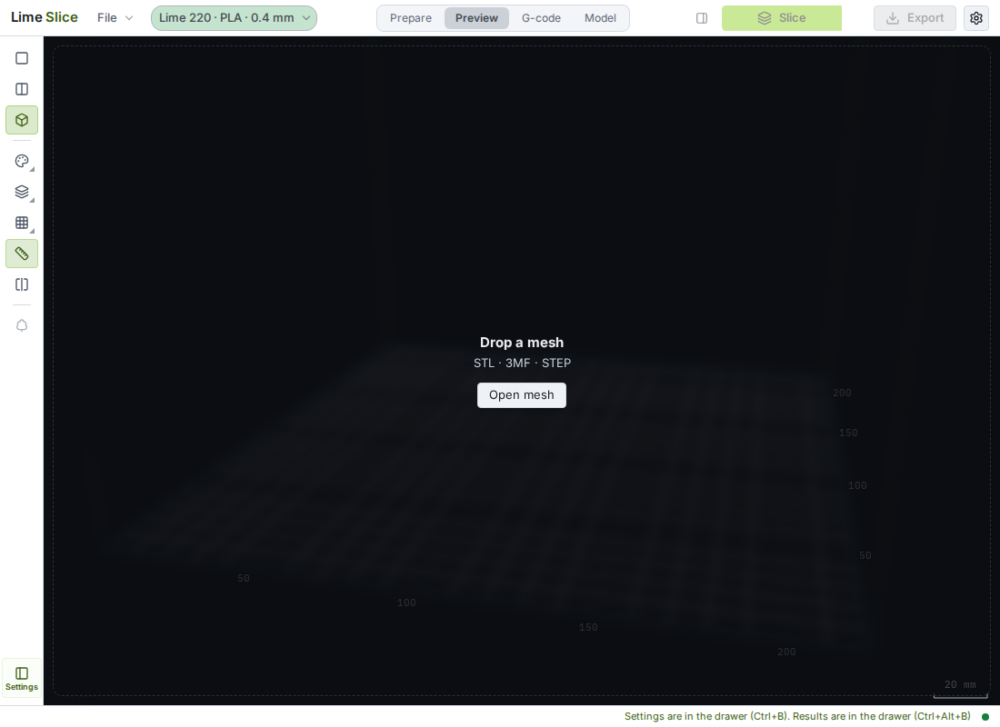

The hint is one line (`white-space: nowrap`, status bar height 24px). A very narrow drawer width clips it with an ellipsis rather than growing the stage.

### 5. Medium — brush tools looked ready when they could not run

**Where:** Paint supports, Paint seam, Reinforce (`#toolRail`), and Edit supports.

**What happens:** With no mesh, or before a tree-support slice, the buttons were enabled. The reason was only in the status line after a click, or not at all.

**Change:** Each button uses `aria-disabled` and `.is-disabled` (not the `disabled` attribute, which would swallow the tooltip). The tooltip and `title` say why:

- "Load a mesh to paint supports."
- "Load a mesh to paint the seam."
- "Load a mesh to reinforce."
- "Slice with tree supports to edit them."

A click toasts that sentence and does not open the bar.

### 6. Medium — Sketch, Apply, and Holes did not show that they were blocked

**Where:** `#modelToolSketch`, and the sketch card's Apply and Holes buttons (`src/app/sketch.ts`).

**What happens:** Sketch could be pressed while history was locked or the file had surfaces but no closed solid. Apply could be pressed before a region or a path existed. Holes on a face sketch could be pressed with no point or circle centre selected. The refusal showed up in the readout afterwards.

**Change:** Those buttons use `aria-disabled`, `.is-disabled`, a tooltip, and a toast. Sketch's tooltip is the lock reason, or "This STEP file has surfaces but no closed solid, so it can be measured but not edited." While a sketch is open the button stays pressed and the tooltip is "Finish the sketch on the card, or press Esc." A second click does not discard the sketch. Holes uses the existing point refusal: "Select points or circle centres."

### 7. Low — the Features opener was a 14px badge hanging off Pocket

**Where:** `#modelFeatureMore` in `src/ui/model-dock.css`.

**What happens:** The badge was 14×14px and stuck out of the 36×32 Pocket button (`right: -3px; bottom: -2px`). It is the way to Boss, Texture, Array, Ribs, Text, and Parameters. A 24×24 badge covers the centre of Pocket, so a click on the tool opens the menu instead, and the overflow folds the Inspect group at 1366×768. The rail at that size is only allowed to fold the Frame group.

**Change:** The opener is 16×22px, inside Pocket, clear of the tool's centre, with a border and a 1px separation shadow. On the phone it is 20×24px inside the 44px tool, also clear of the centre. Pocket's own click still starts Pocket. The menu item for Parameters now says that Ctrl+Alt+P opens them when the dock is closed. No new toolbar button.

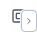

### 8. Low — focus rings and a few hit targets

**Where:** `#model`, `.mh-menu`, `.layer-action`, `.split-more > summary`.

**What happens:** `#model:focus { outline: none }` hid the keyboard ring. The history menu cleared its outline on focus. Layer pause/filament marks were 16px. The top bar's overflow menu summary was 22px wide.

**Change:** `#model:focus-visible` and the history menu items draw a 2px accent outline. Layer marks are 24px. The overflow summary is 28px wide. The top bar stays one 40px row at the widths the window-fit spec checks, including 1440×900.

## Second pass

### Overlapping layers

Panels that sit on the view (the empty card, the selection bar and its menu, the gizmo and section readouts, the drag tip, the heads-up size box, paint and support bars, driving dimensions, toasts, dialogs, menus, and the drawer docks) use an opaque background, a solid border, and a shadow. Stage chips use an opaque fill instead of a translucent white. A drawer dock has a border as well as its shadow.

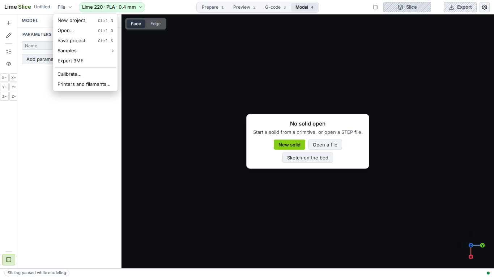

### Extrude, Revolve, Loft, and Sweep

With no closed profile, Extrude and Revolve are disabled. The tooltip, a keyboard focus, and a click all say "Draw a closed profile to extrude." (or revolve). With several regions and none selected, they say to select one. Loft and Sweep stay clickable when a profile or an open path exists, because the click starts the pick. The card then shows the sentence ("Pick at least two sections to loft.") and a Cancel. Model tools that cannot run (fillet with no edge, a locked solid) use the same `aria-disabled` treatment, so the reason is a tooltip a keyboard user can reach. The panel note for a pick ("Pick a face.") is a bordered prompt above the fields.

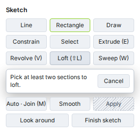

### Hit targets

The Features opener is no longer a badge on Pocket. Pocket and the opener share one 48px rail row, 24px each, so a click on Pocket still starts Pocket and the row is no taller than the other tools. At 1366×768 only the Frame group folds. On the phone the opener is its own 44px control in the scrolling strip.

The gizmo nudge is a 2-by-3 grid of 24px keys. Six keys in a column at 24px would be taller than the old 16px stack; two columns are shorter, so showing them does not fold another group.

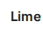

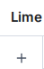

The earlier corner badge, for comparison:

### Disabled controls

Disabled buttons stay at full opacity, in `--text-dim`, with a dashed border and a diagonal stripe, plus `cursor: not-allowed`. The "why" tooltip opens on keyboard focus (`:focus-visible`), not only on hover. Text fields that are disabled get the dashed border and the dim colour, without a stripe across the value.

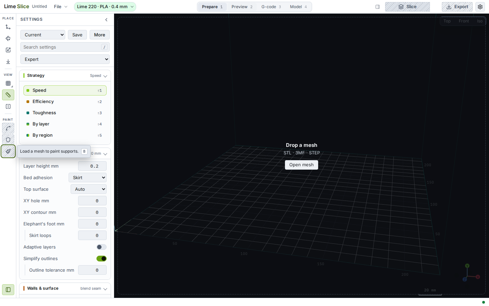

## Left for Marius

- **The selection bar still fades after 3 seconds.** It fades to the chip, not to nothing. It can stay open instead if that is what you want.
- **A canvas tap on the phone still hides the chrome.** The new button is the way back.
- **Settings groups below the fold** are reached by scrolling the dock. There is no separate "expand all".
- **A dock closed by the 30% width budget** does not add a sentence of its own. The rail toggles, Ctrl+B, and Ctrl+Alt+B already open it. In the drawer range the status line already names a closed dock.

## Checks

- `npx tsc --noEmit`
- `npm run test:unit`
- Playwright, against the dev server, for the specs this branch changes: `ui-review`, `model-sketch`, `model-context-bar`, `model-layout`, `model-features`, `model-parameters`, `window-fit`, `compact-layout`
- `tools/golden_ab.sh` needs a built slicer binary. This change does not touch the engine, the slice path, or G-code. The unit runner reports `golden: SKIPPED` when that binary is absent.

At 1440×900 every Model tool is on the rail. At 1366×768 only the Frame group folds. Tools still take a typed value and a click. New actions went into existing menus and the command palette, not onto the toolbar.
