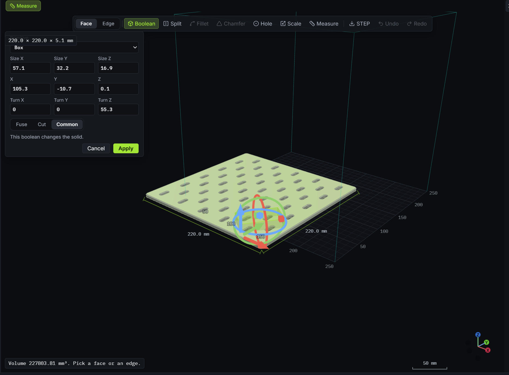
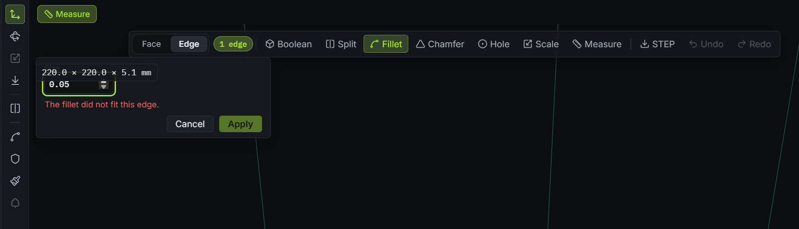
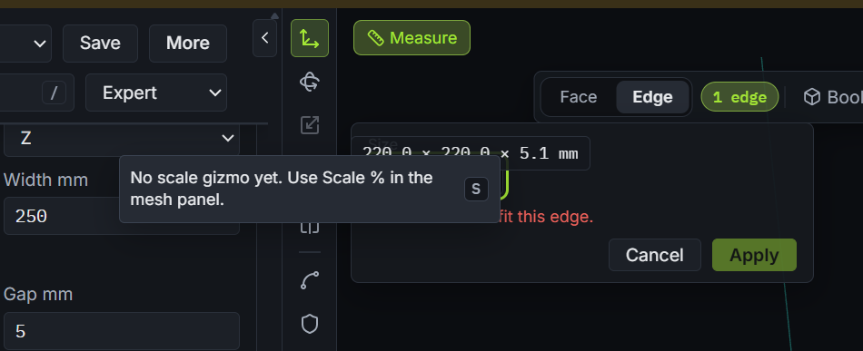
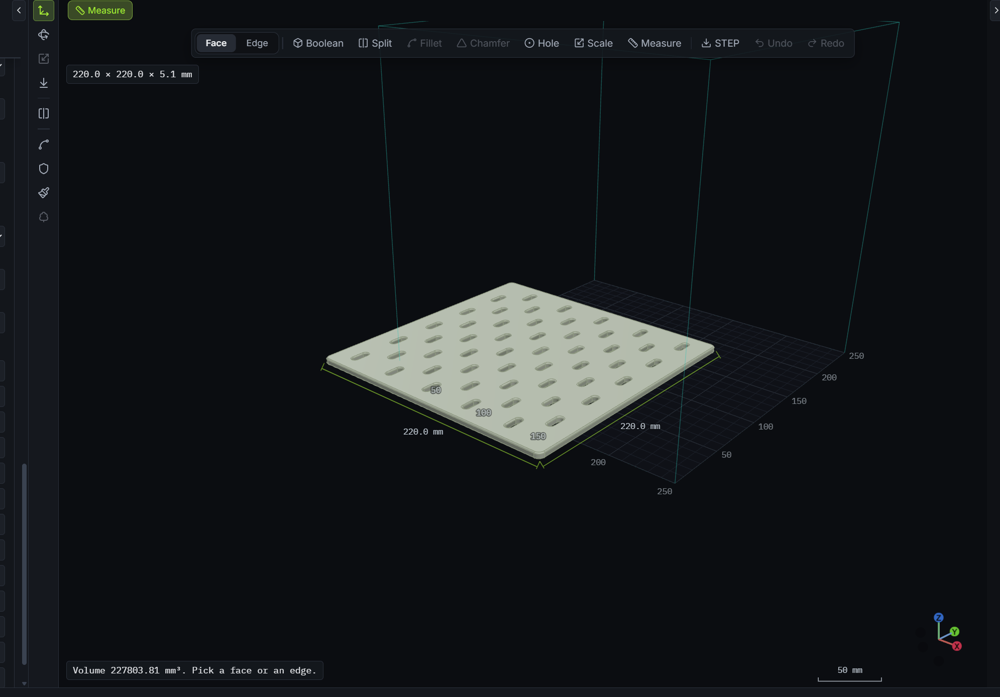
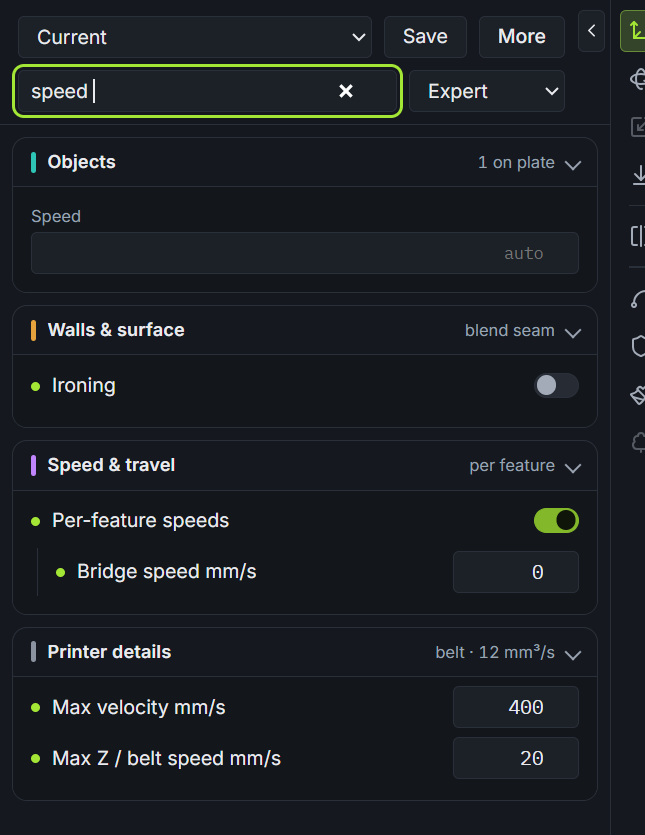

# Usability and Ergonomics Review — 1.2.0 (`PR #255`–`#285`)

This review audits the UI and ergonomics of the 1.2.0 build across the recent Model mode, viewport chrome, numeric controls, search, and slicer setting additions (`PR #255`–`#285`), starting with the issues captured in the owner's 1.2.0 screenshots, including a later note that the move and rotate gizmo covers the plate.

---

## Findings Ranked by Severity

### 1. High — Model mode overlays cover the top of tool panels and crowd the toolbar

**Where:** `src/styles.css` (`.model-panel`, `.model-fit`), `src/model-view.ts` (`#modelFit`), `src/app/viewer.ts` (`#measureField` / `.viewbar`), `src/ui/tooltip.ts` (`#toolRail` tooltip placement).

**What happens:**
- `#modelFit` (`220.0 × 220.0 × 5.1 mm`) is appended to `#modelBody` after `#modelBar` with `position: absolute; top: 58px; left: 10px; z-index: 2;`, while `#modelPanel` opens at `position: absolute; top: 48px; left: 10px;` inside `#modelBar` (`z-index: 2`). Because `#modelFit` is a later sibling at the same `z-index`, it paints directly across the top control of every open Model tool panel — obscuring the `Primitive` select in **Boolean**, the `Size` input in **Fillet** and **Chamfer**, the `Factor` field in **Scale**, and `Plane Z` in **Split**.
- In Model mode, `.viewbar` stays at `top: 10px; left: 10px` solely to show `#measureField` (`Measure`), placing a second `Measure` chip next to `#toolRail` while `#modelTools` already has a `Measure` tool button (`#modelToolMeasure`).
- `#toolRail` buttons use `placement: "bottom"` in `src/ui/tooltip.ts`, so hovering a rail button extends the tooltip bubble rightward across `#modelPanel`.

**Fix:**
- Anchor `#modelFit` at the bottom-left above `#modelReadout` (and away from `#modelPanel` and `#modelBar`), so opening any Model tool never collides with the size readout.
- Dock `#measureField` cleanly in Model mode and use `placement: "right"` (or non-overlapping placement) for `#toolRail` tooltips.

---

### 2. High — Model mode edit base and bed grid sit off-center from the solid

**Where:** `src/viewport-chrome.ts` (`mountBedReference`), `src/model-view.ts` (`load`, `applyBed`, `refreshMeasure`).

**What happens:**
- `mountBedReference` always builds the bed plate, grid lines, and build-volume cage over `[0..width, 0..depth, 0..height]` with the bed corner at `(0, 0, 0)` and bed center at `(width / 2, depth / 2, 0)`.
- Unlike Prepare mode (which seats and centers the mesh on the plate via `centeringShift`), Model mode renders the B-rep in its native CAD coordinate frame so kernel operations (`Boolean`, `Hole`, `Split`, `Measure`) read and write exact CAD coordinates.
- Most CAD parts and STEP exports are authored around the origin `(0, 0, 0)` (for example, a `220 × 220 × 5.1 mm` plate spanning `[-110..110, -110..110, 0..5.1]`). Because the bed grid is fixed at `[0..220, 0..220]`, three quarters of the part hangs off the edit base into negative X and Y.

**Fix:**
- Keep the solid's true CAD vertices untouched for OCCT operations, and center `mountBedReference` (grid, build-volume cage, and bed bounds passed to `drawMeasure`) under the solid's XY center `(cx, cy)` and base `minZ` whenever a solid is open.

---

### 3. High — Move, rotate, and scale gizmos cover the solid they edit

**Where:** `src/model-drag.ts` and `src/model-view.ts` (Boolean move arrows and turn rings, and the Model scale knob), `src/prepare-view.ts` (the Prepare manipulator, including the scale gizmo still to be added).

**What happens:**
- In Model mode the Boolean move arrows and turn rings are drawn on the primitive, which sits on the solid. On the owner's plate the rings and arrows cover the middle of the part, so the solid is hard to see while you edit it. The same would happen to a Prepare scale gizmo built at the part centre.
- A gizmo that follows the camera, or that flips from one side of the solid to another as the view orbits, jumps. A seat that still overlaps a large plate is not a clearance.

**Fix:**
- Keep the gizmo near the solid, a short gap off its screen box, so the solid stays visible. Prefer the left of the box.
- When that offset would leave the canvas, still cover the solid, or swap with the other seat as the view moves, park the gizmo on the left edge of the viewport and leave it there until the offset seat is clearly clear.
- Freeze the seat for the duration of a drag. Arrows, rings, and the scale knob stay draggable, and they keep writing the same numeric fields.
- The Prepare scale gizmo uses that same rule, on the same widget as Move and Rotate, so it never sits on the part.

---

### 4. High — Prepare mode has no 3D Scale gizmo (`Scale` rail button disabled)

**Where:** `src/ui/chrome.ts` (`#toolRail [data-tool="scale"]`), `src/prepare-view.ts` (`GizmoTool`, `makeGizmo`, pointer drag handlers), `src/app/viewer.ts`, `src/ui/preview-ux.ts`.

**What happens:**
- Model mode provides a 3D scale knob handle (`factor`) synced with its numeric factor input, and Prepare mode's modifier/reinforce volume gizmo also supports handle scaling, but the main Prepare part gizmo only implements `Move` and `Rotate`.
- The `Scale` button in `#toolRail` is permanently `.is-disabled` (`aria-disabled="true"`) with the placeholder tooltip `"No scale gizmo yet. Use Scale % in the mesh panel."`.

**Fix:**
- Enable the `Scale` tool (`S`) on `#toolRail` in Prepare mode and add 3D scale handles (axis and uniform knob handles matching Model mode's visual style) to `PrepareView`.
- Keep gizmo drags, wheel/nudge actions, `#partScale` (`10%`–`400%`), `#gizmoReadout`, and undo/redo history in sync.

---

### 5. Medium — Settings search (`/`) hides group items when matching a group header and misses `&` vs `and`

**Where:** `src/ui/settings-search.ts` (`settingMatches`), `src/app/settings.ts` (`applyFilter`).

**What happens:**
- `applyFilter()` tests each `.setting` row individually against `row.dataset.label` and `row.dataset.keywords`, ignoring the parent `.group` summary title (`Speed & travel`, `Walls & surface`, `Quality`, `Infill`, `Supports`, `Printer details`, `Objects`, `Strategy`) and sub-section headers (`Overhang and bridges`, `Travel and seam`, `Fuzzy skin`, `Brim`, `Top and bottom skin`, `Dimensional compensation`, `Support interface`, `Layer pauses & filament`, `Sequential printing`, `Belt mode`). Searching `"speed"` shows only the rows whose own label/keywords contain `"speed"`, hiding the rest of `Speed & travel` (`Travel speed`, `First-layer speed`, `Wall speed`, `Outer wall speed`, `Infill speed`, `Top/bottom speed`, `Support speed`, `Acceleration`, `Jerk`, `Min layer time`, `Slow down to`).
- `settingMatches()` splits only on whitespace without normalizing `&` and `and` or punctuation. Because group headers use `&` (`Walls & surface`, `Speed & travel`) while sub-section labels use `and` (`Overhang and bridges`, `Travel and seam`), searching `"Overhang & bridges"` or `"Walls & surface"` fails to match the expected controls.

**Fix:**
- Normalize `&` and `and` equivalently in `src/ui/settings-search.ts` while preserving symbol/unit token matching (`%`, `°`, `/`, `mm/s`, `mm³`).
- In `src/app/settings.ts`, when the query matches a group title or sub-section header, reveal all level-eligible controls in that group or sub-section.

---

### 6. Medium — Model mode fillet feasibility at `0.05 mm`, smooth/seam edge messaging, and synchronous `Apply` disabling

**Where:** `crates/lime-model-occt/cpp/session.cpp` (`largest_blend`, `probe_json`, `fillet`, `chamfer`), `src/ui/model-chrome.ts` (`toggleTool`, `refreshApply`, `syncModelChrome`, `setModelProbe`).

**What happens:**
- **Why `0.05 mm` failed in Screenshot 3:** On a perforated plate with stadium slots or pre-rounded corners, the vertical edge where a semicircular arc meets a straight wall is already tangent-continuous (`G1`), and full cylinders have a periodic seam edge. Open CASCADE (`BRepFilletAPI_MakeFillet` / `BRepFilletAPI_MakeChamfer`) refuses tangent and seam edges at *any* radius, including `0.05 mm`. Reporting `"The fillet did not fit this edge."` implies the radius is still too large rather than explaining that the edge is already smooth or a seam.
- **Boundary condition at `0.05 mm`:** `largest_blend()` in `session.cpp` stops binary search with `if (!(mid > 0.05)) break;` and `probe_json` checks `if (max_mm > 0.05)`, which excludes `0.05 mm` (the minimum step of `#modelBlend`) when `0.05 mm` is the largest valid radius.
- **Synchronous `Apply` state on tool switch / input:** In `src/ui/model-chrome.ts`, `toggleTool()` does not reset `probe` before calling `refreshApply()`, and the `input` / `change` listeners call `refreshApply()` before `hooks?.paramsChanged()` sets `probe = { phase: "checking" }`. Switching from a valid tool (such as `Boolean`) to `Fillet` or changing a parameter leaves `Apply` momentarily enabled until the probe callback runs. In addition, `probeNote()` does not pass `probe.error` through `plainModelError()`.

**Fix:**
- Reset `probe` to `{ phase: "checking" }` immediately inside `toggleTool()` and before `refreshApply()` on every parameter edit so `Apply` is always disabled until feasibility passes, and pass probe errors through `plainModelError()`.
- In `session.cpp`, detect tangent/smooth edges (`BRep_Tool::Continuity >= GeomAbs_G1`) and seam edges (`BRep_Tool::IsClosed` on a single face) before running the blend so the note explains `"This edge is already smooth and cannot be filleted."` / `"This seam edge cannot be filleted."`, and include `0.05 mm` in `largest_blend()`.

---

## Audit of Recent Changes (`PR #255`–`#285`)

| Area | PRs | Status & Notes |
| --- | --- | --- |
| **Model toolbar, booleans, split, fillet, chamfer, hole, scale, measure** | `#257`–`#260`, `#269`, `#284` | Every tool supports both numeric inputs and 3D drag handles (`src/model-drag.ts`), verified by `src/model-drag.test.ts`. Multi-edge fillets and face-normal holes (`#284`) work cleanly. Overlay collision and `Apply` state race are tracked in Findings 1 and 6. The gizmo covering the solid is Finding 3. |
| **Model & Prepare undo / redo** | `#273` | Solid checkpoints and plate snapshots interleave cleanly across Prepare and Model; undoing a Model commit restores `sourcePos`, `hold`, paint strokes, and `partScale`. |
| **Shared studio viewport & 70% budget** | `#271`, `#277` | `src/ui/splitters.ts` keeps the 3D stage `>= 70%` of the window width on desktop (`MIN_STAGE_SHARE = 0.7`) and auto-folds the right results drawer after slicing when needed. Bed reference alignment in Model mode is tracked in Finding 2. |
| **Numeric controls for rotation, brush size, and section offset** | `#279` | `#rotX`, `#rotY`, `#rotZ`, `#paintRadius`, `#reinfRadius`, `#seamRadius`, and `#sectionOffsetNum` stay in two-way sync with their gizmo/slider counterparts. |
| **Plain-language mesh repair & OCCT warnings** | `#276` | `plainRepairNotice()` and `plainModelError()` translate kernel and mesh diagnostics into plain sentences; applying `plainModelError()` to `probeNote()` is included in Finding 6. |
| **Foreign 3MF recipe banner & shell split** | `#280`, `#282` | Foreign 3MF files with embedded slicer settings show a non-blocking banner (`#recipeBanner`) with explicit `Use settings` / `Keep mine` actions. Disconnected shells offer `#splitShells` in the object list. |
| **Brim, skin patterns, XY compensation, support interface, bridge tuning, layer pauses** | `#262`, `#272`, `#274`, `#281`, `#283`, `#285` | All new engine features are opt-in and off by default (`tools/golden_ab.sh` stays byte-identical). Controls use Prepare's card/disclosure style and plain labels. |
| **Moonraker & OctoPrint send, no stray console windows** | `#261`, `src-tauri/src/lib.rs` | `send_printer` runs asynchronously off the UI thread with clear HTTP/connection errors, and Windows child processes set `CREATE_NO_WINDOW` (`0x08000000`). |
